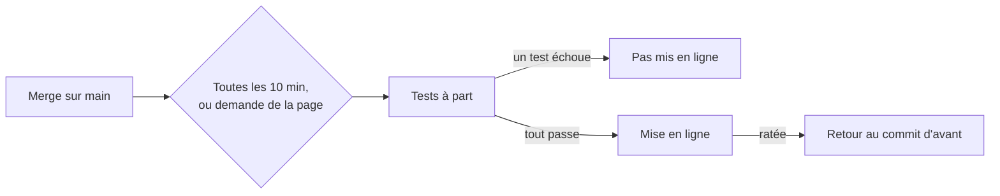
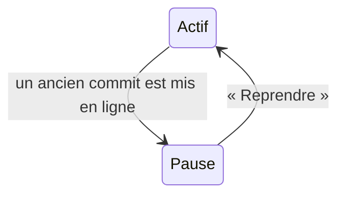

# Mise en ligne automatique et page des déploiements

> Depuis la v1.9, plus besoin de se connecter au serveur après un merge : toutes les 10 minutes, le serveur teste le dernier commit de `main` et le met en ligne si tout passe. Les admins suivent et pilotent ces mises en ligne sur une page, `/admin/deploiement.html`.

## Comment ça marche

Chaque tour du serveur s'appelle un passage. Le serveur regarde s'il a quelque chose à faire, teste le commit à côté du site en ligne, puis le met en ligne. Si un test échoue, rien ne change en ligne, et ce commit n'est plus retenté tant que `main` n'avance pas.

Si la mise en ligne rate après avoir commencé, le retour automatique remet tout seul la version d'avant. S'il rate lui aussi, la page passe au rouge et affiche la commande à lancer.

### Demander quelque chose depuis la page
La page ne lance rien elle-même. Elle dépose une demande de déploiement, que le serveur vérifie puis traite en quelques secondes. Si un passage est déjà en cours, la demande attend sa fin. Une nouvelle demande remplace celle qui attend.

| Bouton | Ce qu'il fait | Quand il apparaît |
|---|---|---|
| « Déployer maintenant » | teste et met en ligne le dernier commit de `main`, tout de suite | toujours |
| « Déployer ce commit » | reteste et remet en ligne un commit plus ancien : un retour en arrière | sur un passage dont les tests ont réussi, si ce commit n'est pas en ligne |
| « Reprendre » | sort de la pause : les nouveaux commits de `main` repartent | seulement en pause |

Chaque bouton demande une confirmation qui dit ce qui va se passer.

### Revenir en arrière, puis reprendre

Mettre en ligne un autre commit que le dernier de `main` met l'automatisme en pause. Sans elle, le serveur remettrait `main` par-dessus dans les 10 minutes. Seul « Reprendre » retire la pause, une fois `main` corrigé.

## Ce que montre la page

| Partie | Ce qu'on y lit |
|---|---|
| Verdict en haut | vert « À jour » ; neutre « main a avancé », « En pause », « Passage en cours » ; rouge en cas de problème (voir ci-dessous) |
| Bandeaux | la demande en attente, et le passage en cours avec son étape (par exemple 2/4) |
| Liste | les 30 derniers passages, le plus récent en haut : date, déclencheur, commit, résultat ; chaque étape avec sa durée et la fin de sa sortie |

Les verdicts rouges : retour arrière raté, mise en ligne interrompue, commit en ligne incertain, serveur qui ne vérifie plus `main` depuis 25 minutes, serveur qui ne joint pas GitHub, dernier commit de `main` en échec. Une demande qui n'est pas prise en charge au bout de 5 minutes passe aussi au rouge.

## Ce qu'il faut savoir

| Règle | En clair | Exemple |
|---|---|---|
| Tests avant tout | aucun commit ne part en ligne si un test échoue | un test des règles du parcours casse : le site reste sur la version d'avant |
| Tests à part | les essais ne touchent jamais au site en ligne, et rien ne reste après | les images d'essai portent d'autres noms que celles en ligne |
| Un seul passage à la fois | un deuxième attend le premier, 30 minutes au plus | une demande pendant un passage est traitée juste après |
| Commits admis | seulement un commit qui a été le dernier de `main` (ligne principale de main), et datant de la v1.9 ou après | un commit intermédiaire d'une branche est refusé, avec le motif |
| Pause | un ancien commit mis en ligne bloque les suivants jusqu'à « Reprendre » | remettre en ligne le dernier de `main` en pause garde la pause |
| Un geste à la main l'emporte | un déploiement lancé en SSH pendant les tests annule le passage | « Annulé : déploiement fait à la main pendant le passage » |
| Réservé aux admins | la page et les demandes | un recruteur lit « Réservé aux admins de l'équipe. » |
| Aucune donnée de candidat | l'état et les demandes ne contiennent que des sorties de tests et des commits | — |

## Cas particuliers

- **Une panne réseau pendant les tests** donne « Tests en échec » : « Déployer maintenant » relance.
- **Pendant la sauvegarde de la nuit** (vers 3 h), la mise en ligne attend jusqu'à 15 minutes, puis le passage s'annule ; le suivant réessaie.
- **Un passage arrêté** (serveur redémarré, service coupé) est noté « interrompu ». S'il l'a été pendant la mise en ligne, la page passe au rouge avec la commande à lancer.
- **Un admin peut remettre une version plus ancienne** (v1.9 ou après), et la pause la garde en place. Le journal du serveur fait foi ; la liste de la page n'est pas un audit. Vérifier de temps en temps qu'une pause n'est pas restée par erreur.
- **Un commit absent de la liste** (trop ancien, ou jamais passé par le serveur) ne peut être remis qu'en SSH, avec `deploy/deploy.sh <commit>`, sans tests.
- **Lancer le script à la main sur le serveur** met tout de suite le dernier commit de `main` en ligne, avec les tests, même en pause.

## Voir aussi
- [Déploiement automatique, côté code](../../technique/deploiement-automatique.md)
- [Mettre à jour le site en production](../../technique/mise-a-jour-production.md)
- [Candidatures partagées et identité](stockage-partage.md)
- Le mode d'emploi du serveur : `deploy/README.md`, section 15
- Toutes les règles, avec leur version, sont dans la version complète.
