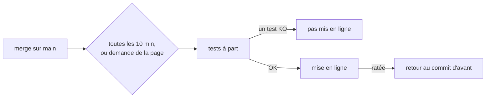

# Mise en ligne automatique et page des déploiements

> Depuis la v1.9, un merge sur `main` est en ligne sur `recrutement.yeita.fr` en 10 minutes si ses tests passent. Les admins suivent et pilotent la mise en ligne sur `/admin/deploiement.html`.

## À quoi ça sert
Ne plus mettre le site à jour à la main en SSH, ne jamais mettre en ligne un commit dont un test échoue, et savoir à tout moment ce qui est en ligne et pourquoi un commit ne l'est pas.

## Comment ça marche

La page ne lance rien : elle dépose une demande, le serveur la vérifie puis agit. Une demande part en quelques secondes ; pendant un passage, elle attend la fin de celui-ci.

## Règles métier
| # | Règle | Depuis |
|---|---|---|
| R1 | Un passage traite la demande déposée, puis le lancement à la main, puis l'automatisme. L'automatisme ne fait rien en pause, ni si le dernier commit de `main` est déjà en ligne ou a échoué ; si le commit en ligne est incertain, il remet le dernier commit de `main` en ligne (sauf si ce commit a échoué) | 1.9 |
| R2 | Lancer `deploy/auto-deploy.sh` à la main met tout de suite le dernier commit de `main` en ligne, avec les tests, même en pause | 1.9 |
| R3 | Depuis la page, seul un commit qui a été la pointe de `main` et qui date de la 1.9 ou après peut être demandé ; sinon la demande est refusée avec son motif | 1.9 |
| R4, R6 | La page ne fait que déposer une demande ; une nouvelle demande remplace celle qui attend ; le serveur la retire et la lit strictement (illisible : refusée) | 1.9 |
| R5 | Le serveur vérifie toutes les 10 minutes, et dès qu'une demande est déposée | 1.9 |
| R7 | Un seul passage à la fois ; un deuxième attend le premier (30 minutes au plus) | 1.9 |
| R8, R9 | Les tests (règles du parcours, API, construction des images) tournent à part : le site en ligne n'est jamais touché par un essai, rien ne reste après | 1.9 |
| R10 | Tests OK → mise en ligne ; si `deploy.sh` s'arrête avant de rien changer, pas de retour | 1.9 |
| R11 | Mise en ligne ratée → retour automatique au commit d'avant ; retour raté → alerte rouge avec la commande à lancer | 1.9 |
| R12, R13 | La page montre les 30 derniers passages (date, déclencheur, commit, résultat, étapes avec durée et 300 dernières lignes de sortie) ; le serveur garde ses décisions hors de portée de l'application | 1.9 |
| R14 | Mettre en ligne un autre commit que le dernier de `main` (page ou `deploy.sh <hash>`) met l'automatisme en pause ; seul « Reprendre » la retire ; déployer le dernier de `main` en pause la laisse | 1.9 |
| R16, R17 | Page et demandes réservées au rôle admin | 1.9 |
| R18 | Aucune donnée de candidat dans l'état ni dans les demandes | 1.9 |
| R19 | Un déploiement fait à la main pendant les tests l'emporte : le passage s'annule | 1.9 |
| R20 | Un passage arrêté est enregistré « interrompu » ; pendant la mise en ligne, alerte rouge | 1.9 |

## La page
| Élément | Contenu |
|---|---|
| Verdict | vert « À jour » ; neutre « main a avancé », « En pause », « Passage en cours » ; rouge « Retour arrière raté », « Mise en ligne interrompue », « Commit en ligne : incertain », « Le serveur ne vérifie plus main » (plus de 25 min), « Le serveur ne joint pas GitHub », « Le dernier commit de main a échoué » |
| Bandeaux | demande en attente (rouge si elle n'est pas prise en charge en 5 min hors passage) ; passage en cours avec son étape (k/4) |
| Boutons | « Déployer maintenant », « Reprendre » (en pause), « Déployer ce commit » (passage aux tests OK, commit pas en ligne) ; chacun avec une confirmation qui dit ce qui va se passer |
| Liste | les 30 derniers passages, quel que soit leur déclencheur (automatique, demande, ligne de commande), le plus récent en haut et ouvert s'il n'a pas mis en ligne ; étapes dépliables, l'étape en échec ouverte |
« Déployer ce commit » n'existe que pour un commit dont un passage a réussi les tests ; pour un autre commit : `deploy.sh <hash>` en SSH.

## Cas particuliers
- Une panne réseau pendant les tests donne « Tests en échec » : « Déployer maintenant » relance.
- Pendant une sauvegarde (3 h), la mise en ligne attend jusqu'à 15 minutes, puis le passage s'annule et le suivant réessaie.
- Un admin peut revenir à une version ancienne (≥ 1.9) ; la pause la maintient. Le journal du serveur fait foi.

## Voir aussi
- [Déploiement automatique (technique)](../../technique/deploiement-automatique.md)
- [Mettre à jour le site en production](../../technique/mise-a-jour-production.md)
- [Candidatures partagées et identité](stockage-partage.md)

## Historique
| Version | Changement |
|---|---|
| 1.9 | Création |
