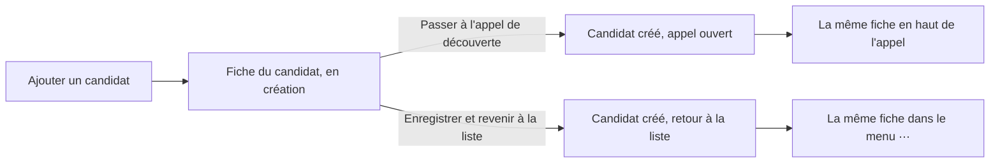
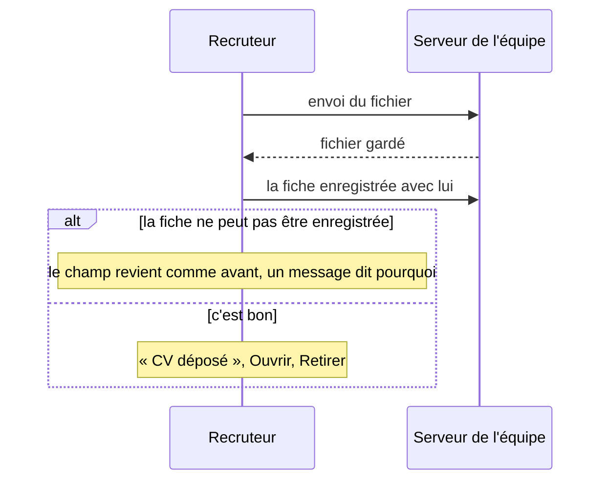

# Fiche du candidat, CV et portfolio

> Depuis la v1.10, toutes les informations d'un candidat tiennent dans une seule fiche, la même partout : à sa création, en haut de l'appel de découverte, et dans le menu ⋯. On y joint son CV et son portfolio, en fichier ou en lien. Les pages des étapes ont aussi été harmonisées. C'est le travail de Léo, repris et rendu sûr pour la production.

## Comment ça marche

### Ajouter un candidat

« Ajouter un candidat » ouvre la fiche en création. Rien n'est enregistré avant de cliquer l'une des deux actions du pied. Seul le nom est obligatoire ; on peut déjà choisir un CV et un portfolio.

La fiche a quatre groupes, toujours dans le même ordre : **Identité, Contact, Documents, Suivi**. Elle s'affiche sur trois colonnes, deux sur tablette, une sur téléphone.

### Joindre un CV ou un portfolio
Chaque document est **soit un fichier, soit un lien**.

| Pour… | Je fais… | Je vois ensuite |
|---|---|---|
| Joindre un fichier | « Déposer un fichier », ou je le glisse sur le champ vide | son nom, sa taille, « Ouvrir » (nouvel onglet), « Retirer » |
| Joindre un lien | « Coller un lien », puis « Valider » | le lien, « Modifier », « Retirer » |
| Remplacer un fichier | « Retirer », puis je dépose un autre fichier ou je colle un lien | le nouveau document |

Pendant un envoi, les boutons du champ sont grisés et la fenêtre ne se ferme pas. On peut continuer à remplir les autres champs : ils seront enregistrés juste après.

### Les étapes harmonisées
| Où | Ce qui change |
|---|---|
| Toutes les étapes | une seule largeur ; le panneau Notes s'ouvre à côté sur un grand écran (dès 1360 px), par-dessus sur un plus petit |
| Appel de découverte | plus de « Liens utiles » |
| EC1 | plus de bloc « Liens et outils » ; la section s'appelle « Yeita Match » ; en visio, « Ouvrir Yeita Match en ligne », en présentiel, « Ouvrir la feuille de décompte » |
| EC2 | la grille de salaire s'ouvre par une icône ; le palier tient sur une ligne ; la séniorité est rappelée sous le barème (Junior 0 à 1 · Intermédiaire 2 à 3 · Senior 3 à 4) |
| Bilans EC1 et EC2 | la partie interne de la carte s'affiche en lecture sous la carte |
| État du candidat | il ne se change plus dans les étapes, seulement sur le kanban et dans la liste |
| Noms de l'équipe | affichés tels qu'ils ont été saisis (les prénoms suffisent) ; la carte du kanban garde les initiales |
| Mention RGPD | durée de conservation annoncée : 22 mois après la fin du recrutement |

## Ce qu'il faut savoir

| Règle | En clair | Exemple |
|---|---|---|
| Un seul candidat créé | dès le premier clic, les actions et la fermeture sont bloquées jusqu'à la fin ; si un document n'a pas pu partir, le candidat existe quand même, et un nouveau clic ne renvoie que ce qui manque | le CV échoue : « Réessaie, ou retire-le pour continuer sans. » ; on réessaie, le candidat n'est pas créé deux fois |
| Fermer après la création | revient à « Enregistrer et revenir à la liste » ; un document qui n'a pas pu partir est signalé dans un bandeau | « CV de Léna Garnier non enregistré : … Ouvre sa fiche pour le déposer à nouveau. » |
| Fichiers acceptés | PDF, PNG ou JPG, reconnus à leur contenu et non à leur nom, 10 Mo au plus | un `.docx` est refusé : « Ce fichier n'est pas accepté. Choisis un PDF, un PNG ou un JPG. » |
| Liens acceptés | une adresse qui commence par `http://` ou `https://` | « linkedin » seul est refusé : « Ce lien n'est pas valide… » |
| Un lien douteux n'est jamais cliquable | un ancien texte qui ne commence pas par `http(s)://` s'affiche tel quel | un dossier importé avec un lien piégé n'ouvre rien |
| La fiche ne cite jamais un fichier absent | un échec remet le champ exactement comme avant | un réseau coupé pendant un dépôt : le champ reste vide, rien n'est perdu ailleurs |
| Une trace de chaque geste | dépôt, retrait, lien ajouté ou retiré : une ligne dans l'historique (menu ⋯ → Historique), avec l'auteur, une fois enregistré | « CV déposé : CV Léna.pdf, Andrea » |
| Effacement réel | supprimer le candidat efface ses documents (la confirmation le rappelle) ; retirer un document l'efface aussi | les sauvegardes gardent l'état de chaque nuit 30 jours |
| Compte en lecture | ouvre les documents, ne dépose, ne modifie ni ne retire rien | |
| Hors du site de l'équipe | pas de dépôt de fichier : CV et portfolio se mettent en lien | sur un poste de test |
| Import | un export ne contient pas les fichiers ; à l'import, un document qui n'existe plus est oublié par la fiche | |

Messages à connaître : « Ce fichier dépasse 10 Mo. Compresse-le ou colle plutôt un lien. » ; « Ce fichier est vide. » ; et « Le serveur refuse ce fichier. Colle plutôt un lien et préviens Sofiane ou Léo. » quand un réglage manque sur le serveur.

## Cas particuliers

- **Deux recruteurs sur le même candidat.** Si l'un enregistre la fiche pendant que l'autre dépose un CV, le dépôt du second est refusé : « CV non enregistré : la candidature a été modifiée par quelqu'un d'autre. Recharge la page, puis dépose-le à nouveau. » Son fichier n'est pas gardé.
- **Une fiche qui cite un document disparu** (retiré entre-temps par un collègue) ne s'enregistre pas : « Le CV ou le portfolio de cette fiche n'existe plus. Recharge la page. »
- **Un fichier envoyé mais jamais rattaché** (panne au mauvais moment) n'apparaît nulle part ; il est effacé au premier enregistrement de la fiche passé une heure.
- **Retour vers la v1.9.** Les documents déposés ne s'affichent plus dans les fiches, mais restent gardés ; l'historique montre leurs lignes comme « undefined → undefined » et « Annuler le dernier passage » peut être refusé. Tout revient avec la v1.10. Ne pas recoller les CV en lien.
- **Restauration d'une sauvegarde.** Un document retiré depuis la date de la copie revient avec elle : à retirer de nouveau si le candidat l'avait demandé.

Le détail des règles et des messages est dans la version complète.

## Voir aussi
- [Candidatures partagées et identité](stockage-partage.md)
- [API de stockage](../../technique/api.md)
- [Comment les pages choisissent où ranger les dossiers](../../technique/mode-serveur.md)
- [Décisions techniques](../../technique/decisions.md)
- [Mettre à jour le site en production](../../technique/mise-a-jour-production.md)
