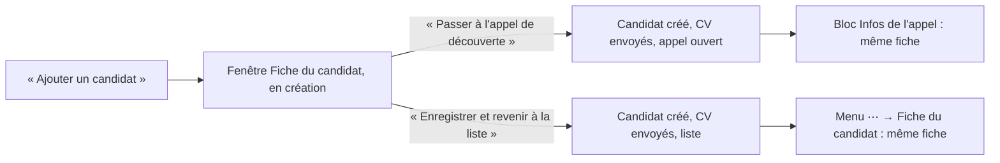
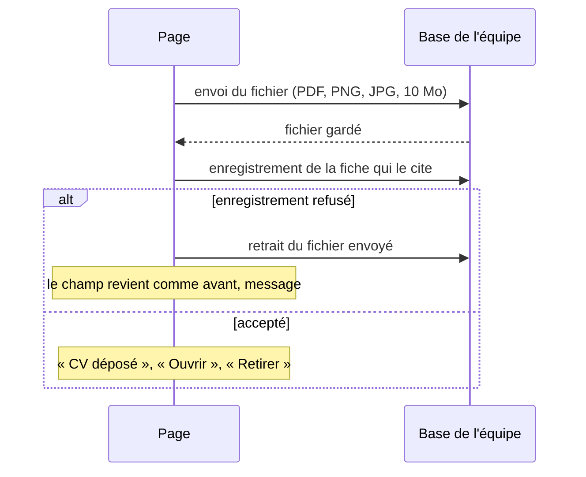

# Fiche du candidat, CV et portfolio

> Comment on ajoute un candidat, où se trouvent ses informations, et comment on joint son CV et son portfolio (fichier ou lien) dans l'espace Candidatures. Depuis la v1.10 (travail de Léo, repris et rendu déployable) : une seule fenêtre « Fiche du candidat », des documents déposés dans la base de l'équipe, et des pages d'étapes harmonisées.

## Comment ça marche

La fiche est le même composant partout : 4 groupes (Identité, Contact, Documents, Suivi), même ordre, grille de 3 colonnes (2 puis 1 sur petit écran). Dans « Documents », le CV et le portfolio sont chacun un fichier déposé ou un lien.

## Règles métier
| Règle | Détail | Depuis |
|---|---|---|
| Une seule fenêtre de création | « Ajouter un candidat » ouvre la Fiche du candidat en création, avec deux actions : « Passer à l'appel de découverte » (principale) et « Enregistrer et revenir à la liste ». Rien n'est enregistré avant l'une des deux | 1.10 |
| Un seul candidat créé | Dès le premier clic, les deux actions et la fermeture de la fenêtre sont bloquées jusqu'à la fin. Si l'envoi d'un document échoue, le candidat est créé quand même : la fenêtre reste ouverte sur lui, le document reste en attente avec « Réessaie, ou retire-le pour continuer sans. » ; un nouveau clic enregistre les champs modifiés et renvoie les seuls documents restants, sans créer de second candidat | 1.10 |
| Fermer après la création | Une fois le candidat créé, fermer la fenêtre revient à « Enregistrer et revenir à la liste » ; un document qui n'a pas pu partir est signalé dans un bandeau : « CV de <nom> non enregistré : <raison> Ouvre sa fiche pour le déposer à nouveau. » | 1.10 |
| CV et portfolio | Chacun : « Déposer un fichier » (bouton ou glisser sur un champ vide) ou « Coller un lien ». Fichier : nom, taille, « Ouvrir » (nouvel onglet), « Retirer ». Lien : cliquable, « Modifier », « Retirer ». Remplacer un fichier = « Retirer » puis déposer ou coller un lien | 1.10 |
| Fichiers acceptés | PDF, PNG ou JPG, reconnus à leur contenu (pas à leur nom), 10 Mo au plus. Le nom est nettoyé (sans chemin, 120 caractères au plus) | 1.10 |
| Fichiers en mode navigateur | Hors du site de l'équipe (pas de base), CV et portfolio se mettent en lien seulement | 1.10 |
| La fiche ne cite jamais un fichier absent | Un fichier n'est cité par la fiche qu'une fois enregistré dans la base ; il ne se retire de la base qu'une fois la fiche enregistrée sans lui ; si un enregistrement échoue, le champ revient exactement comme avant. La base refuse une fiche qui cite un fichier absent (« Le CV ou le portfolio de cette fiche n'existe plus. Recharge la page. ») et le retrait d'un fichier encore cité | 1.10 |
| Fichier non référencé | Un fichier que plus aucune fiche ne cite (panne au mauvais moment) n'est jamais affiché ; il est effacé au premier enregistrement de la fiche passé une heure | 1.10 |
| Une action à la fois | Pendant l'envoi ou le retrait d'un document, les boutons de ce champ sont désactivés et la fenêtre ne se ferme pas ; les autres champs restent modifiables et sont enregistrés ensuite | 1.10 |
| Messages | Fichier trop gros : « Ce fichier dépasse 10 Mo. Compresse-le ou colle plutôt un lien. » ; mauvais type : « Ce fichier n'est pas accepté. Choisis un PDF, un PNG ou un JPG. » ; refus du serveur du site (réglage manquant) : « Le serveur refuse ce fichier. Colle plutôt un lien et préviens Sofiane ou Léo. » ; conflit : « CV non enregistré : la candidature a été modifiée par quelqu'un d'autre. Recharge la page, puis dépose-le à nouveau. » ; fichier vide : « Ce fichier est vide. » ; lien mal formé : « Ce lien n'est pas valide. Colle une adresse qui commence par https://. » | 1.10 |
| Lien sûr | Un lien collé doit commencer par `http://` ou `https://`. Seul un lien qui commence par `http://` ou `https://` est cliquable ; tout autre texte (dossier ancien, import) s'affiche tel quel, sans lien | 1.10 |
| Historique | Dépôt, retrait, lien ajouté, lien retiré : une ligne dans l'historique du dossier (menu ⋯ → Historique), avec le nom du fichier et l'auteur, seulement si l'enregistrement a réussi | 1.10 |
| Effacement | La confirmation de suppression le dit (« Son CV et son portfolio déposés sont effacés avec elle. ») ; supprimer un candidat efface ses documents, réellement (rien ne reste lisible dans les fichiers de la base) ; retirer un document l'efface aussi. Les copies de sauvegarde gardent l'état de la nuit 30 jours | 1.10 |
| Lecture seule | Un compte en lecture ouvre les documents, ne dépose ni ne retire rien | 1.10 |
| Import | Un export ne contient pas les documents ; à l'import, un document qui n'existe plus dans la base est oublié par la fiche | 1.10 |
| Étapes harmonisées | Une seule largeur (1120 px) pour l'appel, les EC, les bilans, la décision et la proposition ; le panneau Notes s'ouvre à côté dès 1360 px d'écran, par-dessus en dessous | 1.10 |
| Appel | Plus de « Liens utiles » | 1.10 |
| EC1 | Plus de « Liens et outils » (ni « Tout déplier », « Copier pour Notion », « Vider la fiche ») ; la section s'appelle « Yeita Match » ; en visio, « Ouvrir Yeita Match en ligne » à côté du choix ; en présentiel, « Ouvrir la feuille de décompte » | 1.10 |
| EC2 | Grille de salaire en icône (nouvel onglet) ; sélecteur de palier sur une ligne ; « Junior 0 à 1 · Intermédiaire 2 à 3 · Senior 3 à 4 » sous le barème ; plus de « Liens et outils » | 1.10 |
| Bilans EC1 et EC2 | La partie interne Yeita de la carte s'affiche en lecture sous la carte | 1.10 |
| État | Le sélecteur d'État n'est plus dans les étapes ; il reste sur le kanban et la liste | 1.10 |
| Noms | Les noms de l'équipe s'affichent tels qu'ils ont été saisis (prénoms ; `equipeNoms` peut donner un nom complet), sauf sur la carte du kanban, qui garde les initiales | 1.10 |
| RGPD | Durée de conservation annoncée : 22 mois après la fin du recrutement (carte, page publique du parcours) ; la suppression reste manuelle | 1.10 |

## Cas particuliers
- **Retour vers la 1.9** (retour automatique ou « Déployer ce commit ») : les documents déposés ne s'affichent plus dans les fiches mais restent dans la base ; l'historique montre leurs lignes comme « undefined → undefined » et « Annuler le dernier passage » peut être refusé pour ces candidats. Tout revient avec la 1.10. Ne pas recoller les CV en lien.
- **Restauration d'une sauvegarde** : un document retiré depuis la date de la copie revient avec elle ; à retirer de nouveau si le candidat l'avait demandé.
- **Deux recruteurs** : si l'un enregistre la fiche pendant que l'autre dépose un CV, le dépôt du second est refusé avec le message de conflit, et son CV n'est pas gardé.

## Voir aussi
- [API de stockage](../../technique/api.md)
- [Mode serveur des pages](../../technique/mode-serveur.md)
- [Décisions](../../technique/decisions.md)
- [Mettre à jour le site en production](../../technique/mise-a-jour-production.md)
- [Candidatures partagées et identité](stockage-partage.md)

## Historique
| Version | Changement |
|---|---|
| 1.10 | Création : fenêtre Fiche du candidat, CV et portfolio en fichier ou en lien, étapes harmonisées (travail de Léo), cohérence entre documents et fiche, création sans doublon, liens filtrés |
