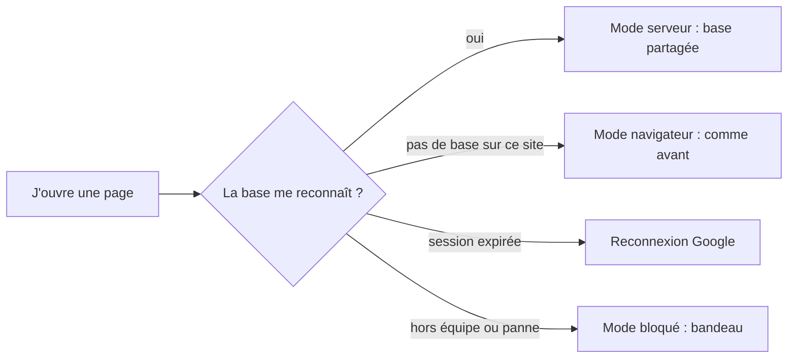
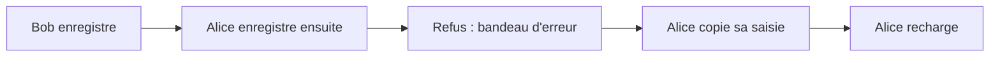
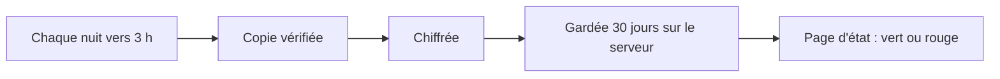

# Candidatures partagées et identité

> Depuis la v1.3, sur `recrutement.yeita.fr`, toute l'équipe lit et écrit les mêmes candidatures, chacun sous son compte Google. Quand deux personnes modifient le même dossier, la seconde est prévenue au lieu d'écraser la première. Depuis la v1.7, la base est sauvegardée chaque nuit, chiffrée, sur le serveur, et les admins voient l'état des sauvegardes sur une page. Hors du site de production, rien ne change.

## Comment ça marche

À l'ouverture, la page attend la réponse de la base, dix secondes au plus. Rien ne s'affiche ni ne s'enregistre avant. Le parcours lui-même (étapes, état, décision, fiches) est le même dans tous les modes.

### Savoir où sont les candidatures
Le bandeau jaune, en haut des six pages de l'espace, change selon le mode.

| Situation | Ce que dit le bandeau jaune |
|---|---|
| Mode serveur | « Les candidatures sont enregistrées sur le serveur de l'équipe Yeita, accessible aux seuls recruteurs connectés. » |
| Mode navigateur, mode bloqué, attente de la réponse | « Données fictives uniquement, jusqu'au déploiement sécurisé. Tout reste dans ce navigateur. » |

### Travailler à plusieurs
En haut de la page, « Connecté·e : Alice » remplace la liste « Qui es-tu ? ». Chaque action est notée à ce prénom. Quand on revient sur l'onglet, la page relit les dossiers et se met à jour si un collègue les a changés. Elle ne relit pas pendant qu'on tape.

### Deux personnes sur le même dossier

Le dossier de Bob reste intact. Le bandeau d'Alice dit « La candidature a été modifiée par quelqu'un d'autre. Recharge la page. » et lui rappelle de copier sa saisie. Celle-ci reste à l'écran, avec « Non enregistré ».

### La sauvegarde de chaque nuit (v1.7)

L'équipe n'a rien à faire : la sauvegarde tourne seule. Seul le fichier de la clé de sauvegarde, gardé hors du serveur, peut ouvrir une copie.

Aucun email n'est envoyé. Un admin ouvre `https://recrutement.yeita.fr/admin/sauvegardes.html` pour vérifier : vert si tout va bien, rouge avec la raison sinon (sauvegarde ratée, trop ancienne, disque presque plein).

> Les copies sont sur le même serveur que la base. Si le serveur est perdu, les sauvegardes le sont aussi.

## Ce qu'il faut savoir

| Règle | En clair | Exemple |
|---|---|---|
| Un seul nom par compte | Le prénom vient de la table de l'équipe, pas d'une liste | « Connecté·e : Alice » |
| Lecture seule | Un lecteur voit tout, mais ne peut rien modifier | « Connecté·e : Léa · lecture seule » |
| Hors équipe | Un compte @yeita.fr absent de l'équipe ne voit rien | « Tu ne fais pas partie de l'équipe. » |
| Pas de repli silencieux | En production, une panne bloque la page au lieu de tout garder dans le navigateur | bandeau d'erreur, rien n'est enregistré |
| Session expirée | La page se recharge et renvoie vers Google ; si ça ne suffit pas, elle s'arrête | « Ta session n'a pas pu être vérifiée. Ferme l'onglet, puis rouvre le site. » |
| Chaque fiche écrit sa partie | La fiche EC1 et la feuille de décompte d'un candidat s'ouvrent ensemble sans se gêner | notes EC1 et décompte enregistrés tous les deux |
| Options partagées | Une option de disponibilité ajoutée par l'un est proposée à tous | « Fin janvier » visible chez Bob |
| Import | Seule la fusion est proposée : « Remplacer tout » effacerait les dossiers de toute l'équipe | un export est une copie, à supprimer après usage |
| Pas d'exemples dans la base partagée | En mode serveur, « Charger des exemples » n'existe pas | tableau vide : « Ajoute la première personne avec qui tu as un appel de découverte. » |
| Page d'état réservée (v1.7) | Seuls les admins voient l'état des sauvegardes | un recruteur y lit « Réservé aux admins de l'équipe. » |
| Un dossier supprimé reste un temps dans les copies (v1.7) | Il quitte la base tout de suite, mais reste dans les copies faites avant | au plus 31 jours, plus si les sauvegardes échouent |
| Après une restauration (v1.7) | La base revient à la date de la copie : les dossiers supprimés depuis reviennent, et l'équipe les supprime à nouveau | l'exploitant fournit la liste des adresses à ouvrir |

### Combien de temps un dossier supprimé reste dans les copies

| Où | Au plus |
|---|---|
| La copie de travail, à côté de la base | 3 jours |
| Les copies chiffrées du serveur | 31 jours |

Tant que les sauvegardes échouent, les anciennes copies ne sont pas effacées : la durée s'allonge d'autant.

## Cas particuliers

- **Une restauration complète** remet toute la base à la date de la copie : ce qui a été saisi depuis est perdu. L'état d'avant la restauration est gardé en copie chiffrée, pour pouvoir revenir en arrière.
- **Un seul dossier perdu ou abîmé** : on ne restaure pas toute la base. L'exploitant ouvre une copie et on ressaisit le dossier dans l'interface.
- **Base actuelle illisible au moment de restaurer** : la liste des suppressions n'est pas connue ; elles sont refaites d'après les demandes d'effacement reçues.
- **Serveur perdu** : il n'y a rien à restaurer, les copies étaient dessus. Le serveur reconstruit repart d'une base vide.
- **Des exemples déjà dans la base** (chargés avant la v1.4) restent visibles de toute l'équipe ; « Retirer les exemples » les retire pour tout le monde.
- **Quitter la page juste après avoir tapé** : si un collègue a enregistré le même dossier juste avant, ces dernières frappes peuvent se perdre sans message.
- **Dossier supprimé par un collègue** : une fiche encore ouverte ne le recrée pas ; le bandeau d'erreur le signale.
- **Un vieil export fusionné** peut faire revenir un dossier supprimé depuis.
- **À chaque déploiement**, la base s'arrête une quinzaine de secondes : les pages ouvertes affichent alors le message réseau.

## Voir aussi
- [Comment les pages choisissent où ranger les dossiers](../../technique/mode-serveur.md)
- [L'API de stockage](../../technique/api.md)
- [Architecture et déploiement](../../technique/architecture.md)
- Le contrat du dossier : `docs/backend/MODELE.md` ; l'exploitation du serveur : `deploy/README.md` ; restaurer : `deploy/RESTAURER.md`
- Toutes les règles, avec leur version, sont dans la version complète.
