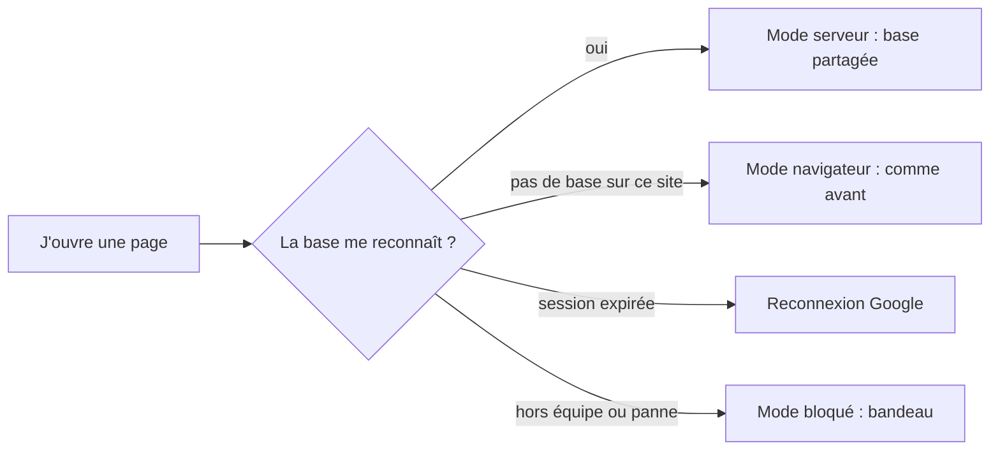
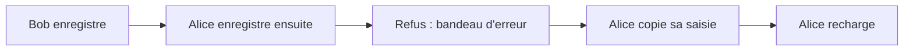

# Candidatures partagées et identité

> Depuis la v1.3, sur `recrutement.yeita.fr`, toute l'équipe lit et écrit les mêmes candidatures, chacun sous son compte Google. Quand deux personnes modifient le même dossier, la seconde est prévenue au lieu d'écraser la première. Depuis la v1.4, le bandeau jaune dit clairement où sont les candidatures, et la base partagée ne reçoit plus d'exemples fictifs. Hors du site de production, rien ne change.

## Comment ça marche

À l'ouverture, la page attend la réponse de la base, dix secondes au plus. Rien ne s'affiche ni ne s'enregistre avant. Le parcours lui-même (étapes, état, décision, fiches) est le même dans tous les modes.

### Savoir où sont les candidatures
Le bandeau jaune, en haut des six pages de l'espace, change selon le mode.

| Situation | Ce que dit le bandeau jaune |
|---|---|
| Mode serveur | « Les candidatures sont enregistrées sur le serveur de l'équipe Yeita, accessible aux seuls recruteurs connectés. » |
| Mode navigateur, mode bloqué, attente de la réponse | « Données fictives uniquement, jusqu'au déploiement sécurisé. Tout reste dans ce navigateur. » |

En mode serveur, « Connecté·e : Alice » reste affiché à côté.

### Travailler à plusieurs
En haut de la page, « Connecté·e : Alice » remplace la liste « Qui es-tu ? ». Chaque action est notée à ce prénom. Quand on revient sur l'onglet, la page relit les dossiers et se met à jour si un collègue les a changés. Elle ne relit pas pendant qu'on tape.

### Deux personnes sur le même dossier

Le dossier de Bob reste intact. Le bandeau d'erreur d'Alice dit « La candidature a été modifiée par quelqu'un d'autre. Recharge la page. » et lui rappelle de copier sa saisie. Celle-ci reste à l'écran, et l'indicateur d'enregistrement affiche « Non enregistré ».

## Ce qu'il faut savoir

| Règle | En clair | Exemple |
|---|---|---|
| Un seul nom par compte | Le prénom vient de la table de l'équipe, pas d'une liste | « Connecté·e : Alice » |
| Lecture seule | Un lecteur voit tout, mais ne peut rien modifier | « Connecté·e : Léa · lecture seule » |
| Hors équipe | Un compte @yeita.fr absent de l'équipe ne voit rien | « Tu ne fais pas partie de l'équipe. » |
| Pas de repli silencieux | En production, une panne bloque la page au lieu de tout garder dans le navigateur | « La base ne répond pas. Vérifie ta connexion, puis réessaie. » |
| Session expirée | La page se recharge et renvoie vers Google ; si ça ne suffit pas, elle s'arrête | « Ta session n'a pas pu être vérifiée. Ferme l'onglet, puis rouvre le site. » |
| Chaque fiche écrit sa partie | La fiche EC1 et la feuille de décompte d'un candidat s'ouvrent ensemble sans se gêner | Notes EC1 et décompte enregistrés tous les deux |
| Options partagées | Une option de disponibilité ajoutée par l'un est proposée à tous | « Fin janvier » visible chez Bob |
| Import | Seule la fusion est proposée : « Remplacer tout » effacerait les dossiers de toute l'équipe | Un export est une copie, à supprimer après usage |
| Pas d'exemples dans la base partagée (v1.4) | En mode serveur, le bouton « Charger des exemples » n'existe plus, ni dans la sauvegarde, ni sur le tableau vide | Tableau vide : « Ajoute la première personne avec qui tu as un appel de découverte. » |

> Avant que la base ait répondu, les boutons d'exemples ne font rien : un clic trop rapide ne peut plus envoyer d'exemples dans la base de l'équipe.

## Cas particuliers

- **Des exemples déjà dans la base** (chargés avant la v1.4) restent visibles de toute l'équipe. « Retirer les exemples » n'apparaît alors que dans ce cas, et les retire pour tout le monde.
- **Quitter la page juste après avoir tapé** : la dernière saisie part aussitôt. Si un collègue a enregistré le même dossier juste avant, ces dernières frappes peuvent se perdre sans message.
- **Dossier supprimé par un collègue** : une fiche encore ouverte ne le recrée pas ; le bandeau d'erreur le signale.
- **Un nom tapé dans le champ Recruteurs** qui n'est pas dans l'équipe reste dans le dossier, mais n'est plus proposé ailleurs.
- **Les candidatures saisies avant la v1.3** dans un navigateur (données fictives) ne sont pas reprises dans la base, pas plus que les codes de l'ancienne carte.
- **Un vieil export fusionné** peut faire revenir un dossier supprimé depuis.
- **À chaque déploiement**, la base s'arrête une quinzaine de secondes : les pages ouvertes affichent alors le message réseau.
- **Impression** : la note renvoie vers un onglet du site du recrutement, et « Ouvrir sur le site » mène à `recrutement.yeita.fr`.

## Voir aussi
- [Comment les pages choisissent où ranger les dossiers](../../technique/mode-serveur.md)
- [L'API de stockage](../../technique/api.md)
- Le contrat du dossier : `docs/backend/MODELE.md` ; l'exploitation du serveur : `deploy/README.md`
- Toutes les règles, avec leur version, sont dans la version complète.
