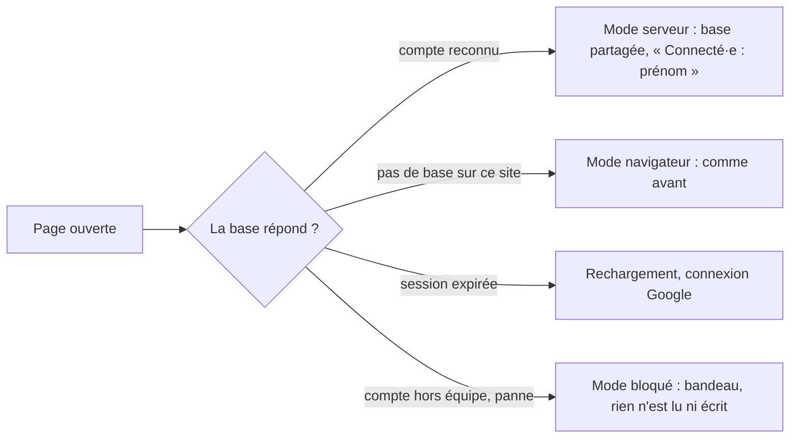

# Candidatures partagées et identité

> Où sont enregistrées les candidatures de l'espace Candidatures, qui les voit, sous quel nom chacun agit, et ce qui se passe quand deux personnes travaillent sur le même dossier. Depuis la v1.3, sur `recrutement.yeita.fr`, toute l'équipe partage une même base ; ailleurs, rien ne change.

## Comment ça marche

La page attend la réponse (10 s au plus) avant d'afficher ou d'enregistrer quoi que ce soit. Les règles du parcours (étapes, état, décision, fiches) sont les mêmes dans les deux modes.

## Règles métier
| Règle | Détail | Depuis |
|---|---|---|
| Mode serveur | Sur `recrutement.yeita.fr`, si la base répond au compte connecté : les candidatures, l'équipe et les options de disponibilité viennent de la base partagée | 1.3 |
| Mode navigateur | Sans base sur le site (404, hors du site de production) ou page ouverte depuis un fichier : tout reste dans le navigateur, comme avant | 1.3 |
| Jamais de repli silencieux | En production, une panne, un mauvais réglage ou un compte hors équipe bloquent la page avec un message ; elle ne passe jamais dans le navigateur sans le dire. Avant la réponse, aucun bouton n'enregistre nulle part | 1.3 |
| Session expirée | La page se recharge une fois (connexion Google) ; si la base refuse encore l'identité dans la minute, message « Ta session n'a pas pu être vérifiée. Ferme l'onglet, puis rouvre le site. » | 1.3 |
| Identité | En mode serveur, chaque action est notée au prénom du compte connecté (table de l'équipe) ; « Connecté·e : Alice » remplace la liste « Qui es-tu ? » ; un lecteur voit « · lecture seule » | 1.3 |
| Lecture seule | Un compte en lecture voit tout ; toute écriture est refusée avec « Lecture seule : tu ne peux pas modifier. » | 1.3 |
| Hors équipe | Un compte Google @yeita.fr qui n'est pas dans l'équipe ne voit aucune candidature : « Tu ne fais pas partie de l'équipe. » | 1.3 |
| Conflit | Si quelqu'un a enregistré le même dossier entre-temps, l'enregistrement est refusé : bandeau « La candidature a été modifiée par quelqu'un d'autre. Recharge la page. » et « Ce que tu as saisi depuis n'est pas enregistré : copie-le avant de recharger. » ; l'indicateur passe à « Non enregistré » ; la saisie reste affichée | 1.3 |
| Bandeau d'erreur | En mode serveur, tout refus de la base s'affiche dans un bandeau rouge collé en haut de la page, même en bas d'une longue fiche, sans déplacer le curseur ; il propose « Recharger », sauf pour un compte en lecture seule (recharger n'y changerait rien) ; il disparaît quand une nouvelle tentative réussit ou qu'une relecture réussit | 1.3 |
| Pas de conflit avec soi-même | Les enregistrements d'un même dossier partent l'un après l'autre, même sur une connexion lente | 1.3 |
| Chaque fiche écrit sa partie | La fiche EC1, la fiche EC2 et la feuille de décompte n'écrivent que leur partie, sur le dossier relu : la fiche EC1 et la feuille de décompte d'un même candidat peuvent être ouvertes ensemble. Si un collègue a changé la même partie, ou supprimé le dossier, rien n'est écrit et le bandeau le dit (dans les deux modes) | 1.3 |
| Retour sur l'onglet | En mode serveur, la page relit les dossiers quand on revient sur son onglet, et ne se redessine que s'ils ont changé ; rien n'est relu pendant une saisie | 1.3 |
| Départ de la page | La dernière saisie part aussitôt quand on quitte la page ; si quelqu'un a enregistré le même dossier juste avant, ces dernières frappes (300 à 400 ms) peuvent être perdues sans message (risque accepté) | 1.3 |
| Options de disponibilité | Une option ajoutée par un recruteur est proposée à toute l'équipe ; si l'ajout est refusé (lecture seule, panne), le bandeau le dit et l'option reste proposée dans la page | 1.3 |
| Dossier supprimé | Un dossier supprimé par un collègue n'est jamais recréé par une page restée ouverte : son enregistrement est refusé avec le bandeau ; au tableau, il disparaît au retour sur l'onglet | 1.3 |
| Import d'un dossier hors format | Un dossier importé dont l'identifiant a été modifié à la main est refusé : « Identifiant invalide pour « {nom} » : ce dossier ne peut pas être enregistré dans la base. » | 1.3 |
| Entrer dans l'équipe | L'accès se donne et se retire par l'exploitant (`docker compose exec api node api/equipe.js add|disable|role`, `deploy/README.md` § 13) ; un compte retiré ne voit plus aucun dossier dès la requête suivante | 1.3 |
| Recruteurs hors équipe | Un nom tapé dans le champ Recruteurs reste dans le dossier, mais n'est plus proposé ailleurs (avant : gardé dans le navigateur) | 1.3 |
| Import en mode serveur | Seule la fusion est proposée (« Remplacer tout » supprimerait les dossiers de toute l'équipe) ; un export est une copie : « Les candidatures sont enregistrées sur le serveur de l'équipe. Un export est une copie : supprime-la après usage. » | 1.3 |
| Bandeau jaune | En mode serveur, le bandeau jaune en tête des six pages dit « Les candidatures sont enregistrées sur le serveur de l'équipe Yeita, accessible aux seuls recruteurs connectés. » ; ailleurs (mode navigateur, mode bloqué, attente de la réponse de la base) il garde « Données fictives uniquement, jusqu'au déploiement sécurisé. Tout reste dans ce navigateur. » | 1.4 |
| Pas d'exemples dans la base partagée | En mode serveur, le tableau ne propose pas « Charger des exemples » (ni dans la section Sauvegarde, ni sur le tableau vide, qui dit seulement « Ajoute la première personne avec qui tu as un appel de découverte. ») ; avant la réponse de la base, ces boutons ne font rien. « Retirer les exemples » n'apparaît que si la base contient déjà des exemples, et les retire pour toute l'équipe | 1.4 |
| Impression | La note d'impression renvoie vers un onglet du site du recrutement, et « Ouvrir sur le site » mène à `recrutement.yeita.fr` | 1.3 |

## Cas particuliers
- Les candidatures saisies dans les navigateurs avant la v1.3 (données fictives) ne sont pas reprises dans la base ; elles restent visibles seulement sur un site sans base.
- Les codes de l'ancienne carte d'identité ne sont pas importés dans la base en mode serveur.
- Un import « Fusion » d'un ancien export peut recréer un dossier supprimé depuis.
- Des exemples chargés dans la base avant la 1.4 restent visibles de toute l'équipe jusqu'à ce que quelqu'un clique « Retirer les exemples ».
- Chaque déploiement coupe la base une quinzaine de secondes : les pages ouvertes affichent alors le message réseau.

## Voir aussi
- [Mode serveur des pages](../../technique/mode-serveur.md)
- [API de stockage](../../technique/api.md)
- Contrat : `docs/backend/MODELE.md` ; exploitation : `deploy/README.md`

## Historique
| Version | Changement |
|---|---|
| 1.3 | Création : mode serveur, mode navigateur, mode bloqué, identité du compte, conflits, fiches par partie, import et impression |
| 1.4 | Bandeau jaune juste en mode serveur ; plus d'exemples fictifs chargés dans la base partagée |
