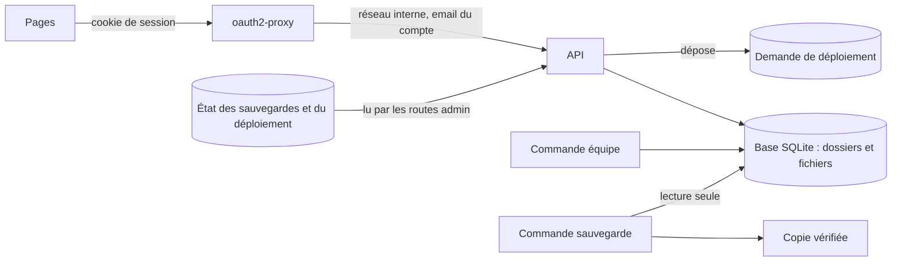
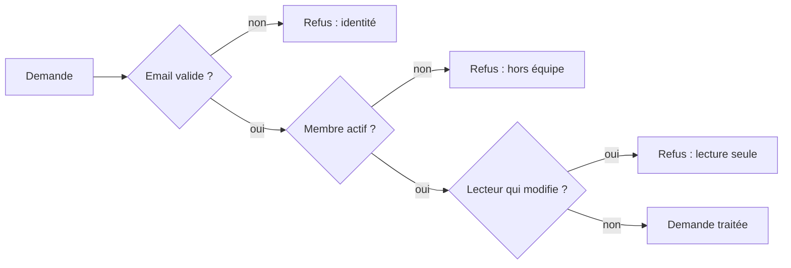
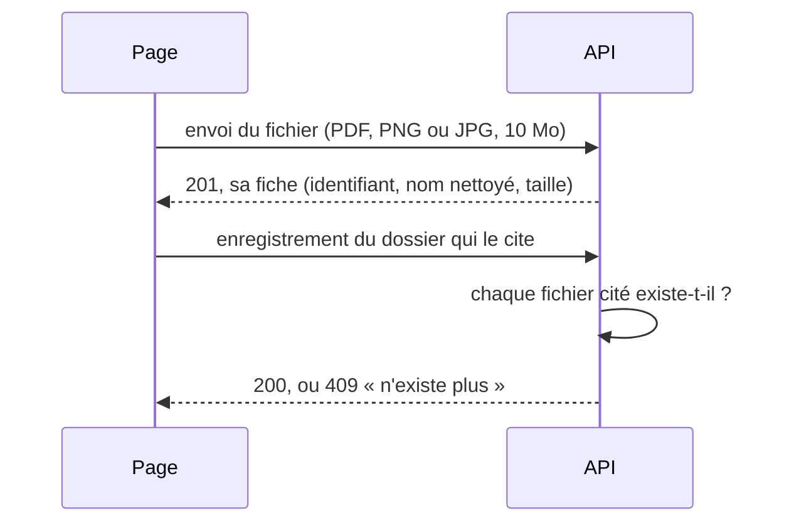

# L'API de stockage

> Un petit serveur garde les dossiers candidat dans une base SQLite partagée et ne répond qu'aux membres de l'équipe. Arrivée en v1.2, elle est en service depuis la v1.3, dans Docker, derrière oauth2-proxy. Depuis la v1.7, elle se copie chaque nuit ; depuis la v1.9, elle sert la page des déploiements. Depuis la v1.10, elle garde aussi les CV et portfolios déposés, à côté du dossier, et veille à ce qu'un dossier ne cite jamais un fichier absent.

## En un coup d'œil



oauth2-proxy vérifie la connexion Google, puis transmet la demande avec l'email du compte. L'API regarde si cet email fait partie de l'équipe, puis lit ou écrit dans la base. Deux commandes, lancées dans le conteneur, ouvrent la base à côté : l'une gère l'équipe, l'autre copie la base.

## Les éléments principaux

### Ce que l'API sait faire, et qui s'en sert
| Demande | Ce qu'elle fait | Qui l'appelle |
|---|---|---|
| Qui suis-je | rend l'email, le prénom et le rôle du compte | le démarrage de chaque page |
| L'équipe | rend les prénoms et rôles des membres actifs | le démarrage (champ Recruteurs) |
| Options de disponibilité | liste ou ajoute une option | le démarrage, puis l'ajout d'une option |
| Dossiers | liste, lit, enregistre, supprime | l'adaptateur serveur des pages |
| Fichiers d'un candidat (v1.10) | reçoit un CV ou un portfolio, le liste, le sert, le retire | la fiche du candidat, et l'import |
| État des sauvegardes (v1.7) | rend la dernière tentative, la dernière réussite et la mesure des disques | la page d'état, admins seulement |
| État du déploiement (v1.9) | rend ce que le serveur a écrit et la demande en attente | la page des déploiements, admins seulement |
| Demande de déploiement (v1.9) | dépose « déployer `main` », « déployer ce commit » ou « reprendre » | la page des déploiements, admins seulement |
| État de santé | dit si la base répond | la sonde de Docker, dans le conteneur |

Le dossier est gardé entier, tel que les pages le fabriquent. Le contenu d'un fichier, lui, n'est jamais dans le dossier : le dossier ne garde qu'une petite fiche (nom, type, taille, date, auteur) qui le cite.

### Qui a le droit



Il y a trois rôles : recruteur, admin et lecture. L'équipe est relue à chaque demande : un membre désactivé perd l'accès dès sa demande suivante. Un compte en lecture ouvre les dossiers et les fichiers, mais ne dépose ni ne retire rien. Les routes d'administration ajoutent un contrôle commun : un compte qui n'est pas admin reçoit « Réservé aux admins de l'équipe. ».

### Deux personnes sur le même dossier
Chaque dossier porte un numéro de version, qui augmente à chaque enregistrement. Pour enregistrer, il faut donner le numéro qu'on a lu. S'il a changé entre-temps, ou si le dossier a été supprimé, l'API refuse : « La candidature a été modifiée par quelqu'un d'autre. Recharge la page. »

### Les documents du candidat (v1.10)
Un CV ou un portfolio se dépose en deux temps : la page envoie le fichier, puis enregistre le dossier qui le cite.



| Ce que l'API garantit | En clair |
|---|---|
| Le bon type, vraiment | PDF, PNG ou JPG, reconnus à leurs premiers octets, pas à leur nom ; sinon 415 |
| Une taille raisonnable | 10 Mo au plus ; au-delà, 413 « Fichier trop volumineux (10 Mo maximum). » |
| Un nom sans danger | sans chemin, 120 caractères au plus, l'extension du vrai type |
| Un fichier se lit sur place | affiché par le navigateur selon son type, jamais interprété autrement, jamais gardé en cache |
| Un dossier ne cite jamais un fichier absent | sinon l'enregistrement est refusé et rien n'est écrit |
| Un fichier cité ne se retire pas | il faut d'abord enregistrer le dossier sans lui ; sinon 409 « Ce fichier est encore sur la fiche. Recharge la page. » |
| Pas de fichiers oubliés | un fichier que le dossier ne cite plus, déposé il y a plus d'une heure, est effacé au prochain enregistrement du dossier |
| Un effacement réel | retirer un fichier, ou supprimer le candidat, l'efface vraiment des fichiers de la base |

Le délai d'une heure protège un dépôt en cours : le fichier est déjà là, le dossier qui le cite pas encore.

### Ce que la base garde
| Table | Contenu |
|---|---|
| Dossiers | chaque dossier entier, sa version, la date et l'auteur du dernier enregistrement |
| Fichiers (v1.10) | le contenu de chaque CV ou portfolio déposé, son nom, son type, sa taille, qui l'a déposé et quand |
| Journal | qui a fait quoi sur quel dossier, quand ; jamais le contenu |
| Équipe | email, prénom, rôle, actif ou non |
| Options de disponibilité | seulement celles ajoutées |

Une suppression efface vraiment : le contenu ne reste pas lisible dans les fichiers de la base. Il reste en revanche dans les sauvegardes faites avant : 3 jours au plus dans la copie de travail, 31 jours au plus dans les copies chiffrées du serveur. Depuis la v1.10, chaque copie contient aussi les fichiers des candidats.

### Ajouter une table sans changer la version (v1.10)
La base porte un numéro de version. L'API d'une version plus ancienne refuse une base plus récente que la sienne : changer ce numéro aurait empêché tout retour vers la v1.9.

La table des fichiers est donc créée « si elle manque », à chaque ouverture, sans toucher au numéro. La v1.9 relit la base sans rien voir des fichiers. C'est désormais la règle : une table qui ne fait qu'ajouter suit ce chemin ; seul un changement qui casserait la lecture par la version d'avant change le numéro.

### Gérer l'équipe
On gère l'équipe par une commande, pas par le site. Sur le serveur, elle passe par le conteneur de l'API :

```bash
docker compose exec api node api/equipe.js add prenom.nom@yeita.fr Prénom admin
```

La même commande liste l'équipe (`list`), désactive un membre (`disable`) ou change son rôle (`role`).

### Copier la base (v1.7)
La commande de sauvegarde fait une copie cohérente, même pendant que l'équipe enregistre. Elle ne garde la base ouverte que le temps de la copie : l'effacement réel n'est pas retardé.

| Ce qu'elle garantit | En clair |
|---|---|
| Un nom définitif = une copie vérifiée | une copie abîmée n'est jamais gardée |
| Un seul fichier | la copie s'ouvre seule, sans fichiers annexes |
| Lisible par son seul propriétaire | comme la base elle-même |
| Ménage sur demande | avec `--nettoyer`, les copies de plus de 2 jours partent, jamais celle qui vient d'être faite |

Chaque nuit, le script de sauvegarde du serveur la lance, puis récupère et chiffre la copie. La dernière ligne affichée est le chemin de la copie : le script s'en sert, il ne faut pas en changer la forme.

### Les routes d'administration (v1.7, v1.9)
La route des sauvegardes rend tels quels les petits fichiers d'état écrits par les scripts du serveur, avec deux drapeaux « en retard ». Les routes du déploiement font deux choses seulement : lire l'état, et déposer une demande sous une forme stricte. L'API ne lance jamais de commande ; c'est le serveur, et lui seul, qui vérifie la demande et agit. Le détail est dans la version complète.

### Lancer l'API sur son poste
Le mode local permet d'essayer l'API sans oauth2-proxy. On dit à l'API quel membre on est ; elle peut aussi servir le site construit.

```bash
cd api && npm ci
node equipe.js add moi@yeita.fr Moi admin
DEV_EMAIL=moi@yeita.fr npm start
```

## À savoir avant de modifier

- **L'API croit l'email que lui transmet oauth2-proxy.** Elle n'est donc reliée qu'à lui, par un réseau interne, sans aucun port publié.
- **Le mode local est verrouillé.** L'image de production le refuse, et l'API s'arrête si on tente de l'activer.
- **Les réponses comptent pour les pages.** Changer un code ou un message change ce que voit le recruteur, ou ce qu'affiche une page d'administration.
- **Les limites des fichiers existent deux fois.** La taille (10 Mo) et les trois types sont écrits dans l'API et recopiés dans la page, qui contrôle avant d'envoyer : les changer des deux côtés.
- **Devant le site, nginx doit accepter 10 Mo.** Par défaut il refuse tout envoi de plus de 1 Mo, avant même l'API (voir la mise en production).
- **Une table nouvelle ne change pas la version de la base**, tant qu'elle ne fait qu'ajouter : sinon le retour arrière automatique casse.
- **Une écriture à la fois.** Si la base est occupée plus de 5 secondes, l'API demande de réessayer.
- **Ne jamais copier la base autrement.** Copier ses fichiers à chaud, ou la lire longtemps avec un autre outil, retarde l'effacement des dossiers et des fichiers supprimés.
- **Le format de la demande de déploiement est partagé avec le serveur** : le changer des deux côtés, et rester lisible par celui de la v1.9.
- **Les tests** : `cd api && npm test` (85 tests, une vingtaine de secondes). Les tests des fichiers simulent l'horloge pour vérifier le délai d'une heure sans attendre.

## Voir aussi
- [Fiche du candidat, CV et portfolio](../doc/produit/fiche-candidat.md)
- [Comment les pages choisissent où ranger les dossiers](mode-serveur.md)
- [Architecture et déploiement](architecture.md)
- [Décisions techniques](decisions.md)
- [Conventions et tests](conventions.md)
- [Le déploiement automatique](deploiement-automatique.md)
- Le mode d'emploi pour l'intégrateur : `api/README.md` (il ne décrit pas encore les routes des fichiers)
- Le détail des routes, des messages, des réglages et des tables est dans la version complète.
