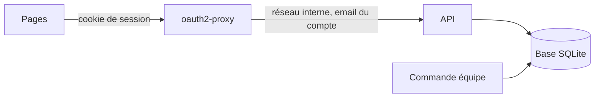
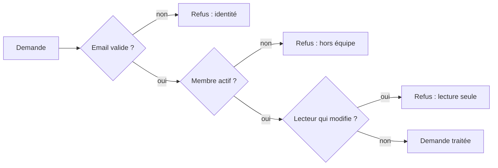

# L'API de stockage

> Un petit serveur garde les dossiers candidat dans une base SQLite partagée et ne répond qu'aux membres de l'équipe. Arrivée en v1.2, elle est en service depuis la v1.3 : elle tourne dans Docker, derrière oauth2-proxy, et les pages l'utilisent en mode serveur.

## En un coup d'œil



oauth2-proxy vérifie la connexion Google, puis transmet la demande à l'API avec l'email du compte. L'API regarde si cet email fait partie de l'équipe, puis lit ou écrit dans la base. Son code n'a pas changé en v1.3 : seule sa place a changé.

## Les éléments principaux

### Ce que l'API sait faire, et qui s'en sert
| Demande | Ce qu'elle fait | Qui l'appelle |
|---|---|---|
| Qui suis-je | rend l'email, le prénom et le rôle du compte | le démarrage de chaque page |
| L'équipe | rend les prénoms et rôles des membres actifs | le démarrage (champ Recruteurs) |
| Options de disponibilité | liste ou ajoute une option | le démarrage, puis l'ajout d'une option |
| Dossiers | liste, lit, enregistre, supprime | l'adaptateur serveur des pages |
| État de santé | dit si la base répond | la sonde de Docker, dans le conteneur |

Le dossier est gardé entier, tel que les pages le fabriquent.

### Qui a le droit



Il y a trois rôles : recruteur, admin et lecture. L'équipe est relue à chaque demande : un membre désactivé perd l'accès dès sa demande suivante, même connecté.

### Deux personnes sur le même dossier
Chaque dossier porte un numéro de version, qui augmente à chaque enregistrement. Pour enregistrer, il faut donner le numéro qu'on a lu. S'il a changé entre-temps, ou si le dossier a été supprimé, l'API refuse : « La candidature a été modifiée par quelqu'un d'autre. Recharge la page. »

> Les pages retiennent la version de chaque dossier lu et envoient leurs enregistrements un par un : un recruteur seul ne se met pas en conflit avec lui-même.

### Ce que la base garde
| Table | Contenu |
|---|---|
| Dossiers | chaque dossier entier, sa version, la date et l'auteur du dernier enregistrement |
| Journal | qui a fait quoi sur quel dossier, quand ; jamais le contenu |
| Équipe | email, prénom, rôle, actif ou non |
| Options de disponibilité | seulement celles ajoutées |

Une suppression efface vraiment : le contenu ne reste pas lisible dans les fichiers.

### Gérer l'équipe
On gère l'équipe par une commande, pas par le site. Sur le serveur, elle passe par le conteneur de l'API :

```bash
docker compose exec api node api/equipe.js add prenom.nom@yeita.fr Prénom admin
```

La même commande liste l'équipe, désactive un membre ou change son rôle.

### Lancer l'API sur son poste
Le mode local permet d'essayer l'API sans oauth2-proxy. On dit à l'API quel membre on est ; elle peut aussi servir le site construit, qui passe alors en mode serveur.

```bash
cd api && npm ci
node equipe.js add moi@yeita.fr Moi admin
DEV_EMAIL=moi@yeita.fr npm start
```

## À savoir avant de modifier

- **L'API croit l'email que lui transmet oauth2-proxy.** Elle n'est donc reliée qu'à lui, par un réseau interne, sans aucun port publié.
- **Le mode local est verrouillé.** L'image de production le refuse, et l'API s'arrête si on tente de l'activer.
- **Les réponses comptent pour les pages.** Les pages classent chaque réponse (succès, conflit, refus, panne) : changer un code ou un message change ce que voit le recruteur.
- **Une écriture à la fois.** Si la base est occupée plus de 5 secondes, l'API demande de réessayer.
- **Les tests** : `cd api && npm test` (52 tests, une vingtaine de secondes).

## Voir aussi
- [Comment les pages choisissent où ranger les dossiers](mode-serveur.md)
- [Architecture et déploiement](architecture.md)
- [Décisions techniques](decisions.md)
- [Conventions et tests](conventions.md)
- Le mode d'emploi complet et le contrat de chaque demande : `api/README.md`
- Le détail des routes, des messages, des réglages et des tables est dans la version complète.
