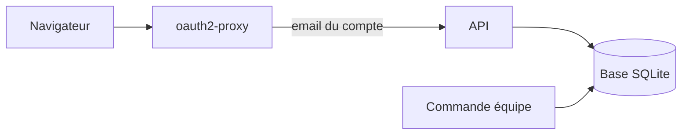
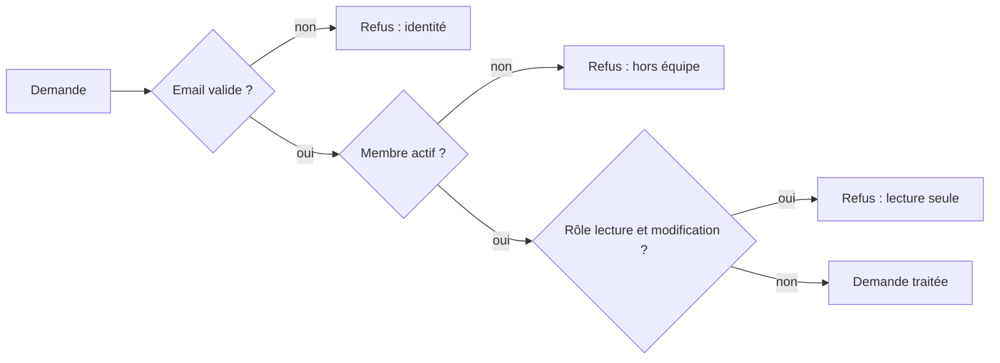

# L'API de stockage

> Depuis la v1.2, un petit serveur garde les dossiers candidat dans une base SQLite partagée, au lieu du navigateur de chacun. Il ne répond qu'aux membres de l'équipe. Les pages ne l'utilisent pas encore, et il ne tourne pas encore sur le serveur.

## En un coup d'œil



Le schéma montre l'installation visée. oauth2-proxy vérifie la connexion Google, puis transmet la demande à l'API avec l'email du compte. L'API regarde si cet email fait partie de l'équipe, puis lit ou écrit dans la base.

> Aujourd'hui, l'API se lance seule, sur un poste ou un serveur. Elle n'est ni dans Docker ni derrière oauth2-proxy : cela viendra avec le branchement des pages.

## Les éléments principaux

### Ce que l'API sait faire

| Demande | Ce qu'elle fait | Qui peut |
|---|---|---|
| État de santé | dit si la base répond | tout le monde, sans connexion |
| Qui suis-je, l'équipe | rend son propre profil, puis les prénoms et rôles des membres actifs | tous les membres |
| Lister, lire un dossier | rend les dossiers, du plus récent au plus ancien | tous les membres |
| Enregistrer, supprimer un dossier | crée, met à jour ou efface | recruteurs et admins |
| Options de disponibilité | liste ou ajoute une option (« Fin janvier », par exemple) | lire : tous ; ajouter : recruteurs et admins |

Le dossier est gardé entier, tel que les pages le fabriquent. L'API ne le découpe pas en colonnes.

### Qui a le droit

Chaque demande passe trois contrôles, dans cet ordre :



Il y a trois rôles. Un recruteur et un admin peuvent tout faire ; un membre en lecture peut seulement consulter. L'équipe est relue à chaque demande : un membre désactivé perd l'accès tout de suite.

### Deux personnes sur le même dossier

Chaque dossier porte un numéro de version, qui augmente à chaque enregistrement. Pour enregistrer, il faut donner le numéro qu'on a lu. S'il a changé entre-temps, c'est un conflit d'écriture : l'API refuse et demande de recharger la page.

| Situation | Réponse |
|---|---|
| Nouveau dossier | créé, version 1 |
| Version lue toujours à jour | enregistré, version suivante |
| Quelqu'un a enregistré entre-temps | refus : « La candidature a été modifiée par quelqu'un d'autre. Recharge la page. » |
| Dossier supprimé entre-temps | même refus |

> Ce numéro de version n'a rien à voir avec la version du format du dossier (toujours 3), qui est dans le dossier lui-même.

### Ce que la base garde

| Table | Contenu |
|---|---|
| Dossiers | chaque dossier entier, sa version, la date et l'auteur du dernier enregistrement |
| Journal | qui a créé, modifié ou supprimé quel dossier, quand, à quelle étape ; jamais le contenu |
| Équipe | email, prénom, rôle, actif ou non |
| Options de disponibilité | seulement celles ajoutées ; les options de base restent dans les pages |

Quand un dossier est supprimé, l'effacement est réel : son contenu ne reste pas lisible dans les fichiers, et son journal est vidé. Il ne reste qu'une ligne « suppression ».

### Gérer l'équipe

On ne gère pas l'équipe par le site, mais par une commande sur le serveur : `node api/equipe.js`. Elle ajoute un membre, liste l'équipe, désactive un membre ou change son rôle. Exemple : `node api/equipe.js add prenom.nom@yeita.fr Prénom admin`.

### Lancer l'API sur son poste

Le mode local permet d'essayer l'API sans oauth2-proxy. On dit à l'API quel membre on est, et elle peut aussi servir le site construit.

```bash
cd api && npm ci
node equipe.js add moi@yeita.fr Moi admin
DEV_EMAIL=moi@yeita.fr npm start
```

L'API répond alors sur `http://127.0.0.1:8000/api/…`.

## À savoir avant de modifier

- **L'API croit l'email que lui transmet oauth2-proxy.** Quiconque la joint directement peut se faire passer pour un membre. Elle n'écoute donc que sur la machine elle-même par défaut, et prévient au démarrage si on change cela.
- **Le mode local est verrouillé.** Il est refusé en production et dès que l'API écoute ailleurs que sur la machine elle-même.
- **Les réglages sont vérifiés au démarrage.** Une valeur absurde (port, chemin de la base, commentaire resté dans la valeur) arrête l'API avec un message qui nomme le réglage.
- **Une écriture à la fois.** Si la base est occupée plus de 5 secondes, l'API répond « Base occupée, réessaie dans un instant. » ; cela vaut pour les dossiers comme pour l'ajout d'une option.
- **Les fichiers de la base ne sont lisibles que par leur propriétaire.** La commande d'équipe doit tourner avec le même utilisateur système et la même base que l'API.
- **Les tests** : `cd api && npm test` (52 tests, une vingtaine de secondes).

## Voir aussi
- [Architecture et déploiement](architecture.md)
- [Décisions techniques](decisions.md)
- [Conventions et tests](conventions.md)
- Le mode d'emploi complet et le contrat de chaque demande : `api/README.md`
- Le détail des routes, des messages d'erreur, des réglages et des tables est dans la version complète.
