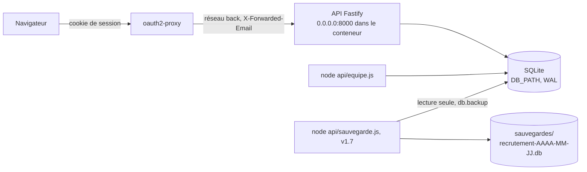

# API de stockage (`api/`)

> Le serveur Node.js qui garde les dossiers candidat entiers dans SQLite et expose le contrat list/get/put/remove de `docs/backend/MODELE.md`, réservé aux membres actifs de la table `equipe`. Placée derrière oauth2-proxy, qui pose `X-Forwarded-Email` ; depuis v1.3, elle tourne dans Docker (service `api`, réseau `back`, [Architecture](architecture.md)) et les pages l'utilisent quand elle répond ([Mode serveur](mode-serveur.md)). Aucun fichier de `api/src/` n'a changé en v1.3. Mode d'emploi et contrat HTTP pour l'intégrateur : `api/README.md`.

## Vue d'ensemble
Déploiement (v1.3) :

Un processus, une connexion better-sqlite3 (synchrone). `equipe.js` ouvre sa propre connexion sur la même base ; `sauvegarde.js` aussi, en lecture seule, le temps de la copie.

## Fichiers
| Fichier | Rôle | Exporte |
|---|---|---|
| `api/server.js` | Point d'entrée (`npm start`) : `lireConfig`, `ouvrirBase`, `construireApp`, écoute, ligne de démarrage, avertissements, arrêt sur `SIGINT`/`SIGTERM` (code 0), erreurs de démarrage (code 1) | — |
| `api/equipe.js` | Commande `add|list|disable|role` | — |
| `api/sauvegarde.js` (v1.7) | Commande `node api/sauvegarde.js [--nettoyer]` : base ouverte en lecture seule (`fileMustExist`), `db.backup()` vers `<dossier de la base>/sauvegardes/recrutement-AAAA-MM-JJ.db.tmp-<pid>` (date UTC), `integrity_check` = `ok` exigé, `journal_mode = DELETE` (un seul fichier), renommage ; masque 077 (dossier 700, copie 600) ; dernière ligne de sortie = chemin de la copie (contrat de `deploy/backup.sh`) ; `--nettoyer` : `recrutement-AAAA-MM-JJ.db` et temporaires de plus de 48 h (date de modification), jamais la copie faite ; code 0/1, messages en français ; aucune route, aucun changement du reste de l'API | — |
| `api/src/config.js` | Lecture et contrôle des variables | `lireConfig(env, dossierApi)`, `cheminBase(env, dossierApi)`, `ErreurConfig`, `DOSSIER_API` |
| `api/src/base.js` | Ouverture de la base, réglages, schéma | `ouvrirBase(chemin)` → `{db, creee, userVersion}`, `SCHEMA`, `VERSION_SCHEMA` (1), `ATTENTE_MS` (5000), `ErreurBase`, `estOccupee(e)` |
| `api/src/app.js` | Application Fastify : analyseur JSON, autorisation, erreurs, `/api/sante`, `/api/moi`, `/api/equipe`, site local, `adminRequis(req)` (v1.9 : 403 `admin-requis` hors rôle admin, routes d'administration) |
| `api/src/candidats.js` | Routes des dossiers, journal, point de contrôle | `routesCandidats(app, db)` |
| `api/src/options.js` | Routes des options de disponibilité | `routesOptions(app, db)` |
| `api/src/sauvegardes.js` (v1.7) | État des sauvegardes : lit `<dossier de la base>/etat/` (`path.dirname(db.name)`), contrôle du rôle par `adminRequis` (v1.9) | `routesSauvegardes(app, db)`, `lire(fichier)` (exportée v1.9, reprise par `deploiement.js`), `RETARD_SAUVEGARDE_MS` (26 h), `RETARD_DISQUE_MS` (2 h) |
| `api/src/deploiement.js` (v1.9) | Déploiement automatique : lit `<dossier de la base>/etat/deploiement.json` (par `lire` de `sauvegardes.js`) et la demande en attente ; écrit `<dossier de la base>/demandes/deploiement.demande` (une ligne `clé=valeur` par champ, `wx` sous un nom temporaire puis renommage, 600, dossier 700) | `routesDeploiement(app, db)`, `lireDemande(fichier)`, `CLES_DEMANDE`, `TAILLE_MAX_DEMANDE` (1 024) |
| `api/src/routes.js` | Liste des routes de données | `routesApi` (candidats, options, sauvegardes, déploiement) |
| `api/src/valeurs.js` | Valeurs recopiées (source citée) et constantes | `SCHEMA_DOSSIER`, `MOTIF_ID`, `ETAPES` (12), `DISPOS` (6), `MOTIF_EMAIL`, `ROLES`, `HOTES_LOCAUX`, `LIMITE_CORPS` (1 048 576), `MESSAGE_CONFLIT`, `emailValide(brut)` |

Rien n'est importé de `assets/` : `SCHEMA_DOSSIER`, `MOTIF_ID` (`uid()`), `DISPOS` viennent de `assets/dossier.js`, `ETAPES` de `MODELE.md`.

## Routes
| Méthode et chemin | Auth | Rôles | Entrée | Succès | Erreurs | Depuis |
|---|---|---|---|---|---|---|
| `GET /api/sante` | non | — | — | 200 `{ok: true}` | 503 `{ok: false}` | 1.2 |
| `GET /api/moi` | oui | tous | — | 200 `{email, prenom, role}` | 401, 403 | 1.2 |
| `GET /api/equipe` | oui | tous | — | 200 `[{prenom, role}]` (actifs, triés par prénom, `localeCompare` fr) | 401, 403 | 1.2 |
| `GET /api/candidats` | oui | tous | — | 200 `[{id, version, data}]`, tri `json_extract(data,'$.meta.modifieLe') DESC, modifie_le DESC` | 401, 403 | 1.2 |
| `GET /api/candidats/:id` | oui | tous | `:id` (`MOTIF_ID`) | 200 `{id, version, data}` | 400, 401, 403, 404 `introuvable` | 1.2 |
| `PUT /api/candidats/:id` | oui | recruteur, admin | `{version: null \| entier ≥ 1, data}` JSON ≤ 1 Mo | 201 (création, `version` 1), 200 (`version + 1`) | 400, 401, 403, 409 `conflit`, 413, 415, 503 | 1.2 |
| `DELETE /api/candidats/:id` | oui | recruteur, admin | `:id` | 204 | 400, 401, 403, 404 `introuvable`, 503 | 1.2 |
| `GET /api/deploiement` (v1.9) | oui | admin (sinon 403 `admin-requis`) | — | 200 `{maintenant, etat, demande}` : `etat` = `deploiement.json` (`null` absent, `{illisible: true}`) ; `demande` = demande en attente lue avec les règles de l'hôte (fichier ordinaire, 1 024 octets, 4 clés exactes, valeurs contrôlées), `null` ou `{illisible: true}` ; consommateur : `admin/deploiement.html` | 401, 403 | 1.9 |
| `POST /api/deploiement/demande` (v1.9) | oui | admin | `{action: "deployer", commit: "main"\|<7 à 40 hex>}` ou `{action: "reprendre"}`, rien d'autre | 202 `{demande: {action, commit, par, le}}` ; `par` = `req.membre.email` ; demande identique (action, commit, par) à celle en attente : rendue sans réécrire | 400 « Demande invalide … », 401, 403, 413 (corps de plus de 1 Mo), 415, 503 `demande-non-ecrite` | 1.9 |
| `GET /api/sauvegardes` (v1.7) | oui | admin (sinon 403 `admin-requis` « Réservé aux admins de l'équipe. ») | — | 200 `{maintenant, sauvegarde: {derniere, reussie, en_retard}, disque: {mesure, en_retard}}` ; fichier absent → `null`, illisible → `{illisible: true}` ; `en_retard` : réussite de plus de 26 h, mesure de plus de 2 h, absente, illisible ou datée dans le futur ; consommateur : `admin/sauvegardes.html` | 401, 403 | 1.7 |
| `GET /api/options-disponibilite` | oui | tous | — | 200 `["…"]` (ajouts, ordre `rowid`) | 401, 403 | 1.2 |
| `POST /api/options-disponibilite` | oui | recruteur, admin | `{libelle}` (1 à 60 caractères, espaces normalisés) | 201 ajouté, 200 doublon ou option de `DISPOS` ; corps : la liste | 400, 401, 403, 413, 415, 503 | 1.2 |
| `* /api/*` (autre) | oui | tous | — | — | 404 « Route inconnue. » (après l'autorisation) | 1.2 |

`version` de l'enveloppe = version de la ligne ; distincte de `data.version` (schéma du dossier, 3). `data` est rendu tel qu'enregistré (pas de mise à niveau). Textes et codes d'erreur : `api/README.md` § Contrat HTTP.

## Autorisation et requête (`api/src/app.js`)
| Étape | Crochet | Règle |
|---|---|---|
| Exemption | `onRequest` | route trouvée `GET /api/sante` (`req.routeOptions.url`), et la route statique `/*` en mode local ; jamais sur le texte de l'adresse |
| Identité | `onRequest` | `X-Forwarded-Email` seul (`X-Forwarded-User` ignoré), `emailValide` : minuscules, `^[a-z0-9._%+-]+@yeita\.fr$` ; absent ou vide → `config.devEmail` ; invalide → 401 |
| Équipe | `onRequest` | `SELECT … FROM equipe WHERE email = ?` à chaque requête ; absent ou `actif = 0` → 403 `hors-equipe` |
| Rôle | `onRequest` | `lecture` : `GET` et `HEAD` seulement (Fastify crée `HEAD` pour chaque `GET`), sinon 403 `lecture-seule` |
| Corps | analyseur | seul `application/json` (`getDefaultJsonParser("error","error")` : `__proto__`, `constructor.prototype` refusés) ; corps vide → `undefined` ; `bodyLimit` 1 048 576 |
| Type | `preValidation` | PUT et POST sans `Content-Type: application/json` → 415 ; toute méthode avec un corps d'un autre type → 415 (aucun autre analyseur) |
| Cache | `onSend` | `Cache-Control: no-store` sauf route statique `/*` |
| Erreurs | `setErrorHandler` | `ErreurHttp` tel quel ; `FST_ERR_CTP_BODY_TOO_LARGE` → 413, `FST_ERR_CTP_INVALID_JSON_BODY` → 400, `FST_ERR_CTP_INVALID_MEDIA_TYPE` → 415, `SQLITE_BUSY*` → 503, autre 4xx → « Requête invalide. », sinon 500 journalisé sans message (type, code, pile sans 1re ligne) |
| Introuvable | `setNotFoundHandler` | 404 « Route inconnue. » |
Routeur : `maxParamLength` 200 (un `:id` plus long → 404 de route inconnue).

## Base (`api/src/base.js`)
| Table | Colonnes | Contraintes | Écrite par |
|---|---|---|---|
| `equipe` | `email` (clé), `prenom`, `role`, `actif`, `ajoute_le` | email en minuscules et `@yeita.fr` ; prénom non vide (`length(trim(prenom)) > 0`) ; rôle `recruteur`/`admin`/`lecture` ; `actif` 0/1 | `equipe.js` |
| `candidats` | `id` (clé), `data` (JSON), `version` (≥ 1), `modifie_le`, `modifie_par` | aucune colonne tirée du JSON | PUT, DELETE |
| `journal` | `id`, `candidat_id`, `action` (`creation`, `modification`, `suppression`), `etape` (une des 12 `ETAPES` ou `null`), `par`, `le` | jamais de contenu du dossier ; purgé à la suppression du dossier, une ligne `suppression` gardée | PUT, DELETE |
| `options_disponibilite` | `libelle` (clé), `ajoute_le` | seulement les ajouts | POST |

| Réglage | Valeur | Raison |
|---|---|---|
| masque | `process.umask(0o077)` avant l'ouverture | dossier 700, `.sqlite`/`-wal`/`-shm` 600 |
| `journal_mode` | `WAL` (hors transaction) | lectures non bloquées par l'écriture |
| `busy_timeout` | 5000 ms (100 ms le temps d'un point de contrôle) | attendre un écrivain ; ne pas geler sur un lecteur |
| `secure_delete` | `ON` | contenu effacé, pas seulement libéré |
| `user_version` | 1 | 0 → schéma créé (sans `IF NOT EXISTS`) dans une transaction immédiate qui relit `user_version` ; > 1 → refus |
Écritures : toutes en `transaction(...).immediate()` (API et `equipe.js`). Après chaque écriture sur `candidats` : `wal_checkpoint(TRUNCATE)` ; s'il est gêné par un lecteur, avertissement « Point de contrôle incomplet » au journal du serveur.

## Configuration (`api/src/config.js`)
| Variable | Défaut | Contrôle |
|---|---|---|
| `PORT` | 8000 | `^\d+$`, 1 à 65535 |
| `HOST` | `127.0.0.1` | sans espace ; `local` = `127.0.0.1`, `::1`, `localhost` |
| `DB_PATH` | `data/recrutement.sqlite` | relatif → depuis `api/` ; refus de `:memory:`, `#`, guillemets, espace au début ou à la fin, dossier existant |
| `NODE_ENV` | — | `production` comparé sans espaces ni casse ; `#` et guillemets refusés |
| `DEV_EMAIL` | — | `emailValide` ; `local` et hors production |
| `DEV_STATIC` | — | `#`, guillemets, espace au début ou à la fin refusés ; dossier existant avec `index.html` ; refus si la base ou `api/` sont dedans (chemins réels) ; `local` et hors production ; servi par @fastify/static (`dotfiles: "deny"`) |
Variable vide = absente. Toute erreur → `ErreurConfig` → code 1 et une ligne (avant l'écoute) ; port pris → code 1 « Impossible d'écouter sur … : port déjà utilisé. ».

## `equipe.js`
`add <email> <prénom> [rôle]` (réactive un membre désactivé ; prénom égal à un rôle refusé), `list`, `disable <email>`, `role <email> <rôle>` (ne réactive pas). Arguments contrôlés avant l'ouverture de la base ; première ligne `Base : <chemin absolu>` (+ ` (créée)`) ; code 0 ou 1 ; base occupée au-delà de 5 s → code 1, rien d'écrit.

## Journal du serveur
Fastify, niveau `info`, sortie standard en JSON : méthode, URL telle que reçue, hôte, adresse distante, statut, durée. Démarrage : `hote`, `port`, `base`, `user_version`, `node_env`, `dev_email`, `dev_static`. Avertissements : exposition (`HOST` non local), mode local, point de contrôle incomplet.

## Tests
`cd api && npm test` (`node --test "test/*.test.js"`), 65 tests (~20 s), 7 fichiers dans `api/test/` : `config`, `base`, `api` (autorisation, erreurs, options, état des sauvegardes, déploiement v1.9), `candidats`, `serveur` et `equipe` (commandes en ligne en processus fils : `equipe.js` et, depuis la 1.7, `sauvegarde.js` — copie pendant des écritures, base absente ou abîmée, dossier non inscriptible, `--nettoyer`), `aide.js` (base temporaire, `creerApp`, `requete`, membres de test). Voir [Conventions](conventions.md#tests).

## Consommateurs (v1.3)
| Consommateur | Routes | Fichier |
|---|---|---|
| Démarrage des pages | `GET /api/moi`, `GET /api/equipe`, `GET /api/options-disponibilite` | `assets/demarrage.js` |
| Options ajoutées | `POST /api/options-disponibilite` | `assets/demarrage.js` (`STORE.sourceDispos`) |
| Dossiers | `GET /api/candidats`, `GET`/`PUT`/`DELETE /api/candidats/:id` | `assets/adapter-serveur.js` |
| Sonde de santé | `GET /api/sante` (dans le conteneur, pas au travers d'oauth2-proxy, où elle exige une session) | `docker/api.Dockerfile` |
Les réponses d'oauth2-proxy (401 `{}`, 502 HTML, 302) sont classées par `AdaptateurServeur.lire` ([Mode serveur](mode-serveur.md)).

## Voir aussi
- [Mode serveur des pages](mode-serveur.md)
- [Architecture et déploiement](architecture.md)
- [Décisions](decisions.md)
- [Conventions et tests](conventions.md)
- Contrat de stockage : `docs/backend/MODELE.md` ; mode d'emploi : `api/README.md`

## Historique
| Version | Changement |
|---|---|
| 1.2 | Création : routes, autorisation, base, configuration, `equipe.js` |
| 1.3 | Dans Docker derrière oauth2-proxy ; consommateurs (pages) ; aucun changement du code de l'API |
| 1.7 | `api/sauvegarde.js` (copie contrôlée) ; route `GET /api/sauvegardes` réservée aux admins (`api/src/sauvegardes.js`) ; tests dans `equipe.test.js` et `api.test.js` |
| 1.9 | `GET /api/deploiement`, `POST /api/deploiement/demande` (`api/src/deploiement.js`) ; `adminRequis(req)` exporté par `app.js`, utilisé par les deux routes d'administration ; 7 tests dans `api.test.js` |
