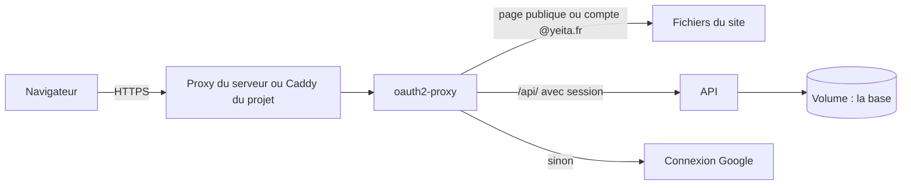

# Architecture et déploiement

> Le site tourne dans Docker sur le serveur OVH de Yeita, derrière une connexion Google @yeita.fr. Depuis la v1.3, l'API de stockage tourne à côté, dans son propre conteneur, et seul oauth2-proxy peut lui parler.

## En un coup d'œil

Le visiteur arrive en HTTPS sur `recrutement.yeita.fr`. oauth2-proxy joue le gardien : il sert les pages, ou envoie se connecter chez Google. Pour une adresse en `/api/`, il transmet la demande à l'API avec l'email du compte. Sans session, il répond un refus au lieu d'une redirection.

## Les éléments principaux

### Deux images
| Image | Ce qu'elle contient | Depuis |
|---|---|---|
| Site (`front`) | le site construit par Python, servi par oauth2-proxy lui-même | v1.1 |
| API (`api`) | l'API en Node.js 22, sur une image figée à une version précise | v1.3 |

L'image de l'API ne tourne pas en administrateur. Elle se dit saine seulement si la base répond et si son dossier de données accepte l'écriture. Sinon, Docker la signale malade et le déploiement s'arrête.

### Trois conteneurs, deux réseaux
| Conteneur | Réseaux | Ports sur le serveur |
|---|---|---|
| oauth2-proxy | public et interne | 4180, sur la machine elle-même |
| API | interne seul | aucun |
| Caddy (cas B) | public seul | 80 et 443 |

Le réseau interne n'a ni sortie vers Internet, ni adresse sur le serveur lui-même. Même un programme du serveur ne peut pas joindre l'API directement. C'est essentiel : l'API croit l'email que lui transmet oauth2-proxy.

### La base dans un volume
La base SQLite vit dans le volume `recrutement_data`. Il survit aux arrêts, aux mises à jour et aux retours en arrière. C'est la seule copie des candidatures.

> Jamais `docker compose down -v` ni `docker volume prune` sur le serveur : la base partirait avec.

### Cas A ou cas B
| Situation sur le serveur | Cas | Qui gère le HTTPS |
|---|---|---|
| Un proxy occupe déjà les ports web | A | le proxy existant |
| Rien sur les ports web | B | le Caddy du projet |
| Proxy dans Docker ou inconnu | — | rien n'est touché : le responsable du serveur décide |

### Les trois scripts
| Script | Qui le lance | À quoi il sert |
|---|---|---|
| Préparation du serveur | l'administrateur, une fois | crée l'utilisateur `deploy`, clone le dépôt, sans rien installer |
| Déploiement | `deploy`, à chaque mise à jour | met le serveur à jour, attend que le site puis l'API soient prêts, ou revient en arrière |
| Contrôle du site | tout le monde | vérifie 6 adresses, dont l'API refusée sans connexion |

Le déploiement n'attend l'API que si la version déployée en a une : un retour vers une version plus ancienne réussit sans elle, et le volume reste.

### Où ça tourne
| Endroit | Adresse | Pour quoi |
|---|---|---|
| Serveur OVH | `https://recrutement.yeita.fr` | la production, en mode serveur |
| Poste, avec Docker | `https://localhost` | la pile complète, API comprise |
| Poste, API et site sans Docker | `http://127.0.0.1:8000/candidatures/` | essayer le mode serveur, identité choisie au lancement |
| Poste, site seul | `http://localhost:8765` | les tests de navigateur, en mode navigateur |

## À savoir avant de modifier

- **Ne jamais publier de port pour l'API.** Elle ne doit rester joignable que par oauth2-proxy.
- **Ne pas toucher au réseau interne sans refaire les essais.** Ses réglages empêchent le serveur de joindre l'API ; ils ont été vérifiés sur la version de Docker du serveur.
- **Ne toucher qu'au projet.** Le serveur est partagé : le nettoyage ne vise que les images du projet.
- **Ajouter une page publique, c'est modifier la liste** dans la configuration d'oauth2-proxy.
- **Le dépôt du serveur doit rester propre.** Un fichier en trop entrerait dans l'image : le déploiement refuse de partir.
- **La première mise en service de l'API** suit une procédure à part : contrôle du réseau, puis premier admin (`deploy/README.md`).

## Voir aussi
- [Comment les pages choisissent où ranger les dossiers](mode-serveur.md)
- [L'API de stockage](api.md)
- [Décisions techniques](decisions.md)
- [Conventions et tests](conventions.md)
- [Lancer le site avec Docker sur ton poste](docker-local.md)
- Le mode d'emploi pas à pas du serveur : `deploy/README.md`
- Le détail (réglages, versions exactes, garde-fous de chaque script) est dans la version complète.
