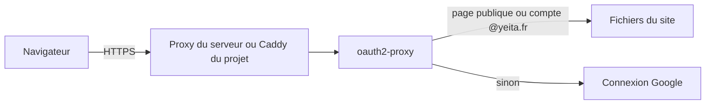

# Architecture et déploiement

> Depuis la v1.1, le site tourne dans Docker sur le serveur OVH de Yeita. Quelques pages restent publiques ; tout le reste demande un compte Google @yeita.fr. Les données restent dans le navigateur.

## En un coup d'œil

Le visiteur arrive en HTTPS sur `recrutement.yeita.fr`. Un proxy transmet la visite à oauth2-proxy, qui joue le rôle de gardien. Il sert la page si elle est publique ou si le visiteur est connecté ; sinon, il l'envoie se connecter chez Google.

## Les éléments principaux

### L'image du site
Une seule image Docker, construite en deux temps. D'abord, Python construit le site à partir du dépôt. Ensuite, le site est rangé dans oauth2-proxy (v7.15.5), qui le sert lui-même : pas de serveur web séparé.

### oauth2-proxy, le gardien
Il n'écoute que sur la machine elle-même (port 4180), jamais directement sur Internet. Il n'accepte que les comptes Google @yeita.fr. Les secrets (identifiants Google, secret des cookies) sont dans un fichier `.env` qui ne quitte jamais le serveur.

### Les pages publiques
Une liste fermée : la page d'accueil, le one-pager, le kit Yeita Match, leurs feuilles de style et scripts, et les téléchargements. Une page qui n'y figure pas est protégée.

> Le one-pager est la page envoyée aux candidats dans les mails (`https://recrutement.yeita.fr/one-pager.html`). Il doit rester dans la liste publique.

### Cas A ou cas B
Le serveur est partagé : on ne sait pas d'avance ce qui y tourne.

| Situation sur le serveur | Cas | Qui gère le HTTPS |
|---|---|---|
| Un proxy (nginx, Caddy) occupe déjà les ports web | A | Le proxy existant, à qui on ajoute le site |
| Rien sur les ports web | B | Le Caddy du projet, allumé par le profil Compose `caddy` |
| Proxy dans Docker ou inconnu | — | Rien n'est touché : le responsable du serveur décide |

### Les trois scripts
| Script | Qui le lance | À quoi il sert |
|---|---|---|
| Préparation du serveur | l'administrateur, une fois | crée l'utilisateur `deploy`, clone le dépôt, sans rien installer |
| Déploiement | `deploy`, à chaque mise à jour | met le serveur sur la dernière version de `main`, ou revient à une version antérieure |
| Contrôle du site | tout le monde | vérifie 5 adresses : pages publiques ouvertes, pages protégées renvoyées vers Google |

Les deux premiers vérifient tout avant d'agir et s'arrêtent au moindre doute. En cas d'échec, le déploiement affiche la commande pour revenir à la version précédente.

### Où ça tourne
| Endroit | Adresse | Connexion |
|---|---|---|
| Poste, comme le serveur (cas B) | `https://localhost` | redirection vers Google visible, connexion impossible (faux identifiants) |
| Poste, sans Docker | `http://localhost:8765` | aucune : sert aux tests de navigateur |
| Serveur OVH | `https://recrutement.yeita.fr` | compte Google @yeita.fr |

## À savoir avant de modifier

- **Ne toucher qu'au projet.** Le serveur partagé fait tourner d'autres services : le nettoyage ne vise que les images du projet, le port n'est publié que sur la machine elle-même.
- **Ajouter une page publique, c'est modifier la liste** dans la configuration d'oauth2-proxy. Sans cela, la nouvelle page demande une connexion.
- **Ne pas faire confiance aux en-têtes du proxy.** Cela ouvrirait une page protégée sans connexion. Conséquence : les journaux ne montrent pas l'adresse des visiteurs (voir les décisions).
- **Le dépôt du serveur doit rester propre.** Un fichier en trop, comme une copie de `.env`, entrerait dans l'image : le déploiement refuse de partir.

## Voir aussi
- [Décisions techniques](decisions.md)
- [Conventions et tests](conventions.md)
- Le mode d'emploi pas à pas du serveur : `deploy/README.md`
- Le détail (réglages, ports, garde-fous de chaque script) est dans la version complète.
