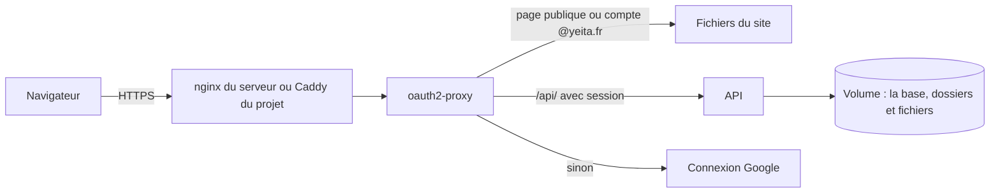
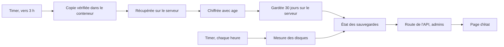
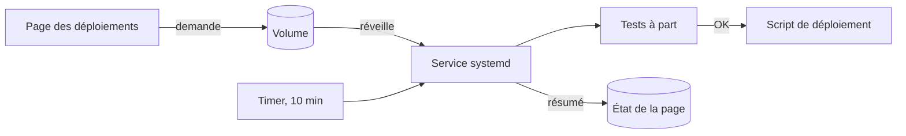

# Architecture et déploiement

> Le site tourne dans Docker sur le serveur OVH de Yeita, derrière une connexion Google @yeita.fr. L'API de stockage tourne à côté, dans son propre conteneur, et seul oauth2-proxy peut lui parler. Depuis la v1.7, la base est sauvegardée chaque nuit, chiffrée, **sur le serveur lui-même**. Depuis la v1.9, le serveur met lui-même `main` en ligne, après les tests. Depuis la v1.10, la base garde aussi les CV et portfolios déposés : les sauvegardes grossissent, et le nginx du serveur doit accepter des envois de 10 Mo.

## En un coup d'œil

Le visiteur arrive en HTTPS sur `recrutement.yeita.fr`. oauth2-proxy joue le gardien : il sert les pages, ou envoie se connecter chez Google. Pour une adresse en `/api/`, il transmet la demande à l'API avec l'email du compte ; sans session, il répond un refus au lieu d'une redirection.

## Les éléments principaux

### Deux images
| Image | Ce qu'elle contient | Depuis |
|---|---|---|
| Site (`front`) | le site construit par Python, servi par oauth2-proxy lui-même | v1.1 |
| API (`api`) | l'API en Node.js 22, sur une image figée à une version précise | v1.3 |

L'image de l'API ne tourne pas en administrateur. Elle se dit saine seulement si la base répond et si son dossier de données accepte l'écriture.

### Trois conteneurs, deux réseaux
| Conteneur | Réseaux | Ports sur le serveur |
|---|---|---|
| oauth2-proxy | public et interne | 4180, sur la machine elle-même |
| API | interne seul | aucun |
| Caddy (cas B) | public seul | 80 et 443 |

Le réseau interne n'a ni sortie vers Internet, ni adresse sur le serveur. Même un programme du serveur ne peut pas joindre l'API directement. C'est essentiel : l'API croit l'email que lui transmet oauth2-proxy.

### La base dans un volume
La base SQLite vit dans le volume `recrutement_data`. Il survit aux arrêts, aux mises à jour et aux retours en arrière. Depuis la v1.10, la base contient aussi le contenu des CV et portfolios déposés. Le volume garde en plus la copie de travail de la nuit, l'état des sauvegardes et, depuis la v1.9, l'état du déploiement automatique et la demande déposée par la page.

> Jamais `docker compose down -v` ni `docker volume prune` sur le serveur : la base partirait avec.

### Cas A ou cas B
| Situation sur le serveur | Cas | Qui gère le HTTPS |
|---|---|---|
| Un proxy occupe déjà les ports web (le serveur OVH : nginx) | A | le proxy existant |
| Rien sur les ports web | B | le Caddy du projet |
| Proxy dans Docker ou inconnu | — | rien n'est touché : le responsable du serveur décide |

> **Depuis la v1.10, en cas A avec nginx**, le site doit avoir le réglage `client_max_body_size 10m`. Sans lui, nginx refuse tout envoi de plus de 1 Mo, donc la plupart des CV, avant même l'API. Le réglage se pose avant le merge de la v1.10 (voir la mise en production). oauth2-proxy et Caddy, eux, laissent passer 10 Mo (vérifié).

### La sauvegarde de chaque nuit (v1.7)

Un timer systemd lance la sauvegarde entre 3 h et 3 h 15, sous le compte `deploy`. La copie en clair est supprimée dès qu'elle est chiffrée, et aussi en cas d'échec. Le serveur ne connaît que la clé publique : il peut chiffrer, pas relire.

| Où | Ce qui est gardé | Combien de temps |
|---|---|---|
| Dans le volume, à côté de la base | la copie de travail, en clair | 2 jours (3 au plus) |
| Sur le serveur (`/var/backups/recrutement`) | les copies chiffrées | 30 jours, effacées seulement après une sauvegarde réussie |

Depuis la v1.10, chaque copie contient les fichiers des candidats. Ordre de grandeur mesuré : 60 fichiers (116 Mo) donnent une copie de 117 Mo ; avec 30 copies chiffrées et 3 dans le volume, environ 3,9 Go. Le contrôle du disque passe au rouge au-delà de 80 %.

> Les copies restent **sur le serveur**. Si le serveur est perdu, les sauvegardes le sont aussi.

### Les scripts
| Script | Qui le lance | À quoi il sert |
|---|---|---|
| Préparation du serveur | l'administrateur, une fois | crée l'utilisateur `deploy`, clone le dépôt, sans rien installer ; vérifie aussi qu'age est là |
| Déploiement | `deploy`, à la main ; depuis la v1.9, surtout le déploiement automatique | met le serveur à jour, attend le site puis l'API, ou revient en arrière ; règle lui-même les droits des fichiers ; lancé à la main sur un ancien commit, met l'automatisme en pause |
| Déploiement automatique (v1.9) | un timer toutes les 10 minutes, une demande de la page, ou `deploy` à la main | teste le dernier commit de `main` à part, le met en ligne, revient en arrière s'il le faut |
| Sauvegarde (v1.7) | le timer de la nuit, ou `deploy` à la main | copie, chiffre, fait le ménage, écrit le résultat |
| Contrôle du disque (v1.7) | le timer horaire | mesure les deux disques, rouge au-delà de 80 % |
| Contrôle du site | tout le monde | vérifie 8 adresses, dont les deux pages d'administration renvoyées vers Google et l'API refusée sans connexion |

Une sauvegarde et un déploiement ne se chevauchent jamais : chacun attend la fin de l'autre, ou s'arrête en le disant.

### Le déploiement automatique (v1.9)

Trois unités systemd font tourner `deploy/auto-deploy.sh` sous le compte `deploy`. Les tests et la construction tournent dans des conteneurs et des images d'essai : le site en ligne n'est jamais touché. Le serveur garde ses décisions dans son propre dossier ; l'application ne fait que déposer des demandes. Le détail est dans [Déploiement automatique](deploiement-automatique.md).

### Où ça tourne
| Endroit | Adresse | Pour quoi |
|---|---|---|
| Serveur OVH | `https://recrutement.yeita.fr` | la production, en mode serveur, mise à jour toute seule depuis la v1.9 |
| Poste, avec Docker | `https://localhost` | la pile complète, API comprise |
| Poste, API et site sans Docker | `http://127.0.0.1:8000/candidatures/` | essayer le mode serveur (dépôt de fichiers compris), identité choisie au lancement |
| Poste, site seul | `http://localhost:8765` | les tests de navigateur, en mode navigateur (CV et portfolio en lien seulement) |

## À savoir avant de modifier

- **Ne jamais publier de port pour l'API.** Elle ne doit rester joignable que par oauth2-proxy.
- **Ne pas toucher au réseau interne sans refaire les essais.** Ses réglages ont été vérifiés sur la version de Docker du serveur.
- **Ne toucher qu'au projet.** Le serveur est partagé : le nettoyage ne vise que les images du projet, les unités systemd portent le préfixe `recrutement-`, et le réglage nginx ne touche que le site `recrutement.yeita.fr`.
- **Un réglage du serveur dont une version a besoin se pose avant le merge.** Depuis le déploiement automatique, le merge met la version en ligne sous 10 minutes.
- **Ajouter une page publique, c'est modifier la liste** dans la configuration d'oauth2-proxy. Les pages d'administration, et l'API qui sert les fichiers, restent protégées.
- **Le dépôt du serveur doit rester propre.** Un fichier en trop entrerait dans l'image : le déploiement refuse de partir.
- **Une unité systemd changée n'est jamais écrasée** par la commande d'installation : elle affiche la différence, et l'administrateur décide.
- **Avant une maintenance de Docker, arrête les timers et l'unité des demandes, puis attends la fin d'un passage.** La première commande `docker` relancerait Docker.
- **Surveille la place des sauvegardes.** Avec les fichiers, elles pèsent plusieurs gigaoctets ; la page d'état passe au rouge quand le disque dépasse 80 %.
- **La clé secrète de sauvegarde ne va jamais sur le serveur.**

## Voir aussi
- [Comment les pages choisissent où ranger les dossiers](mode-serveur.md)
- [L'API de stockage](api.md)
- [Décisions techniques](decisions.md)
- [Conventions et tests](conventions.md)
- [Déployer sur OVH, pas à pas](deploiement-ovh.md)
- [Lancer le site avec Docker sur ton poste](docker-local.md)
- [Le déploiement automatique](deploiement-automatique.md)
- [Mettre à jour le site en production](mise-a-jour-production.md)
- [Fiche du candidat, CV et portfolio](../doc/produit/fiche-candidat.md)
- Le mode d'emploi du serveur : `deploy/README.md` ; mettre à jour : `deploy/METTRE-A-JOUR.md` ; la clé : `deploy/CLE-SAUVEGARDE.md` ; restaurer : `deploy/RESTAURER.md`
- Le détail (réglages, versions exactes, garde-fous de chaque script) est dans la version complète.
