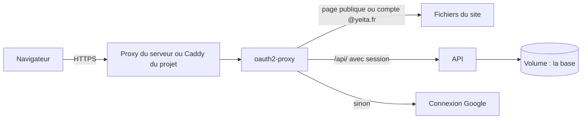
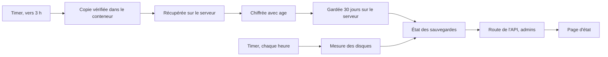
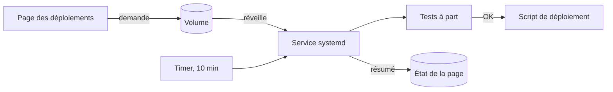

# Architecture et déploiement

> Le site tourne dans Docker sur le serveur OVH de Yeita, derrière une connexion Google @yeita.fr. L'API de stockage tourne à côté, dans son propre conteneur, et seul oauth2-proxy peut lui parler. Depuis la v1.7, la base est sauvegardée chaque nuit, chiffrée, **sur le serveur lui-même**. Depuis la v1.9, le serveur met lui-même `main` en ligne, après les tests. Deux pages réservées aux admins disent où en sont les sauvegardes et les mises en ligne.

## En un coup d'œil

Le visiteur arrive en HTTPS sur `recrutement.yeita.fr`. oauth2-proxy joue le gardien : il sert les pages, ou envoie se connecter chez Google. Pour une adresse en `/api/`, il transmet la demande à l'API avec l'email du compte ; sans session, il répond un refus au lieu d'une redirection.

## Les éléments principaux

### Deux images
| Image | Ce qu'elle contient | Depuis |
|---|---|---|
| Site (`front`) | le site construit par Python, servi par oauth2-proxy lui-même | v1.1 |
| API (`api`) | l'API en Node.js 22, sur une image figée à une version précise | v1.3 |

L'image de l'API ne tourne pas en administrateur. Elle se dit saine seulement si la base répond et si son dossier de données accepte l'écriture.

### Trois conteneurs, deux réseaux
| Conteneur | Réseaux | Ports sur le serveur |
|---|---|---|
| oauth2-proxy | public et interne | 4180, sur la machine elle-même |
| API | interne seul | aucun |
| Caddy (cas B) | public seul | 80 et 443 |

Le réseau interne n'a ni sortie vers Internet, ni adresse sur le serveur. Même un programme du serveur ne peut pas joindre l'API directement. C'est essentiel : l'API croit l'email que lui transmet oauth2-proxy.

### La base dans un volume
La base SQLite vit dans le volume `recrutement_data`. Il survit aux arrêts, aux mises à jour et aux retours en arrière. Depuis la v1.7, il contient aussi la copie de travail de la nuit et l'état des sauvegardes ; depuis la v1.9, l'état du déploiement automatique et la demande déposée par la page.

> Jamais `docker compose down -v` ni `docker volume prune` sur le serveur : la base partirait avec.

### La sauvegarde de chaque nuit (v1.7)

Un timer systemd lance la sauvegarde entre 3 h et 3 h 15, sous le compte `deploy`. La copie en clair est supprimée dès qu'elle est chiffrée, et aussi en cas d'échec ou d'arrêt forcé. Le serveur ne connaît que la clé publique : il peut chiffrer, pas relire.

| Où | Ce qui est gardé | Combien de temps |
|---|---|---|
| Dans le volume, à côté de la base | la copie de travail, en clair | 2 jours (3 au plus) |
| Sur le serveur (`/var/backups/recrutement`) | les copies chiffrées | 30 jours, effacées seulement après une sauvegarde réussie |

> Les copies restent **sur le serveur** (reprise de la v1.7 : plus d'envoi chez OVH Object Storage). Si le serveur est perdu, les sauvegardes le sont aussi.

Chaque passage écrit son résultat dans l'état des sauvegardes, trois petits fichiers du volume, sans aucune donnée de candidat. L'écriture passe par un conteneur jetable : elle marche même API arrêtée. La route de l'API les lit, et la page `admin/sauvegardes.html` les affiche en vert ou en rouge. Aucune alerte n'est envoyée.

### Cas A ou cas B
| Situation sur le serveur | Cas | Qui gère le HTTPS |
|---|---|---|
| Un proxy occupe déjà les ports web | A | le proxy existant |
| Rien sur les ports web | B | le Caddy du projet |
| Proxy dans Docker ou inconnu | — | rien n'est touché : le responsable du serveur décide |

### Les scripts
| Script | Qui le lance | À quoi il sert |
|---|---|---|
| Préparation du serveur | l'administrateur, une fois | crée l'utilisateur `deploy`, clone le dépôt, sans rien installer ; depuis la v1.7, vérifie aussi qu'age est là |
| Déploiement | `deploy`, à la main ; depuis la v1.9, surtout le déploiement automatique | met le serveur à jour, attend le site puis l'API, ou revient en arrière ; depuis la v1.8, règle lui-même les droits des fichiers (`umask 022`) ; depuis la v1.9, note le commit mis en ligne et, lancé à la main sur un ancien commit, met l'automatisme en pause |
| Déploiement automatique (v1.9) | un timer toutes les 10 minutes, une demande de la page, ou `deploy` à la main | teste le dernier commit de `main` à part, le met en ligne par le script de déploiement, revient en arrière s'il le faut |
| Sauvegarde (v1.7) | le timer de la nuit, ou `deploy` à la main | copie, chiffre, fait le ménage, écrit le résultat |
| Contrôle du disque (v1.7) | le timer horaire | mesure les deux disques, rouge au-delà de 80 % |
| Contrôle du site | tout le monde | vérifie 8 adresses, dont les deux pages d'administration renvoyées vers Google et l'API refusée sans connexion |

Une sauvegarde et un déploiement ne se chevauchent jamais : la sauvegarde attend jusqu'à 10 minutes la fin d'un déploiement, et un déploiement lancé pendant une sauvegarde s'arrête en le disant. Le déploiement automatique, lui, attend jusqu'à 15 minutes la fin d'une sauvegarde.

### Le déploiement automatique (v1.9)

Trois unités systemd font tourner `deploy/auto-deploy.sh` sous le compte `deploy` : un service, un timer de 10 minutes et une unité qui se réveille quand une demande arrive dans le volume. Les tests et la construction tournent dans des conteneurs et des images d'essai : le site en ligne n'est jamais touché. Le serveur garde ses décisions dans son propre dossier ; l'application ne fait que déposer des demandes. Le détail est dans [Déploiement automatique](deploiement-automatique.md).

### Où ça tourne
| Endroit | Adresse | Pour quoi |
|---|---|---|
| Serveur OVH | `https://recrutement.yeita.fr` | la production, en mode serveur, mise à jour toute seule depuis la v1.9 |
| Poste, avec Docker | `https://localhost` | la pile complète, API comprise |
| Poste, API et site sans Docker | `http://127.0.0.1:8000/candidatures/` | essayer le mode serveur, identité choisie au lancement |
| Poste, site seul | `http://localhost:8765` | les tests de navigateur, en mode navigateur |

## À savoir avant de modifier

- **Ne jamais publier de port pour l'API.** Elle ne doit rester joignable que par oauth2-proxy.
- **Ne pas toucher au réseau interne sans refaire les essais.** Ses réglages ont été vérifiés sur la version de Docker du serveur.
- **Ne toucher qu'au projet.** Le serveur est partagé : le nettoyage ne vise que les images du projet, et les unités systemd portent le préfixe `recrutement-`.
- **Ajouter une page publique, c'est modifier la liste** dans la configuration d'oauth2-proxy. Les pages d'administration, elles, doivent rester protégées.
- **Le dépôt du serveur doit rester propre.** Un fichier en trop entrerait dans l'image : le déploiement refuse de partir.
- **Une unité systemd changée n'est jamais écrasée** par la commande d'installation : elle affiche la différence, et l'administrateur décide.
- **Avant une maintenance de Docker, arrête les timers et l'unité des demandes, puis attends la fin d'un passage.** Les unités ne demandent pas Docker, mais la première commande `docker` d'une sauvegarde ou d'un passage le relancerait.
- **Le déploiement automatique décide sur ses propres fichiers**, jamais sur ce qu'écrit l'application. Il ne lit dans le volume que la demande, par un conteneur jetable.
- **Le volume doit rester là où l'unité des demandes le surveille** (`/var/lib/docker/volumes/…`). La commande d'installation le vérifie et refuse sinon.
- **La clé secrète de sauvegarde ne va jamais sur le serveur.** C'est un fichier gardé hors du serveur par une ou deux personnes ; sans lui, les copies sont illisibles.
- **Les scripts écrivent l'état dans `/data/etat`.** Si le chemin de la base change dans l'image, il faut les changer avec.

## Voir aussi
- [Comment les pages choisissent où ranger les dossiers](mode-serveur.md)
- [L'API de stockage](api.md)
- [Décisions techniques](decisions.md)
- [Conventions et tests](conventions.md)
- [Déployer sur OVH, pas à pas](deploiement-ovh.md)
- [Lancer le site avec Docker sur ton poste](docker-local.md)
- [Le déploiement automatique](deploiement-automatique.md)
- [Mettre à jour le site en production](mise-a-jour-production.md)
- Le mode d'emploi du serveur : `deploy/README.md` ; mettre à jour : `deploy/METTRE-A-JOUR.md` ; la clé : `deploy/CLE-SAUVEGARDE.md` ; restaurer : `deploy/RESTAURER.md`
- Le détail (réglages, versions exactes, garde-fous de chaque script) est dans la version complète.
