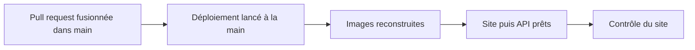

# Conventions et tests

> Comment le dépôt est rangé, publié et testé. Le site est publié à la main sur le serveur OVH, avec Docker. En v1.3, le mode serveur des pages arrive avec deux nouveaux tests, et l'API reçoit sa propre image Docker.

## Où se trouve quoi

| Dossier | Ce qu'on y trouve |
|---|---|
| racine | les pages du site |
| `candidatures/` | l'espace Candidatures des recruteurs |
| `assets/` | ce que les pages partagent : charte, données, textes, dossier candidat, et depuis la v1.3 le démarrage et l'adaptateur du mode serveur |
| `docs/` | le modèle de données (`docs/backend/MODELE.md` fait foi) |
| `tools/` | la construction du site, les tests, le contrôle du site déployé |
| `docker/` | les recettes des images du site (v1.1) et de l'API (v1.3) |
| `deploy/` | la configuration et les scripts du serveur, et leur mode d'emploi |
| `api/` | l'API de stockage, ses tests et son mode d'emploi (v1.2) |

Ne sont jamais commités : le fichier `.env` (les secrets), et dans `api/`, les bibliothèques installées et la base de données. Ils n'entrent pas non plus dans les images.

## Publier

Le script de construction copie le dépôt sans ce qui ne doit pas être servi : outils, docs, fichiers Docker, trace Hlýja, fichiers `.env`, dossier `api/`.

## Tester

| Test | Ce qu'il vérifie | Ce qu'il demande |
|---|---|---|
| Règles du parcours | le dossier candidat et ses étapes | Node |
| Mode serveur sans navigateur (v1.3) | démarrage, adaptateur, bandeau, identité, options, fiches, contre une fausse API | Node 22 |
| Quatre tests de navigateur | tableau, parcours, liens, exports PDF, en mode navigateur | le site servi sur le port 8765, Playwright pour Python |
| Mode serveur de bout en bout (v1.3) | trois navigateurs (deux recruteurs, une lectrice) sur l'API réelle | le site construit, l'API installée, Playwright |
| Tests de l'API | réglages, base, droits, dossiers, conflits, commande d'équipe | Node 22, `npm ci` dans `api/` |
| Contrôle du site | pages publiques ouvertes, pages protégées renvoyées vers Google, API refusée sans connexion | `curl`, un site déployé ou la pile locale |

Chaque test affiche `OK` ou `FAIL` ligne par ligne, puis un verdict. Lis le verdict : les quatre tests de navigateur historiques se terminent sans code d'erreur même en cas d'échec (le test de bout en bout du mode serveur, lui, en rend un).

> Le test de bout en bout lance lui-même l'API, sur une base jetable. Chaque navigateur y porte son identité, comme derrière oauth2-proxy. Les pannes du proxy et du réseau y sont simulées.

Sans Playwright sur le poste, tous ces tests tournent dans un conteneur jetable ; la commande exacte est dans la version complète.

### Une erreur attendue
En mode navigateur, chaque page demande l'API et reçoit « pas de page ici ». Le navigateur l'écrit comme une erreur. Deux tests de navigateur l'écartent, et seulement celle-là : toute autre erreur compte toujours.

## Les règles du serveur partagé

| Règle | En clair |
|---|---|
| Versions figées | oauth2-proxy, Caddy et l'image Node de l'API sont fixés à une version précise |
| Secrets dans `.env` seulement | rien de secret dans le dépôt |
| Jamais de commande Docker globale | le nettoyage ne vise que les images du projet |
| Jamais d'effacement du volume de la base | c'est la seule copie des candidatures |

> Les scripts du serveur ne s'essaient jamais sur le serveur : on les rejoue dans un conteneur qui imite un serveur neuf.

## Écrire du code

- Le code, les noms et les messages sont en français.
- Les textes affichés par les pages vivent dans `assets/wording.fr.js`.
- L'API n'emprunte rien aux pages : les valeurs partagées sont recopiées dans un seul fichier, avec leur source.
- Chaque test travaille sur une base jetable et arrête ce qu'il a lancé.

## Branches

Une branche par sujet, puis une pull request vers `main`.

## Voir aussi
- [Comment les pages choisissent où ranger les dossiers](mode-serveur.md)
- [L'API de stockage](api.md)
- [Architecture et déploiement](architecture.md)
- [Décisions techniques](decisions.md)
- [Lancer le site avec Docker sur ton poste](docker-local.md)
- Les commandes exactes et les versions des outils de test sont dans la version complète.
