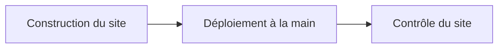

# Conventions et tests

> Comment le dépôt est rangé, publié et testé. Le site est publié à la main sur le serveur OVH, avec Docker. En v1.7 arrivent les fichiers des sauvegardes (unités systemd, procédure de restauration) et un banc de test pour les scripts de sauvegarde.

## Où se trouve quoi

| Dossier | Ce qu'on y trouve |
|---|---|
| racine | les pages du site ; quelques anciennes adresses renvoient vers `candidatures/` |
| `candidatures/` | l'espace Candidatures des recruteurs |
| `assets/` | ce que les pages partagent : dossier candidat, règles du parcours, textes, et depuis la v1.3 le démarrage et l'adaptateur du mode serveur |
| `docs/` | le modèle de données qui fait foi (`docs/backend/MODELE.md`) et son schéma |
| `tools/` | la construction du site, les tests, le contrôle du site déployé |
| `docker/` | les recettes des images du site (v1.1) et de l'API (v1.3) |
| `deploy/` | la configuration et les scripts du serveur, et leur mode d'emploi ; depuis la v1.7, les unités systemd (`deploy/systemd/`) et la procédure de restauration (`deploy/RESTAURER.md`) |
| `api/` | l'API de stockage, ses commandes (équipe, et sauvegarde depuis la v1.7), ses tests et son mode d'emploi (v1.2) |

Ne sont jamais commités : le fichier `.env` (les secrets), et dans `api/`, les bibliothèques installées et la base de données.

## Publier

Le script de construction copie le dépôt sans ce qui ne doit pas être servi : outils, docs, fichiers Docker et de déploiement, trace Hlýja, fichiers `.env`, dossier `api/`. Le site est ensuite déployé à la main sur le serveur OVH ; GitHub Pages n'est plus utilisé depuis la v1.1.

## Tester

| Test | Ce qu'il vérifie | Ce qu'il demande |
|---|---|---|
| Règles du parcours | le dossier candidat et ses étapes | Node |
| Mode serveur sans navigateur (v1.3) | démarrage, adaptateur, bandeau d'erreur, identité, options, fiches, bandeau jaune selon le mode, contre une fausse API ; 87 vérifications, environ 4 s | Node 22 |
| Quatre tests de navigateur | tableau, parcours, liens, exports PDF, en mode navigateur ; celui du tableau vérifie aussi le bandeau jaune et les boutons d'exemples | le site servi sur le port 8765, Playwright pour Python |
| Mode serveur de bout en bout (v1.3) | trois navigateurs (deux recruteurs, une lectrice) sur l'API réelle ; bandeau jaune des six pages et boutons d'exemples ; 51 vérifications | le site construit, l'API installée, Playwright |
| Tests de l'API | réglages, base, droits, dossiers, options, commande d'équipe, et depuis la v1.7 la commande de sauvegarde ; 55 tests | Node 22, `npm ci` dans `api/` |
| Scripts de sauvegarde (v1.7) | la sauvegarde et le contrôle du disque : réglages refusés, chaque échec signalé, aucune copie en clair laissée, ménage des vieilles copies, alertes ; 119 vérifications | un conteneur jetable Ubuntu 26.04, en root, avec Docker, age et rclone |
| Contrôle du site | pages publiques ouvertes, pages protégées renvoyées vers Google, API refusée sans connexion | `curl`, un site déployé ou la pile locale |

Chaque test affiche `OK` ou `FAIL` ligne par ligne, puis un verdict. Lis le verdict : deux tests de navigateur (tableau et parcours) se terminent sans code d'erreur même en cas d'échec. Celui des scripts de sauvegarde finit par `TOUT OK`, ou par `ÉCHECS :` suivi du nombre d'échecs.

> Le test de bout en bout lance lui-même l'API, sur une base jetable, puis l'arrête. Chaque navigateur y porte son identité, comme derrière oauth2-proxy. Les pannes du proxy et du réseau, et les lenteurs, y sont simulées.

### Tester les scripts de sauvegarde sans rien envoyer
Le banc remplace Docker, l'envoi vers OVH et la mesure du disque par de faux outils. Le chiffrement est le vrai. healthchecks.io est imité par un petit serveur local en HTTPS. Ainsi, chaque panne se provoque à la demande : API malade, copie ratée, chiffrement raté, envoi refusé, disque plein.

L'essai réel (vrai OVH, vrai healthchecks.io, vraies unités systemd) se fait une fois, à la mise en service sur le serveur.

Sans Playwright sur le poste, les tests de navigateur tournent dans un conteneur jetable ; la commande exacte est dans la version complète.

### Une erreur attendue
En mode navigateur, chaque page demande l'API et reçoit « pas de page ici ». Le navigateur l'écrit comme une erreur. Deux tests de navigateur l'écartent, et seulement celle-là : toute autre erreur compte toujours.

## Les règles du serveur partagé

| Règle | En clair |
|---|---|
| Versions figées | les images servies (oauth2-proxy, Caddy) sont fixées à une version précise |
| Secrets dans `.env` seulement | rien de secret dans le dépôt, y compris les adresses des contrôles healthchecks.io |
| Jamais de commande Docker globale | le nettoyage ne vise que ce qui porte l'étiquette du projet |
| Réglages dans `compose.yaml` | journaux et redémarrage se règlent dans le projet, jamais dans la configuration globale de Docker |

> Les scripts du serveur ne s'essaient jamais sur le serveur : on les rejoue dans un conteneur qui imite un serveur neuf. Depuis la v1.7, ce conteneur a le même système que le serveur (Ubuntu 26.04), et une variante fait tourner systemd pour essayer les timers.

Les scripts du serveur passent aussi `shellcheck` sans remarque. Il faut lui donner une langue qui accepte les accents, sinon il s'arrête ; la commande exacte est dans la version complète.

## Écrire du code

- Le code de l'API, ses noms et ses messages sont en français.
- Les textes affichés par les pages vivent dans `assets/wording.fr.js`.
- L'API n'emprunte rien aux pages : les valeurs partagées sont recopiées dans un seul fichier, avec leur source.
- Chaque test de l'API travaille sur une base jetable et arrête ce qu'il a lancé.

## Branches

Une branche par sujet, puis une pull request vers `main`.

## Voir aussi
- [Comment les pages choisissent où ranger les dossiers](mode-serveur.md)
- [L'API de stockage](api.md)
- [Architecture et déploiement](architecture.md)
- [Décisions techniques](decisions.md)
- [Lancer le site avec Docker sur ton poste](docker-local.md)
- Les commandes exactes et les versions des outils de test sont dans la version complète.
