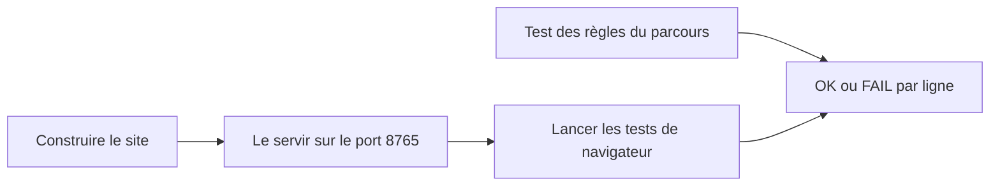

# Conventions et tests

> Le site se construit avec un petit script Python, se teste avec un test Node et quatre tests de navigateur, et chaque changement passe par une pull request.

## Où se trouve quoi

| Dossier | Ce qu'on y trouve |
|---|---|
| racine | les pages du site |
| `candidatures/` | l'espace Candidatures des recruteurs |
| `assets/` | ce que les pages partagent : charte, données, textes, dossier candidat |
| `docs/` | le modèle de données (`docs/backend/MODELE.md` fait foi) |
| `tools/` | la construction du site et les tests |

## Publier

Un push sur `main` publie le site automatiquement. Pour le construire chez soi : `python3 tools/build.py`.

## Tester

Le test des règles ne demande que Node. Les tests de navigateur demandent Playwright pour Python.

> Ce référentiel est encore partiel : il ne couvre que ce que la v1.0 a touché. Le détail est dans la version complète.
