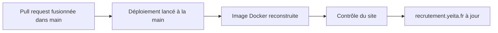

# Conventions et tests

> Comment le dépôt est rangé, publié et testé. Depuis la v1.1, le site est publié à la main sur le serveur OVH, avec Docker. En v1.2, le dossier de l'API rejoint le dépôt, avec ses propres tests.

## Où se trouve quoi

| Dossier | Ce qu'on y trouve |
|---|---|
| racine | les pages du site |
| `candidatures/` | l'espace Candidatures des recruteurs |
| `assets/` | ce que les pages partagent : charte, données, textes, dossier candidat |
| `docs/` | le modèle de données (`docs/backend/MODELE.md` fait foi) |
| `tools/` | la construction du site, les tests, le contrôle du site déployé |
| `docker/` | la recette de l'image du site (v1.1) |
| `deploy/` | la configuration et les scripts du serveur, et leur mode d'emploi (v1.1) |
| `api/` | l'API de stockage, ses tests et son mode d'emploi (v1.2) |

Ne sont jamais commités : le fichier `.env` (les secrets), et dans `api/`, les bibliothèques installées et la base de données.

## Publier

Le script de construction copie le dépôt sans ce qui ne doit pas être servi : outils, docs, fichiers Docker, trace Hlýja, tout fichier `.env`, et depuis la v1.2 le dossier `api/`. Pour construire chez soi : `python3 tools/build.py`.

## Les règles du serveur partagé

| Règle | En clair |
|---|---|
| Versions figées | oauth2-proxy et Caddy sont fixés à une version précise ; seule l'image Python qui construit le site suit la 3.12 |
| Secrets dans `.env` seulement | rien de secret dans le dépôt |
| Jamais de commande Docker globale | le nettoyage ne vise que les images du projet |
| Réglages dans `compose.yaml` | journaux et redémarrage réglés pour le projet, jamais pour tout Docker |

## Tester

| Test | Ce qu'il vérifie | Ce qu'il demande |
|---|---|---|
| Règles du parcours | le dossier candidat et ses étapes | Node |
| Quatre tests de navigateur | tableau, parcours, liens, exports PDF | le site servi sur le port 8765, Playwright pour Python |
| Tests de l'API (v1.2) | réglages, base, droits d'accès, dossiers, conflits, commande d'équipe, démarrage | Node 22, `npm ci` dans `api/` |
| Contrôle du site (v1.1) | pages publiques ouvertes, pages protégées renvoyées vers Google | `curl`, un site déployé ou lancé en local |

Chaque test de navigateur affiche `OK` ou `FAIL` ligne par ligne. Sans Playwright sur le poste, ils tournent dans un conteneur jetable.

Les tests de l'API se lancent par `cd api && npm test`. Il y en a 52, pour une vingtaine de secondes : quelques-uns attendent exprès que la base cesse d'être occupée.

> Les scripts du serveur ne s'essaient jamais sur le serveur : on les rejoue dans un conteneur qui imite un serveur neuf.

## Écrire du code dans l'API

- Le code, les noms et les messages sont en français.
- L'API n'emprunte rien aux pages : les valeurs qu'elle partage avec elles (format des identifiants, étapes, options de base) sont recopiées dans un seul fichier, avec leur source.
- Chaque test travaille sur une base jetable et arrête ce qu'il a lancé.
- Aucun outil de test à installer : seul celui fourni avec Node.js.

## Branches

Une branche par sujet, puis une pull request vers `main`.

## Voir aussi
- [L'API de stockage](api.md)
- [Architecture et déploiement](architecture.md)
- [Décisions techniques](decisions.md)
- [Lancer le site avec Docker sur ton poste](docker-local.md)
- Les commandes exactes et les versions des outils de test sont dans la version complète.
