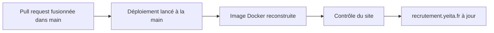

# Conventions et tests

> Comment le dépôt est rangé, publié et testé. Depuis la v1.1, le site est publié à la main sur le serveur OVH, avec Docker ; GitHub Pages n'est plus utilisé.

## Où se trouve quoi

| Dossier | Ce qu'on y trouve |
|---|---|
| racine | les pages du site |
| `candidatures/` | l'espace Candidatures des recruteurs |
| `assets/` | ce que les pages partagent : charte, données, textes, dossier candidat |
| `docs/` | le modèle de données (`docs/backend/MODELE.md` fait foi) |
| `tools/` | la construction du site, les tests, le contrôle du site déployé |
| `docker/` | la recette de l'image du site (v1.1) |
| `deploy/` | la configuration et les scripts du serveur, et leur mode d'emploi (v1.1) |

Le fichier `.env` contient les secrets : il n'est jamais commité.

## Publier

Le script de construction copie le dépôt sans ce qui ne doit pas être servi : outils, docs, fichiers Docker, trace Hlýja, et tout fichier `.env`. Pour construire chez soi : `python3 tools/build.py`.

## Les règles du serveur partagé

| Règle | En clair |
|---|---|
| Versions figées | oauth2-proxy et Caddy sont fixés à une version précise ; seule l'image Python qui construit le site suit la 3.12 |
| Secrets dans `.env` seulement | rien de secret dans le dépôt |
| Jamais de commande Docker globale | le nettoyage ne vise que les images du projet |
| Réglages dans `compose.yaml` | journaux et redémarrage réglés pour le projet, jamais pour tout Docker |

## Tester

| Test | Ce qu'il vérifie | Ce qu'il demande |
|---|---|---|
| Règles du parcours | le dossier candidat et ses étapes | Node |
| Quatre tests de navigateur | tableau, parcours, liens, exports PDF | le site servi sur le port 8765, Playwright pour Python |
| Contrôle du site (v1.1) | pages publiques ouvertes, pages protégées renvoyées vers Google | `curl`, un site déployé ou lancé en local |

Chaque test affiche `OK` ou `FAIL` ligne par ligne. Sans Playwright sur le poste, les tests de navigateur tournent dans un conteneur jetable.

> Les scripts du serveur ne s'essaient jamais sur le serveur : on les rejoue dans un conteneur qui imite un serveur neuf.

## Branches

Une branche par sujet, puis une pull request vers `main`.

## Voir aussi
- [Architecture et déploiement](architecture.md)
- [Décisions techniques](decisions.md)
- [Lancer le site avec Docker sur ton poste](docker-local.md)
- Les commandes exactes et les versions des outils de test sont dans la version complète.
