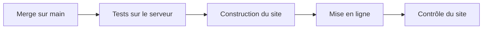

# Conventions et tests

> Comment le dépôt est rangé, publié et testé. Le site tourne sur le serveur OVH, avec Docker. En v1.7 arrivent les fichiers des sauvegardes, une première page d'administration et un banc de test pour leurs scripts. En v1.9, le serveur publie lui-même `main` après les tests ; arrivent une deuxième page d'administration et un banc de test pour le déploiement automatique.

## Où se trouve quoi

| Dossier | Ce qu'on y trouve |
|---|---|
| racine | les pages du site ; quelques anciennes adresses renvoient vers `candidatures/` |
| `candidatures/` | l'espace Candidatures des recruteurs |
| `admin/` (v1.7) | les pages d'administration : l'état des sauvegardes (v1.7) et les déploiements (v1.9) ; protégées par la connexion Google, sans lien depuis Candidatures |
| `assets/` | ce que les pages partagent : dossier candidat, règles du parcours, textes, démarrage et adaptateur du mode serveur |
| `docs/` | le modèle de données qui fait foi (`docs/backend/MODELE.md`) et son schéma |
| `tools/` | la construction du site, les tests, le contrôle du site déployé |
| `docker/` | les recettes des images du site (v1.1) et de l'API (v1.3) |
| `deploy/` | la configuration et les scripts du serveur, et leur mode d'emploi ; depuis la v1.7, les unités systemd (`deploy/systemd/`) et trois pages : la clé (`CLE-SAUVEGARDE.md`), la mise à jour (`METTRE-A-JOUR.md`), la restauration (`RESTAURER.md`) ; depuis la v1.9, le déploiement automatique (`auto-deploy.sh`) et ses unités |
| `api/` | l'API de stockage, ses commandes (équipe, et sauvegarde depuis la v1.7), ses tests et son mode d'emploi |

Ne sont jamais commités : le fichier `.env` (les secrets), et dans `api/`, les bibliothèques installées et la base de données.

## Publier



Le script de construction copie le dépôt sans ce qui ne doit pas être servi : outils, docs, fichiers Docker et de déploiement, trace Hlýja, fichiers `.env`, dossier `api/`. Le dossier `admin/` est publié, mais protégé. Depuis la v1.9, le serveur teste puis met en ligne le dernier commit de `main` tout seul, sous 10 minutes ; la mise à jour à la main reste le secours. Il n'y a pas de GitHub Actions.

## Tester

| Test | Ce qu'il vérifie | Ce qu'il demande |
|---|---|---|
| Règles du parcours | le dossier candidat et ses étapes | Node |
| Mode serveur sans navigateur | démarrage, adaptateur, bandeaux, identité, options, fiches, contre une fausse API ; 87 vérifications | Node 22 |
| Quatre tests de navigateur | tableau, parcours, liens, exports PDF, en mode navigateur | le site servi sur le port 8765, Playwright pour Python |
| Mode serveur de bout en bout | trois navigateurs (deux recruteurs, une lectrice) sur l'API réelle ; depuis la v1.9, la page des déploiements avec un état d'exemple par verdict ; 81 vérifications | le site construit, l'API installée, Playwright |
| Tests de l'API | réglages, base, droits, dossiers, options, commande d'équipe, et depuis la v1.7 la commande de sauvegarde et la route de l'état ; depuis la v1.9 les routes du déploiement ; 65 tests | Node 22, `npm ci` dans `api/` |
| Scripts de sauvegarde (v1.7) | sauvegarde et contrôle du disque : réglages refusés, chaque échec écrit dans l'état, aucune copie en clair laissée, ménage des vieilles copies, disques ; 102 vérifications | un conteneur jetable Ubuntu 26.04, en root, avec Docker, age, et `BANC_JETABLE=oui` |
| Déploiement automatique (v1.9) | le script de déploiement automatique et la pause de `deploy.sh` : demandes refusées, tests KO, retour automatique, annulation, verrous, état de la page ; 95 vérifications | un conteneur jetable Ubuntu 26.04, en root, avec Docker, git, python3, et `AUTO_DEPLOY_JETABLE=oui` |
| Contrôle du site | pages publiques ouvertes, pages protégées (dont les deux pages d'administration) renvoyées vers Google, API refusée sans connexion ; 8 contrôles | `curl`, un site déployé ou la pile locale |

Chaque test affiche `OK` ou `FAIL` ligne par ligne, puis un verdict. **Lis le verdict** : deux tests de navigateur (tableau et parcours) se terminent sans code d'erreur même en cas d'échec. Les bancs des scripts du serveur finissent par `TOUT OK`, ou par `ÉCHECS :` suivi du nombre d'échecs.

### Tester les scripts de sauvegarde
Le banc remplace Docker et la mesure du disque par de faux outils ; le chiffrement est le vrai. Chaque panne se provoque ainsi à la demande : API malade, copie ratée, chiffrement raté, disque plein, clé refusée. Le faux Docker écrit l'état dans un faux volume, pour vérifier ce que la page affichera.

> Le banc **vide** `/var/backups/recrutement`. Il refuse de démarrer sans `BANC_JETABLE=oui`, et sur une machine où les unités sont installées hors conteneur. Ne le lance jamais sur le serveur.

```bash
docker run --rm -e BANC_JETABLE=oui -v "$PWD:/depot:ro" <image du banc> bash /depot/tools/test-sauvegarde.sh /depot
```

L'essai réel, avec les vraies unités systemd, se fait sur une variante du banc qui fait tourner systemd, puis une fois à la mise en service sur le serveur.

### Tester le déploiement automatique (v1.9)
Le banc rejoue des passages avec un faux Docker et un vrai dépôt git d'essai. Chaque commit d'essai dit quelle étape doit échouer : un test, la construction, la mise en ligne, le retour. Une dernière partie essaie le vrai `deploy.sh` (pause, commit noté en ligne).

> Le banc crée l'utilisateur `deploy` et efface des dossiers. Il refuse de démarrer sans `AUTO_DEPLOY_JETABLE=oui`, et hors d'un conteneur. Ne le lance jamais sur le serveur.

```bash
docker run --rm -e AUTO_DEPLOY_JETABLE=oui -v "$PWD:/depot:ro" <image du banc> bash /depot/tools/test-auto-deploy.sh /depot
```

Avec `--reel`, il tourne sur le banc systemd préparé, avec la vraie pile et les vraies unités : environ 25 minutes. Sur ce banc, un service en train de tourner est « activating », pas « active » : il faut attendre sur cet état.

## Les règles du serveur partagé

| Règle | En clair |
|---|---|
| Versions figées | les images servies (oauth2-proxy, Caddy) sont fixées à une version précise |
| Secrets dans `.env` seulement | rien de secret dans le dépôt ; la clé publique de sauvegarde n'est pas un secret, la clé privée ne va jamais sur le serveur |
| Jamais de commande Docker globale | le nettoyage ne vise que ce qui porte l'étiquette du projet |
| Réglages dans `compose.yaml` | journaux et redémarrage se règlent dans le projet, jamais dans la configuration globale de Docker |

> Les scripts du serveur ne s'essaient jamais sur le serveur : on les rejoue dans un conteneur qui imite un serveur neuf, sous Ubuntu 26.04 comme le serveur. Une variante fait tourner systemd pour essayer les timers.

Les scripts du serveur passent aussi `shellcheck` sans remarque. Depuis la v1.9, on le lance au format `gcc` : avec le format par défaut, il s'arrête sur une ligne accentuée, même avec une langue qui accepte les accents. La commande exacte est dans la version complète.

Pour s'assurer qu'un test attrape bien une erreur, on casse exprès le script dans une copie hors du dépôt, puis on relance le banc entier : il doit échouer.

## Écrire du code

- Le code de l'API, ses noms et ses messages sont en français.
- Les textes affichés par les pages vivent dans `assets/wording.fr.js`.
- L'API n'emprunte rien aux pages : les valeurs partagées sont recopiées dans un seul fichier, avec leur source.
- Chaque test de l'API travaille sur une base jetable et arrête ce qu'il a lancé.
- Les scripts du serveur ont leur corps dans une fonction `main`, refusent root, et s'arrêtent avec un message clair.

## Branches

Une branche par sujet, puis une pull request vers `main`.

## Voir aussi
- [Comment les pages choisissent où ranger les dossiers](mode-serveur.md)
- [L'API de stockage](api.md)
- [Architecture et déploiement](architecture.md)
- [Décisions techniques](decisions.md)
- [Lancer le site avec Docker sur ton poste](docker-local.md)
- [Le déploiement automatique](deploiement-automatique.md)
- Les commandes exactes et les versions des outils de test sont dans la version complète.
