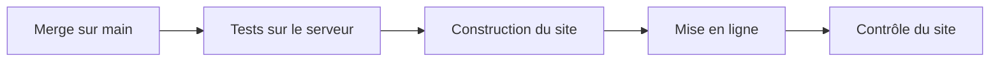

# Conventions et tests

> Comment le dépôt est rangé, publié et testé. Le site tourne sur le serveur OVH, avec Docker, et le serveur publie lui-même `main` après les tests depuis la v1.9. La v1.10 ajoute une règle de mise en page commune à toutes les étapes d'un candidat, et des tests pour le dépôt des CV et portfolios.

## Où se trouve quoi

| Dossier | Ce qu'on y trouve |
|---|---|
| racine | les pages du site ; quelques anciennes adresses renvoient vers `candidatures/` |
| `candidatures/` | l'espace Candidatures des recruteurs |
| `admin/` (v1.7) | les pages d'administration : l'état des sauvegardes (v1.7) et les déploiements (v1.9) ; protégées par la connexion Google, sans lien depuis Candidatures |
| `assets/` | ce que les pages partagent : dossier candidat, règles du parcours, textes, démarrage et adaptateur du mode serveur |
| `docs/` | le modèle de données qui fait foi (`docs/backend/MODELE.md`) et son schéma |
| `tools/` | la construction du site, les tests, le contrôle du site déployé |
| `docker/` | les recettes des images du site (v1.1) et de l'API (v1.3) |
| `deploy/` | la configuration et les scripts du serveur, leur mode d'emploi, les unités systemd, et trois pages : la clé, la mise à jour, la restauration |
| `api/` | l'API de stockage, ses commandes (équipe, sauvegarde), ses tests et son mode d'emploi |

Ne sont jamais commités : le fichier `.env` (les secrets), et dans `api/`, les bibliothèques installées et la base de données.

## La mise en page des étapes (v1.10)

Toutes les étapes d'un candidat (appel, EC1, bilans, EC2, EC3, décision, proposition, onboarding) ont **la même largeur : 1120 px au plus**. Toute nouvelle page d'étape la reprend.

| Règle | Pourquoi |
|---|---|
| 1120 px pour chaque étape | la grille de l'EC2 (palier sur une ligne, quatre tuiles, radar) et la carte d'identité y tiennent sans défilement |
| Panneau Notes à côté du contenu dès 1360 px d'écran, par-dessus en dessous | avec le panneau ouvert, il reste au moins 900 px de contenu |
| Une seule fiche du candidat, partout | même composant dans l'appel, la fenêtre du menu ⋯ et la création : 4 groupes, 3 colonnes, 2 sur tablette, 1 sur téléphone |

## Publier

Le script de construction copie le dépôt sans ce qui ne doit pas être servi : outils, docs, fichiers Docker et de déploiement, trace Hlýja, fichiers `.env`, dossier `api/`. Le dossier `admin/` est publié, mais protégé. Le serveur teste puis met en ligne le dernier commit de `main` tout seul, sous 10 minutes ; la mise à jour à la main reste le secours. Il n'y a pas de GitHub Actions.

## Tester

| Test | Ce qu'il vérifie | Ce qu'il demande |
|---|---|---|
| Règles du parcours | le dossier candidat et ses étapes | Node |
| Mode serveur sans navigateur | démarrage, adaptateur, bandeaux, identité, options, fiches, contre une fausse API ; 87 vérifications | Node 22 |
| Quatre tests de navigateur | tableau, parcours, liens, exports PDF, en mode navigateur ; depuis la v1.10, la fenêtre de création, la largeur commune, le panneau Notes à 1360 px, l'affichage sur téléphone (84 `OK` pour le parcours) | le site servi sur le port 8765, Playwright pour Python |
| Mode serveur de bout en bout | trois navigateurs (deux recruteurs, une lectrice) sur l'API réelle ; la page des déploiements (v1.9) ; depuis la v1.10, les CV et portfolios : création sans doublon, deux recruteurs réels, pannes simulées et vraies, refus de nginx, import, liens piégés, rôle lecture, clavier ; 135 vérifications | le site construit, l'API installée, Playwright |
| Tests de l'API | réglages, base, droits, dossiers, options, commandes, sauvegardes, déploiement ; depuis la v1.10, la base et les fichiers ; 85 tests | Node 22, `npm ci` dans `api/` |
| Scripts de sauvegarde (v1.7) | sauvegarde et contrôle du disque ; 102 vérifications | un conteneur jetable Ubuntu 26.04, en root, avec `BANC_JETABLE=oui` |
| Déploiement automatique (v1.9) | le script de déploiement automatique et la pause ; 95 vérifications | un conteneur jetable, en root, avec `AUTO_DEPLOY_JETABLE=oui` |
| Contrôle du site | pages publiques ouvertes, pages protégées renvoyées vers Google, API refusée sans connexion ; 8 contrôles | `curl`, un site déployé ou la pile locale |

Chaque test affiche `OK` ou `FAIL` ligne par ligne, puis un verdict. **Lis le verdict** : deux tests de navigateur (tableau et parcours) se terminent sans code d'erreur même en cas d'échec.

> **Un échec attendu, pour l'instant.** Dans le test de bout en bout, le contrôle « départ de la page, enregistrement précédent lent » échoue à chaque passage dans le conteneur Playwright, sur `main` comme sur la v1.10 (fiche 1.10-3 du backlog). Le verdict reste `ÉCHECS` tant qu'elle est ouverte : vérifier que c'est la seule ligne `FAIL`.

Lance les tests de navigateur **un par un** : deux tests de bout en bout en même temps se gênent.

### Tester avec une horloge simulée (v1.10)
Certaines règles dépendent du temps : un fichier que plus rien ne cite n'est effacé qu'après une heure. Les tests de l'API construisent l'application avec une horloge qu'ils avancent eux-mêmes, au lieu d'attendre.

### Tester les scripts du serveur
Les bancs remplacent Docker et la mesure du disque par de faux outils, pour provoquer chaque panne à la demande. Ils finissent par `TOUT OK`, ou par `ÉCHECS :` suivi du nombre d'échecs.

> Les bancs **effacent des dossiers**. Ils refusent de démarrer sans leur variable (`BANC_JETABLE=oui`, `AUTO_DEPLOY_JETABLE=oui`) et hors d'un conteneur. Ne les lance jamais sur le serveur.

Pour s'assurer qu'un test attrape bien une erreur, on casse exprès le code dans une copie hors du dépôt, puis on relance : le test doit échouer.

## Les règles du serveur partagé

| Règle | En clair |
|---|---|
| Versions figées | les images servies (oauth2-proxy, Caddy) sont fixées à une version précise |
| Secrets dans `.env` seulement | rien de secret dans le dépôt ; la clé privée de sauvegarde ne va jamais sur le serveur |
| Jamais de commande Docker globale | le nettoyage ne vise que ce qui porte l'étiquette du projet |
| Réglages dans `compose.yaml` | journaux et redémarrage se règlent dans le projet, jamais dans la configuration globale de Docker |

Les scripts du serveur ne s'essaient jamais sur le serveur, et passent `shellcheck` sans remarque. La commande exacte est dans la version complète.

## Écrire du code

- Le code de l'API, ses noms et ses messages sont en français.
- Les textes affichés par les pages vivent dans `assets/wording.fr.js`.
- L'API n'emprunte rien aux pages : les valeurs partagées sont recopiées dans un seul fichier, avec leur source. Les limites des fichiers (10 Mo, trois types) existent ainsi deux fois : les changer des deux côtés.
- Chaque test de l'API travaille sur une base jetable et arrête ce qu'il a lancé.
- Les scripts du serveur ont leur corps dans une fonction `main`, refusent root, et s'arrêtent avec un message clair.

## Branches

Une branche par sujet, puis une pull request vers `main`.

## Voir aussi
- [Comment les pages choisissent où ranger les dossiers](mode-serveur.md)
- [L'API de stockage](api.md)
- [Architecture et déploiement](architecture.md)
- [Décisions techniques](decisions.md)
- [Lancer le site avec Docker sur ton poste](docker-local.md)
- [Le déploiement automatique](deploiement-automatique.md)
- [Fiche du candidat, CV et portfolio](../doc/produit/fiche-candidat.md)
- Les commandes exactes et les versions des outils de test sont dans la version complète.
