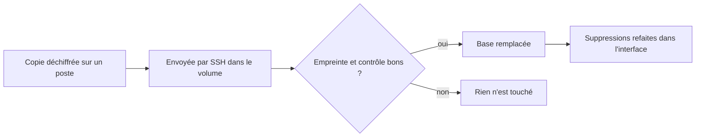

# Décisions techniques

> Les grands choix du dépôt et ce qu'ils écartent. En v1.1, le site est hébergé chez Yeita derrière une connexion Google. En v1.2, une API garde les dossiers dans SQLite. En v1.3, les pages l'utilisent. En v1.7, la base est sauvegardée chaque nuit, chiffrée, chez OVH, sans que le serveur puisse effacer ces copies.

## En un coup d'œil

| Décision | En clair | Depuis |
|---|---|---|
| Stockage et connexion | SQLite chez Yeita, connexion Google @yeita.fr — réalisé en v1.3 | v1.0 |
| Retrait du code Supabase | La piste abandonnée sort du dépôt | v1.0 |
| Source de vérité | On modifie le dépôt, plus l'artefact Claude | v1.0 |
| Hébergement chez Yeita | Docker sur le serveur OVH, derrière oauth2-proxy | v1.1 |
| Pas de confiance dans les en-têtes de proxy | Fermer une porte dérobée vers les pages protégées | v1.1 |
| `/index.html` servi directement | Pas de redirection vers `/` | v1.1 |
| API de stockage | Un serveur Node.js garde chaque dossier entier dans SQLite | v1.2 |
| Confiance dans l'email transmis | L'API croit oauth2-proxy ; personne d'autre ne doit la joindre | v1.2 |
| Version optimiste | Un enregistrement fait sur une version dépassée est refusé | v1.2 |
| Effacement réel | Un dossier supprimé ne reste pas lisible dans les fichiers | v1.2 |
| Dépendances très récentes | Une exception acceptée pour éviter des failles connues | v1.2 |
| Choix du mode des pages | Navigateur seulement sans API hors production ; sinon bloqué avec un message | v1.3 |
| Versions et file par dossier | Un recruteur seul ne se met pas en conflit avec lui-même | v1.3 |
| Fiches qui écrivent leur partie | Deux fiches d'un même candidat s'ouvrent ensemble | v1.3 |
| Réseau interne sans adresse sur le serveur | Seul oauth2-proxy joint l'API | v1.3 |
| Image Node figée | Une version précise, avec son correctif de sécurité | v1.3 |
| « Remplacer tout » masqué | En mode serveur, seule la fusion est proposée | v1.3 |
| Méthode de copie | La copie passe par SQLite lui-même, vérifiée, en un seul fichier | v1.7 |
| Chiffrement et clé | Une clé publique sur le serveur, la clé privée au coffre | v1.7 |
| Rétention et droits chez OVH | OVH efface au bout de 30 jours ; le serveur ne peut rien effacer | v1.7 |
| Alertes | Deux contrôles healthchecks.io, un par tâche | v1.7 |
| Restauration | La copie en clair ne touche jamais le disque du serveur | v1.7 |

Les décisions de v1.0 à v1.3 sont expliquées dans la version complète. Voici celles de v1.7.

## Copier sans retarder l'effacement

Une lecture longue de la base, par un autre outil, empêche l'API de nettoyer ses fichiers : un dossier supprimé y resterait lisible plus longtemps. La copie utilise donc la fonction de sauvegarde de SQLite, dans le conteneur, et ne garde la base ouverte que le temps de la copie.

La copie est vérifiée avant de recevoir son nom définitif, et tient en un seul fichier. Les autres façons de copier (copier les fichiers à chaud, l'outil `sqlite3`) sont écartées.

## Chiffrer pour une seule clé

Les copies contiennent les dossiers candidat et quittent le serveur. Elles sont chiffrées avec age pour une seule clé publique. La clé privée est créée sur un poste, rangée au coffre de Yeita et connue d'au moins deux personnes. Une copie ne se déchiffre que sur un poste, jamais sur le serveur.

> Perdre la clé privée rend toutes les copies illisibles. À la mise en service, on vérifie que la clé du coffre correspond à celle du serveur, et qu'une vraie copie s'ouvre.

## Laisser OVH effacer, pas le serveur

Un serveur piraté ne doit pas pouvoir détruire les copies. Trois comptes de stockage se partagent les rôles :

| Compte | Ce qu'il peut faire | Où il vit |
|---|---|---|
| Administrateur | tout régler, y compris l'effacement automatique à 30 jours | au coffre, utilisé depuis un poste |
| Serveur | déposer des copies, sans jamais pouvoir les effacer | sur le serveur |
| Restauration | lire les copies | au coffre, avec la clé privée |

Le compte du serveur pourrait encore remplacer un fichier du même nom. Chaque copie porte donc un nom à la seconde près : une relance ne remplace jamais celle de la nuit.

| Endroit | Un dossier supprimé y reste au plus |
|---|---|
| Copie de travail, à côté de la base | 3 jours |
| Copies chiffrées du serveur | 31 jours |
| Copies chez OVH | 32 jours |

## Une alerte par tâche

Chaque tâche signale son succès ou son échec à son propre contrôle healthchecks.io. Un contrôle unique aurait été trompeur : les signaux du disque, toutes les heures, l'auraient gardé au vert malgré une sauvegarde ratée. Un contrôle qui ne reçoit plus rien alerte aussi : il voit un serveur éteint ou un timer cassé.

L'adresse d'un contrôle est un secret : elle ne passe jamais dans la ligne de commande d'un programme, que tout compte du serveur peut lire. Le signal ne compte comme reçu que si healthchecks.io répond exactement « OK ».

## Restaurer sans risque

Une restauration ratée ne doit pas détruire la base, et la copie en clair ne doit jamais toucher le disque du serveur.

Avant de remplacer, l'état actuel est sauvegardé, pour pouvoir revenir en arrière. Après, l'équipe supprime à nouveau, dans l'interface, les dossiers supprimés depuis la date de la copie. La procédure a été rejouée sur un serveur d'essai, dans trois situations.

## Voir aussi
- [Comment les pages choisissent où ranger les dossiers](mode-serveur.md)
- [L'API de stockage](api.md)
- [Architecture et déploiement](architecture.md)
- [Conventions et tests](conventions.md)
- Restaurer la base : `deploy/RESTAURER.md`
- Le détail de chaque décision (contexte, options écartées, conséquences) est dans la version complète.
