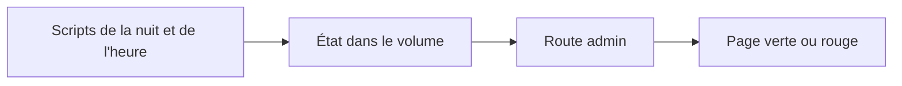
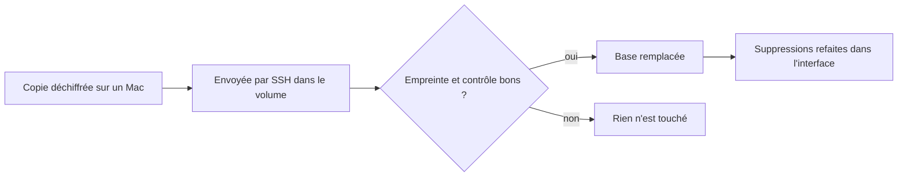
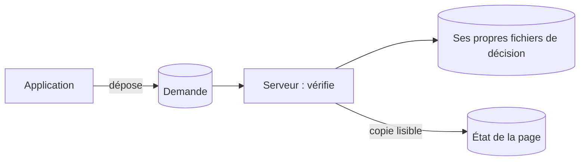
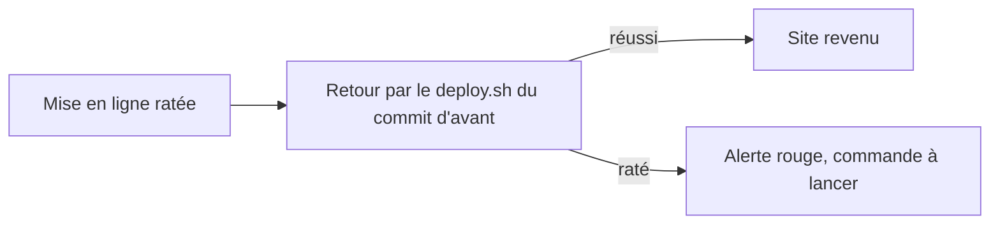

# Décisions techniques

> Les grands choix du dépôt et ce qu'ils écartent. En v1.1, le site est hébergé chez Yeita derrière une connexion Google. En v1.2, une API garde les dossiers dans SQLite. En v1.3, les pages l'utilisent. En v1.7, la base est sauvegardée chaque nuit, chiffrée, sur le serveur, et une page d'état remplace les alertes. En v1.9, le serveur met lui-même `main` en ligne après les tests ; l'application ne peut que le lui demander.

## En un coup d'œil

| Décision | En clair | Depuis |
|---|---|---|
| Stockage et connexion | SQLite chez Yeita, connexion Google @yeita.fr — réalisé en v1.3 | v1.0 |
| Retrait du code Supabase | La piste abandonnée sort du dépôt | v1.0 |
| Source de vérité | On modifie le dépôt, plus l'artefact Claude | v1.0 |
| Hébergement chez Yeita | Docker sur le serveur OVH, derrière oauth2-proxy | v1.1 |
| Pas de confiance dans les en-têtes de proxy | Fermer une porte dérobée vers les pages protégées | v1.1 |
| `/index.html` servi directement | Pas de redirection vers `/` | v1.1 |
| API de stockage | Un serveur Node.js garde chaque dossier entier dans SQLite | v1.2 |
| Confiance dans l'email transmis | L'API croit oauth2-proxy ; personne d'autre ne doit la joindre | v1.2 |
| Version optimiste | Un enregistrement fait sur une version dépassée est refusé | v1.2 |
| Effacement réel | Un dossier supprimé ne reste pas lisible dans les fichiers | v1.2 |
| Dépendances très récentes | Une exception acceptée pour éviter des failles connues | v1.2 |
| Choix du mode des pages | Navigateur seulement sans API hors production ; sinon bloqué avec un message | v1.3 |
| Versions et file par dossier | Un recruteur seul ne se met pas en conflit avec lui-même | v1.3 |
| Fiches qui écrivent leur partie | Deux fiches d'un même candidat s'ouvrent ensemble | v1.3 |
| Réseau interne sans adresse sur le serveur | Seul oauth2-proxy joint l'API | v1.3 |
| Image Node figée | Une version précise, avec son correctif de sécurité | v1.3 |
| « Remplacer tout » masqué | En mode serveur, seule la fusion est proposée | v1.3 |
| Méthode de copie | La copie passe par SQLite lui-même, vérifiée, en un seul fichier | v1.7 |
| Chiffrement et clé | Une clé publique sur le serveur, la clé secrète dans un fichier hors du serveur | v1.7 |
| Copies sur le serveur seulement | Pas de stockage payant : les copies restent sur le serveur | v1.7 |
| Page d'état au lieu d'alertes | Les admins regardent une page ; aucun service tiers | v1.7 |
| Restauration | La copie en clair ne touche jamais le disque du serveur | v1.7 |
| Déploiement automatique sans GitHub Actions | Le serveur vérifie `main` lui-même et teste à part | v1.9 |
| Frontière application → serveur | La page dépose une demande ; le serveur décide sur ses propres fichiers | v1.9 |
| Commits admis depuis la page | Seulement la ligne principale de main, depuis la v1.9 | v1.9 |
| Retour automatique et pause | Revenir seul au commit d'avant ; un retour voulu n'est pas défait | v1.9 |

Les décisions de v1.0 à v1.3 sont expliquées dans la version complète. Voici celles de v1.7, puis celles de v1.9.

## Copier sans retarder l'effacement

Une lecture longue de la base, par un autre outil, empêche l'API de nettoyer ses fichiers : un dossier supprimé y resterait lisible plus longtemps. La copie utilise donc la fonction de sauvegarde de SQLite, dans le conteneur, et ne garde la base ouverte que le temps de la copie.

La copie est vérifiée avant de recevoir son nom définitif, et tient en un seul fichier. Copier les fichiers à chaud ou passer par l'outil `sqlite3` est écarté.

## Chiffrer pour une seule clé

Les copies contiennent les dossiers candidat. Elles sont chiffrées avec age pour une seule clé publique, posée sur le serveur. La clé secrète est créée sur un Mac et n'existe que sous forme d'un fichier `.txt`, confié en main propre à une ou deux personnes, en attendant un coffre de mots de passe.

> Perdre ce fichier rend toutes les copies illisibles. Après la première sauvegarde, on vérifie qu'il ouvre bien une vraie copie.

Une clé SSH, que age accepterait aussi, est refusée par le script : une seule forme de clé, plus simple à contrôler.

## Garder les copies sur le serveur

La première spec envoyait les copies chez OVH Object Storage. Ce service est payant, et aucun stockage gratuit n'a été retenu. Pour cette version, les copies chiffrées restent donc 30 jours sur le serveur, dans `/var/backups/recrutement`.

| Ce que ça permet | Ce que ça ne permet pas |
|---|---|
| Revenir en arrière après une erreur, une base abîmée, un volume Docker perdu | Survivre à la perte du serveur : les copies partent avec lui |

Choix accepté par l'utilisateur. Un dossier supprimé reste au plus 3 jours dans la copie de travail et 31 jours dans les copies chiffrées.

## Une page plutôt que des alertes

Pour savoir si les sauvegardes tournent sans dépendre d'un service tiers, les scripts écrivent leur résultat dans le volume de l'API. Une route réservée aux admins le lit, et la page `/admin/sauvegardes.html` l'affiche : vert, ou rouge avec la raison en clair.

Écartés : healthchecks.io (retiré avec la reprise), un lien depuis Candidatures (refusé), le nom `/dashboard/` (remplacé par `/admin/`, réservé au futur tableau de bord).

> Aucune alerte n'est envoyée : si personne n'ouvre la page, personne ne voit une panne. Les emails viendront dans une évolution ultérieure.

## Restaurer sans risque

Une restauration ratée ne doit pas détruire la base, et la copie en clair ne doit jamais toucher le disque du serveur.

Avant de remplacer, l'état actuel est sauvegardé, pour pouvoir revenir en arrière. Après, l'équipe supprime à nouveau, dans l'interface, les dossiers supprimés depuis la date de la copie. Poser la copie avec `docker compose cp` est écarté : le fichier serait illisible par l'API. La procédure a été rejouée sur un serveur d'essai, dans trois situations.

## Mettre en ligne sans service tiers (v1.9)

Le but : qu'un merge sur `main` parte en ligne sans connexion SSH, et jamais si un test échoue. Plutôt que GitHub Actions, c'est le serveur qui vérifie `main`, toutes les 10 minutes, avec un timer systemd. Une préproduction était hors du sujet.

Les tests tournent dans une copie de travail à part et des conteneurs jetables. La construction d'essai prend d'autres noms d'image : sinon elle écraserait les images du site en ligne. Pas de Node, ni de jq, ni de python sur le serveur : le script écrit son JSON lui-même.

| Ce que ça coûte | Ce que ça apporte |
|---|---|
| Un passage dure de 35 secondes (avec le cache) à quelques minutes | Un merge est en ligne en 10 minutes, tests compris |
| Le cache de construction reste sur le disque, surveillé par le contrôle du disque | Aucun compte ni service extérieur |

## L'application demande, le serveur décide (v1.9)

La page doit pouvoir demander une mise en ligne, sans pouvoir piloter le serveur. L'API dépose donc seulement un petit fichier de demande dans son volume. Le serveur le prend par un conteneur jetable, le lit strictement, vérifie le commit, puis agit.

Ses décisions (commit en ligne, échec, pause, passages) vivent dans le dossier du compte `deploy`, jamais dans le volume. L'état que lit la page n'en est qu'une copie : si l'application le falsifiait, rien ne changerait.

> Même compromise, l'application ne peut que : mettre en ligne un commit testé de la ligne principale de main (v1.9 ou après), poser ou retirer la pause, et faire tourner le service.

Elle peut aussi remplir de refus l'historique de la page : une demande illisible est refusée, et ce refus est noté comme un passage. Si l'application empêche le serveur de retirer la demande, le service ne tourne plus qu'une fois par minute. Écartés : un dossier partagé entre l'application et le serveur (il aurait fallu changer `compose.yaml` et mêler les droits), et des décisions relues dans l'état de la page.

## Quels commits on peut demander (v1.9)

Le dépôt fusionne les branches par merge. `main` a 227 ancêtres, mais seulement 19 commits ont été, à un moment, son dernier commit. Seuls ces derniers (la ligne principale de main) peuvent être demandés depuis la page, et seulement s'ils datent de la v1.9 ou après. Choix de l'utilisateur.

Les commits intermédiaires d'une branche n'ont jamais été relus ni mis en ligne seuls : ils sont refusés. En SSH, `deploy.sh <commit>` garde son ancienne règle (tout ancêtre de `main`).

## Revenir seul, et ne pas défaire un retour voulu (v1.9)

Quand la mise en ligne rate après avoir changé de version, le serveur revient tout seul au commit d'avant (choix de l'utilisateur). Il utilise le `deploy.sh` **de ce commit-là** : celui du commit en échec peut être cassé avec lui. Si `deploy.sh` s'arrête avant de rien changer, il n'y a pas de retour à faire.

Un retour voulu par un admin ne doit pas être défait 10 minutes plus tard. Celui qui demande un ancien commit (la page, ou `deploy.sh` en SSH) pose donc une pause ; l'automatisme n'en pose jamais. La pause est un fichier ignoré par git par une exclusion locale : un `.gitignore` disparaîtrait en revenant à un commit plus ancien. Et si quelqu'un déploie à la main pendant les tests, son geste l'emporte : le passage s'annule.

> Le pire cas (retour raté, passage tué pendant la mise en ligne) est une alerte rouge sur la page, avec la commande à lancer. Aucune notification n'est envoyée.

## Voir aussi
- [Comment les pages choisissent où ranger les dossiers](mode-serveur.md)
- [L'API de stockage](api.md)
- [Architecture et déploiement](architecture.md)
- [Conventions et tests](conventions.md)
- [Le déploiement automatique](deploiement-automatique.md)
- La clé : `deploy/CLE-SAUVEGARDE.md` ; restaurer la base : `deploy/RESTAURER.md`
- Le détail de chaque décision (contexte, options écartées, conséquences) est dans la version complète.
