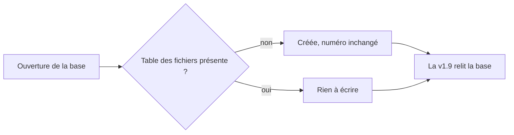
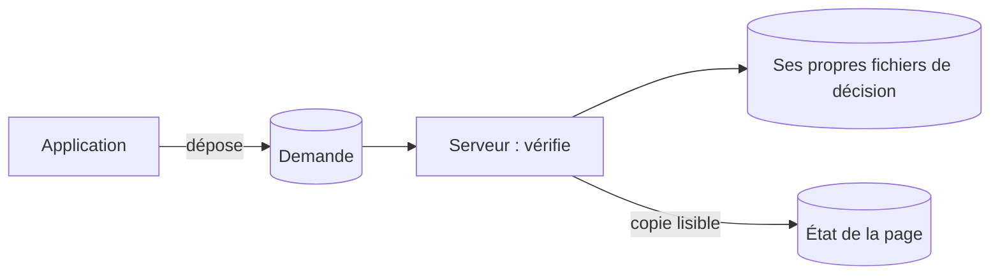

# Décisions techniques

> Les grands choix du dépôt et ce qu'ils écartent. En v1.1, le site est hébergé chez Yeita derrière une connexion Google. En v1.2, une API garde les dossiers dans SQLite ; en v1.3, les pages l'utilisent. En v1.7, la base est sauvegardée chaque nuit, chiffrée, sur le serveur. En v1.9, le serveur met lui-même `main` en ligne après les tests. En v1.10, les CV et portfolios entrent dans la même base, sans casser le retour arrière.

## En un coup d'œil

| Décision | En clair | Depuis |
|---|---|---|
| Stockage et connexion | SQLite chez Yeita, connexion Google @yeita.fr — réalisé en v1.3 | v1.0 |
| Retrait du code Supabase | La piste abandonnée sort du dépôt | v1.0 |
| Source de vérité | On modifie le dépôt, plus l'artefact Claude | v1.0 |
| Hébergement chez Yeita | Docker sur le serveur OVH, derrière oauth2-proxy | v1.1 |
| Pas de confiance dans les en-têtes de proxy | Fermer une porte dérobée vers les pages protégées | v1.1 |
| `/index.html` servi directement | Pas de redirection vers `/` | v1.1 |
| API de stockage | Un serveur Node.js garde chaque dossier entier dans SQLite | v1.2 |
| Confiance dans l'email transmis | L'API croit oauth2-proxy ; personne d'autre ne doit la joindre | v1.2 |
| Version optimiste | Un enregistrement fait sur une version dépassée est refusé | v1.2 |
| Effacement réel | Un dossier supprimé ne reste pas lisible dans les fichiers | v1.2 |
| Dépendances très récentes | Une exception acceptée pour éviter des failles connues | v1.2 |
| Choix du mode des pages | Navigateur seulement sans API hors production ; sinon bloqué avec un message | v1.3 |
| Versions et file par dossier | Un recruteur seul ne se met pas en conflit avec lui-même | v1.3 |
| Fiches qui écrivent leur partie | Deux fiches d'un même candidat s'ouvrent ensemble | v1.3 |
| Réseau interne sans adresse sur le serveur | Seul oauth2-proxy joint l'API | v1.3 |
| Image Node figée | Une version précise, avec son correctif de sécurité | v1.3 |
| « Remplacer tout » masqué | En mode serveur, seule la fusion est proposée | v1.3 |
| Méthode de copie | La copie passe par SQLite lui-même, vérifiée, en un seul fichier | v1.7 |
| Chiffrement et clé | Une clé publique sur le serveur, la clé secrète dans un fichier hors du serveur | v1.7 |
| Copies sur le serveur seulement | Pas de stockage payant : les copies restent sur le serveur | v1.7 |
| Page d'état au lieu d'alertes | Les admins regardent une page ; aucun service tiers | v1.7 |
| Restauration | La copie en clair ne touche jamais le disque du serveur | v1.7 |
| Déploiement automatique sans GitHub Actions | Le serveur vérifie `main` lui-même et teste à part | v1.9 |
| Frontière application → serveur | La page dépose une demande ; le serveur décide sur ses propres fichiers | v1.9 |
| Commits admis depuis la page | Seulement la ligne principale de main, depuis la v1.9 | v1.9 |
| Retour automatique et pause | Revenir seul au commit d'avant ; un retour voulu n'est pas défait | v1.9 |
| Fichiers des candidats dans SQLite | CV et portfolios dans la base, avec le dossier | v1.10 |
| Ajout de table sans changer la version de la base | La v1.9 relit toujours la base : le retour arrière marche | v1.10 |

Les décisions de v1.0 à v1.3 sont expliquées dans la version complète. Voici celles de v1.10, puis de v1.9 et de v1.7.

## Les CV et portfolios dans la base (v1.10)

Depuis la v1.10, on peut déposer un CV ou un portfolio dans la fiche du candidat. Ces fichiers sont des données personnelles : ils doivent avoir le même accès, la même durée et le même effacement que le dossier.

Ils vont donc dans la base existante, dans une table à eux, servis sous l'adresse du candidat. Aucune bibliothèque n'a été ajoutée. La limite est de 10 Mo, et seuls les PDF, PNG et JPG passent, reconnus à leur contenu (validé par Léo).

| Écarté | Pourquoi |
|---|---|
| Un dossier de fichiers sur un volume | hors de la base : accès, sauvegarde et effacement réel à refaire à part |
| Les fichiers dans le dossier lui-même | le dossier est limité à 1 Mo, et chaque enregistrement renverrait les fichiers |
| Une bibliothèque d'envoi de fichiers | une dépendance de plus ; le serveur sait déjà lire un fichier brut |
| Laisser les fichiers oubliés jusqu'à la suppression du candidat | un fichier que plus rien ne cite resterait gardé jusque-là |

Deux règles, décidées par l'utilisateur, tiennent fichiers et fiche d'accord : un dossier enregistré ne cite jamais un fichier absent, et un fichier que plus rien ne cite est effacé passé une heure.

> Chaque sauvegarde contient désormais les fichiers. Mesure : 60 fichiers (116 Mo) donnent une copie de 117 Mo, gardée en 33 exemplaires. Et le nginx du serveur doit accepter 10 Mo par envoi.

## Ajouter une table sans casser le retour arrière (v1.10)

La base porte un numéro de version. L'API d'une version refuse une base plus récente que la sienne. La branche d'origine passait ce numéro à 2 : l'API de la v1.9 n'aurait plus pu ouvrir la base. Le retour automatique et « Déployer ce commit » vers la v1.9 étaient cassés (vérifié).

La table est donc créée « si elle manque », à chaque ouverture, et le numéro reste 1. C'est la règle pour la suite (décision de l'utilisateur) : un ajout qui ne casse pas la lecture par la version d'avant ne change pas le numéro.

| Ce que ça coûte | Ce que ça apporte |
|---|---|
| Revenue à la v1.9, l'interface affiche mal les lignes de dépôt de l'historique (accepté, temporaire) | Le retour arrière reste possible, sans restauration |
| Une base d'essai déjà passée en 2 est à recréer | Rien n'est perdu : tout revient avec la v1.10 |

## Mettre en ligne sans service tiers (v1.9)

Le but : qu'un merge sur `main` parte en ligne sans connexion SSH, et jamais si un test échoue. Plutôt que GitHub Actions, c'est le serveur qui vérifie `main`, toutes les 10 minutes, avec un timer systemd.

Les tests tournent dans une copie de travail à part et des conteneurs jetables. La construction d'essai prend d'autres noms d'image : sinon elle écraserait les images du site en ligne.

| Ce que ça coûte | Ce que ça apporte |
|---|---|
| Un passage dure de 35 secondes (avec le cache) à quelques minutes | Un merge est en ligne en 10 minutes, tests compris |
| Le cache de construction reste sur le disque, surveillé | Aucun compte ni service extérieur |

## L'application demande, le serveur décide (v1.9)

La page doit pouvoir demander une mise en ligne, sans pouvoir piloter le serveur. L'API dépose donc seulement un petit fichier de demande dans son volume. Le serveur le prend par un conteneur jetable, le lit strictement, vérifie le commit, puis agit.

Ses décisions vivent dans le dossier du compte `deploy`, jamais dans le volume. L'état que lit la page n'en est qu'une copie : si l'application le falsifiait, rien ne changerait.

> Même compromise, l'application ne peut que : mettre en ligne un commit testé de la ligne principale de main (v1.9 ou après), poser ou retirer la pause, et faire tourner le service.

## Quels commits on peut demander (v1.9)

`main` a 227 ancêtres, mais seulement 19 commits ont été, à un moment, son dernier commit. Seuls ces derniers (la ligne principale de main) peuvent être demandés depuis la page, et seulement s'ils datent de la v1.9 ou après. Les commits intermédiaires d'une branche n'ont jamais été relus ni mis en ligne seuls : ils sont refusés.

## Revenir seul, et ne pas défaire un retour voulu (v1.9)

Quand la mise en ligne rate après avoir changé de version, le serveur revient tout seul au commit d'avant. Il utilise le `deploy.sh` **de ce commit-là** : celui du commit en échec peut être cassé avec lui.

Un retour voulu par un admin ne doit pas être défait 10 minutes plus tard. Celui qui demande un ancien commit pose donc une pause ; l'automatisme n'en pose jamais. Si quelqu'un déploie à la main pendant les tests, son geste l'emporte.

> Le pire cas (retour raté, passage tué pendant la mise en ligne) est une alerte rouge sur la page, avec la commande à lancer. Aucune notification n'est envoyée.

## Les sauvegardes (v1.7)

| Décision | En clair | Écarté |
|---|---|---|
| Copier par SQLite lui-même | une copie cohérente, vérifiée, en un seul fichier, sans retarder l'effacement | copier les fichiers à chaud, l'outil `sqlite3` |
| Chiffrer pour une seule clé | age, une clé publique sur le serveur, la clé secrète dans un fichier gardé hors du serveur | GPG, une clé SSH |
| Garder les copies sur le serveur | 30 jours dans `/var/backups/recrutement` | OVH Object Storage (payant) |
| Une page plutôt que des alertes | `/admin/sauvegardes.html`, verte ou rouge | healthchecks.io, un lien depuis Candidatures |
| Restaurer sans risque | la copie en clair ne touche jamais le disque du serveur ; empreinte et contrôle avant de remplacer | poser la copie avec `docker compose cp` |

> Perdre le fichier de la clé rend toutes les copies illisibles. Et si le serveur est perdu, les copies partent avec lui : choix accepté.

## Voir aussi
- [Fiche du candidat, CV et portfolio](../doc/produit/fiche-candidat.md)
- [Comment les pages choisissent où ranger les dossiers](mode-serveur.md)
- [L'API de stockage](api.md)
- [Architecture et déploiement](architecture.md)
- [Conventions et tests](conventions.md)
- [Le déploiement automatique](deploiement-automatique.md)
- La clé : `deploy/CLE-SAUVEGARDE.md` ; restaurer la base : `deploy/RESTAURER.md`
- Le détail de chaque décision (contexte, options écartées, conséquences) est dans la version complète.
