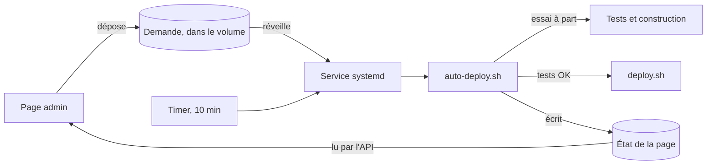
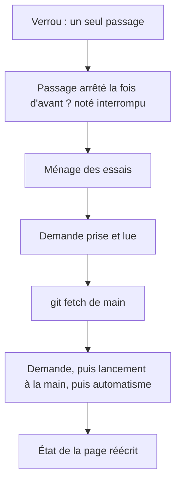

# Le déploiement automatique

> Depuis la v1.9, un script du serveur, `deploy/auto-deploy.sh`, teste puis met en ligne le dernier commit de `main`. Il tourne toutes les 10 minutes, et aussi dès qu'un admin dépose une demande sur la page des déploiements. C'est le serveur qui décide de tout : l'application ne fait que déposer la demande.

## En un coup d'œil

Deux déclencheurs lancent le même service : un timer systemd toutes les 10 minutes, et une unité qui surveille l'arrivée d'une demande dans le volume de l'API. Le script prend la demande, teste le commit dans un dossier à part, puis appelle le `deploy.sh` habituel. Il écrit ensuite un résumé que la page affiche.

## Les éléments principaux

### Ce que fait un passage, dans l'ordre

L'automatisme ne fait rien en pause, ni sans GitHub, ni si le dernier commit de `main` a déjà échoué. Sinon, il met en ligne `main` si le commit en place est incertain, ou si `main` a avancé. Une demande et un lancement à la main sont toujours traités, même en pause.

### Les étapes d'un passage

| Étape | Ce qu'elle fait | Si elle échoue |
|---|---|---|
| Tests des règles du parcours | `node tools/test-store.js` dans un conteneur jetable | « tests KO », commit noté en échec |
| Tests de l'API | `npm ci` puis `npm test` dans `api/` | idem |
| Construction | `docker compose build` sous des noms d'image d'essai | idem |
| Mise en ligne | `deploy.sh <commit>` | refusée avant de commencer : rien ne change ; ratée après : retour automatique |
| Retour arrière | le `deploy.sh` du commit d'avant | raté : alerte rouge et commit en ligne incertain |

Les tests tournent dans une copie de travail séparée du dépôt (un « worktree » git), dans `~/.recrutement-deploiement/essai`. Les conteneurs n'y voient que cette copie : ni socket Docker, ni volume, ni `.env`. L'image Node est celle du `FROM` de `docker/api.Dockerfile` du commit testé.

> La construction d'essai utilise d'autres noms d'image. Sans eux, elle écraserait les images du site en ligne, car `compose.yaml` fixe leurs noms.

### Où vivent les informations

| Fichier | Où | À quoi il sert |
|---|---|---|
| La demande | `/data/demandes/deploiement.demande`, dans le volume | ce que l'admin a demandé : 4 lignes `clé=valeur` |
| Les décisions | `~deploy/.recrutement-deploiement/` | commit en ligne (`deploye`), commit en échec, incertain, alerte de retour, passage en cours, 30 derniers passages |
| La pause | `/opt/recrutement/deploy/PAUSE` | bloque l'automatisme ; ignorée par git (exclusion locale) |
| L'état de la page | `/data/etat/deploiement.json`, dans le volume | une copie lisible des décisions, réécrite à chaque passage |

Le serveur ne relit jamais l'état de la page pour décider : l'application pourrait le falsifier. Du volume, il ne lit que la demande, et seulement par un conteneur jetable.

### La page et l'API
La page `admin/deploiement.html` lit l'état par `GET /api/deploiement` et dépose une demande par `POST /api/deploiement/demande`. Les deux routes sont réservées aux admins. L'API écrit la demande sous un nom provisoire, puis la renomme : le serveur ne lit jamais une demande à moitié écrite.

### Les durées
| Attente | Par défaut | Réglage |
|---|---|---|
| Un autre passage en cours | 30 min | `AUTO_DEPLOY_ATTENTE_VERROU` |
| Le verrou de `deploy.sh` (sauvegarde, geste à la main) | 15 min | `AUTO_DEPLOY_ATTENTE_DEPLOY` |
| Une étape de test | 20 min | `AUTO_DEPLOY_DUREE_ETAPE` |
| Docker qui ne répond pas | 60 s | `AUTO_DEPLOY_ATTENTE_DOCKER` |

Le service s'arrête de force au bout de 4 heures, une marge calculée sur ces valeurs.

## À savoir avant de modifier

- **Les formats sont un contrat.** Une version suivante doit rester lisible par l'`auto-deploy.sh` de la v1.9 : c'est lui qui fait le passage après un retour vers la v1.9.
- **La demande est lue strictement.** Fichier ordinaire, 1 024 octets au plus, exactement 4 clés, valeurs contrôlées ; sinon elle est refusée. L'API applique les mêmes règles pour l'afficher.
- **Seule la ligne principale de main est admise**, et seulement depuis la v1.9 (le commit doit contenir `auto-deploy.sh`).
- **L'automatisme ne pose jamais la pause.** Il appelle `deploy.sh` avec `RECRUTEMENT_PAR_AUTO=1`, aussi pour le retour ; c'est lui qui décide de la pause.
- **Le retour utilise le `deploy.sh` du commit d'avant**, extrait sous le verrou : celui du commit en échec peut être cassé avec lui.
- **Un geste à la main l'emporte.** Si le commit en place a changé pendant les tests, le passage s'annule.
- **Tout le script est dans `main`**, lu en entier avant d'agir : `deploy.sh` peut réécrire le fichier pendant le passage.
- **Pas de jq ni de python sur le serveur** : le JSON est écrit et échappé par le shell.
- **Les tests** : `tools/test-auto-deploy.sh`, 95 vérifications avec un faux Docker, et `--reel` sur un banc avec les vraies unités systemd ([Conventions et tests](conventions.md)).

## Voir aussi
- [Mise en ligne automatique, côté produit](../doc/produit/deploiement-automatique.md)
- [Architecture et déploiement](architecture.md)
- [L'API de stockage](api.md)
- [Mettre à jour le site en production](mise-a-jour-production.md)
- [Décisions techniques](decisions.md)
- Le mode d'emploi du serveur : `deploy/README.md`, section 15
- L'ordre exact d'un passage, les formats champ par champ et les messages sont dans la version complète.
