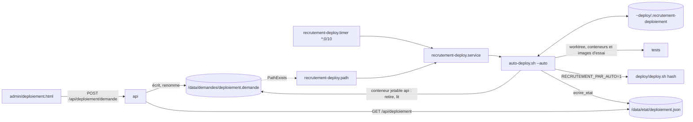

# Déploiement automatique (`deploy/auto-deploy.sh`)

> Depuis la v1.9, le serveur teste et met en ligne le dernier commit de `main` toutes les 10 minutes, ou dès qu'un admin dépose une demande sur `/admin/deploiement.html`. Cette page donne l'ordre d'un passage, les fichiers et leurs formats (contrat entre les versions), les attentes et les issues.

## Vue d'ensemble

## Modes
`--auto` (service : déclencheur « automatique » ou « demande »), sans option (à la main : « ligne-de-commande », dernier `main` même en pause), `--nettoyer` (`ExecStopPost` : nettoyage de l'essai seulement). Refus : lancé en root (`ARRÊT`), argument inconnu ou en trop (usage, code 2).

## Ordre d'un passage (`main` de `auto-deploy.sh`)
| # | Étape | Détail |
|---|---|---|
| 1 | Verrou | `~/.recrutement-auto-deploy.lock` ; pris : « · Un passage est en cours, attente… », jusqu'à `AUTO_DEPLOY_ATTENTE_VERROU` (1 800 s), puis `ARRÊT : un passage tient le verrou …` (code 1, rien d'enregistré) |
| 2 | `trap` TERM/INT | `sur_arret` : enregistre le passage `interrompu`, nettoie, réécrit la vue, code 143 |
| 3 | Exclusion | `/deploy/PAUSE` dans `.git/info/exclude` |
| 4 | Reprise (R20) | `en-cours` de l'hôte trouvé → passage `interrompu` (son étape) ; pendant `deploy` ou `retour` : `incertain` + `retour-ko` de type `interrompu` |
| 5 | Nettoyage (R9) | conteneurs d'étiquette `fr.yeita.projet=recrutement-essai`, `~/.recrutement-deploiement/essai`, `git worktree prune`, images `recrutement-essai-front` et `-api` par nom |
| 6 | Docker | `docker info` en échec : « Docker ne répond pas … », attente `AUTO_DEPLOY_ATTENTE_DOCKER` (60 s), code 1 |
| 7 | Demande (R6) | prise par `docker compose run --rm --no-deps -T api sh -c …` : `/data/demandes` qui n'est pas un vrai dossier (lien) → retiré, « non retirée » ; renommage en `.prise` puis lecture (fichier ordinaire, sans NUL, `head -c 1025`) ; conteneur en échec → `non-retiree` : journal seulement, attente de 60 s en fin de passage |
| 8 | `git fetch origin main` | échec : `fetch` = `echec` ; demande `deployer` refusée « GitHub injoignable » (une demande `reprendre` retire quand même la pause) ; automatisme sans action |
| 9 | Demande prise | `reprendre` → `rm deploy/PAUSE` ; `deployer main` → passage ; `deployer <hash>` → `valider_commit` puis passage (pause si ≠ `origin/main`) ; sinon passage `demande-refusee` |
| 10 | Lancement à la main | sans `--auto` : passage `ligne-de-commande` du dernier `main`, même en pause |
| 11 | Automatisme (R1) | `fetch` en échec → rien ; `deploy/PAUSE` → rien ; `origin/main` = `echec` → rien ; `deploye` absent, ≠ `HEAD` ou `incertain` → passage ; `origin/main` ≠ `deploye` → passage |
| 12 | Vue | `ecrire_vue` ; `ATTENDRE_FIN` → `sleep 60` ; code 1 si un passage a fini `tests-ko`, `deploiement-ko` ou `interrompu` |

## Un passage (`passage`)
| Étape | Commande | Issue |
|---|---|---|
| `test-store` | `timeout 1200 docker run --rm --label …-essai --user <deploy> -e HOME=/tmp -v <essai>:/w -w /w <FROM> node tools/test-store.js` | KO → `tests-ko`, commit dans `echec` |
| `npm-test` | idem, `-w /w/api … sh -c 'npm ci --no-audit --no-fund && npm test'` | idem |
| `build` | `docker compose -p recrutement-essai --env-file <essai>/.env.example -f <essai>/compose.yaml -f ~/.recrutement-deploiement/essai-images.yaml build --progress plain` | idem |
| (verrou) | `flock -w AUTO_DEPLOY_ATTENTE_DEPLOY` (900 s) sur `~/.recrutement-deploy.lock`, libéré | expiré → `annule` « verrou de deploy.sh occupé … » |
| (R19) | `HEAD` ≠ début du passage, ou pause apparue (automatisme) | `annule` « déploiement fait à la main pendant le passage » |
| `deploy` | `env RECRUTEMENT_PAR_AUTO=1 deploy/deploy.sh <hash complet>` | OK → `deploye` ; sans ligne `· Dépôt sur` : « déjà en cours » → `annule`, sinon `deploiement-ko` (motif = ligne `ARRÊT`), commit en échec, pas de retour ; commit visé = commit d'avant, ou `deploye` absent → `incertain`, `redeploiement-ko`, motif « mise en ligne ratée, pas de commit d'avant vers lequel revenir » |
| `retour` | sous le verrou : `HEAD` = commit visé ? puis `git checkout --detach <deploye>` ; libéré ; `env RECRUTEMENT_PAR_AUTO=1 deploy/deploy.sh <deploye>` (celui du commit d'avant ; sans la variable, le retour poserait la pause) | OK → « retour à … réussi » ; « déjà en cours » une fois → attente du verrou, rejoué si `HEAD` = commit d'avant ; KO → `incertain` + `retour-ko` |
Ligne principale : `valider_commit` exige `^[0-9a-f]{7,40}$`, `git rev-parse --verify` (un seul commit), présence dans `git rev-list --first-parent origin/main` (`grep` sans `-q` : pas de SIGPIPE sous `pipefail`), `deploy/auto-deploy.sh` dans le commit.

## Fichiers et formats (contrat R15 : lisibles par l'`auto-deploy.sh` de la 1.9)
| Fichier | Où | Écrit par | Format |
|---|---|---|---|
| Demande | `/data/demandes/deploiement.demande` (volume `recrutement_data`, `node`, 600 ; dossier 700) | `POST /api/deploiement/demande` | 4 lignes `action=deployer\|reprendre`, `commit=main\|<hash>\|` (vide pour `reprendre`), `par=<email>`, `le=<ISO>` ; 1 024 octets au plus |
| Vue | `/data/etat/deploiement.json` | `ecrire_etat` | `{maj, dernier_controle: {le, fetch}, en_ligne: commit, incertain, dernier_main: commit, pause: {depuis, par, commit: <hash court>}\|null, echec: commit\|null, retour_ko: {type, le, etape, commit, avant}\|null, en_cours: {depuis, etape, etape_depuis, commit, declencheur: {type, par}}\|null, passages: [30 au plus, le plus récent d'abord]}` ; commit = `{commit, court, message, auteur}` ; `incertain` au premier niveau (pas dans `en_ligne`) |
| Passage | `~/.recrutement-deploiement/passages/<AAAAMMJJTHHMMSS.NNNNNNNNNZ>-<pid>.json` (30 gardés) | `fin_passage` | `{id, debut, fin, declencheur: {type: automatique\|demande\|ligne-de-commande, par}, commit, branche: "main", resultat: deploye\|tests-ko\|deploiement-ko\|demande-refusee\|annule\|interrompu, motif, etapes: [{nom, statut: ok\|ko\|non-lancee, duree_s, sortie}]}` ; sortie : 300 dernières lignes de 2 000 caractères au plus, JSON échappé par `json_texte` |
| `deploye` | `~/.recrutement-deploiement/` (600) | `deploy.sh` (1.9) à « Déploiement réussi », quel que soit le lanceur ; commande d'installation si absent | hash complet |
| `echec`, `incertain`, `retour-ko`, `en-cours` | idem | `auto-deploy.sh` | hash ; vide ; `type=`, `le=`, `etape=`, `commit=`, `avant=` ; `debut=`, `etape=`, `etape_debut=`, `commit=`, `avant=`, `declencheur=`, `par=`, `id=` |
| Pause | `/opt/recrutement/deploy/PAUSE` (ignorée par git, exclusion locale) | `auto-deploy.sh` (600) pour une demande de hash ; `deploy.sh` à la main | 3 lignes `le=`, `par=`, `commit=` |
L'hôte ne lit dans le volume que la demande. Un format modifié par une version suivante doit rester lisible par l'`auto-deploy.sh` de la 1.9 : c'est lui qui fait le passage qui suit un retour vers la 1.9.

## Durées réglables
`AUTO_DEPLOY_ATTENTE_VERROU` (1 800), `AUTO_DEPLOY_ATTENTE_DEPLOY` (900), `AUTO_DEPLOY_DUREE_ETAPE` (1 200), `AUTO_DEPLOY_ATTENTE_DOCKER` (60) ; les unités ne les fixent pas ; valeur non numérique → défaut. `TimeoutStartSec=4h` suppose ces valeurs.

## Tests
`tools/test-auto-deploy.sh` : niveau A (95 vérifications) et `--reel` (niveau B, banc systemd) ; voir [Conventions](conventions.md#tests).

## Voir aussi
- [Architecture et déploiement](architecture.md)
- [API de stockage](api.md)
- [Mettre à jour le site en production](mise-a-jour-production.md)
- [Décisions](decisions.md)
- [Déploiement automatique (produit)](../doc/produit/deploiement-automatique.md)

## Historique
| Version | Changement |
|---|---|
| 1.9 | Création |
