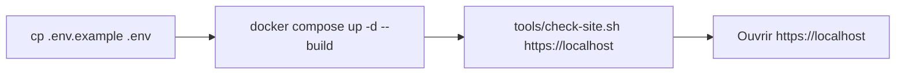
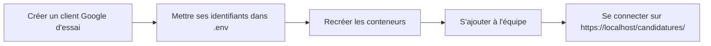

# Lancer le site avec Docker sur ton poste

> Trois commandes suffisent pour faire tourner le site comme sur le serveur, connexion Google et API comprises. Cette page dit aussi quels avertissements sont normaux, et comment tester une vraie connexion avec un compte @yeita.fr.

## En un coup d'œil

Il faut que Docker Desktop soit lancé. Trois conteneurs démarrent : oauth2-proxy, l'API et Caddy. Les pages publiques s'affichent ; l'espace Candidatures renvoie vers Google.

## Démarrer
```bash
cp .env.example .env
docker compose up -d --build
tools/check-site.sh https://localhost
```
Le contrôle doit afficher 6 `OK`, dont l'API refusée sans connexion. Le fichier `.env` contient des réglages de test ; il n'est jamais envoyé sur GitHub.

L'API n'a aucun port sur ton poste : on ne la joint qu'au travers d'oauth2-proxy, sous `/api/`. Ses journaux : `docker compose logs --tail 100 api`.

Après un changement de `.env` : `docker compose up -d --force-recreate`. Après un changement des pages : `docker compose up -d --build`.

## Tout arrêter
Depuis le dossier du dépôt, du plus léger au plus complet :

| Je veux… | Commande |
|---|---|
| Arrêter le site (conteneurs et réseaux supprimés, base et certificat gardés) | `docker compose --profile caddy down` |
| Vérifier que plus rien ne tourne | `docker compose ps -a` (liste vide) |
| Effacer aussi les volumes : certificat local **et base des candidatures** | `docker compose --profile caddy down --volumes` |
| Supprimer les images construites | `docker image rm recrutement-front recrutement-api` |
| Supprimer les réglages de test | `rm .env` |
| Arrêter Docker lui-même | menu de la baleine, « Quit Docker Desktop », ou `osascript -e 'quit app "Docker"'` |

> Écris bien `--profile caddy` : un `docker compose down` sans lui laisse Caddy tourner, et il garde les ports 80 et 443.

> `--volumes` efface la base : sur ton poste seulement, jamais sur le serveur.

## Les avertissements normaux
| Ce que tu vois | Pourquoi | Que faire |
|---|---|---|
| « Non sécurisé » sur `https://localhost` | Le certificat est fabriqué par Caddy sur ton poste | Rien ; ou lui faire confiance (ci-dessous) |
| « Not secure » sur `http://127.0.0.1:4180` | Test sans Caddy, sans chiffrement | Normal en local |
| Google : `Erreur 401 : invalid_client` | Le `.env` de test contient un faux identifiant Google | Normal : la redirection prouve que la page est protégée |

### Faire confiance au certificat local (facultatif, Mac)
```bash
docker compose cp caddy:/data/caddy/pki/authorities/local/root.crt ./caddy-root.crt
sudo security add-trusted-cert -d -r trustRoot -k /Library/Keychains/System.keychain ./caddy-root.crt
```
Supprime ensuite `caddy-root.crt` du dossier. Pour revenir en arrière : Trousseau d'accès, « Caddy Local Authority - <année> ECC Root », supprimer.

## Tester une vraie connexion Google

1. Dans la console Google Cloud de Yeita : écran de consentement de type **Interne**, puis un identifiant OAuth « Application Web », avec l'adresse de retour `https://localhost/oauth2/callback`.
2. Dans ton `.env`, remplace l'identifiant et le secret du client. Garde le reste tel quel.
3. Lance `docker compose up -d --force-recreate`.
4. Ajoute ton compte à l'équipe de la base locale : `docker compose exec api node api/equipe.js add prenom.nom@yeita.fr Prénom admin`.
5. Ouvre `https://localhost/candidatures/` : en haut, « Connecté·e : » suivi de ton prénom. Un compte extérieur est refusé.

> Teste avec Caddy (`https://localhost`), pas sur `http://127.0.0.1:4180` : sans HTTPS, le navigateur ne renvoie pas le cookie de session.

Si Google répond `redirect_uri_mismatch`, l'adresse de retour du client n'est pas exactement `https://localhost/oauth2/callback`.

## À savoir
- Les vrais identifiants Google ne vont que dans `.env`, jamais ailleurs dans le dépôt.
- Un client Google d'essai, séparé de celui du serveur, évite de mélanger les deux.
- Sans Caddy (cas A), oauth2-proxy et l'API démarrent seuls ; la vraie connexion n'aboutit qu'avec Caddy.
- Le mode d'emploi du serveur est dans `deploy/README.md`.

## Voir aussi
- [Architecture et déploiement](architecture.md)
- [L'API de stockage](api.md)
- [Conventions et tests](conventions.md)
- Les commandes du cas A et le détail de chaque étape sont dans la version complète.
