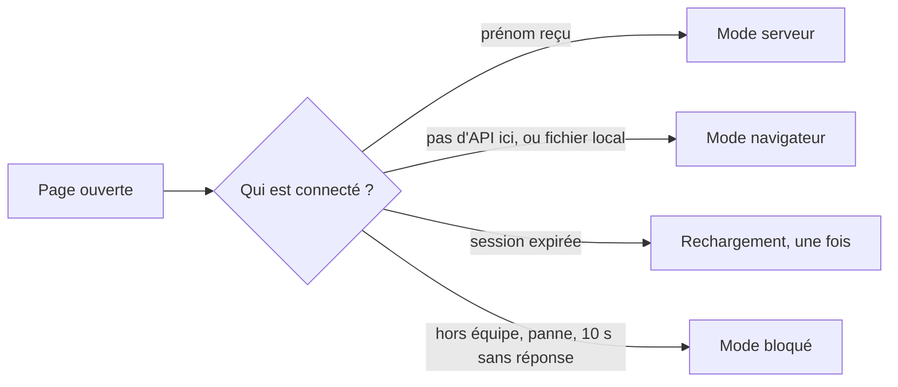
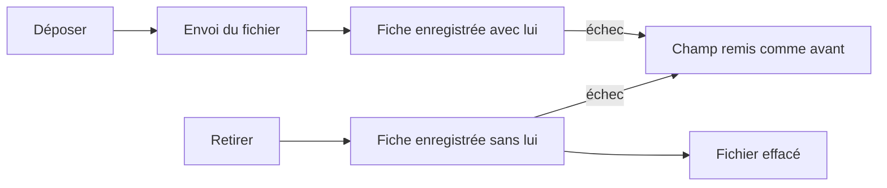

# Comment les pages choisissent où ranger les dossiers

> Depuis la v1.3, chaque page de l'espace Candidatures demande d'abord à l'API qui est connecté. Selon la réponse, elle travaille avec la base partagée (mode serveur), dans le navigateur comme avant (mode navigateur), ou ne fait rien et explique pourquoi (mode bloqué). Depuis la v1.10, en mode serveur, la fiche du candidat dépose aussi des fichiers (CV, portfolio) dans un ordre qui garde toujours le fichier et le dossier d'accord.

## En un coup d'œil

La question part dès le chargement. Tant que la réponse n'est pas arrivée, la page montre sa structure sans données et rien ne s'enregistre. Les règles du parcours ne changent pas : seuls le rangement des dossiers et l'identité changent.

> Sur le site de production, une page ne passe jamais en mode navigateur sans le dire. Une API absente y donne le mode bloqué, avec un bandeau.

## Les éléments principaux

### Le démarrage (`assets/demarrage.js`)
C'est le premier à parler à l'API. Il choisit le mode, puis branche le bon rangement, la bonne identité et la bonne liste d'options de disponibilité. Les pages attendent son feu vert avant leur première lecture.

Il porte aussi le bandeau d'erreur : un message collé en haut de la fenêtre, avec un bouton « Recharger ». Il ne vole pas le focus. Un lecteur n'a pas de bouton, puisque recharger ne changerait rien. En mode serveur, il remplace aussi le texte du bandeau jaune sur toutes les pages (v1.4).

| Réponse de l'API | Ce que fait la page |
|---|---|
| Page ouverte depuis un fichier | mode navigateur, sans rien demander |
| « Pas de page ici » (404), hors du site de production | mode navigateur |
| La même, sur le site de production | mode bloqué, message réseau |
| Session expirée | un rechargement ; si ça recommence dans la minute, message de session |
| Compte hors équipe | mode bloqué, « Tu ne fais pas partie de l'équipe. » |
| Le compte et son prénom | mode serveur |
| Tout le reste (panne, 10 s sans réponse) | mode bloqué, message réseau |

### L'adaptateur serveur (`assets/adapter-serveur.js`)
Il traduit les gestes du dossier (lister, lire, enregistrer, supprimer) en demandes à l'API. Il retient la version de chaque dossier lu, pour que l'API refuse un enregistrement fait sur une version dépassée.

Les enregistrements d'un même dossier partent l'un après l'autre : un recruteur seul ne se met jamais en conflit avec lui-même. L'adaptateur ne réessaie jamais tout seul. Un refus remonte à la page, qui l'affiche dans le bandeau d'erreur.

Depuis la v1.10, il sait aussi envoyer un fichier, lister ceux d'un candidat, donner l'adresse pour l'ouvrir et le retirer. Ces demandes passent hors de la file du dossier. Leurs refus ne montent pas dans le bandeau : la fiche les affiche sous le champ concerné, avec un message adapté.

### Les fiches qui écrivent leur partie (`assets/dossier.js`)
La fiche EC1, la fiche EC2 et la feuille de décompte n'enregistrent pas le dossier entier. Elles relisent le dossier, y posent leur seule partie, puis l'écrivent. Si la partie a changé ailleurs entre-temps, rien n'est écrit et le bandeau d'erreur le dit.

Quand on quitte une page juste après avoir tapé, la dernière saisie part aussitôt, sans attendre la file. Si un collègue a enregistré juste avant, ces dernières frappes peuvent être perdues sans message : c'est un risque accepté.

### L'identité et les options (`assets/qui.js`, `assets/store.js`)
En mode serveur, la liste « Qui es-tu ? » disparaît : l'en-tête affiche « Connecté·e : Alice », avec « · lecture seule » pour un compte en lecture. Depuis la v1.10, ce même rôle retire toutes les commandes d'écriture des documents : un lecteur ouvre un CV, il ne voit ni « Déposer », ni « Retirer », ni « Modifier ». Les options de disponibilité viennent de l'API.

Les règles du parcours ignorent les lignes de documents de l'historique : un dépôt ou un retrait n'est jamais pris pour un passage d'étape (pour « Annuler le dernier passage » ou le temps passé dans l'étape).

### CV et portfolio (`candidatures/menu-candidat.js`, v1.10)
Un même champ vit à deux endroits : dans le bloc Infos en haut de l'appel, et dans la fenêtre Fiche du candidat du menu ⋯. Le principe : la fiche ne cite un fichier qu'une fois celui-ci gardé par l'API, et l'API ne l'efface qu'une fois la fiche enregistrée sans lui.

| Situation | Ce que fait la page |
|---|---|
| L'enregistrement est refusé par l'API (conflit…) | le champ revient exactement comme avant, et le fichier tout juste envoyé est retiré |
| La réponse se perd (réseau) | le champ revient comme avant ; rien n'est retiré, l'API fera le ménage plus tard |
| Une opération est en cours | les boutons du champ sont désactivés et la fenêtre ne se ferme pas ; les autres champs restent modifiables et partent ensuite |
| Fin de l'opération | seul le champ est redessiné, le focus y revient, le message est annoncé aux lecteurs d'écran |
| Un lien collé | il s'enregistre comme toute saisie ; il n'est cliquable que s'il commence par `http://` ou `https://` |
| Un import | toute référence à un fichier que l'API n'a pas est retirée avant l'enregistrement |

### La création d'un candidat (v1.10)
« Ajouter un candidat » ouvre la même fenêtre, en création. Au premier clic sur une action du pied, les deux actions et la fermeture sont bloquées jusqu'à la fin. Une fois le candidat créé, la fenêtre travaille sur lui : un nouveau clic enregistre les champs modifiés et renvoie seulement les fichiers restés en attente. On ne crée donc jamais deux fois le même candidat. Fermer après la création envoie ce qui reste ; un échec s'affiche alors dans un bandeau en tête de la page.

### Les six pages
Chaque page attend le démarrage avant de lire. En mode serveur, le tableau, la fiche candidat, la fiche EC2 et la carte relisent le dossier quand on revient sur leur onglet, et ne se redessinent que s'il a changé. La fiche candidat ne relit pas pendant une saisie.

## À savoir avant de modifier

- **L'ordre des scripts compte.** Le démarrage se charge après le dossier, l'identité, les règles et l'adaptateur, et avant l'interface.
- **Toute nouvelle lecture doit attendre le démarrage.** Sinon, la page lirait avant de savoir où sont les dossiers.
- **Toute décision « selon le mode » passe par le démarrage**, jamais par l'adresse du site. En mode navigateur, il n'y a pas de dépôt de fichier : CV et portfolio se mettent en lien.
- **Ne jamais citer un fichier avant que l'API l'ait gardé**, ni l'effacer avant que la fiche soit enregistrée sans lui. L'API refuse d'ailleurs les deux.
- **Un échec ne doit rien laisser derrière lui.** Après un échec, aucun enregistrement suivant (différé, départ de la page, fermeture) ne doit renvoyer le changement raté : c'est la file par dossier de l'adaptateur qui le garantit, en faisant partir l'enregistrement suivant après la remise en état.
- **Rien du dossier dans le navigateur en mode serveur.** Restent seulement un identifiant de dossier courant, la date du dernier export, des préférences d'affichage, deux relais existants et la garde contre les rechargements en boucle.
- **Les droits restent ceux de l'API.** Masquer les commandes à un lecteur est un confort ; c'est l'API qui refuse.
- **Les textes** (bandeaux, messages des documents, conflit, réseau…) sont dans `assets/wording.fr.js`.
- **Les tests** : un test sans navigateur contre une fausse API (87 vérifications), et un test de bout en bout avec l'API réelle et trois navigateurs (135 vérifications, dont 39 pour les CV et portfolios ; une seule, « départ de la page avec un enregistrement précédent lent », échoue aujourd'hui, comme sur `main`).

## Voir aussi
- [Fiche du candidat, CV et portfolio](../doc/produit/fiche-candidat.md)
- [Candidatures partagées et identité](../doc/produit/stockage-partage.md)
- [API de stockage](api.md)
- [Architecture et déploiement](architecture.md)
- [Décisions techniques](decisions.md)
- [Conventions et tests](conventions.md)
- Le détail (classement de chaque réponse, état interne de l'adaptateur, ordre exact des opérations, page par page) est dans la version complète.
