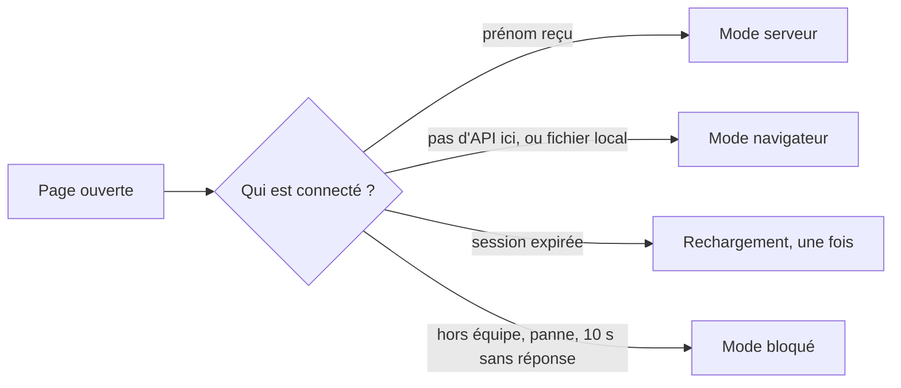

# Comment les pages choisissent où ranger les dossiers

> Depuis la v1.3, chaque page de l'espace Candidatures demande d'abord à l'API qui est connecté. Selon la réponse, elle travaille avec la base partagée (mode serveur), dans le navigateur comme avant (mode navigateur), ou ne fait rien et explique pourquoi (mode bloqué). Depuis la v1.4, ce choix règle aussi le texte du bandeau jaune et les boutons d'exemples du tableau.

## En un coup d'œil

La question part dès le chargement. Tant que la réponse n'est pas arrivée, la page montre sa structure sans données et rien ne s'enregistre. Les règles du parcours (étapes, état, décision) ne changent pas : seuls le rangement des dossiers et l'identité changent.

> Sur le site de production, une page ne passe jamais en mode navigateur sans le dire. Une API absente y donne le mode bloqué, avec un bandeau.

## Les éléments principaux

### Le démarrage (`assets/demarrage.js`)
C'est le premier à parler à l'API. Il choisit le mode, puis branche le bon rangement, la bonne identité et la bonne liste d'options de disponibilité. Les pages attendent son feu vert avant leur première lecture.

Il porte aussi le bandeau d'erreur : un message collé en haut de la fenêtre, visible même en bas d'une longue fiche, avec un bouton « Recharger ». Il ne vole pas le focus : on peut continuer à taper. Un lecteur n'a pas de bouton, puisque recharger ne changerait rien.

| Réponse de l'API | Ce que fait la page |
|---|---|
| Page ouverte depuis un fichier | mode navigateur, sans rien demander |
| « Pas de page ici » (404), hors du site de production | mode navigateur |
| La même, sur le site de production | mode bloqué, message réseau |
| Session expirée | un rechargement ; si ça recommence dans la minute, message de session |
| Compte hors équipe | mode bloqué, « Tu ne fais pas partie de l'équipe. » |
| Le compte et son prénom | mode serveur |
| Tout le reste (panne, 10 s sans réponse) | mode bloqué, message réseau |

### Le bandeau jaune (v1.4)
Chaque page porte en tête un bandeau jaune qui dit où vont les données. Au moment où le démarrage entre en mode serveur, il remplace ce texte par celui du serveur de l'équipe, sur toutes les pages. Dans les autres modes, et pendant l'attente, le texte d'origine reste.

Le démarrage change aussi l'étiquette qui désigne ce texte. Ainsi, si la page repose ses textes plus tard, elle garde le bon.

### L'adaptateur serveur (`assets/adapter-serveur.js`)
Il traduit les quatre gestes du dossier (lister, lire, enregistrer, supprimer) en demandes à l'API. Il retient la version de chaque dossier qu'il a lu, pour que l'API refuse un enregistrement fait sur une version dépassée.

Les enregistrements d'un même dossier partent l'un après l'autre : un recruteur seul ne se met jamais en conflit avec lui-même. L'adaptateur ne réessaie jamais tout seul. Un refus remonte à la page, qui l'affiche.

### Les fiches qui écrivent leur partie (`assets/dossier.js`)
La fiche EC1, la fiche EC2 et la feuille de décompte n'enregistrent pas le dossier entier. Elles relisent le dossier, y posent leur seule partie, puis l'écrivent. La fiche EC1 et la feuille de décompte d'un même candidat peuvent ainsi rester ouvertes ensemble.

Si la partie a changé ailleurs entre-temps, ou si le dossier a été supprimé, rien n'est écrit et le bandeau d'erreur le dit. Cela vaut dans les deux modes. La fiche candidat, elle, garde l'enregistrement du dossier entier.

### Le départ de la page
Quand on quitte une page juste après avoir tapé, la dernière saisie part aussitôt, sans attendre la file. Si un collègue a enregistré le même dossier juste avant, ces dernières frappes peuvent être perdues sans message : c'est un risque accepté.

### L'identité et les options (`assets/qui.js`, `assets/store.js`)
En mode serveur, la liste « Qui es-tu ? » disparaît : l'en-tête affiche « Connecté·e : Alice », ou « · lecture seule » en plus pour un lecteur. L'historique note le prénom du compte. Les options de disponibilité viennent de l'API : une option ajoutée par l'un est proposée à tous.

### Les six pages
Chaque page attend le démarrage avant de lire. En mode serveur, le tableau, la fiche candidat, la fiche EC2 et la carte relisent le dossier quand on revient sur leur onglet. Elles ne se redessinent que si le dossier a changé. La fiche candidat ne relit pas pendant une saisie.

### Les exemples du tableau (v1.4)
Le tableau (`candidatures/index.html`) règle ses boutons d'exemples selon le mode.

| Mode | « Charger des exemples » | « Retirer les exemples » |
|---|---|---|
| Navigateur | présent, comme avant | visible |
| Serveur | retiré de la page, tableau vide sans mention des exemples | visible seulement si la base contient un exemple |
| Attente, bloqué | présent mais sans effet | caché |

La visibilité de « Retirer les exemples » est recalculée à chaque affichage du tableau.

## À savoir avant de modifier

- **L'ordre des scripts compte.** Le démarrage se charge après le dossier, l'identité, les règles et l'adaptateur, et avant l'interface.
- **Toute nouvelle lecture doit attendre le démarrage.** Sinon, la page lirait avant de savoir où sont les dossiers.
- **Toute décision « selon le mode » passe par le démarrage.** Le bandeau jaune et les exemples se règlent sur le mode retenu, jamais sur l'adresse du site. Un bouton qui écrit doit vérifier le mode : pendant l'attente, son action partirait plus tard vers la base partagée.
- **Rien du dossier dans le navigateur en mode serveur.** Restent seulement un identifiant de dossier courant, la date du dernier export, des préférences d'affichage, deux relais existants et la garde contre les rechargements en boucle.
- **Les droits restent ceux de l'API.** « · lecture seule » n'est qu'un affichage ; c'est l'API qui refuse.
- **Les textes** (bandeau jaune, tableau vide, conflit, réseau, session, bouton…) sont dans `assets/wording.fr.js`.
- **Les tests** : un test sans navigateur contre une fausse API (87 vérifications), et un test de bout en bout avec l'API réelle et trois navigateurs (51 vérifications).

## Voir aussi
- [Candidatures partagées et identité](../doc/produit/stockage-partage.md)
- [API de stockage](api.md)
- [Architecture et déploiement](architecture.md)
- [Décisions techniques](decisions.md)
- [Conventions et tests](conventions.md)
- Le détail (classement de chaque réponse, état interne de l'adaptateur, page par page) est dans la version complète.
