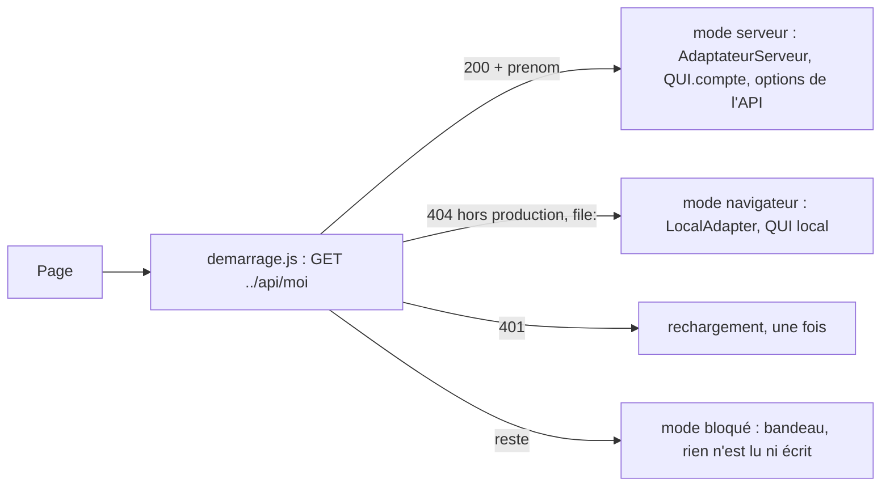

# Mode serveur des pages (démarrage, adaptateur, identité)

> Comment les 6 pages de `candidatures/` choisissent où vivent les dossiers (API ou navigateur), avant toute lecture, et comment elles lisent et écrivent dans l'API sans écraser le travail des autres. Composants créés en v1.3 : `assets/demarrage.js`, `assets/adapter-serveur.js` ; étendus : `assets/qui.js`, `assets/store.js`, `assets/dossier.js`.

## Vue d'ensemble

Ordre des scripts : `adapter-serveur.js` puis `demarrage.js` juste après `store.js`, avant `data-parcours.js`, `ui.js` et le script de la page ; `dossier.js`, `qui.js` et `store.js` sont toujours chargés avant (selon la page, `config.js` et `wording.fr.js` avant ou après `dossier.js`).

## `assets/demarrage.js` — `window.DEMARRAGE`
| Membre | Rôle |
|---|---|
| `pret` | promesse résolue au choix du mode serveur ou navigateur ; jamais résolue en mode bloqué |
| `mode()` | `"attente"`, `"serveur"`, `"navigateur"`, `"bloque"` |
| `auRetour(fn)` | `fn()` à chaque `visibilitychange` vers `visible`, en mode serveur seulement |
| `erreur(message, cas)` | bandeau `.notice.err.demarrage-bandeau`, `role="alert"`, collant (`position:sticky`), inséré en tête du `<body>` ; bouton « Recharger » (`location.reload()`) sauf `cas.code === "lecture-seule"` ; phrase « saisie non enregistrée » si `cas.ecriture` ; remplace le précédent |
| `effacer()` | retire le bandeau |

Au chargement : `D.use(adaptateur d'attente)` (chaque méthode attend `pret` puis délègue), `QUI.attente()`, `STORE.sourceDispos(mémoire)`.

| Réponse de `/api/moi` (dans cet ordre) | Effet |
|---|---|
| `location.protocol === "file:"` | navigateur, sans requête |
| rien en `window.DEMARRAGE_DELAI` (10 000 ms) | bloqué, message réseau |
| `fetch` rejeté | bloqué, réseau |
| 404 (corps non lu) | navigateur, sauf si `hoteDeProduction()` → bloqué, réseau |
| 401 | `sur401()` |
| 200 JSON avec `prenom` non vide | `serveur(moi)` |
| 200 sans `prenom` | bloqué, réseau |
| erreur `hors-equipe` | bloqué, « Tu ne fais pas partie de l'équipe. » |
| autre (non JSON, 5xx, JSON sans `code`) | bloqué, message de `AdaptateurServeur.lire` |

| Fonction | Règle |
|---|---|
| `hoteDeProduction()` | `nom(new URL(YEITA.SITE).hostname) === nom(location.hostname)`, `nom` = minuscules, points finaux retirés ; exception → `true` |
| `sur401()` | `sessionStorage` `yeita-rechargement-401` : horodatage de moins de 60 s → bloqué, message de session ; sinon horodatage écrit puis `location.reload()` ; écriture impossible → bloqué, session ; rend une promesse jamais résolue |
| `serveur(moi)` | `GET ../api/equipe` et `../api/options-disponibilite` ; un 401 → `sur401` ; autre que 200 avec un tableau → bloqué ; sinon `D.use(AdaptateurServeur({sur401, surErreur}))`, `D.onRefus`, `QUI.compte(moi, prénoms)`, `STORE.sourceDispos({ajouts, ajouter})` (POST, la réponse remplace la liste), chaque `[data-t="commun.fictif"]` reçoit `data-t="commun.serveur"` et son texte (v1.4), mode `serveur`, `pret` résolue |
| `navigateur()` | `D.use(LocalAdapter)`, `D.onRefus` (bandeau), `QUI.local()`, `STORE.sourceDispos(null)`, `pret` résolue |

## `assets/adapter-serveur.js` — `window.AdaptateurServeur(opts)`
`opts` : `base` (`"../api/"`), `sur401()`, `surErreur(erreur)`, `fetch` (tests). Rend `{name: "serveur", volatile: false, list, get, put, remove, partir, deposer, fichiers, fichierUrl, retirerFichier, enVol, version}`.

| État interne | Contenu |
|---|---|
| `parObjet` (`WeakMap`) | objet dossier → version lue ou écrite |
| `parId` | id → plus haute version reçue |
| `supprimes` | id supprimés depuis cette page |
| `enCours` | id → `{objet, version}` du PUT en cours |
| `files` | id → dernière requête de la file (les requêtes d'un même id partent l'une après l'autre) |

| Méthode | Comportement |
|---|---|
| `list()` | `GET ../api/candidats` (hors file) ; chaque `data` passe par `DOSSIER.upgrade` ; versions retenues |
| `get(id)` | id hors `MOTIF_ID` (`^cand-[a-z0-9]{1,16}-[a-z0-9]{1,16}$`) → `null` sans requête ; 200 → `upgrade(data)` ; `introuvable` ou 400 → `null` ; autre → rejet |
| `put(d)` | id hors motif → rejet `identifiant` (« Identifiant invalide pour « {nom} » … ») sans requête ; id supprimé → rejet `conflit` sans requête ; version = `parObjet(d)`, sinon `parId[id]`, sinon `null`, lue au départ de la requête ; 200/201 → version retenue, rend `d` |
| `remove(id)` | hors motif → `null` ; 204 ou `introuvable` → id retenu comme supprimé |
| `partir(d, base)` | `keepalive`, hors file ; version = celle du PUT en cours + 1 si `base` est son objet, sinon `parObjet(base)`, sinon `null` ; jamais la plus haute par id (revue v1.3, Q1) |
| `deposer(id, champ, fichier)` (1.10) | `POST ../api/candidats/:id/fichiers?champ=…`, corps brut, `Content-Type` du fichier, nom dans `X-Nom-Fichier` ; hors file ; rend les métadonnées ; rejet sans bandeau (`e.status` gardé : un 413 sans JSON de nginx reste `reseau` avec `status` 413) |
| `fichiers(id)` (1.10) | `GET …/fichiers` ; `[]` si le candidat n'existe pas |
| `fichierUrl(id, fid)` (1.10) | adresse de lecture (lien « Ouvrir ») |
| `retirerFichier(id, fid)` (1.10) | `DELETE …/fichiers/:fid` ; `fichier-introuvable` → résolu ; autre → rejet sans bandeau |
| `enVol(id)` | objet du PUT en cours, ou `null` |
| `AdaptateurServeur.lire(res)` | classement : 401 → `{type: "401"}` ; 204 → ok ; `Content-Type` sans `application/json` → `reseau` ; JSON illisible → `reseau` ; ok → `{type: "ok", json}` ; JSON avec `code` → erreur de ce code (texte de `wording` pour `conflit`, `hors-equipe`, `lecture-seule`) ; sans `code` → `api`, texte `erreur` |
| `AdaptateurServeur.texte(cle, vars)` | texte de `WORDING.serveur`, repli interne |
Tout rejet (hors 401) appelle `surErreur(e)` puis rejette ; `e.ecriture` vaut `true` pour `put` et `remove` ; un 401 appelle `sur401()` et ne se résout pas. Aucune nouvelle tentative.

## `assets/dossier.js` (étendu)
| Fonction | Rôle |
|---|---|
| `DOSSIER.ecrirePartie(d, {lire, poser})` | relit `d.id` ; vide → refus `conflit` ; `JSON.stringify(lire(relu))` ≠ celui de `lire(d)` → refus ; sinon `poser(relu)`, `save(relu)` ; sur 409, une seule nouvelle tentative avec le même contrôle ; refus : `e.code = "conflit"`, `e.ecriture`, `DOSSIER.onRefus(e)` |
| `DOSSIER.partir(d)` | `touch(upgrade(d))`, `adapter.partir(d, d)` ou `put` |
| `DOSSIER.partirPartie(base, poser)` | socle = `adapter.enVol(base.id)` ou `base` ; copie, `poser`, `adapter.partir(copie, socle)` |
| `DOSSIER.onRefus` | posé par le démarrage (bandeau), dans les deux modes |
| `DOSSIER.onRetabli` | posé par le démarrage en mode serveur (`effacer`) : appelé quand la nouvelle tentative après un 409 réussit (revue v1.3, Q2) |

## `assets/qui.js` (étendu)
| État | `moi()` | `equipe()` | `ajouter(nom)` | `monter(el)` |
|---|---|---|---|---|
| `local` (défaut) | `yeita-recruteur` | `YEITA_CONFIG.equipe` + `yeita-equipe-ajouts` | localStorage | liste « Qui es-tu ? » |
| `attente` (`QUI.attente()`) | `""` | — | mémoire de la page | vide |
| `compte` (`QUI.compte(moi, prenoms)`) | `moi.prenom` | prénoms de `/api/equipe` + ajouts de la page | mémoire de la page | `` « Connecté·e : {prénom} » + « · lecture seule » si `role === "lecture"` |
`choisir()` ne fait rien hors de l'état `local`. `monter` se redessine à chaque changement d'état (`emit`).

## `assets/store.js` (étendu)
`STORE.sourceDispos(src)` : `src = {ajouts(), ajouter(libelle)}` ou `null` (localStorage `yeita-options-disponibilite`). `dispos()` et `addDispo()` gardent leurs règles (base `D.DISPOS` + ajouts, sans doublon, synchrones).

## Pages
| Page | Première lecture | Retour sur l'onglet | Écriture |
|---|---|---|---|
| `index.html` | `DEMARRAGE.pret.then(load)` ; en mode serveur, `label` de « Remplacer tout » retiré, `#demo-load` et `#empty-demo` retirés, texte du tableau vide `tableau.vide.texteServeur` (v1.4) ; le clic sur `#demo-load` / `#empty-demo` ne fait rien hors du mode `navigateur` ; `#demo-clear` caché au départ, puis à chaque `renderBoard` : visible en mode navigateur, en mode serveur seulement si un dossier lu a `meta.demo` (v1.4) | relit la liste, redessine si `id@modifieLe` change | `store.js` (inchangé) |
| `candidat.html` | `DEMARRAGE.pret.then(load)` | relit si `peutRelire()` (ni enregistrement en attente, en cours ou refusé, ni formulaire de refus ouvert, ni champ actif dans `#body`), revérifié à la réponse ; redessine si `meta.modifieLe` change ; retire le bandeau | dossier entier ; « Non enregistré » dans `#saved` sur refus ; `pagehide` → `D.partir(cur)` |
| `ec1.html`, `ec2.html` | `DEMARRAGE.pret.then(get)` | `ec2` : `renderFrom1()` | `ecrirePartie` : `{fiches.ec1, ec1}` / `{fiches.ec2, ec2}` ; « Non enregistré » dans `renderExits` des deux pages (EC2 corrigée à la relecture de la doc) ; `pagehide` → `partirPartie(cand, …)` |
| `decompte.html` | `DEMARRAGE.pret.then(get)` (avec `?id=`) | — | `ecrirePartie` : `fiches.decompte` ; `pagehide` → `partirPartie` |
| panneau Notes (`candidatures/notes.js`, 1.6) | le dossier de la page | — | sur `ec1.html` et `ec2.html` : `ecrirePartie` : `notesLibres[étape]`, avec sa propre base (le dernier dossier écrit par le panneau) ; `pagehide` → `partirPartie`. Sur `candidat.html` : la note est posée sur le dossier de la page, enregistré comme le reste |
| menu ⋯ (`candidatures/menu-candidat.js`, 1.6) | `STORE.getCandidate` à l'ouverture | — | Fiche du candidat : `saveCandidate` de sa copie, la page reprend le dossier à la fermeture ; Supprimer : `removeCandidate` |
| `carte.html` | `pret`, puis `migrateCodes()` seulement hors mode serveur, puis `refresh` | relit, redessine si `meta.modifieLe` change | `store.js`, `setRestitution` |
Les écoutes `storage` existantes restent (mode navigateur).

## CV et portfolio (`candidatures/menu-candidat.js`, 1.10)
Spec 1.10 R3 à R7, R19 à R21. Un champ (`docHTML`) vit dans le bloc Infos de l'appel (`data-doc-ctx="page"`, objet `cur` de `candidat.html`) ou dans la fenêtre du menu ⋯ (`"modal"`, objet `copie`).

| Opération | Ordre | Échec |
|---|---|---|
| Dépôt (`deposer`, champ vide) | `deposer` (POST) → référence, lien vidé, ligne `fichier/depot` sur l'objet → `saveCandidate` → ancien fichier retiré au mieux | envoi : message R7 (`docs.erreurServeur` si 413 sans JSON, `docs.erreurTaille`, `docs.erreurType`) ; enregistrement : champ remis (`remettre`), refus lu (code ≠ `reseau`) → nouveau fichier retiré au mieux (`auMieux`), sinon rien ; 409 → `docs.nonEnregistreConflit` |
| Retrait (`enleverFichier`) | référence ôtée, ligne `fichier/retrait` (et `lien` si un lien remplace) → `saveCandidate` → `retirerFichier` au mieux | champ remis, message |
| Lien seul | `c.identite[champ] = v`, ligne `fichier/lien` ; enregistrement différé de la page (`plusTard` / `schedule`) | comme toute saisie |

`operer` : une opération à la fois (`operation`), boutons du champ `disabled`, fenêtre impossible à fermer ; `h.avant()` enregistre d'abord une saisie en attente ; à la fin, seul le champ est redessiné (`redessinerChamp`), le focus y revient, le message (`.docmsg`, `aria-live`) est écrit au tour suivant. Les enregistrements différés ne sont pas retenus pendant l'opération : la file par dossier de l'adaptateur (`enFile`) fait partir le suivant après la réaction à l'échec du précédent, donc après `remettre` (mutation T5 survivante, garde-fou retiré, fiche de la tâche 03).

Création (`creer`, `valider`, `enregistrerCreation`) : `creation` (pied et fermeture bloqués), `cree` (le candidat créé : un nouveau clic enregistre la fiche normalisée par `normFiche`, puis les seuls fichiers d'`attente`) ; un fichier en échec reste dans `attente` (message + `docs.relance`) ; fermer une fois créé → `fermerApresCreation` (envoi, puis `bandeau` en tête de page en cas d'échec, `role="alert"`).

Liens (R20) : `docHTML` ne rend un `<a href>` que pour `^https?://`, sinon un texte. Import (R21) : `STORE.importAll` passe chaque dossier par `sansFichiersAbsents` (référence absente de `fichiers(id)` → `null`).

## Textes (`assets/wording.fr.js`)
`qui.connecte` « Connecté·e : », `qui.lectureSeule` « · lecture seule » ; `commun.serveur` (bandeau jaune en mode serveur) et `tableau.vide.texteServeur` (v1.4) ; `serveur` : `conflit`, `horsEquipe`, `lectureSeule`, `reseau`, `session`, `identifiant`, `saisie`, `nonEnregistre`, `recharger`, `exportTexte`. `YEITA.SITE` = `https://recrutement.yeita.fr/` (`assets/yeita.js`) ; `wirePrint` y ajoute le nom de la page, précédé de `candidatures/` pour une page de ce dossier (lien « Ouvrir sur le site »).

## Stockage du navigateur en mode serveur
Rien n'est écrit dans `yeita-dossiers`, `yeita-equipe-ajouts`, `yeita-recruteur`, `yeita-options-disponibilite`. Restent : `yeita-dossier-courant` (un identifiant), `yeita-dernier-export` (date du dernier export, `store.js`), `yeita-candidatures-ui`, `yeita-carte-identite`, `yeita-match-resultat` (relais hors périmètre), `sessionStorage` `yeita-notice`, `yeita-rechargement-401`.

## Tests
`node tools/test-serveur.js` (87 vérifications, fausse API, contexte `vm` comme `tools/test-store.js`) ; `tools/e2e-serveur.py` (120 vérifications (41 pour la page des déploiements, v1.9 ; 24 « 1.10 » pour les fichiers), API réelle) : voir [Conventions](conventions.md#tests).

## Voir aussi
- [API de stockage](api.md)
- [Architecture et déploiement](architecture.md)
- [Décisions](decisions.md)
- Contrat : `docs/backend/MODELE.md`

## Historique
| Version | Changement |
|---|---|
| 1.3 | Création : démarrage, adaptateur serveur, identité et options en mode serveur, écriture des fiches par partie |
| 1.4 | Bandeau jaune en mode serveur (`commun.serveur`) ; boutons d'exemples de `index.html` selon le mode |
| 1.6 | Deux écrivains de plus : le panneau Notes (`notesLibres[étape]`, par partie) et la fenêtre Fiche du candidat du menu ⋯ ; les fiches EC1 et EC2 travaillent sur une copie de leur partie |
| 1.10 | Dépôt de fichiers : `AdaptateurServeur.deposer`, `fichiers`, `fichierUrl`, `retirerFichier` (hors de la file par dossier) ; en mode navigateur, CV et portfolio en lien seulement ; ordres de dépôt et de retrait, état d'avant après un échec, création sans doublon, liens filtrés, import sans référence absente (section « CV et portfolio ») |
