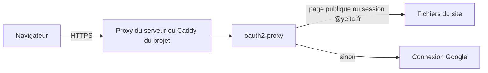

# Mettre l'espace Candidatures en ligne sur le serveur de Yeita, réservé à l'équipe

> L'espace Candidatures quitte GitHub Pages pour le serveur OVH de Yeita. Il n'est visible qu'avec un compte Google @yeita.fr, sauf les pages destinées aux candidats, qui restent ouvertes à tous.

## Pourquoi
Aujourd'hui, le site est public sur GitHub Pages. Pour que l'équipe l'utilise vraiment, l'espace Candidatures doit être fermé aux personnes extérieures. Le serveur de Yeita fait déjà tourner d'autres services, dont on ne connaît pas encore la liste : l'installation ne doit rien casser ni rien supposer sur eux. Les données restent dans le navigateur de chacun, comme avant.

## Ce qui change pour l'utilisateur
| Avant | Après |
|---|---|
| Tout le site est public sur GitHub Pages | Le site vit sur `recrutement.yeita.fr` |
| L'espace Candidatures s'ouvre sans connexion | Il demande un compte Google @yeita.fr |
| Le guide, le one-pager, le kit Yeita Match et les téléchargements sont publics | Ils restent publics, sans connexion |
| Le lien « Ton parcours » du mail candidat pointe vers GitHub Pages | Il pointe vers `recrutement.yeita.fr/one-pager.html` |

## Comment ça marche

oauth2-proxy est le gardien : il sert lui-même les fichiers du site, et il ne laisse passer que les pages publiques ou les personnes connectées avec un compte @yeita.fr. Il n'écoute que sur la machine elle-même : on arrive jusqu'à lui par le proxy déjà installé sur le serveur (cas A) ou par un Caddy fourni par le projet, s'il n'y en a pas (cas B).

### Installer puis mettre à jour
L'administrateur prépare le serveur une seule fois avec un script prudent. Ensuite, le compte `deploy` lance un script de déploiement à chaque mise à jour. Ce script contrôle le site à la fin, et il sait revenir à une version précédente.

## Les règles à retenir
| Règle | En clair | Exemple |
|---|---|---|
| Liste publique fermée | Seules quelques adresses sont ouvertes ; tout le reste demande une connexion | `one-pager.html` s'ouvre, `candidatures/` redirige vers Google |
| Pas de confiance dans les en-têtes des proxys | Un en-tête ajouté à la main ne peut pas ouvrir une page protégée | Faille trouvée et fermée pendant la relecture |
| Secrets hors du dépôt | Les identifiants Google et le secret des cookies vivent dans un fichier `.env` sur le serveur | Le déploiement refuse les valeurs d'exemple |
| Ne rien supposer du serveur | Les scripts vérifient tout avant d'agir, et s'arrêtent au moindre doute sans rien changer | Un compte `deploy` déjà utilisé par un autre service arrête la préparation |
| Nettoyer seulement ce qui est à nous | Seules les images Docker étiquetées « recrutement » sont supprimées | Jamais de nettoyage global |

## Côté technique
- Une image Docker en deux étapes : Python construit le site, puis oauth2-proxy 7.15.5 le sert.
- Docker Compose avec un service `front` et, en option, un service `caddy` (2.11.7).
- Journaux limités à 30 Mo par service ; redémarrage automatique après un redémarrage du serveur.
- Un script `check-site.sh` vérifie cinq adresses clés après chaque déploiement.

## Ce qu'on ne fait pas
- Pas de base de données ni d'API : les données restent dans le navigateur.
- Pas de sauvegarde, pas de déploiement automatique, pas de supervision.
- Rien n'est installé sur le serveur (ni Docker, ni pare-feu), et rien n'y est exécuté pendant cette version.
- Les pages ne changent pas, même celles qui citent encore GitHub Pages (proposé pour plus tard).

## Comment on saura que c'est réussi
- En local, le site complet tourne derrière Caddy et le contrôle automatique passe, dans le cas A comme dans le cas B.
- Chaque page publique s'ouvre sans connexion, et chaque page protégée renvoie vers Google, même avec un en-tête forgé.
- Les scripts du serveur, testés dans un conteneur Ubuntu, s'arrêtent proprement dans tous les cas risqués, et une seconde préparation ne change rien.
- Les exemples nginx et Caddy du mode d'emploi passent les validations officielles.
- Les tests existants du site passent toujours.

## Points de vigilance
- `reverse_proxy` passe à `false` contre la décision initiale : les journaux montrent l'adresse du proxy, pas celle du visiteur.
- La vraie connexion Google n'est testable qu'avec le vrai client OAuth, sur le serveur.
- La durée de session reste celle par défaut (7 jours) : une durée plus courte est proposée pour plus tard.
