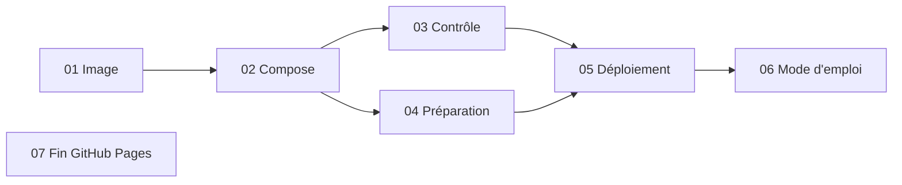

# Découpage — Déploiement de l'espace Candidatures sur le serveur OVH

> 7 tâches · ordre : l'image d'abord (tout en dépend), puis la pile locale et son contrôle, puis les deux scripts serveur (les plus risqués, testés dans Ubuntu), enfin le mode d'emploi et la fin de GitHub Pages.

## Tâches
| # | Tâche | Objectif | Dépend de | Spec |
|---|---|---|---|---|
| 01 | [Image front](01-image-front.md) | `docker/front.Dockerfile`, `.dockerignore`, `SKIP` de `build.py`, `deploy/oauth2-proxy.cfg` | — | R1–R5, R7, R17 ; CA1, CA3 (en direct) |
| 02 | [Pile Compose](02-pile-compose.md) | `compose.yaml`, `deploy/Caddyfile`, `.env.example`, `.gitignore` | 01 | R6, R8–R12, R20–R22 ; CA4, CA5, CA6 |
| 03 | [Contrôle du site](03-controle-site.md) | `tools/check-site.sh` ; mode test local cas B et A | 02 | R13, R21 ; CA2, CA3, CA7, CA13 |
| 04 | [Préparation du serveur](04-preparation-serveur.md) | `deploy/prepare-serveur.sh`, testé selon R23 | 02 | R16, R23 ; CA8 |
| 05 | [Déploiement](05-deploiement.md) | `deploy/deploy.sh`, testé selon R23 | 03, 04 | R14, R15, R23 ; CA9 |
| 06 | [Mode d'emploi](06-mode-emploi.md) | `deploy/README.md`, exemples nginx et Caddy validés | 03, 04, 05 | R19 ; CA12 |
| 07 | [Fin de GitHub Pages](07-fin-github-pages.md) | suppression de `pages.yml`, `assets/config.js`, `README.md` racine | — | R18 ; CA10, CA11 |

## Logique d'ordre
L'image porte la règle la plus sensible (la liste publique) : elle passe en premier, testée seule. La pile Compose et le contrôle du site suivent, car les scripts serveur s'appuient sur eux. Les deux scripts serveur, à risque sur un serveur partagé, sont faits avant le mode d'emploi, qui décrit ce qu'ils font réellement. La fin de GitHub Pages est indépendante.

## Dépendances

