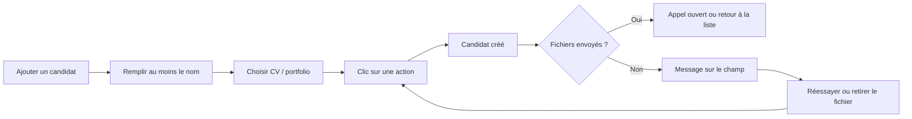
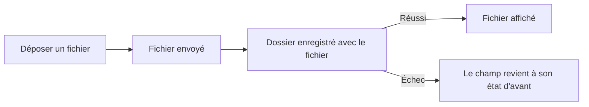

# La fiche du candidat de Léo, prête pour la production

> On reprend le travail de Léo sur la fiche du candidat (création dans une seule fenêtre, CV et portfolio en fichier ou en lien, étapes harmonisées) et on le rend sûr en production. Un CV déposé est toujours bien rangé dans le bon dossier, et le déploiement automatique, le retour arrière et les sauvegardes continuent de marcher.

## Pourquoi
Léo a préparé une branche qui améliore nettement l'espace Candidatures. Il l'a écrite avant les versions v1.7 (sauvegardes), v1.8 et v1.9 (déploiement automatique). Telle quelle, elle ne pouvait pas partir en ligne sans risque.

Les principaux défauts relevés au départ :
- après sa mise en ligne, l'ancienne version ne savait plus lire la base, donc aucun retour arrière possible ;
- le serveur web de production refuse tout envoi de plus de 1 Mo : aucun vrai CV ne serait passé ;
- un envoi de fichier raté, puis un nouveau clic, créait un second candidat ;
- un échec au mauvais moment laissait un fichier sans dossier, ou un dossier qui pointe vers un fichier effacé ;
- aucun fichier abandonné n'était jamais nettoyé, ce qui pose un problème de données personnelles.

Après cette version : les écrans de Léo sont en ligne, et chacun de ces défauts est corrigé et prouvé par un test.

## Ce qui change pour l'utilisateur
| Sujet | Ce que voit le recruteur |
|---|---|
| Créer un candidat | « Ajouter un candidat » ouvre la fenêtre « Fiche du candidat » (Identité, Contact, Documents, Suivi), avec deux boutons : « Passer à l'appel de découverte » ou « Enregistrer et revenir à la liste » |
| CV et portfolio | « Déposer un fichier » (PDF, PNG ou JPEG, 10 Mo au plus) ou « Coller un lien » |
| Un fichier déposé | Son nom, sa taille, « Ouvrir » (nouvel onglet) et « Retirer » |
| Supprimer un candidat | Le message prévient que ses fichiers partent avec lui ; tout est effacé |
| Pages d'étapes | Harmonisées : appel sans liens utiles, section « Yeita Match » à l'étape EC1, plus de « Liens et outils », plus de sélecteur d'État, noms tels que saisis, initiales sur le kanban, durée RGPD de 22 mois |
| Mise en page | Largeur commune ; le panneau Notes se place à côté sur un grand écran, par-dessus sinon |

## Comment ça marche

### Créer un candidat

Dès le premier clic, les deux boutons et la fermeture de la fenêtre sont bloqués jusqu'à la fin. Il ne peut donc y avoir qu'un seul candidat, même en cliquant deux fois ou sur l'autre bouton.

Si un fichier n'arrive pas, le candidat existe déjà. Le message dit : « Réessaie, ou retire-le pour continuer sans. » Un nouveau clic enregistre les champs modifiés et renvoie seulement les fichiers qui manquent.

Fermer la fenêtre une fois le candidat créé revient à « Enregistrer et revenir à la liste ». Si un envoi échoue alors, un bandeau sur la liste le signale.

### Déposer, retirer, remplacer un document

Pour retirer, c'est l'inverse : on enregistre d'abord le dossier sans le fichier, puis seulement on efface le fichier. Pour remplacer un fichier, on le retire, puis on dépose le nouveau ou on colle un lien.

Si le serveur refuse clairement, le fichier tout juste envoyé est retiré. Si on ne sait pas ce qui s'est passé (coupure réseau, réponse perdue), rien n'est retiré : le nettoyage automatique s'en occupera.

## Les règles à retenir
| Règle | En clair | Exemple |
|---|---|---|
| Un échec ne change rien | Si un dépôt ou un retrait échoue, le champ garde son contenu d'avant. Ce qu'on a tapé ailleurs pendant ce temps est gardé | Dépôt refusé : l'ancien lien reste affiché, la note saisie à côté est enregistrée |
| Jamais de lien vers un fichier absent | Le serveur refuse d'enregistrer un dossier qui cite un fichier qui n'existe pas | Message : « Le CV ou le portfolio de cette fiche n'existe plus. Recharge la page. » |
| Nettoyage automatique | À chaque enregistrement d'un dossier, le serveur efface les fichiers de ce candidat que le dossier ne cite pas, s'ils ont plus d'une heure | Un CV envoyé mais jamais rattaché disparaît au prochain enregistrement, au-delà d'une heure |
| Effacement réel | Un fichier retiré, nettoyé ou supprimé avec son candidat ne laisse aucune trace dans la base | — |
| Fichiers contrôlés | PDF, PNG, JPEG, vérifiés sur leur contenu et pas seulement leur nom ; 10 Mo au plus ; nom nettoyé | Un faux PDF est refusé |
| Liens sûrs | Un lien n'est cliquable que s'il commence par `http://` ou `https://` ; sinon il s'affiche en texte simple | Un lien piégé importé ne s'exécute pas |
| Droits | Tous les membres actifs lisent ; seuls les rôles recruteur et admin déposent ou retirent | Un lecteur voit le CV, sans bouton |
| Historique | Dépôt, retrait, lien posé, lien retiré s'inscrivent dans l'historique du dossier, seulement si l'enregistrement a réussi | — |
| Deux recruteurs en même temps | Si quelqu'un a modifié la candidature entre-temps, le dépôt est refusé | « CV non enregistré : la candidature a été modifiée par quelqu'un d'autre. Recharge la page, puis dépose-le à nouveau. » |

## À l'écran
| État du champ | Ce qu'on voit |
|---|---|
| Vide | « Déposer un fichier », « Coller un lien », et « ou glisse-le ici » |
| Envoi en cours | « Envoi de <nom>… », tous les boutons du champ désactivés |
| Fichier | Trombone, nom, taille, « Ouvrir », « Retirer » |
| Lien | Lien court, « Modifier », « Retirer » |
| Erreur | Le message, et le contenu d'avant toujours affiché |
| Lecture seule | Le fichier ou le lien sans bouton ; vide : « Non renseigné » |

Si le serveur web refuse un fichier trop lourd pour lui, le message dit : « Le serveur refuse ce fichier. Colle plutôt un lien et préviens Sofiane ou Léo. »

Pour l'accessibilité : « Déposer un fichier » est un vrai bouton, le glisser-déposer n'est jamais le seul moyen ; les messages sont lus par les lecteurs d'écran ; le focus revient sur le champ après un dépôt ou un retrait.

En mode navigateur (sans serveur), CV et portfolio ne se donnent qu'en lien.

## Mise en production et retour arrière
- **Avant de cliquer Merge**, Sofiane ou Léo font une étape sur le serveur : une sauvegarde, puis le réglage du serveur web pour accepter les fichiers jusqu'à 10 Mo, avec une preuve qu'un envoi de 2 Mo passe. Le guide de mise à jour le dit dès son introduction.
- Ensuite, le déploiement automatique de la v1.9 fait le reste, sans modification.
- La base garde son numéro de version : la v1.9 sait toujours la relire.
- **Retour vers la v1.9** : possible. Pendant ce temps, les fichiers ne s'affichent pas, les lignes de dépôt apparaissent comme des passages sans étape, et « Annuler le dernier passage » est refusé si une ligne de dépôt est la dernière. Rien n'est perdu : tout revient avec la v1.10. Il ne faut pas recoller les CV en lien.
- **Sauvegardes** : les fichiers sont dans chaque copie. La taille totale à prévoir vaut 33 fois la taille d'une copie (30 copies chiffrées et 3 sur le serveur), mesurée pendant les tests.
- **Restauration** : une copie d'avant la v1.10 reste acceptée. Un fichier retiré après la date de la copie revient avec elle et doit être retiré à nouveau.
- La base de test locale de Léo, faite avec l'ancienne version de sa branche, est refusée : il faut la recréer.

## Ce qu'on ne fait pas
- Rediscuter les choix d'interface de Léo : pas de bouton « remplacer », glisser-déposer sur un champ vide seulement. On ne corrige que ce qui est cassé.
- Les sujets notés au backlog (dont un test « départ de la page » déjà instable).
- Stocker les fichiers ailleurs que dans la base, les passer à l'antivirus, en afficher un aperçu.
- Les fichiers en mode navigateur.
- Toucher au numéro de version de la base ou aux scripts de déploiement.
- Agir sur le vrai serveur : l'étape d'avant le merge est faite par Sofiane ou Léo.

## Comment on saura que c'est réussi
- Une base actuelle s'ouvre avec la v1.10 sans perte, et la v1.9 relit une base passée par la v1.10.
- Une création qui rencontre une panne, un double clic ou une fermeture donne toujours un seul candidat, avec les bons fichiers.
- Deux recruteurs réels sur le même candidat : le second reçoit le bon message, et sa page revient à l'état d'avant.
- Après chaque panne simulée (refus, coupure, réponse perdue), le dossier ne cite jamais un fichier absent, et un fichier abandonné finit effacé pour de bon.
- Les contrôles de taille, de type, de droits et de liens piégés sont prouvés ; les écrans de Léo sont vérifiés par des tests de parcours, y compris sur téléphone.
- Les commandes du guide (réglage du serveur web, contrôle des copies) passent sur un banc d'essai, et toutes les suites de tests restent vertes, sauf le test déjà instable s'il échoue aussi sur `main`.

Le détail des critères est dans la version complète.

## Points de vigilance
- Si l'étape d'avant le merge est oubliée, la v1.10 part en ligne et tout CV de plus de 1 Mo est refusé.
- Pendant un retour vers la v1.9, l'affichage est dégradé (voir plus haut), de façon temporaire et acceptée.
- Un CV effacé reste jusqu'à 30 jours dans les copies chiffrées, comme un dossier.
- Hypothèse de volume : quelques dizaines de candidats par an, un ou deux fichiers chacun. La taille réelle d'une copie sera mesurée pendant les tests.
