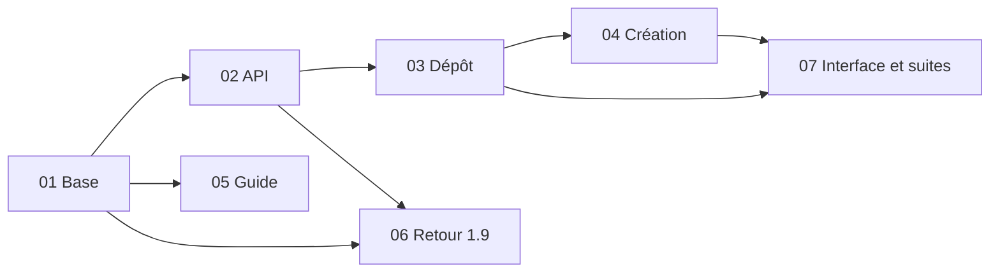

# Découpage — Fiche du candidat, dépôt de fichiers et harmonisation des étapes

> 7 tâches · ordre : la base et l'API d'abord (ce qui touche la production et ne se rattrape pas), puis les pages (dépôt, création), puis le guide de mise en production et la restauration, enfin la couverture de l'interface de Léo et les suites complètes.
> Tests : fichiers existants seulement (`api/test/base.test.js`, `fichiers.test.js`, `tools/e2e-*.py`) ; la tâche 06 est un essai de QA documenté, sans outil (P3).
> Le risque est d'abord côté serveur (migration, invariant de R6) ; les pages s'appuient ensuite sur le contrat fixé par l'API.

## Tâches
| # | Tâche | Objectif | Dépend de | Spec |
|---|---|---|---|---|
| 01 | [Base sans changer de version](01-base.md) | `fichiers` ajoutée de façon idempotente à chaque ouverture, `user_version` 1, deux ouvertures simultanées ; base v2 refusée ; la 1.9 relit la base et efface en cascade | — | R1, R1b, R2 (API), CA1, CA2 (API), CA3 |
| 02 | [API : références et nettoyage](02-api-references.md) | dans la transaction du PUT : refus d'une référence absente (409 `fichier-introuvable`), nettoyage des non référencés de plus d'une heure (horloge injectable) ; effacement réel après nettoyage | 01 | R6, R10, R8, R9, R12, CA6 (c, API), CA9, CA10, CA12 |
| 03 | [Pages : dépôt, retrait, lien](03-pages-depot.md) | ordre R4 et R5, R19 (copie, saisies ailleurs, départ), commandes désactivées, messages R7 (dépôt seulement), R20 (liens), R21 (import), annonces et focus | 02 | R4, R5, R7, R11, R19, R20, R21, Accessibilité, CA5, CA6, CA7, CA8, CA11, CA15, CA18 |
| 04 | [Pages : création](04-pages-creation.md) | R3 : un seul candidat, relance, « Retirer » sur un échec, fermeture bloquée puis « Enregistrer et revenir », bandeau | 03 | R3, R7 (bandeau), CA4 |
| 05 | [Mise en production et restauration](05-guide-production.md) | `deploy/README.md` § 7, `deploy/METTRE-A-JOUR.md` (intro, § 1, § 5 « 1.10 — avant le merge », retour vers la 1.9), `deploy/RESTAURER.md` (`fichiers=absente`, retraits à refaire) ; banc nginx (`nginx -t`, preuve `curl`), `bash -n`, `zsh -n`, copies 1.9 et 1.10 | 01 | R2 (guide), R13, R14, R15, CA13, CA14 |
| 06 | [Retour vers la 1.9 : pages de `main`](06-retour-19.md) | essai des pages et de l'API de `main` sur une base et un dossier de la 1.10 (historique, annulation, saisie gardant `identite.fichiers`) | 01, 02 | R2, CA2 (pages) |
| 07 | [Interface de Léo et suites complètes](07-interface-suites.md) | compléter `e2e-candidatures.py` et `e2e-parcours.py` pour les points de R17 non couverts (téléphone, Notes à 1360 px…) ; suites complètes sous Node 22, `docker compose build` | 03, 04 | R16, R17, R18, CA16, CA17 |

## Logique d'ordre
La base (01) décide si la production redémarre et si le retour arrière marche : elle passe en premier. L'API (02) fixe le contrat que les pages respectent (référence absente refusée, nettoyage) ; les pages (03, 04) viennent ensuite, le dépôt avant la création qui le réutilise. Le guide (05) ne dépend que de la base ; l'essai des pages de `main` (06) a besoin de la base et de l'API finales. Les suites complètes (07) ferment la version.

## Dépendances

