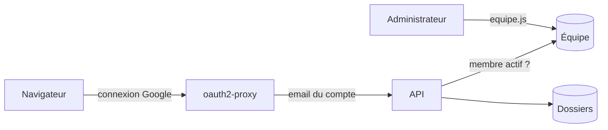

# Un serveur pour garder les dossiers candidat, réservé à l'équipe

> Une API garde les dossiers candidat dans une base SQLite sur le serveur, au lieu du navigateur de chacun. Seuls les membres actifs de l'équipe Yeita peuvent la lire ou l'écrire.

## Pourquoi
Aujourd'hui, chaque recruteur garde ses dossiers dans son propre navigateur : rien n'est partagé, et on ne peut pas y saisir de vraies données. Cette version livre le serveur qui les gardera. Les pages ne changent pas encore : elles seront branchées sur ce serveur à la version suivante.

## Ce qui change pour l'utilisateur
| Avant | Après cette version |
|---|---|
| Dossiers dans le navigateur de chacun | Une base commune sur le serveur, prête à être branchée |
| « Qui es-tu ? » choisi à la main | L'identité vient du compte Google, vérifiée contre la liste de l'équipe |
| Deux recruteurs peuvent s'écraser | Le second reçoit « La candidature a été modifiée par quelqu'un d'autre. Recharge la page. » |
| Rien à administrer | Une commande sur le serveur pour ajouter, désactiver ou changer le rôle d'un membre |

## Comment ça marche

oauth2-proxy vérifie la connexion Google et transmet l'email à l'API. L'API cherche cet email dans la liste de l'équipe, puis lit ou enregistre le dossier entier. Chaque dossier porte un numéro de version : un enregistrement fait sur une version périmée est refusé.

## Les règles à retenir
| Règle | En clair | Exemple |
|---|---|---|
| Identité | Sans email transmis, l'accès est refusé | Une requête qui contourne oauth2-proxy n'a pas d'identité valable |
| Équipe | Il faut être dans la liste et actif | Un membre désactivé est refusé dès la requête suivante |
| Rôles | « lecture » consulte seulement ; « recruteur » et « admin » modifient | Un rôle « lecture » qui enregistre reçoit un refus |
| Conflit | On ne peut enregistrer que la version qu'on a lue | Deux recruteurs sur le même dossier : le second doit recharger |
| Effacement | Supprimer un dossier l'efface aussi du disque | Le journal ne garde qu'une ligne « supprimé par… le… » |
| Taille | Un dossier fait 1 Mo au plus | Au-delà, l'enregistrement est refusé |

## Côté technique
- Node.js 22, Fastify et better-sqlite3, versions figées ; tests avec le lanceur intégré à Node.
- L'API écoute seulement sur la machine (127.0.0.1) par défaut : elle croit l'email transmis, elle ne doit être joignable que par oauth2-proxy.
- La base s'installe toute seule au démarrage, d'un seul bloc : en cas de panne, elle reste vide ou complète, jamais à moitié.
- Au démarrage, l'API affiche ses vrais réglages, et refuse les réglages absurdes avec un message clair.
- Un mode local, pour développer sur son poste, refuse de démarrer en production ou hors de la machine.

## Ce qu'on ne fait pas
- Brancher les pages sur l'API, et passer « Qui es-tu ? » sur le compte Google : version suivante.
- Ajouter l'API dans Docker, la déployer, la sauvegarder.
- Gérer l'équipe depuis une page : tout passe par la commande sur le serveur.
- Reprendre les dossiers déjà saisis dans les navigateurs.

## Comment on saura que c'est réussi
- Une installation propre sous Node 22 passe tous les tests, sans vulnérabilité connue.
- Chaque refus d'accès (sans identité, hors équipe, lecture seule) est testé, et chaque test a été mis à l'épreuve en cassant volontairement le contrôle.
- Deux écritures concurrentes donnent un conflit, et le premier enregistrement est conservé.
- Après une suppression ou une modification, l'ancien contenu est introuvable dans les fichiers de la base.
- Une panne provoquée pendant l'installation de la base, suivie d'une relance, laisse une base saine.

## Points de vigilance
- On suppose qu'avec Google, oauth2-proxy transmet bien l'email du compte : à vérifier à la version suivante, avec de vrais identifiants.
- Si l'API devient joignable sans passer par oauth2-proxy, n'importe qui peut se faire passer pour un membre : le port ne doit jamais être exposé.
- Un dossier importé avec un identifiant modifié à la main sera refusé lors de la reprise des données.
