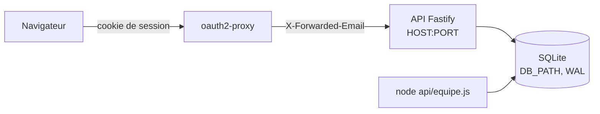

# Spec v1 — API Node.js sur SQLite pour les dossiers candidat

> Une API HTTP dans `api/` (Node 22, Fastify, better-sqlite3) qui garde les dossiers candidat entiers dans SQLite et expose le contrat list/get/put/remove de `MODELE.md`, réservée aux membres actifs de la table `equipe`.
> Pensée pour être placée derrière oauth2-proxy, qui pose `X-Forwarded-Email` ; n'écoute que sur 127.0.0.1 par défaut.

## Contexte et objectif
Aujourd'hui les dossiers vivent dans le navigateur de chaque recruteur (`localStorage` `yeita-dossiers`) : rien n'est partagé, et une donnée réelle ne peut pas y être saisie. Le site est déjà servi derrière oauth2-proxy (v1.1). Cette version livre le serveur de stockage : l'API, sa base, la gestion de l'équipe en ligne de commande et un mode local pour la développer. Après elle, la version suivante n'aura plus qu'à écrire l'adaptateur navigateur (`DOSSIER.use(...)`), à brancher `QUI` sur `/api/moi` et à ajouter l'API dans Docker.

## Utilisateurs et parcours
Utilisateurs : l'**adaptateur navigateur** (version suivante), au nom d'un recruteur connecté par Google ; l'**administrateur** du serveur, en ligne de commande ; le **développeur**, en local.

### Lire et enregistrer un dossier (adaptateur)
1. `GET /api/candidats` : tous les dossiers, chacun avec sa `version`.
2. Le recruteur modifie un dossier ; l'adaptateur envoie `PUT /api/candidats/<id>` avec `{version: <version lue>, data: <dossier>}`.
3. Réponse 200 avec la nouvelle `version` : l'adaptateur la garde pour l'écriture suivante.
4. Si quelqu'un a écrit entre-temps : 409 avec « La candidature a été modifiée par quelqu'un d'autre. Recharge la page. ».
Cas limites : nouveau dossier (`version: null`, 201 ; 409 si l'id existe déjà) ; dossier supprimé entre-temps (404) ; dossier de plus de 1 Mo (413) ; rôle `lecture` (403 sur toute écriture).

### Mettre en place l'équipe (administrateur, sur le serveur)
1. `node api/equipe.js add prenom.nom@yeita.fr Prénom admin` crée le premier admin, avant ou après le premier démarrage de l'API.
2. `list`, `disable`, `role` pour la suite ; un départ se fait par `disable` (l'accès est refusé à la requête suivante).
Cas limites : membre déjà présent, email hors @yeita.fr, rôle inconnu, base occupée par l'API.

### Développer en local
1. `cd api && npm ci`, puis `DEV_EMAIL=moi@yeita.fr npm start` après `node equipe.js add moi@yeita.fr Moi admin`.
2. Avec `DEV_STATIC=../_site`, le site construit est servi à la même adresse que l'API.
Cas limites : `DEV_EMAIL` avec `HOST=0.0.0.0` ou `NODE_ENV=production` : l'API refuse de démarrer.

## Périmètre
### Inclus
- `api/` : serveur, base, autorisation, routes listées par le pitch, `equipe.js`, tests `node:test`, `README.md`.
- [ajout] `HOST` (127.0.0.1 par défaut) : décision de l'utilisateur après V10.
- [ajout] `DB_PATH` (chemin de la base) : sans lui, la base ne peut être placée ni sur un volume (version suivante) ni dans un dossier de test.
- [ajout] `api` dans `SKIP` de `tools/build.py` (V13) : sans lui, la base et `node_modules` seraient publiés.
- [ajout] `.gitignore` : `api/node_modules/`, `api/data/`.
- [ajout] `api/.npmrc` (`ignore-scripts=true`) : installation reproductible sous npm 10 (V3).
- [ajout] `@fastify/static` : sert `DEV_STATIC` sans réécrire un serveur de fichiers (chemins, traversée).
- `docs/backend/MODELE.md` : section des tables alignée (décision de l'utilisateur, V12) ; `README.md` racine : un renvoi vers `api/README.md`.
### Exclu
- Les pages (`assets/dossier.js`, `qui.js`, `store.js` inchangés), l'adaptateur navigateur.
- Docker, `compose.yaml`, `.dockerignore`, `deploy/`, le déploiement, les sauvegardes, la migration des données du navigateur.
- Toute route non listée : pas de gestion de l'équipe par HTTP, pas de lecture du journal, pas d'export.
- Fiches 1.0-1, 1.0-2, 1.1-1 à 1.1-9.

## Existant réutilisé
| Besoin | Décision | Élément | Référentiel |
|---|---|---|---|
| Contrat, message de conflit | réutiliser | `docs/backend/MODELE.md` (V11) | — |
| Valeur de `schema`, format d'`id`, `meta.modifieLe`, `parcours.etape` | réutiliser | `assets/dossier.js` (V15) | [Conventions](../../../technique/conventions.md) |
| Options de base de la disponibilité | réutiliser (non stockées) | `DISPOS` de `assets/dossier.js` (V14) | — |
| Exclusion de la publication | étendre | `SKIP` de `tools/build.py` | [Conventions](../../../technique/conventions.md#publication) |
| Serveur HTTP | créer (pitch) | Fastify 5.12.7 | — |
| SQLite | créer (pitch) | better-sqlite3 13.0.3 | — |
| Fichiers statiques locaux | créer : aucun serveur de fichiers en Node dans le dépôt | @fastify/static 10.1.6 | — |
| Tests | créer (pitch) : `node:test`, aucun outillage Node existant hors `tools/test-store.js` | `node --test` | [Conventions](../../../technique/conventions.md#tests) |

## Règles et comportements
| # | Règle | Détail / valeurs |
|---|---|---|
| R1 | Node 22, modules ES | `api/package.json` : `"type": "module"`, `"engines": {"node": ">=22"}`, `"private": true` (V1) |
| R2 | Dépendances figées | Exactement `fastify` 5.12.7, `better-sqlite3` 13.0.3, `@fastify/static` 10.1.6, versions sans `^` ni `~` ; `package-lock.json` commité ; aucune autre dépendance directe, aucune dépendance de développement (V2) |
| R3 | Installation | `npm ci` dans `api/` ; `api/.npmrc` contient `ignore-scripts=true` (V3) |
| R4 | Écoute | `HOST` (défaut `127.0.0.1`), `PORT` (défaut `8000`). L'API ne doit être joignable que par oauth2-proxy : quiconque l'atteint directement peut forger son identité (V10). Au démarrage, le journal indique l'adresse d'écoute |
| R5 | Identité | Lue dans `X-Forwarded-Email`, espaces retirés, mise en minuscules. Valide seulement si elle correspond à `^[a-z0-9._%+-]+@yeita\.fr$` (une seule adresse : un doublon arrive joint par une virgule, V8). Absente, vide ou invalide → **401** |
| R6 | Autorisation | Email absent de `equipe` ou `actif = 0` → **403**. Vérifiée à chaque requête (un `disable` prend effet à la requête suivante) |
| R7 | Rôles | `lecture` : lecture seule (toute méthode autre que GET → **403**). `recruteur` et `admin` : lecture et écriture. Aucune route HTTP propre à `admin` à cette version |
| R8 | Mode local, identité | `DEV_EMAIL` (si définie et non vide) remplace l'en-tête **seulement quand il est absent** ; elle doit être valide (R5) et passe ensuite par R6 et R7 comme un vrai compte. L'API **refuse de démarrer** (code 1, message clair) si `DEV_EMAIL` est définie et que `NODE_ENV` vaut `production`, ou que `HOST` n'est pas `127.0.0.1`, `::1` ou `localhost`. Avertissement au démarrage : « Mode local : DEV_EMAIL=… » |
| R9 | Mode local, site | `DEV_STATIC` (si définie et non vide) : dossier du site construit, servi à la racine `/` ; les routes `/api/*` restent prioritaires. Refus de démarrer si le dossier n'existe pas, ne contient pas `index.html`, contient le fichier de la base (`DB_PATH`), ou si `NODE_ENV` vaut `production` |
| R10 | Base | Fichier `DB_PATH` (défaut : `api/data/recrutement.sqlite`, résolu par rapport à `api/`, pas au dossier courant) ; dossier parent créé s'il manque (mode 700). `journal_mode = WAL` (V4), `busy_timeout = 5000` |
| R11 | Base occupée | Une écriture qui dépasse le délai (`SQLITE_BUSY`, V7) → **503** « Base occupée, réessaie dans un instant. » ; rien n'est écrit à moitié (une transaction par écriture) |
| R12 | Schéma au démarrage | Appliqué par l'API **et** par `equipe.js`, dans une transaction, idempotent (`CREATE TABLE IF NOT EXISTS`), numéroté par `PRAGMA user_version = 1`. Une base de version supérieure → refus de démarrer. Arrêt au milieu puis relance : la base est soit vide de schéma, soit complète |
| R13 | Liste | `GET /api/candidats` → 200, tableau de `{id, version, modifieLe, modifiePar, data}`, trié par `meta.modifieLe` du dossier décroissant (`json_extract`, V6), puis par `modifie_le` décroissant |
| R14 | Lecture | `GET /api/candidats/:id` → 200, même objet ; inconnu → **404** « Candidature introuvable. » |
| R15 | Identifiant | `:id` doit correspondre à `^[A-Za-z0-9_-]{1,100}$` (couvre `cand-…` et les identifiants repris d'un code, V15), sinon **400** « Identifiant invalide. » |
| R16 | Corps du PUT | `Content-Type: application/json` obligatoire (sinon **415**) ; corps ≤ 1 048 576 octets (sinon **413** « Dossier trop volumineux (1 Mo maximum). », V5) ; JSON invalide → **400**. Exiger du JSON empêche un formulaire d'un autre site d'écrire avec le cookie d'oauth2-proxy |
| R17 | Contrôles du PUT | Corps = objet `{version, data}` ; `version` est `null` ou un entier ≥ 1 ; `data` est un objet ; `data.schema === "yeita-dossier-candidat"` ; `data.id === :id`. Sinon **400** avec un message qui nomme le champ en faute |
| R18 | Création | `version: null` : insertion avec `version = 1` → **201** ; id déjà présent → **409** (message de R19) |
| R19 | Mise à jour | `version: n` : mise à jour seulement si la version en base vaut `n` (dans la même instruction) → **200**, `version = n + 1`. Version différente → **409** `{erreur: "La candidature a été modifiée par quelqu'un d'autre. Recharge la page.", code: "conflit"}` (V11) ; id absent → **404** |
| R20 | Enregistrement | `data` est gardé tel que reçu (pas de mise à niveau, pas de champ ajouté) ; `modifie_le` = date ISO 8601 du serveur, `modifie_par` = email. La réponse rend l'objet de R13 tel qu'enregistré |
| R21 | Suppression | `DELETE /api/candidats/:id` → **204** ; la ligne est réellement effacée (demande d'effacement) ; inconnu → **404** |
| R22 | Journal | Une ligne par création, modification, suppression, dans la même transaction : `candidat_id`, `action` (`creation`, `modification`, `suppression`), `etape` (`data.parcours.etape` si c'est l'une des 12 étapes de `MODELE.md`, sinon `null`), `par` (email), `le` (ISO). **Jamais** d'autre donnée du dossier. Le journal survit à la suppression du dossier |
| R23 | Options de disponibilité | `GET /api/options-disponibilite` → 200, tableau des libellés **ajoutés** (les 6 de base restent dans le code, V14), dans l'ordre d'ajout. `POST` `{libelle}` → 201 ; libellé sans espaces en trop, 1 à 60 caractères, sinon 400 ; déjà présent → 200 sans doublon |
| R24 | Moi | `GET /api/moi` → 200 `{email, prenom, role}` |
| R25 | Équipe | `GET /api/equipe` → 200, membres **actifs** `{prenom, role}`, triés par prénom ; pas d'email (inutile aux pages) |
| R26 | Santé | `GET /api/sante`, **sans authentification** → 200 `{ok: true}` si `SELECT 1` répond, sinon 503 `{ok: false}`. Rien d'autre (ni version, ni chemin) |
| R27 | Erreurs | Toute erreur répond en JSON `{erreur: "<message en français>"}` (plus `code` pour le conflit), y compris les erreurs de Fastify (413, 415, 400) et une route inconnue sous `/api` (404 « Route inconnue. »). Une erreur inattendue → 500 « Erreur interne. », détail seulement dans le journal du serveur |
| R28 | Journaux du serveur | Journal de Fastify au niveau `info`, sérialiseurs par défaut : méthode, URL, statut, durée ; jamais le corps ni les en-têtes (V16) |
| R29 | Cache | [ajout] Toute réponse `/api/*` porte `Cache-Control: no-store` : des dossiers nominatifs ne restent pas dans le cache du navigateur ou d'un proxy |
| R30 | Variables | Lues dans `process.env` (valeur résolue). Une variable vide vaut absente. `PORT` : entier de 1 à 65535 en chiffres seuls (`"8000 # commentaire"`, `"abc"`, `"0"` refusés) ; `HOST` sans espace ; `DB_PATH` non vide. Valeur refusée → code 1 et message qui nomme la variable, avant toute écoute |
| R31 | Arrêt | `SIGINT` et `SIGTERM` : fermeture du serveur puis de la base |
| R32 | `equipe.js` | `node api/equipe.js add <email> <prénom> [rôle]` (rôle par défaut `recruteur`) ; `list` ; `disable <email>` ; `role <email> <rôle>`. Email mis en minuscules, validé (R5) ; rôle parmi `recruteur`, `admin`, `lecture` ; prénom non vide. `add` d'un membre actif → erreur ; `add` d'un membre désactivé → réactivé avec le prénom et le rôle donnés. `disable` ou `role` d'un inconnu → erreur. Code 0 si fait, 1 sinon, message en français ; même `DB_PATH`, même schéma (R12), même délai (R10) |
| R33 | Publication | `api` ajouté à `SKIP` de `tools/build.py` ; `.gitignore` : `api/node_modules/`, `api/data/` |
| R34 | Tests | `npm test` dans `api/` lance `node --test` (V17) ; chaque test sur une base dans un dossier temporaire, via `DB_PATH` ; `node tools/test-store.js` reste vert |
| R35 | Documentation | `api/README.md` : installation, lancement, variables, mode local, `equipe.js`, tests ; `README.md` racine : renvoi vers lui ; `MODELE.md` : tables réelles (R36) |

## Données
Tables (R12) :
```sql
CREATE TABLE IF NOT EXISTS equipe (
  email     TEXT PRIMARY KEY CHECK (email = lower(email) AND email LIKE '%@yeita.fr'),
  prenom    TEXT NOT NULL CHECK (length(trim(prenom)) > 0),
  role      TEXT NOT NULL CHECK (role IN ('recruteur','admin','lecture')),
  actif     INTEGER NOT NULL DEFAULT 1 CHECK (actif IN (0,1)),
  ajoute_le TEXT NOT NULL
);
CREATE TABLE IF NOT EXISTS candidats (
  id          TEXT PRIMARY KEY,
  data        TEXT NOT NULL,          -- le dossier entier, JSON
  version     INTEGER NOT NULL CHECK (version >= 1),
  modifie_le  TEXT NOT NULL,
  modifie_par TEXT NOT NULL
);
CREATE TABLE IF NOT EXISTS journal (
  id          INTEGER PRIMARY KEY,
  candidat_id TEXT NOT NULL,
  action      TEXT NOT NULL CHECK (action IN ('creation','modification','suppression')),
  etape       TEXT,
  par         TEXT NOT NULL,
  le          TEXT NOT NULL
);
CREATE TABLE IF NOT EXISTS options_disponibilite (
  libelle  TEXT PRIMARY KEY,
  ajoute_le TEXT NOT NULL,
  ajoute_par TEXT NOT NULL
);
```
- R36 : aucune colonne tirée du JSON (pitch) ; la section « Tables SQLite proposées » de `MODELE.md` est remplacée par ces tables et un renvoi à `api/README.md`.
- Volumes : quelques recruteurs, quelques centaines de dossiers de moins de 1 Mo ; la liste renvoie tout (contrat `list()`).
- Rétention : un dossier supprimé est effacé de `candidats` ; le journal garde l'identifiant opaque, l'action, l'étape, l'auteur et la date. Le fichier WAL est intégré à la base au point de contrôle automatique de SQLite.
- Migration : aucune (base neuve) ; `user_version` prépare les suivantes.

## API et intégrations
| Méthode et route | Auth | Rôles | Succès | Erreurs |
|---|---|---|---|---|
| `GET /api/sante` | non | — | 200 `{ok: true}` | 503 |
| `GET /api/moi` | oui | tous | 200 `{email, prenom, role}` | 401, 403 |
| `GET /api/equipe` | oui | tous | 200 `[{prenom, role}]` | 401, 403 |
| `GET /api/candidats` | oui | tous | 200 `[{id, version, modifieLe, modifiePar, data}]` | 401, 403 |
| `GET /api/candidats/:id` | oui | tous | 200 `{id, version, modifieLe, modifiePar, data}` | 400, 401, 403, 404 |
| `PUT /api/candidats/:id` | oui | recruteur, admin | 201 (création), 200 (mise à jour) | 400, 401, 403, 404, 409, 413, 415, 503 |
| `DELETE /api/candidats/:id` | oui | recruteur, admin | 204 | 400, 401, 403, 404, 503 |
| `GET /api/options-disponibilite` | oui | tous | 200 `["…"]` | 401, 403 |
| `POST /api/options-disponibilite` | oui | recruteur, admin | 201, 200 si déjà là | 400, 401, 403, 415 |
Ordre des contrôles : 401 → 403 (équipe) → 403 (rôle) → 400 (id, corps) → 404 / 409. Correspondance avec l'adaptateur : `list()` → `GET /api/candidats` puis `.data` ; `get(id)` → `GET …/:id` (404 → `null`) ; `put(d)` → `PUT …/:id` avec la version gardée ; `remove(id)` → `DELETE`.

## Architecture technique

- Un seul processus, une connexion better-sqlite3 (synchrone) ; `equipe.js` ouvre sa propre connexion (WAL : lectures non bloquées, V7).
- L'application est construite par une fonction qui reçoit sa configuration (testable par `inject`, sans port) ; le point d'entrée lit les variables et écoute.
- Rien n'est importé de `assets/` : les valeurs reprises (`schema`, étapes) sont recopiées, citées dans le code avec leur source.

## Sécurité et conformité
- Confiance : l'API croit `X-Forwarded-Email`. Elle n'est sûre que si **seul oauth2-proxy** peut la joindre (V9 : il retire l'en-tête forgé ; V10 : en direct, l'en-tête passe). D'où R4 ; la version suivante n'exposera pas le port de l'API hors du réseau Docker. H1 : avec Google, oauth2-proxy pose bien l'email du compte (non vérifiable sans vrais identifiants).
- Contrôle d'accès : R5 à R7, à chaque requête ; mode local verrouillé par R8.
- Entrées non fiables : id (R15), corps (R16, R17), en-tête (R5) ; toutes les requêtes SQL sont paramétrées.
- Données personnelles : contenu du dossier seulement dans `candidats.data` ; ni journal (R22), ni journaux du serveur (R28), ni cache (R29) ; effacement réel (R21). Fichier de base dans un dossier en mode 700, hors publication (R10, R33).

## Exploitation
- Variables : `PORT`, `HOST`, `DB_PATH`, `NODE_ENV`, `DEV_EMAIL`, `DEV_STATIC` (R30) ; documentées dans `api/README.md`.
- Premier admin : `equipe.js add … admin`, avant ou après le premier démarrage (R12).
- Journaux : sortie standard, JSON de Fastify (R28).
- Santé : `/api/sante` (R26), pour un futur contrôle de Docker.

## Critères d'acceptation
- [ ] CA1 — `api/package.json` et `package-lock.json` : exactement les 3 dépendances de R2, versions exactes ; `npm ci` (avec `api/.npmrc`) réussit sous `node:22-bookworm-slim` sans Python, puis `npm test` passe ; `npm audit` : 0 vulnérabilité.
- [ ] CA2 — Sans en-tête : 401 sur chaque route authentifiée ; avec un email hors équipe, inactif, en double, hors @yeita.fr : 401 ou 403 selon R5 et R6 ; `/api/sante` répond 200 sans en-tête.
- [ ] CA3 — Rôle `lecture` : 200 sur les GET, 403 sur PUT, DELETE et POST, la base inchangée.
- [ ] CA4 — PUT `version: null` crée (201, `version` 1) ; seconde création du même id : 409.
- [ ] CA5 — Deux PUT avec la même version lue : le premier 200 (`version` 2), le second 409 avec le message exact de `MODELE.md` et `code: "conflit"` ; le dossier en base est celui du premier.
- [ ] CA6 — PUT refusé (400) pour : `schema` faux, `data.id` différent de l'adresse, `version` non entière, `data` absent ; 413 au-delà de 1 048 576 octets ; 415 sans `application/json` ; id invalide : 400.
- [ ] CA7 — DELETE : 204, puis GET 404 ; le journal garde `suppression` ; aucune ligne de `journal` ne contient autre chose que les 6 colonnes (pas de nom de candidat dans la base hors `candidats.data`, vérifié par recherche du nom dans le fichier après suppression et `VACUUM`).
- [ ] CA8 — Liste triée par `meta.modifieLe` décroissant ; chaque élément porte `version`.
- [ ] CA9 — Schéma : démarrage sur base vide puis redémarrage sans erreur ; `user_version` = 1 ; base de `user_version` 2 → refus ; `journal_mode` = `wal`.
- [ ] CA10 — `equipe.js` : `add`, `list`, `disable`, `role` ; cas d'erreur de R32 en code 1 ; `disable` pendant que l'API tourne → 403 à la requête suivante ; `add` pendant une écriture longue de l'API → attend puis réussit, ou échoue en code 1 sans état à moitié fait.
- [ ] CA11 — Mode local : `DEV_EMAIL` sert d'identité sans en-tête, l'en-tête l'emporte s'il est présent ; refus de démarrer avec `HOST=0.0.0.0` ou `NODE_ENV=production` ; `DEV_STATIC` sert `index.html` et `/api/sante` reste l'API ; `DEV_STATIC` absent, sans `index.html` ou contenant la base → refus.
- [ ] CA12 — Variables : `PORT` absent → 8000 ; `PORT` vide → 8000 ; `"abc"`, `"0"`, `"70000"`, `"8000 # x"` → refus, code 1 ; `HOST` absent → écoute sur 127.0.0.1 seulement.
- [ ] CA13 — Options : ajout, doublon sans nouvelle ligne, libellé vide ou de plus de 60 caractères refusé ; `lecture` ne peut pas ajouter.
- [ ] CA14 — `/api/moi` et `/api/equipe` rendent les champs de R24 et R25, sans email dans `/api/equipe`.
- [ ] CA15 — Toutes les erreurs sont en JSON `{erreur}` ; `Cache-Control: no-store` sur `/api/*` ; le journal du serveur ne contient ni corps ni email (capture pendant un PUT).
- [ ] CA16 — `python3 tools/build.py` ne copie pas `api/` ; `git status` ne montre ni `node_modules` ni la base après un essai ; `node tools/test-store.js` vert.
- [ ] CA17 — Chaque contrôle d'autorisation (401, 403 équipe, 403 rôle) et de conflit (409) est mis à l'épreuve par mutation.

## Hypothèses et questions ouvertes
- H1 : oauth2-proxy avec le fournisseur Google pose `X-Forwarded-Email` avec l'email du compte (V9 l'a montré absent pour une session htpasswd, qui n'a pas d'email). À vérifier à la version suivante avec de vrais identifiants.
- H2 : `admin` n'a pas de droit HTTP supplémentaire ; la suppression est ouverte aux recruteurs comme aujourd'hui dans le navigateur.
- H3 : derrière oauth2-proxy, une requête `/api/*` sans session reçoit sa réponse (302 ou 403), pas celle de l'API ; l'adaptateur de la version suivante devra la traiter.

## Améliorations possibles
Aucun.
