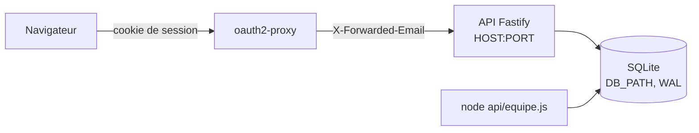

# Spec v2 — API Node.js sur SQLite pour les dossiers candidat

> Une API HTTP dans `api/` (Node 22, Fastify, better-sqlite3) qui garde les dossiers candidat entiers dans SQLite et expose le contrat list/get/put/remove de `MODELE.md`, réservée aux membres actifs de la table `equipe`.
> Pensée pour être placée derrière oauth2-proxy, qui pose `X-Forwarded-Email` ; n'écoute que sur 127.0.0.1 par défaut.
> Changements depuis v1 : transactions immédiates et schéma en une transaction mise à l'épreuve, effacement réel sur le disque et purge du journal, 415 réel, 409 pour tout PUT périmé, enveloppe `{id, version, data}`, valeurs résolues journalisées et valeurs absurdes refusées (voir challenges/tour-1.md).

## Changements depuis la version précédente
- R16 : seul l'analyseur JSON ; 415 pour `text/plain`, formulaire, absence de `Content-Type` ; corps vide accepté sur GET et DELETE (T1, I8, V19).
- R6, R7, ordre des contrôles : contrôles dans le crochet `onRequest`, avant l'analyse du corps (S3, V20).
- R11 : toute transaction d'écriture en `IMMEDIATE` ; gel de l'API pendant l'attente (T2, T7, V23).
- R12 : ordre d'ouverture, création sans `IF NOT EXISTS`, échec provoqué puis relance (T3, T4, T5, V22) ; CA18.
- R13, R20 : enveloppe réduite à `{id, version, data}` ; `version` ≠ `data.version` (I1, I6).
- R19 : 409 aussi quand l'id a disparu (I2).
- R10, R21, R22 : `secure_delete`, point de contrôle `TRUNCATE`, purge du journal du dossier supprimé (D1, D2, V18 ; arbitrage de l'utilisateur).
- R15 : motif de `uid()` (D3, V24).
- R5, R6, R7, R16, R26, R27 : textes et codes d'erreur fixés ; `/api/sante` hors du format d'erreur (I5).
- R23 : réponse du POST, options de base exclues, plus de colonne `ajoute_par` (I7, D6).
- R4, R8, R9, R10, R30, R31, R32 : ligne de démarrage avec les valeurs résolues, avertissement d'exposition, mode local verrouillé par `HOST` **et** `NODE_ENV`, chemins relatifs résolus depuis `api/`, valeurs absurdes refusées, codes de sortie, sortie d'`equipe.js` (E1, E4, E5, E6, E8, S1, S2, S6, D7).
- R27, R28 : pas de message d'erreur brut dans le journal du serveur ; liste exacte des champs journalisés (D4, D8).
- R35, R36 : README (première mise en place, variables, exposition, contrat HTTP) ; renvoi depuis la section des tables de `MODELE.md` (E9, I9).
- CA2, CA3, CA5, CA6, CA7, CA9, CA10, CA11, CA12, CA15, CA17 précisés ; CA18 ajouté.

## Contexte et objectif
Aujourd'hui les dossiers vivent dans le navigateur de chaque recruteur (`localStorage` `yeita-dossiers`) : rien n'est partagé, et une donnée réelle ne peut pas y être saisie. Le site est déjà servi derrière oauth2-proxy (v1.1). Cette version livre le serveur de stockage : l'API, sa base, la gestion de l'équipe en ligne de commande et un mode local pour la développer. Après elle, la version suivante n'aura plus qu'à écrire l'adaptateur navigateur (`DOSSIER.use(...)`), à brancher `QUI` sur `/api/moi` et à ajouter l'API dans Docker.

## Utilisateurs et parcours
Utilisateurs : l'**adaptateur navigateur** (version suivante), au nom d'un recruteur connecté par Google ; l'**administrateur** du serveur, en ligne de commande ; le **développeur**, en local.

### Lire et enregistrer un dossier (adaptateur)
1. `GET /api/candidats` : tous les dossiers, chacun dans une enveloppe `{id, version, data}`.
2. Le recruteur modifie un dossier ; l'adaptateur envoie `PUT /api/candidats/<id>` avec `{version: <version de l'enveloppe lue>, data: <dossier>}`.
3. Réponse 200 avec la nouvelle `version` : l'adaptateur la garde pour l'écriture suivante.
4. Si quelqu'un a écrit ou supprimé entre-temps : 409 avec « La candidature a été modifiée par quelqu'un d'autre. Recharge la page. ».
Cas limites : nouveau dossier (`version: null`, 201 ; 409 si l'id existe déjà) ; dossier de plus de 1 Mo (413) ; rôle `lecture` (403 sur toute écriture).

### Mettre en place l'équipe (administrateur, sur le serveur)
1. Avec **le même utilisateur système et le même `DB_PATH` que l'API** : `node api/equipe.js add prenom.nom@yeita.fr Prénom admin`, avant ou après le premier démarrage. La commande affiche la base utilisée.
2. `list`, `disable`, `role` pour la suite ; un départ se fait par `disable` (l'accès est refusé à la requête suivante).
Cas limites : membre déjà présent, email hors @yeita.fr, rôle inconnu, rôle tapé à la place du prénom, base occupée par l'API.

### Développer en local
1. `cd api && npm ci`, `node equipe.js add moi@yeita.fr Moi admin`, puis `DEV_EMAIL=moi@yeita.fr npm start`.
2. Avec `DEV_STATIC=../_site`, le site construit est servi à la même adresse que l'API.
Cas limites : mode local avec `HOST=0.0.0.0` ou `NODE_ENV=production` : l'API refuse de démarrer.

## Périmètre
### Inclus
- `api/` : serveur, base, autorisation, routes listées par le pitch, `equipe.js`, tests `node:test`, `README.md`.
- [ajout] `HOST` (127.0.0.1 par défaut) : décision de l'utilisateur après V10.
- [ajout] `DB_PATH` (chemin de la base) : sans lui, la base ne peut être placée ni sur un volume (version suivante) ni dans un dossier de test.
- [ajout] `api` dans `SKIP` de `tools/build.py` (V13) : sans lui, la base et `node_modules` seraient publiés.
- [ajout] `.gitignore` : `api/node_modules/`, `api/data/`.
- [ajout] `api/.npmrc` (`ignore-scripts=true`) : installation reproductible sous npm 10 (V3, V21).
- [ajout] `@fastify/static`, enregistré seulement si `DEV_STATIC` : sert le site sans réécrire un serveur de fichiers.
- [ajout] Effacement réel sur le disque (V18), fichiers de la base lisibles par leur seul propriétaire, refus des valeurs absurdes, avertissement d'exposition : sans eux, la demande d'effacement, les données personnelles ou la confiance dans l'en-tête ne sont pas tenues (tour 1).
- `docs/backend/MODELE.md` : section des tables alignée, avec un renvoi au contrat HTTP (décision de l'utilisateur, V12) ; `README.md` racine : un renvoi vers `api/README.md`.
### Exclu
- Les pages (`assets/dossier.js`, `qui.js`, `store.js` inchangés), l'adaptateur navigateur et ses choix (mise à niveau par `DOSSIER.upgrade`).
- Docker, `compose.yaml`, `.dockerignore`, `deploy/`, le déploiement, les sauvegardes, la migration des données du navigateur.
- Toute route non listée : pas de gestion de l'équipe par HTTP, pas de lecture du journal, pas d'export.
- Fiches 1.0-1, 1.0-2, 1.1-1 à 1.1-9.

## Existant réutilisé
| Besoin | Décision | Élément | Référentiel |
|---|---|---|---|
| Contrat, message de conflit | réutiliser | `docs/backend/MODELE.md` (V11) | — |
| Valeur de `schema`, format d'`id`, étapes | réutiliser (recopiés, source citée) | `assets/dossier.js` (V15, V24) | [Conventions](../../../technique/conventions.md) |
| Options de base de la disponibilité | réutiliser (recopiées, non stockées) | `DISPOS` de `assets/dossier.js` (V14) | — |
| Exclusion de la publication | étendre | `SKIP` de `tools/build.py` | [Conventions](../../../technique/conventions.md#publication) |
| Serveur HTTP | créer (pitch) | Fastify 5.12.7 | — |
| SQLite | créer (pitch) | better-sqlite3 13.0.3 | — |
| Fichiers statiques locaux | créer : aucun serveur de fichiers en Node dans le dépôt | @fastify/static 10.1.6 | — |
| Tests | créer (pitch) : `node:test` | `node --test` | [Conventions](../../../technique/conventions.md#tests) |

## Règles et comportements
| # | Règle | Détail / valeurs |
|---|---|---|
| R1 | Node 22, modules ES | `api/package.json` : `"type": "module"`, `"engines": {"node": ">=22"}`, `"private": true`, scripts `start` et `test` (V1) |
| R2 | Dépendances figées | Exactement `fastify` 5.12.7, `better-sqlite3` 13.0.3, `@fastify/static` 10.1.6, sans `^` ni `~` ; `package-lock.json` commité ; aucune autre dépendance directe, aucune dépendance de développement (V2) |
| R3 | Installation | `npm ci` dans `api/` ; `api/.npmrc` contient seulement `ignore-scripts=true` (V3, V21) |
| R4 | Écoute et démarrage | `HOST` (défaut `127.0.0.1`), `PORT` (défaut `8000`). Au démarrage, une ligne de journal donne les valeurs résolues : hôte, port, chemin **absolu** de la base, `user_version`, `NODE_ENV`, et `DEV_EMAIL`, `DEV_STATIC` (chemin absolu) s'ils sont actifs. Si `HOST` n'est pas `127.0.0.1`, `::1` ou `localhost` : avertissement « L'API croit X-Forwarded-Email : elle ne doit être joignable que par oauth2-proxy. » (V10) |
| R5 | Identité | Lue dans `X-Forwarded-Email` seulement (`X-Forwarded-User` est ignoré), espaces retirés, mise en minuscules ; valide si elle correspond à `^[a-z0-9._%+-]+@yeita\.fr$` (un doublon arrive joint par une virgule, V8). Absente, vide ou invalide → **401** « Identité absente ou invalide. » |
| R6 | Autorisation | Email absent de `equipe` ou `actif = 0` → **403** « Tu ne fais pas partie de l'équipe. », `code: "hors-equipe"`. Vérifiée à chaque requête, dans le crochet `onRequest`, donc avant l'analyse du corps (V20) |
| R7 | Rôles | `lecture` : GET seulement ; toute autre méthode → **403** « Lecture seule : tu ne peux pas modifier. », `code: "lecture-seule"`. `recruteur` et `admin` : lecture et écriture. Aucune route HTTP propre à `admin` |
| R8 | Mode local, identité | `DEV_EMAIL` remplace l'en-tête **seulement quand il est absent** ; elle passe ensuite par R6 et R7. `DEV_EMAIL` invalide (R5) → refus de démarrer. `DEV_EMAIL` et `DEV_STATIC` ne sont acceptées que si `HOST` est `127.0.0.1`, `::1` ou `localhost` **et** que `NODE_ENV`, sans espaces et en minuscules, ne vaut pas `production` ; sinon refus de démarrer. Avertissement au démarrage : « Mode local : DEV_EMAIL=… » |
| R9 | Mode local, site | `DEV_STATIC` : dossier du site construit, servi à la racine `/` ; les routes `/api/*` restent celles de l'API. Refus de démarrer si le dossier n'existe pas, ne contient pas `index.html`, ou si le chemin réel (`realpath`) de la base ou du dossier `api/` est à l'intérieur de `DEV_STATIC` (ex. `DEV_STATIC=..`) |
| R10 | Base | Fichier `DB_PATH` (défaut `data/recrutement.sqlite`) ; tout chemin relatif (`DB_PATH`, `DEV_STATIC`) est résolu par rapport à `api/`, quel que soit le dossier courant, pour l'API comme pour `equipe.js`. Dossier parent créé s'il manque. [ajout] Masque `0o077` avant l'ouverture : base, `-wal`, `-shm` et dossier créés lisibles par leur seul propriétaire. Réglages : `journal_mode = WAL` (V4), `busy_timeout = 5000`, `secure_delete = ON` (V18) |
| R11 | Écritures et attente | Toute transaction d'écriture (API, `equipe.js`, schéma) s'ouvre en `BEGIN IMMEDIATE` : le délai d'attente s'applique (V7 ; une transaction différée échoue sans attendre, V23). Délai dépassé → **503** « Base occupée, réessaie dans un instant. », rien n'est écrit. better-sqlite3 étant synchrone, l'API ne répond à aucune requête pendant l'attente (5 s au plus) |
| R12 | Schéma au démarrage | Ordre, identique pour l'API et `equipe.js` : WAL et réglages (hors transaction, V22), lecture de `user_version` ; `0` → dans une transaction immédiate, les 4 `CREATE TABLE` (sans `IF NOT EXISTS`) et `user_version = 1` ; `1` → rien ; supérieure → refus « Base d'une version plus récente (user_version N). ». Une table déjà présente à `user_version = 0` fait échouer la transaction : refus de démarrer, base inchangée (V22) |
| R13 | Liste | `GET /api/candidats` → 200, tableau d'enveloppes `{id, version, data}`, trié par `meta.modifieLe` du dossier décroissant (`json_extract`, V6), puis par `modifie_le` décroissant. `version` est la version de la ligne (≥ 1), **distincte de `data.version`** (version du schéma du dossier, 3, jamais lue par l'API) |
| R14 | Lecture | `GET /api/candidats/:id` → 200, l'enveloppe ; inconnu → **404** « Candidature introuvable. » |
| R15 | Identifiant | `:id` doit correspondre au motif de `uid()` : `^cand-[a-z0-9]{1,16}-[a-z0-9]{1,16}$` (V24), sinon **400** « Identifiant invalide. » : un nom ne peut entrer ni dans le journal ni dans les URL journalisées |
| R16 | Corps | Seul l'analyseur `application/json` est actif (l'analyseur `text/plain` de Fastify est retiré, V19). PUT et POST sans `Content-Type` JSON → **415** « Le corps doit être en JSON (application/json). » ; corps > 1 048 576 octets → **413** « Dossier trop volumineux (1 Mo maximum). » (V5) ; JSON invalide → **400** « JSON invalide. ». GET et DELETE ignorent le corps : un `Content-Type` JSON avec un corps vide est accepté. Exiger du JSON empêche un formulaire d'un autre site d'écrire avec le cookie d'oauth2-proxy |
| R17 | Contrôles du PUT | Corps = objet `{version, data}` ; `version` est `null` ou un entier ≥ 1 ; `data` est un objet ; `data.schema === "yeita-dossier-candidat"` ; `data.id === :id`. Sinon **400** avec un message qui nomme le champ en faute |
| R18 | Création | `version: null` : insertion avec `version = 1` → **201** ; id déjà présent → **409** (message et code de R19) |
| R19 | Mise à jour | `version: n` : mise à jour seulement si la ligne existe et que sa version vaut `n`, dans une transaction immédiate → **200**, `version = n + 1`. Version différente **ou dossier absent** → **409** `{erreur: "La candidature a été modifiée par quelqu'un d'autre. Recharge la page.", code: "conflit"}` (pitch, V11) |
| R20 | Enregistrement | `data` est gardé tel que reçu (pas de mise à niveau, pas de champ ajouté) ; `modifie_le` = date ISO 8601 du serveur, `modifie_par` = email (en base seulement). La réponse rend l'enveloppe telle qu'enregistrée |
| R21 | Suppression | `DELETE /api/candidats/:id` → **204** ; dans une même transaction immédiate : la ligne est supprimée, les lignes de `journal` de cet id sont supprimées, une ligne `suppression` est écrite (arbitrage de l'utilisateur). Puis `wal_checkpoint(TRUNCATE)` : avec `secure_delete`, le contenu n'est plus lisible ni dans la base ni dans le WAL (V18) ; si le point de contrôle ne peut aboutir, un avertissement est journalisé (sans contenu). Inconnu → **404** |
| R22 | Journal | Une ligne par création, modification, suppression, dans la transaction de l'écriture : `candidat_id`, `action` (`creation`, `modification`, `suppression`), `etape` (`data.parcours.etape` si c'est l'une des 12 étapes de `MODELE.md`, sinon `null` ; toujours `null` pour `suppression`), `par` (email), `le` (ISO). **Jamais** d'autre donnée du dossier. Après une suppression, il ne reste qu'une ligne pour cet id |
| R23 | Options de disponibilité | `GET` → 200, tableau des libellés **ajoutés**, dans l'ordre d'ajout. `POST` `{libelle}` → 201, ou 200 si déjà présent ou égal à l'une des 6 options de base (`DISPOS`, recopiées, V14), sans insertion ; corps de la réponse = le même tableau que le GET. Libellé sans espaces en trop, 1 à 60 caractères, sinon **400** |
| R24 | Moi | `GET /api/moi` → 200 `{email, prenom, role}` |
| R25 | Équipe | `GET /api/equipe` → 200, membres **actifs** `{prenom, role}`, triés par prénom ; pas d'email |
| R26 | Santé | `GET /api/sante`, **sans authentification** → 200 `{ok: true}` si `SELECT 1` répond, sinon 503 `{ok: false}` (seule exception au format de R27). Rien d'autre |
| R27 | Erreurs | Toute autre erreur de l'API répond en `application/json` `{erreur}` (plus `code` pour `conflit`, `hors-equipe`, `lecture-seule`), y compris celles de Fastify (413, 415, 400) et une route inconnue sous `/api` (404 « Route inconnue. »). Une réponse d'un autre type sur `/api/*` ne vient pas de l'API (H3). Erreur inattendue → 500 « Erreur interne. » ; le journal du serveur n'en garde que le type, le code et la pile sans sa première ligne : aucun message d'erreur brut, qui pourrait citer un dossier |
| R28 | Journaux du serveur | Journal de Fastify au niveau `info`, sérialiseurs par défaut : méthode, URL (avec l'id opaque, R15), hôte, adresse distante, statut, durée ; jamais le corps, les en-têtes ni l'email (V16) |
| R29 | Cache | [ajout] Toute réponse `/api/*` porte `Cache-Control: no-store` |
| R30 | Variables | Lues dans `process.env` (valeur résolue) ; une variable vide vaut absente. `PORT` : chiffres seuls, de 1 à 65535. `HOST` : sans espace. `DB_PATH` : refusé s'il vaut `:memory:`, contient `#` ou un guillemet, ou désigne un dossier existant. `DEV_STATIC` : mêmes refus de forme. Toute erreur de démarrage (variable refusée, port occupé, base impossible à créer ou à ouvrir, schéma) → **code 1** et une ligne en français qui nomme la variable ou le chemin (ex. « Impossible d'écouter sur 127.0.0.1:8000 : port déjà utilisé. »), avant toute écoute |
| R31 | Arrêt | `SIGINT` et `SIGTERM` : fermeture du serveur puis de la base, sortie en code 0 |
| R32 | `equipe.js` | `node api/equipe.js add <email> <prénom> [rôle]` (défaut `recruteur`), `list`, `disable <email>`, `role <email> <rôle>`. Chaque commande commence par « Base : <chemin absolu> », suivi de « (créée) » si le fichier n'existait pas. Email en minuscules, validé (R5) ; rôle parmi `recruteur`, `admin`, `lecture` ; prénom non vide et différent d'un nom de rôle (« admin » en position de prénom → erreur). `add` d'un membre actif → erreur ; d'un membre désactivé → réactivé avec le prénom et le rôle donnés. `role` ne réactive pas. `disable` ou `role` d'un inconnu → erreur. `add`, `disable`, `role` affichent la ligne obtenue ; `list` affiche email, prénom, rôle, actif, ajouté le, membres désactivés compris. Code 0 si fait, 1 sinon, message en français ; même résolution de `DB_PATH` (R10), même schéma (R12), transactions immédiates (R11) |
| R33 | Publication | `api` ajouté à `SKIP` de `tools/build.py` ; `.gitignore` : `api/node_modules/`, `api/data/` |
| R34 | Tests | `npm test` dans `api/` lance `node --test` (V17) ; chaque test sur une base dans un dossier temporaire ; `node tools/test-store.js` reste vert |
| R35 | Documentation | `api/README.md` : installation ; **première mise en place** (même utilisateur système et même `DB_PATH` pour `equipe.js` et l'API) ; tableau des variables (défaut, valeurs admises, refus) ; `NODE_ENV=production` hors du poste ; **exposition** (V10) ; mode local ; `equipe.js` ; arrêt et codes de sortie ; tests ; **contrat HTTP** (routes, enveloppe, codes et messages, correspondance list/get/put/remove). `README.md` racine : renvoi vers lui |
| R36 | `MODELE.md` | La section « Tables SQLite proposées » est remplacée par les tables réelles et un renvoi au contrat HTTP de `api/README.md` ; le reste du document ne change pas |

## Données
Tables, créées à `user_version = 0` (R12) :
```sql
CREATE TABLE equipe (
  email     TEXT PRIMARY KEY CHECK (email = lower(email) AND email LIKE '%@yeita.fr'),
  prenom    TEXT NOT NULL CHECK (length(trim(prenom)) > 0),
  role      TEXT NOT NULL CHECK (role IN ('recruteur','admin','lecture')),
  actif     INTEGER NOT NULL DEFAULT 1 CHECK (actif IN (0,1)),
  ajoute_le TEXT NOT NULL
);
CREATE TABLE candidats (
  id          TEXT PRIMARY KEY,
  data        TEXT NOT NULL,          -- le dossier entier, JSON
  version     INTEGER NOT NULL CHECK (version >= 1),
  modifie_le  TEXT NOT NULL,
  modifie_par TEXT NOT NULL
);
CREATE TABLE journal (
  id          INTEGER PRIMARY KEY,
  candidat_id TEXT NOT NULL,
  action      TEXT NOT NULL CHECK (action IN ('creation','modification','suppression')),
  etape       TEXT,
  par         TEXT NOT NULL,
  le          TEXT NOT NULL
);
CREATE TABLE options_disponibilite (
  libelle   TEXT PRIMARY KEY,
  ajoute_le TEXT NOT NULL
);
```
- Aucune colonne tirée du JSON (pitch).
- Volumes : quelques recruteurs, quelques centaines de dossiers de moins de 1 Mo ; la liste renvoie tout (contrat `list()`).
- Rétention : un dossier supprimé est effacé de `candidats` et du disque (R21) ; le journal n'en garde qu'une ligne `suppression` (id opaque, auteur, date). Les versions précédentes d'un dossier **vivant** restent dans le WAL jusqu'au point de contrôle automatique : c'est le même dossier, pas une fuite.
- Migration : aucune (base neuve) ; `user_version` prépare les suivantes.

## API et intégrations
| Méthode et route | Auth | Rôles | Succès | Erreurs |
|---|---|---|---|---|
| `GET /api/sante` | non | — | 200 `{ok: true}` | 503 `{ok: false}` |
| `GET /api/moi` | oui | tous | 200 `{email, prenom, role}` | 401, 403 |
| `GET /api/equipe` | oui | tous | 200 `[{prenom, role}]` | 401, 403 |
| `GET /api/candidats` | oui | tous | 200 `[{id, version, data}]` | 401, 403 |
| `GET /api/candidats/:id` | oui | tous | 200 `{id, version, data}` | 400, 401, 403, 404 |
| `PUT /api/candidats/:id` | oui | recruteur, admin | 201 (création), 200 (mise à jour) | 400, 401, 403, 409, 413, 415, 503 |
| `DELETE /api/candidats/:id` | oui | recruteur, admin | 204 | 400, 401, 403, 404, 503 |
| `GET /api/options-disponibilite` | oui | tous | 200 `["…"]` | 401, 403 |
| `POST /api/options-disponibilite` | oui | recruteur, admin | 201, 200 si déjà là ; corps : `["…"]` | 400, 401, 403, 413, 415 |
Ordre des contrôles : 401 → 403 équipe → 403 rôle (crochet `onRequest`, V20) → 415 / 413 / 400 JSON (analyse du corps) → 400 (id, champs) → 404 / 409.
Correspondance avec l'adaptateur (décrite dans `api/README.md`) : `list()` → `GET /api/candidats`, `.data` de chaque enveloppe ; `get(id)` → `GET …/:id`, 404 ou 400 → `null` ; `put(d)` → `PUT …/:id` avec la version d'enveloppe gardée pour cet id (ou `null`), rend `.data`, garde `.version` ; `remove(id)` → `DELETE`, 204 ou 404 → résolue. Toute autre erreur rejette la promesse avec `erreur`.

## Architecture technique

- Un seul processus, une connexion better-sqlite3 (synchrone) ; `equipe.js` ouvre sa propre connexion (WAL : lectures non bloquées, V7).
- La lecture des variables, la construction de l'application et l'écoute sont séparées : l'application reçoit sa configuration (testable par `inject`, sans port).
- Rien n'est importé de `assets/` : les valeurs reprises (`schema`, motif d'`id`, étapes, `DISPOS`) sont recopiées, citées dans le code avec leur source.

## Sécurité et conformité
- Confiance : l'API croit `X-Forwarded-Email`. Elle n'est sûre que si **seul oauth2-proxy** peut la joindre (V9 : il retire l'en-tête forgé ; V10 : en direct, l'en-tête passe). D'où R4 (écoute locale par défaut, avertissement sinon) ; la version suivante n'exposera pas le port de l'API hors du réseau Docker. H1 : avec Google, oauth2-proxy pose bien l'email du compte.
- Contrôle d'accès : R5 à R7, à chaque requête, avant l'analyse du corps ; mode local verrouillé par R8 et R9.
- Entrées non fiables : id (R15), corps (R16, R17), en-tête (R5) ; requêtes SQL paramétrées.
- Données personnelles : contenu du dossier seulement dans `candidats.data` ; ni journal (R22), ni journaux du serveur (R27, R28), ni cache (R29), ni réponse hors dossier (R13, R25) ; effacement réel (R21) ; fichiers réservés au propriétaire, hors publication (R10, R33).

## Exploitation
- Variables : `PORT`, `HOST`, `DB_PATH`, `NODE_ENV`, `DEV_EMAIL`, `DEV_STATIC` (R30) ; valeurs résolues journalisées au démarrage (R4).
- Premier admin : `equipe.js add … admin`, même utilisateur et même `DB_PATH` que l'API, avant ou après le premier démarrage (R12, R32).
- Journaux : sortie standard, JSON de Fastify (R28). Santé : `/api/sante` (R26).

## Critères d'acceptation
- [ ] CA1 — `api/package.json` et `package-lock.json` : exactement les 3 dépendances de R2, versions exactes ; dans `node:22-bookworm-slim` sans Python, `npm ci` (avec `api/.npmrc` seul) réussit, puis `npm test` passe ; `npm audit` : 0 vulnérabilité.
- [ ] CA2 — Route authentifiée : sans en-tête → 401 ; avec seulement `X-Forwarded-User: alice@yeita.fr` → 401 ; en-tête en double → 401 ; `a@yeita.fr.evil.com`, `a@gmail.com` → 401 ; `A@Yeita.FR` d'un membre actif → 200 ; hors équipe → 403 `hors-equipe` ; inactif → 403 `hors-equipe`. `/api/sante` sans en-tête → 200.
- [ ] CA3 — Rôle `lecture` : 200 sur les GET ; 403 `lecture-seule` sur PUT, DELETE, POST, y compris avec un corps invalide ou de plus de 1 Mo ; base inchangée.
- [ ] CA4 — PUT `version: null` crée (201, `version` 1) ; seconde création du même id : 409 `conflit`.
- [ ] CA5 — Deux PUT avec la même version lue : le premier 200 (`version` 2), le second 409 avec le message exact de `MODELE.md` et `code: "conflit"`, le dossier en base est celui du premier ; PUT `version: 3` sur une ligne en version 1 → 409 ; PUT `version: 1` sur un id supprimé → 409.
- [ ] CA6 — PUT refusé en 400 pour : `schema` faux, `data.id` différent de l'adresse, `version` non entière ou < 1, `data` absent, JSON invalide ; id invalide (`jean-dupont`) → 400 ; > 1 048 576 octets → 413 ; `text/plain`, formulaire, sans `Content-Type` → 415 ; DELETE et GET avec `Content-Type: application/json` sans corps → acceptés.
- [ ] CA7 — Après PUT puis DELETE d'un dossier portant un nom repère (contenu ancien et contenu remplacé), **sans `VACUUM`** : GET → 404 ; le nom repère est absent de la base, du `-wal` et du `-shm` ; le journal ne garde qu'une ligne pour cet id (`suppression`, `etape` nulle) ; aucune colonne du journal ne contient de donnée du dossier.
- [ ] CA8 — Liste triée par `meta.modifieLe` décroissant ; chaque élément est exactement `{id, version, data}`.
- [ ] CA9 — Schéma : démarrage sur base vide puis redémarrage sans erreur ; `user_version` = 1 ; `journal_mode` = `wal`, `secure_delete` = 1 ; base de `user_version` 2 → refus, code 1 ; base, `-wal`, `-shm` créés en mode `600` et dossier créé en `700`.
- [ ] CA10 — `equipe.js` : `add`, `list`, `disable`, `role`, affichages et erreurs de R32 en code 1 (dont « admin » pris pour un prénom) ; « Base : … (créée) » au premier appel ; `disable` pendant que l'API tourne → 403 à la requête suivante. Une connexion de test garde `BEGIN IMMEDIATE` : `equipe.js add` attend puis réussit après `COMMIT`, ou échoue en code 1 sans ligne écrite si le délai expire ; un PUT de l'API dans la même situation → 503.
- [ ] CA11 — Mode local : `DEV_EMAIL` sert d'identité sans en-tête, l'en-tête l'emporte s'il est présent ; refus de démarrer pour `DEV_EMAIL` ou `DEV_STATIC` avec `HOST=0.0.0.0`, avec `NODE_ENV=production` ou `" Production "`, et pour un `DEV_EMAIL` invalide ; `DEV_STATIC` sert `index.html` et `/api/sante` reste l'API ; `DEV_STATIC` absent, sans `index.html` ou égal à `..` → refus.
- [ ] CA12 — Variables : `PORT` absent ou vide → 8000 ; `"abc"`, `"0"`, `"70000"`, `"8000 # x"` → code 1 ; port occupé → code 1 et message ; `HOST` absent → écoute sur 127.0.0.1 seulement ; `HOST=0.0.0.0` → avertissement d'exposition ; `DB_PATH` `":memory:"`, `"x.sqlite # base"`, `"\"x.sqlite\""`, un dossier existant → code 1 ; un `DB_PATH` relatif lancé depuis la racine et depuis `api/` vise le même fichier ; la ligne de démarrage contient les valeurs de R4.
- [ ] CA13 — Options : ajout (201, corps = la liste), doublon et option de base (« 1 mois ») sans nouvelle ligne (200), libellé vide ou de plus de 60 caractères refusé ; `lecture` ne peut pas ajouter.
- [ ] CA14 — `/api/moi` et `/api/equipe` rendent exactement les champs de R24 et R25.
- [ ] CA15 — Toutes les erreurs sont en `application/json` `{erreur}` avec les textes et codes de R5 à R27 ; `Cache-Control: no-store` sur `/api/*` ; le journal du serveur, capturé pendant un PUT réussi, un 400, un 409, un 413 et un 500 provoqué (ligne `data` abîmée en base), ne contient ni le nom repère du dossier ni l'email.
- [ ] CA16 — `python3 tools/build.py` ne copie pas `api/` ; `git status` ne montre ni `node_modules` ni la base après un essai ; `node tools/test-store.js` vert.
- [ ] CA17 — Mise à l'épreuve manuelle (pas d'outil de mutation, R2) : pour 401, 403 équipe, 403 rôle et 409, la condition est inversée ou retirée dans une copie hors du dépôt, `npm test` échoue sur l'assertion visée, puis la condition est restaurée ; consigné dans la fiche de la tâche.
- [ ] CA18 — Échec provoqué puis relance (règle 2) : (a) une table `journal` créée à la main dans une base à `user_version = 0` → l'API et `equipe.js` refusent, code 1, `user_version` reste 0 et aucune autre table n'est créée ; la table retirée, la relance réussit ; (b) `equipe.js add` en échec (délai dépassé) puis relancé → le membre existe une seule fois.

## Hypothèses et questions ouvertes
- H1 : oauth2-proxy avec le fournisseur Google pose `X-Forwarded-Email` avec l'email du compte (V9 l'a montré absent pour une session htpasswd, qui n'a pas d'email). À vérifier à la version suivante avec de vrais identifiants.
- H2 : `admin` n'a pas de droit HTTP supplémentaire ; la suppression est ouverte aux recruteurs comme aujourd'hui dans le navigateur.
- H3 : derrière oauth2-proxy, une requête `/api/*` sans session reçoit sa réponse (302 ou 403, pas en `application/json` de l'API) ; l'adaptateur de la version suivante devra la traiter.
- H4 : les dossiers du navigateur ont tous un `id` produit par `uid()` (V24) ; un dossier importé d'un fichier modifié à la main avec un autre identifiant sera refusé (400) à la migration de la version suivante.

## Améliorations possibles
Aucun.
