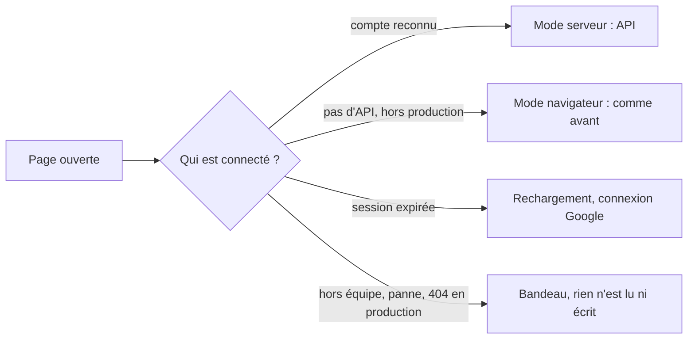

# Les candidatures partagées par toute l'équipe, sur le serveur de Yeita

> Sur `recrutement.yeita.fr`, les pages de candidatures lisent et écrivent les dossiers dans l'API, chacun sous son compte Google. Ailleurs (poste local, tests), rien ne change.

## Pourquoi
Aujourd'hui, chaque recruteur travaille dans son propre navigateur, sur des données fictives, et passe les dossiers d'un poste à l'autre par des codes ou des exports. L'API construite en v1.2 attend d'être branchée. Après cette version, toute l'équipe voit les mêmes dossiers, et deux personnes ne peuvent plus s'écraser sans le savoir.

## Ce qui change pour l'utilisateur
| Avant | Après (sur le site de production) |
|---|---|
| « Qui es-tu ? » : on choisit son prénom dans une liste | « Connecté·e : Alice » (« · lecture seule » pour un lecteur) |
| Les dossiers vivent dans le navigateur | Les dossiers vivent sur le serveur, partagés par l'équipe |
| Un autre onglet met la page à jour aussitôt | La page se met à jour quand on revient sur l'onglet |
| Deux personnes sur le même dossier : la dernière écrase l'autre | Le second enregistrement est refusé, avec un bandeau, et la saisie reste à l'écran |
| « Remplacer tout » à l'import | Seule la fusion est proposée |

## Comment ça marche

La page attend la réponse avant de lire quoi que ce soit, 10 secondes au plus. Tant que le mode n'est pas connu, aucun bouton n'écrit nulle part.

## Les règles à retenir
| Règle | En clair |
|---|---|
| Jamais d'enregistrement silencieux dans le navigateur en production | Une panne ou un mauvais réglage bloque la page avec un message ; il ne fait pas basculer en mode local |
| Refus en cas de conflit | Si quelqu'un a enregistré entre-temps, le bandeau le dit et propose de recharger ; ce qui a été tapé reste affiché pour être copié |
| Pas de conflit avec soi-même | Les enregistrements d'un même dossier partent l'un après l'autre |
| Chaque fiche n'écrit que sa partie | La fiche EC1 et la feuille de décompte d'un même candidat, ouvertes ensemble, ne se gênent pas |
| Un dossier supprimé ne revient pas | Une fiche restée ouverte ne le recrée jamais |

## À l'écran
- Le bandeau d'erreur reste visible en haut, même sur une fiche longue, et ne déplace pas le curseur.
- L'indicateur d'enregistrement passe à « Non enregistré » quand un enregistrement est refusé.
- La note d'impression ne parle plus du « site GitHub » et renvoie vers `recrutement.yeita.fr`.

## Côté technique
- L'API tourne dans Docker, sur un réseau interne que seul oauth2-proxy partage avec elle.
- Le réseau n'a aucune adresse côté serveur (ni IPv4 ni IPv6) : essayé sur un moteur Linux, la machine elle-même ne peut plus joindre l'API.
- L'image Node est figée par son empreinte ; les données sont dans un volume nommé `recrutement_data`.
- Le déploiement attend que l'API soit saine, et revenir à la v1.2 reste possible.

## Ce qu'on ne fait pas
- Reprendre les dossiers déjà dans les navigateurs (exclu par toi).
- Le bandeau « Données fictives », le relais entre la feuille de décompte et la fiche EC1, le temps réel, les sauvegardes.
- Changer l'API elle-même.

## Comment on saura que c'est réussi
- Les tests existants passent toujours, en mode navigateur.
- Un nouveau test de bout en bout couvre la création puis le rechargement, le conflit entre deux navigateurs, le rôle lecture et le prénom sans liste, ainsi que les pannes simulées.
- Sur un banc Docker Linux, l'API n'est joignable que par oauth2-proxy, et un en-tête d'identité forgé ne passe pas.
- Une suppression ne laisse aucune trace du dossier, ni sur le serveur, ni dans les navigateurs, ni dans les journaux.

## Points de vigilance
- L'essai avec un vrai compte Google reste à faire à la main : il faut vérifier que l'email du compte arrive bien à l'API.
- En quittant une page sur une connexion lente, les toutes dernières frappes peuvent être perdues sans message (risque accepté).
- Avant le premier admin, l'exploitant doit faire le contrôle réseau du README sur le vrai serveur.
- Hypothèse à confirmer : aucune vraie candidature n'est restée dans les navigateurs de l'équipe.
