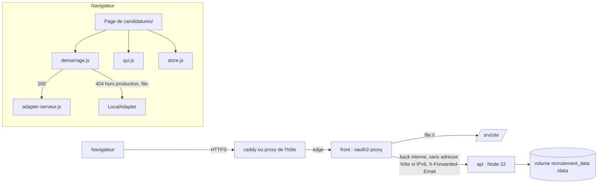

# Spec finale — Pages de candidatures branchées sur l'API, API dans Docker derrière oauth2-proxy

> Au chargement, chaque page de `candidatures/` demande à l'API qui est connecté : si l'API répond, les dossiers, l'identité, l'équipe et les options de disponibilité passent par elle ; hors du site de production, sans API (404) ou en `file://`, tout reste dans le navigateur ; sinon la page ne montre rien et explique pourquoi.
> L'API rejoint la pile Docker sur un réseau interne, sans adresse côté hôte (ni IPv4 ni IPv6), que seul oauth2-proxy partage avec elle.
> Validée au tour 3 (97/100). Intégrés après validation : comparaison de la partie de la fiche à chaque écriture relue (tour 3, R10), ordre d'arrivée de l'envoi de départ (A9), contrôle IPv6 à la mise en service (S8, V40).
> Changements depuis v2 : 404 classé avant la lecture du corps, envoi de départ des fiches sans relecture, nouvelle tentative seulement si la partie de la fiche n'a pas changé, aucune écriture sur un dossier supprimé, IPv6 coupé sur `back`, contrôle réseau à la mise en service (voir challenges/tour-2.md). Depuis v1 : challenges/tour-1.md.

## Changements depuis la version précédente
### Finale (tour 3)
- **Fiches** : R6i compare la partie de la fiche à chaque écriture relue, pas seulement après un conflit (R10) ; CA7 : aucun `PUT` du second onglet n'aboutit.
- **Départ de la page** : H5 cite l'arrivée de l'envoi de départ avant le `PUT` en cours ; CA8 retarde la réponse du `PUT` précédent (A9).
- **Réseau** : V40 ; le contrôle de mise en service vérifie aussi `EnableIPv6` et l'adresse IPv6 (S8).

### v3 (tour 2)
- **Démarrage** : le 404 de `/api/moi` est classé avant la lecture du corps (A7, V22) : tableau § API et intégrations, CA2.
- **Fiches** : R6g et R6h réécrites d'un seul tenant (F9, A2, R10, D11) : envoi de départ sans relecture, avec la version que le `PUT` en cours produira ; nouvelle tentative seulement si la partie de la fiche est inchangée ; relecture vide → aucune écriture ; H5 ; CA7, CA8, CA21.
- **Réseau** : `enable_ipv6: false` sur `back` (S6, V39) ; sortie de `front` par `edge` dans CA17 (S7, V38) ; moteur du serveur et contrôle avant le premier admin (E10) : R32, § Déploiement.

### v2 (tour 1)
- **Lecture et écriture** : R6f (file par dossier, version la plus haute, A1, D8), R6g (`keepalive` sur `pagehide`, A2), R6h (fiches qui écrivent leur partie, F4), R6c-R6e (identifiant contrôlé partout, A3), R4e (adaptateur d'attente, R1), R15b (relecture sans redessin inutile, R3).
- **Réponses** : un seul tableau ordonné (A5) ; R3 (F8) ; R2 : hôte de production, `file:`, délai de 10 s (D3, F5, R9 ; arbitrages de l'utilisateur).
- **Bandeau** : collant, « Non enregistré », pas de bouton en lecture seule (R4, R2, R7) ; « · lecture seule » dans l'en-tête (R6).
- **Données** : « Remplacer tout » masqué en mode serveur (D1, arbitrage de l'utilisateur) ; textes d'export (D2) ; CA21, CA1 élargi (D5, D6) ; H4 (D7).
- **Docker** : pont sans adresse hôte (S1, V30, V31) ; volume nommé (E3, V36) ; sonde 200 seulement (E4) ; digest de l'index (E6, V32) ; `deploy.sh` et retour arrière (E1, E2, E5) ; consignes au README (E8, E9, D10).
- **Tests** : erreurs simulées par interception réseau (F6) ; formes d'adresse de V6 dans CA13 (S2) ; § Sécurité réécrit (S3, V35) ; `no-store` (D9, V34).
- **Au backlog** : contrôle de la configuration résolue dans `deploy.sh` (S4) ; noms des recruteurs hors équipe proposés depuis les dossiers (R8). Chef d'équipe P2.

## Contexte et objectif
La v1.2 a livré l'API de stockage (`api/`) sans la brancher. Les recruteurs travaillent donc chacun dans leur navigateur, sur des données fictives, et passent les dossiers d'un poste à l'autre par des codes ou des exports. Après cette version, sur `recrutement.yeita.fr`, toute l'équipe lit et écrit les mêmes dossiers, chacun sous son compte Google, avec un refus explicite quand deux personnes modifient le même dossier. La logique métier des pages (`store.js`, parcours, fiches) ne change pas : seuls le stockage et l'identité changent. Hors du site de production, sans API, rien ne change.

## Utilisateurs et parcours
Recruteurs (rôles `recruteur`, `admin`), lecteurs (`lecture`), et l'exploitant du serveur.

### P1 — Ouvrir une page (mode serveur)
1. La page s'affiche sans données ; le démarrage appelle `/api/moi`.
2. 200 : la page charge l'équipe et les options, puis lit ses dossiers ; en haut, « Connecté·e : Alice » à la place de la liste « Qui es-tu ? ».
3. Chaque action est notée au nom du compte (`historique[].par` = prénom de l'équipe).
Cas limites : session expirée (401) → la page se recharge et oauth2-proxy renvoie vers Google ; compte hors équipe (403) → message d'accès, aucune donnée ; API arrêtée (502), réseau coupé ou pas de réponse en 10 s → message réseau avec « Recharger », aucune donnée. Avant la réponse, aucun bouton n'écrit nulle part (R4e).

### P2 — Deux recruteurs sur le même dossier
1. Alice et Bob ouvrent la même candidature sur `candidat.html`.
2. Bob enregistre ; Alice enregistre ensuite.
3. L'enregistrement d'Alice est refusé ; un bandeau, visible quel que soit le défilement, dit le message de conflit et « Ce que tu as saisi depuis n'est pas enregistré : copie-le avant de recharger. » ; l'indicateur affiche « Non enregistré » ; sa saisie reste à l'écran ; le dossier de Bob est intact.
Cas limites : Alice quitte l'onglet et y revient avant d'écrire : la page relit (version de Bob) et son enregistrement suivant passe. La fiche EC1 et la feuille de décompte du même candidat, ouvertes ensemble, enregistrent chacune leur partie sans se gêner (R6h).

### P3 — Lecteur
Léa (`lecture`) voit le tableau et les dossiers, « Connecté·e : Léa · lecture seule » ; une écriture est refusée avec « Lecture seule : tu ne peux pas modifier. », sans bouton.

### P4 — Hors du site de production, sans API
Serveur statique des tests (`/api/moi` en 404), poste local, ou page ouverte en `file://` : la page fonctionne exactement comme avant (localStorage, liste « Qui es-tu ? »).

### P5 — Exploitant
1. `deploy/deploy.sh` construit `front` et `api`, démarre la pile, attend `/ping` puis la santé d'`api`, lance `tools/check-site.sh`.
2. Il ajoute le premier admin : `docker compose exec api node api/equipe.js add prenom.nom@yeita.fr Prénom admin`.
3. Retour arrière vers un commit d'avant la 1.3 : le déploiement réussit sans `api` ; le volume reste (R30, § Déploiement).

## Périmètre
### Inclus
- Démarrage (`assets/demarrage.js`), adaptateur serveur (`assets/adapter-serveur.js`), `QUI` et options de disponibilité en mode serveur, relecture au retour sur l'onglet, attente du démarrage dans les 6 pages.
- `[ajout]` Bandeau d'erreur visible du mode serveur (R11), une seule action « Recharger » (chef d'équipe P1) : sans lui, un conflit ou un refus pendant un enregistrement automatique resterait invisible (`YEITA.flash(null, …)` n'écrit que dans la zone `#live`, masquée).
- `[ajout]` Fiches EC1, EC2 et feuille de décompte qui écrivent leur partie sur le dossier relu (R6h) : sinon deux pages ouvertes sur le même candidat se refusent l'une l'autre (tour 1, F4).
- `[ajout]` « Remplacer tout » non proposé en mode serveur (R17, décision de l'utilisateur, tour 1, D1).
- Service `api` dans Docker, `docker/api.Dockerfile`, réseau `back`, volume, oauth2-proxy, `.dockerignore`, `check-site.sh`, `deploy.sh` (attente de l'api), `deploy/README.md`.
- Notes d'impression de `carte.html` et `decompte.html` (décision de l'utilisateur).
- `[ajout]` `YEITA.SITE` vers `https://recrutement.yeita.fr/` (R36) : la note corrigée garde sinon un lien « Ouvrir sur le site » qui mène à une page 404 (V25) ; il sert aussi à reconnaître l'hôte de production (R2).
- `[ajout]` Garde contre une boucle de rechargement sur 401 (R8) : si l'API refuse l'identité alors que la session oauth2-proxy est valide (email absent, H1), le rechargement imposé par le pitch tournerait sans fin.
- Tests : non-régression en mode navigateur, test de bout en bout du mode serveur.
- Fiches 1.2-1, 1.2-2, 1.2-3 (sans l'essai Google ni la migration).

### Exclu
Bandeau « Données fictives » ; relais `yeita-match-resultat` ; règles de `store.js` (seules la source des options ajoutées et l'offre « Remplacer tout » de `index.html` changent) ; temps réel ; sauvegardes (1.2-5) ; évolution de l'API (aucun fichier de `api/src/` modifié) ; migration du localStorage ; autres liens vers GitHub Pages (libellé de l'inventaire de `index.html`, 1.1-1) ; 1.2-6, 1.2-8, 1.2-9, 1.1-5, 1.1-8 ; essai avec un vrai compte Google (manuel) ; « Charger des exemples » en mode serveur (tour 1, R5, écarté) ; contrôle de la configuration résolue dans `deploy.sh` (tour 1, S4 : backlog) ; noms de recruteurs hors équipe repris des dossiers (tour 1, R8 : backlog).

## Existant réutilisé
| Besoin | Décision | Élément | Référentiel |
|---|---|---|---|
| Branchement du stockage | réutiliser | `DOSSIER.use`, `DOSSIER.adapter()` | [API](../../../technique/api.md) |
| Mise à niveau à la lecture | réutiliser | `DOSSIER.upgrade` | — |
| Adaptateur | créer (aucun adaptateur HTTP dans l'arbre ; forme reprise de `a86b6f4:assets/adapter-supabase.js`, V2) | `assets/adapter-serveur.js` | [Décisions](../../../technique/decisions.md) |
| Choix du mode, bandeau, adaptateur d'attente | créer (aucun point de démarrage commun aux pages, V1) | `assets/demarrage.js` | — |
| Identité | étendre | `assets/qui.js` | — |
| Options de disponibilité | étendre (source des ajouts) | `STORE.dispos`, `STORE.addDispo` | — |
| Style du bandeau | réutiliser | `.notice`, `.notice.err` (`candidatures/style.css`) | — |
| Contrat HTTP | réutiliser | `api/README.md` (V4) | [API](../../../technique/api.md#routes) |
| Pile Docker | étendre | `compose.yaml`, `deploy/oauth2-proxy.cfg`, `.dockerignore`, `deploy/deploy.sh`, `tools/check-site.sh` | [Architecture](../../../technique/architecture.md) |
| Image de l'API | créer (V13, V14, V32) | `docker/api.Dockerfile` | — |
| Test de bout en bout | réutiliser l'outillage (Playwright Python) | `tools/e2e-serveur.py` (créer) | [Conventions](../../../technique/conventions.md#tests) |

## Règles et comportements
### Démarrage
| # | Règle | Détail / valeurs |
|---|---|---|
| R1 | Un démarrage commun | `assets/demarrage.js`, chargé par les 6 pages après `dossier.js`, `qui.js`, `store.js`, `adapter-serveur.js`, avant `ui.js` ; il lance aussitôt `GET ../api/moi` et expose la promesse `DEMARRAGE.pret`, le mode (`attente`, `serveur`, `navigateur`, `bloque`), `auRetour(fn)` et `erreur(message, cas)` |
| R2 | Choix du mode (décisions de l'utilisateur ; V9, V10, V22) | `location.protocol` = `file:` → navigateur, sans requête. Sinon, réponse de `/api/moi` classée par le tableau § API et intégrations : 200 avec `prenom` → serveur ; 404 → navigateur, **sauf sur l'hôte de `YEITA.SITE`** → bloqué, message réseau ; 401 → R8 ; 403 → bloqué, message d'accès ; tout le reste, et aucune réponse en 10 s → bloqué, message réseau |
| R3 | Mode serveur | `GET ../api/equipe` et `GET ../api/options-disponibilite` en parallèle ; 200 pour les deux → `DOSSIER.use(AdaptateurServeur())`, `QUI` et options branchés, puis `DEMARRAGE.pret` résolue ; 401 → R8 ; toute autre réponse → bloqué, message réseau (jamais d'état mixte) |
| R4 | Mode navigateur | rien n'est changé : `LocalAdapter`, `QUI` local, options locales ; `DEMARRAGE.pret` résolue |
| R4b | Mode bloqué | `DEMARRAGE.pret` n'est jamais résolue ; la page ne lit ni n'écrit rien ; bandeau (R11) |
| R4c | Chaque page attend | la première lecture du stockage (tableau du cadrage, V1) et tout ce qui lit `QUI` ou les options passent dans `DEMARRAGE.pret.then(...)` ; le reste du script (textes, logo, écouteurs) ne change pas. `decompte.html` sans identifiant n'attend pas |
| R4d | Codes de l'ancienne carte | en mode serveur, `carte.html` ne lance pas `migrateCodes()` (migration exclue par l'utilisateur) |
| R4e | Adaptateur d'attente | dès son chargement, le démarrage pose un adaptateur dont chaque méthode attend `DEMARRAGE.pret` puis passe à l'adaptateur choisi : en mode bloqué, rien n'est lu ni écrit. Jusqu'au choix du mode, `QUI.moi()` rend `""`, `#qui` reste vide, `QUI.ajouter` et `STORE.addDispo` n'écrivent que dans la mémoire de la page |

### Adaptateur serveur
| # | Règle | Détail / valeurs |
|---|---|---|
| R5 | Forme | `{name: "serveur", volatile: false, list, get, put, remove}` (V24) ; requêtes de même origine vers `../api/candidats`, `Accept: application/json`, `cache: "no-store"` |
| R6 | Version gardée par dossier | retenue pour **l'objet** dossier rendu ou enregistré et, à défaut, par identifiant ; `put(d)` envoie celle de `d`, sinon celle de l'identifiant, sinon `null` (un objet ancien ne passe pas sans être relu) |
| R6b | `list()` | `GET` → `data` de chaque enveloppe passé par `DOSSIER.upgrade`, dans l'ordre de l'API (même ordre que `LocalAdapter`, V4) |
| R6c | `get(id)` | identifiant hors motif de l'API (`^cand-[a-z0-9]{1,16}-[a-z0-9]{1,16}$`) → `null` sans requête ; 200 → `upgrade(data)` ; 404 `introuvable` ou 400 → `null` ; 404 sans `code` → rejet (1.2-3, point 2) |
| R6d | `put(d)` | identifiant hors motif → rejet sans requête : « Identifiant invalide pour « <nom> » : ce dossier ne peut pas être enregistré dans la base. » (1.2-3, point 4) ; sinon `PUT` `{version, data: d}` ; 200/201 → nouvelle version retenue ; rend `d` |
| R6e | `remove(id)` | hors motif → `null` sans requête ; 204 ou 404 `introuvable` → résolue ; l'identifiant est retenu comme supprimé pour la vie de la page : un `put` ultérieur est rejeté avec le message de conflit, sans requête (D8) |
| R6f | File par dossier | les requêtes d'un même identifiant partent l'une après l'autre ; `put` prend la version au moment où il part ; pour un identifiant, seule la version la plus haute reçue est gardée (A1) |
| R6g | Départ de la page | l'enregistrement lancé sur `pagehide` part aussitôt avec `keepalive: true` (un dossier pèse 1,4 à 20 Ko, V33, sous la limite de 64 Ko), sans attendre la file ni relire : si un `put` du même identifiant est en cours, il porte la version que ce `put` produira (version envoyée + 1), sinon la version la plus haute connue ; un refus ne peut plus être affiché (H5) |
| R6h | `[ajout]` Fiches | en mode serveur comme en mode navigateur, `ec1.html`, `ec2.html` et `decompte.html` enregistrent en relisant le dossier, en y posant leur seule partie (celle qu'elles écrivent aujourd'hui, V37) et en l'écrivant ; sur `pagehide`, sans relecture (R6g), la partie est posée sur le dernier dossier lu ou enregistré ; `candidat.html` garde son enregistrement du dossier entier |
| R6i | Fiches : conflit et suppression | à **chaque** écriture relue (et à la seule nouvelle tentative après un 409) : relecture vide (dossier supprimé) → aucune écriture, bandeau de conflit et saisie non enregistrée (R11b) ; partie de la fiche dans le dossier relu différente de celle que la page a lue ou écrite en dernier (comparées après `DOSSIER.upgrade`) → aucune écriture, rejet `conflit`, même bandeau ; dans les deux modes (sans effet dans un seul onglet) |
| R7 | Rejets | toute réponse non réussie rejette avec `Error(message)` et `error.code` (tableau § API et intégrations). L'adaptateur ne retente jamais seul ; après un 409, la version gardée ne change pas |
| R8 | 401 | `location.reload()`, la promesse reste en attente ; garde : un 401 moins de 60 s après un rechargement dû à un 401 → mode bloqué, message de session, sans nouveau rechargement ; même règle au démarrage ; le corps n'est pas lu (V29) |
| R10 | Requêtes | relatives à la page (`../api/…`), donc de même origine ; identifiant passé par `encodeURIComponent` ; aucun en-tête d'identité envoyé par la page ; jamais de contenu de dossier dans l'adresse |

### Bandeau d'erreur
| # | Règle | Détail / valeurs |
|---|---|---|
| R11 | `[ajout]` Erreurs visibles en mode serveur | tout rejet de l'adaptateur (hors 401 en cours de rechargement) et tout échec de R14 affichent un bandeau `.notice.err`, `role="alert"`, collé en haut de la fenêtre quel que soit le défilement, sans déplacer le focus ; un nouveau message remplace le précédent ; bouton « Recharger », sauf pour la lecture seule (aucun bouton) ; les pages qui affichent déjà `x.message` continuent |
| R11b | Saisie non enregistrée | sur un rejet d'enregistrement (conflit, réseau, lecture seule, identifiant), le bandeau ajoute « Ce que tu as saisi depuis n'est pas enregistré : copie-le avant de recharger. » (sauf lecture seule), et l'indicateur d'enregistrement des pages qui en ont un (`candidat`, `ec1`, `ec2`) affiche « Non enregistré » ; la saisie reste à l'écran |

### Identité (`assets/qui.js`)
| # | Règle | Détail / valeurs |
|---|---|---|
| R12 | Mode serveur | `QUI.moi()` rend le prénom du compte ; `QUI.equipe()` les prénoms de `/api/equipe` (membres actifs, ordre de l'API) ; `QUI.choisir()` ne change rien ; `QUI.ajouter(nom)` n'ajoute le nom qu'à la liste de la page (régression notée dans `MODELE.md`) |
| R13 | `QUI.monter(el)` | rien tant que le mode n'est pas connu ; en mode navigateur, la liste actuelle ; en mode serveur, « Connecté·e : <prénom> », suivi de « · lecture seule » pour le rôle `lecture` (affichage seulement : les droits restent ceux de l'API) ; `focus()` reste appelable |
| R13b | Pages | aucun changement d'appel de `QUI.monter` ; `S.me()` n'est jamais vide en mode serveur |

### Options de disponibilité (`assets/store.js`)
| # | Règle | Détail / valeurs |
|---|---|---|
| R14 | Source des ajouts | `STORE.dispos()` et `STORE.addDispo()` gardent leurs règles (base `D.DISPOS` + ajouts, sans doublon, synchrones) ; en mode serveur, les ajouts viennent de la liste chargée au démarrage ; `addDispo` l'ajoute aussitôt et envoie `POST ../api/options-disponibilite` ; la réponse remplace la liste ; un échec affiche le bandeau (l'option reste proposée dans la page) |

### Retour sur l'onglet
| # | Règle | Détail / valeurs |
|---|---|---|
| R15 | Relecture | `DEMARRAGE.auRetour(fn)` : en mode serveur, `fn()` à chaque `visibilitychange` vers `visible` ; en mode navigateur, rien (les écoutes `storage` restent) |
| R15b | Pages | `index` (`load()`), `candidat`, `ec2` (`renderFrom1()`), `carte` (`refresh(id)`) enregistrent leur fonction d'écoute actuelle ; la page ne redessine que si le dossier relu a changé (`meta.modifieLe`) ; `candidat.html` ne relit pas si un enregistrement est en attente, en cours ou refusé, ni pendant une saisie dans le panneau (formulaire ouvert, champ actif) ; une relecture réussie retire le bandeau de conflit. `ec1` (`yeita-match-resultat`) ne change pas |

### Mode navigateur et import
| # | Règle | Détail / valeurs |
|---|---|---|
| R16 | Inchangé | règles et parcours identiques à `main` ; seule différence, invisible dans un seul onglet : les fiches écrivent leur partie sur le dossier relu (R6h) ; les 4 tests de bout en bout existants passent sans modification (V22) |
| R17 | `[ajout]` Import en mode serveur | `index.html` ne propose pas « Remplacer tout » ; seul « Fusion » reste (`store.js` inchangé) ; en mode navigateur, rien ne change |
| R18 | Textes d'export en mode serveur | à la place de « Exporte la base de temps en temps : c'est ta sauvegarde. » et de la date du dernier export : « Les candidatures sont enregistrées sur le serveur de l'équipe. Un export est une copie : supprime-la après usage. » |

### Docker
| # | Règle | Détail / valeurs |
|---|---|---|
| R22 | Service `api` | construit depuis `.` avec `docker/api.Dockerfile`, image `recrutement-api`, volume nommé `recrutement_data` (déclaré avec `name:`, V36, étiquette `fr.yeita.projet=recrutement`) sur `/data`, réseau `back` seul, **aucun `ports:`**, aucune variable, `restart: unless-stopped`, journaux `*journaux` ; `front` : `edge` et `back` ; `caddy` : `edge` seul |
| R22b | Réseau `back` | `internal: true`, pont sans adresse IPv4 côté hôte (`com.docker.network.bridge.inhibit_ipv4: "true"`) et `enable_ipv6: false` explicite (un IPv6 activé par défaut sur le moteur ne s'applique pas) : sans cela, l'hôte Linux et tout conteneur en réseau hôte joignent l'API par son adresse (V30, V31, V39) |
| R23 | oauth2-proxy | `upstreams` + `"http://api:8000/api/"` ; `api_routes = ["^/api/"]` ; `skip_auth_routes` inchangé (V5) |
| R24 | Joignabilité | l'API n'est joignable ni depuis l'hôte (`127.0.0.1` ni son adresse sur `back`), ni depuis un conteneur en réseau hôte, ni depuis caddy, ni depuis un conteneur du seul réseau `edge` ; `front` la joint ; un en-tête d'identité forgé n'atteint pas l'API sans session et est écrasé avec une session (V7, V11, V12, V30, V31) |
| R25 | Image | `FROM node:22.23.4-slim@sha256:de170b39439eb0e5a3444ad7d60b015614a381e10fecae2e30ec9e735122f38d` (digest de l'index multi-architecture, V32 ; décision de l'utilisateur, exception aux 14 jours, V13) ; `LABEL fr.yeita.projet=recrutement` ; `npm ci --omit=dev` dans le dossier de `api/package.json`, `.npmrc` compris (aucun script d'installation) ; `USER node` ; `NODE_ENV=production`, `HOST=0.0.0.0`, `PORT=8000`, `DB_PATH=/data/recrutement.sqlite` ; lance `node api/server.js` |
| R26 | Droits | `/data` propriétaire `node`, mode 700 (V14) ; base en 600 |
| R27 | Santé | `HEALTHCHECK` en Node (pas de `curl`, V20) : sain seulement si `/api/sante` rend 200 en moins de 4 s ; intervalle 30 s, 3 essais, 10 s de démarrage |
| R28 | Jamais de mode local | ni `DEV_EMAIL` ni `DEV_STATIC` dans `compose.yaml` ; l'image fixe `NODE_ENV=production` ; l'API refuse de démarrer sinon (V15) |
| R29 | Échec de démarrage | base illisible → code 1 et cause au journal ; Compose relance ; après correction, l'API repart (V16) |
| R30 | Déploiement | `deploy/deploy.sh`, après `/ping` : si `docker compose config --services`, lu **après** le changement de commit, contient `api`, attendre qu'elle soit `healthy` (60 s au plus), sinon même sortie en échec que pour `front` ; puis `check-site.sh` |
| R31 | Équipe en production | `deploy/README.md` : `docker compose exec api node api/equipe.js add|list|disable|role …`, depuis `/opt/recrutement` ; premier admin après le premier `up` ; `disable` coupe l'accès aux données dès la requête suivante ; la base est dans le volume `recrutement_data` (V17) |
| R32 | Consignes du README | version du moteur Docker du serveur relevée aux prérequis (parade vérifiée sur 29.9.2, V31 : la refaire si le serveur est plus ancien) ; premier déploiement de la 1.3 (lancé par le script de la 1.2 : vérifier `docker compose ps api`) ; **contrôle réseau avant le premier admin** : `back` en `EnableIPv6: false`, aucune adresse IPv6 pour `api`, l'hôte ne joint pas l'api sur `back` (V40), sinon pas de mise en service (commande et conduite à tenir dans le README) ; retour arrière ; jamais `down -v` ni `docker volume prune` ; coupure d'environ 15 s à chaque déploiement ; rotation des journaux ; données locales des navigateurs (H4) |
| R33 | `check-site.sh` | 6e contrôle : `/api/moi` sans cookie → 401 (V5) |
| R34 | `.dockerignore` | + `api/node_modules`, `api/data`, `*.sqlite`, `*.sqlite-wal`, `*.sqlite-shm` (1.2-2) |

### Textes d'impression
| # | Règle | Détail / valeurs |
|---|---|---|
| R35 | Notes | `carte.html` et `decompte.html` ne parlent plus du « site GitHub » (§ Contenu et textes) |
| R36 | `[ajout]` Lien | `assets/yeita.js` : `SITE = "https://recrutement.yeita.fr/"`, commentaires « GitHub Pages » mis à jour (V25) |

### Tests et documentation
| # | Règle | Détail / valeurs |
|---|---|---|
| R37 | Non-régression | `node tools/test-store.js`, les 4 `tools/e2e-*.py` en mode navigateur, `cd api && npm test` passent sans modification |
| R38 | Test du mode serveur | `tools/e2e-serveur.py` (Playwright Python) contre l'API lancée avec une base temporaire et `DEV_STATIC`, sans `DEV_EMAIL` ; identité de chaque navigateur par `X-Forwarded-Email` (V21) ; équipe : Alice et Bob (`recruteur`), Léa (`lecture`) ; les réponses que l'API ne produit pas (proxy, réseau, lenteur) sont simulées par interception réseau ; commande dans `hlyja/technique/conventions.md` |
| R39 | Banc Docker | R22 à R34 vérifiés sur la pile construite, sur les valeurs résolues (`docker compose config`), sur un moteur Linux pour R22b et R24 |
| R40 | `MODELE.md` | messages ; branchement réel (`demarrage.js`, `adapter-serveur.js`) ; tableau « Ce qui vit encore dans le navigateur » pour le mode serveur ; régression de `QUI.ajouter` ; risque H5 ; un export est une copie, un import « Fusion » peut recréer un dossier supprimé |

## UX / UI
- **Attente** : la page montre sa structure sans données (mêmes éléments masqués qu'aujourd'hui avant `load()`), 10 s au plus.
- **En-tête** : « Connecté·e : Alice » (« · lecture seule » pour un lecteur) à l'emplacement de « Qui es-tu ? » (`#qui`), même taille de texte.
- **Bandeau** (R11) : collé en haut de la fenêtre, `.notice.err`, `role="alert"`, message puis « Recharger » ; le focus n'est pas déplacé (l'utilisateur peut être en train d'écrire).
- **Non enregistré** (R11b) : l'indicateur remplace l'heure du dernier enregistrement ; la saisie reste à l'écran pour être copiée (« Copier pour Notion » existe sur EC1 et EC2).
- **Retour sur l'onglet** : la page ne se redessine que si le dossier a changé ; rien n'est relu pendant une saisie.

## Contenu et textes
Textes exacts (dans `assets/wording.fr.js`, clé `serveur`) :
| Cas | Texte | Source |
|---|---|---|
| Conflit | La candidature a été modifiée par quelqu'un d'autre. Recharge la page. | `MODELE.md`, `api/README.md` |
| Hors équipe | Tu ne fais pas partie de l'équipe. | `api/README.md` |
| Lecture seule | Lecture seule : tu ne peux pas modifier. | `api/README.md` |
| Réseau | La base ne répond pas. Vérifie ta connexion, puis réessaie. | `a86b6f4:assets/adapter-supabase.js` |
| Session (garde de R8) | Ta session n'a pas pu être vérifiée. Ferme l'onglet, puis rouvre le site. | nouveau |
| Identifiant | Identifiant invalide pour « {nom} » : ce dossier ne peut pas être enregistré dans la base. | nouveau (tour 1, A3) |
| Saisie non enregistrée | Ce que tu as saisi depuis n'est pas enregistré : copie-le avant de recharger. | nouveau (tour 1, R2) |
| Indicateur | Non enregistré | nouveau |
| En-tête | Connecté·e : {prenom} · lecture seule | nouveau (« · lecture seule » pour le rôle `lecture`) |
| Bouton du bandeau | Recharger | nouveau |
| Export (mode serveur) | Les candidatures sont enregistrées sur le serveur de l'équipe. Un export est une copie : supprime-la après usage. | nouveau (tour 1, D2) |
| Note `carte.html` | Pour imprimer ou exporter en PDF, ouvre cette page dans un onglet du site du recrutement. | remplace « … depuis le site GitHub du recrutement. » |
| Note `decompte.html` | Pour imprimer, ouvre cette page dans un onglet du site du recrutement, ou utilise le PDF du kit. | idem |

## API et intégrations
| Méthode | Appel | Succès | Autres réponses |
|---|---|---|---|
| démarrage | `GET ../api/moi` | 200 `{email, prenom, role}` | R2 |
| démarrage | `GET ../api/equipe`, `GET ../api/options-disponibilite` | 200 | R3 |
| `STORE.addDispo` | `POST ../api/options-disponibilite` `{libelle}` | 200/201, la liste | tableau ci-dessous |
| `list()`, `get(id)` | `GET ../api/candidats`, `GET ../api/candidats/<id>` | 200 | R6c, tableau |
| `put(d)` | `PUT ../api/candidats/<id>` | 200/201 | R6d, tableau |
| `remove(id)` | `DELETE ../api/candidats/<id>` | 204 | 404 `introuvable` → résolue ; tableau |

Classement des réponses, dans cet ordre (le premier cas qui s'applique l'emporte ; démarrage et adaptateur) :
| # | Réponse | Effet | `error.code` | Message |
|---|---|---|---|---|
| 1 | aucune (`fetch` rejeté), ou pas de réponse en 10 s au démarrage | bloqué au démarrage ; rejet ensuite | `reseau` | Réseau |
| 2 | 401, quel que soit le corps | R8 | — | Session si la garde joue |
| 3 | 204 | succès, corps non lu | — | — |
| 4 | 404 de `/api/moi` au démarrage, corps non lu (le 404 d'un serveur statique est en `text/html`, V22) | navigateur, ou bloqué sur l'hôte de production (R2) | — | Réseau si bloqué |
| 5 | corps non JSON (`Content-Type` sans `application/json`, ou JSON illisible), quel que soit le statut (403 et 502 d'oauth2-proxy compris) | bloqué au démarrage ; rejet ensuite | `reseau` | Réseau |
| 6 | JSON avec `code` (`conflit`, `hors-equipe`, `lecture-seule`, `introuvable`) | selon R6c à R6e ; au démarrage, 403 → bloqué | le `code` | celui du `code` |
| 7 | JSON sans `code`, statut d'erreur (400, 404 « Route inconnue. », 413, 415, 500, 503) | rejet ; au démarrage, bloqué | `api` | le texte `erreur` de l'API |
| 8 | 200 de `/api/moi` sans `prenom` | bloqué | `reseau` | Réseau |
Aucune route ni comportement de l'API ne change.

## Architecture technique

Ordre des scripts : … `dossier.js`, `config.js`, `wording.fr.js`, `qui.js`, `store.js`, `adapter-serveur.js`, `demarrage.js`, `data-parcours.js`, `ui.js`, (`parcours-ui.js`), script de la page. Aucune dépendance ajoutée.
Alternatives écartées : mode navigateur sur tout échec (repli silencieux, décision de l'utilisateur) ; version par identifiant seul (écrasement par un objet ancien) ; options de disponibilité dans l'adaptateur du dossier (contrat à quatre méthodes de `MODELE.md` changé) ; `front` dépendant de la santé d'`api` (le site tomberait avec l'API) ; `gateway_mode_ipv4: isolated` (même effet, V31 ; option plus récente).

## Sécurité et conformité
| Sujet | Règle |
|---|---|
| Qui joint l'API | `front` seul (R22, R22b, R24) ; aucun port publié ; réseau interne sans sortie ni adresse côté hôte |
| Identité | posée par oauth2-proxy depuis la session (V7) ; la page n'envoie aucun en-tête d'identité ; H1 (Google) vérifié à la main |
| Mode local | impossible dans l'image (R28, V15) |
| Rôles | appliqués par l'API (V8) ; la page n'en déduit aucun droit ; `disable` coupe l'accès aux données dès la requête suivante, même avec une session ouverte (R31) |
| Requêtes inter-sites | même site (`*.yeita.fr`), le cookie part : la protection est le 415 sans `application/json` sur `PUT`/`POST` et le prévol CORS, sans cookie, refusé par oauth2-proxy (401, aucun en-tête CORS) ; essayé (V35) |
| Données dans le navigateur | en mode serveur, aucun contenu de dossier n'est écrit dans le stockage du navigateur, sauf deux exceptions existantes : `yeita-match-resultat` (relais hors périmètre, sans nom, effacé à sa reprise par EC1) et `yeita-notice` (sessionStorage, nom du candidat, effacé à la lecture) ; `yeita-dossier-courant` ne garde qu'un identifiant ; réponses en `no-store` au travers d'oauth2-proxy (V34) |
| Copies | un export est une copie hors de l'effacement ; un import « Fusion » d'un ancien export peut recréer un dossier supprimé (R18, R40) ; « Remplacer tout » n'est pas proposé (R17) |
| Journaux | API : méthode, adresse (identifiant du dossier), statut, jamais le corps ; oauth2-proxy : adresse et compte ; rotation `json-file` 10 Mo × 3 par service : après une suppression, l'identifiant reste jusqu'à la rotation, jamais le nom ni le contenu |

## Déploiement et compatibilité
- **Compatibilité** : mode navigateur intact hors production (R16) ; un aperçu sans API se comporte comme `main`.
- **Mise en service** : premier `deploy.sh` (celui de la 1.2, qui n'attend pas l'api : vérifier `docker compose ps api`), contrôle réseau de R32, premier admin (R31), puis H1 à la main : `/api/moi` dans le navigateur rend son email.
- **Données existantes** : les dossiers du localStorage des postes ne sont pas repris ; H4.
- **Retour arrière** : de préférence vers un commit antérieur de la 1.3 (la base reste servie). Vers la 1.2 : `deploy.sh` réussit sans `api` (R30), le volume reste ; les pages repassent dans le navigateur : prévenir l'équipe de ne rien saisir avant le retour de la 1.3 (R32).

## Exploitation
Journaux `docker compose logs api` (une ligne par contrôle de santé, toutes les 30 s) ; état `docker compose ps` ; équipe R31 ; consignes R32 ; contrôle `tools/check-site.sh` (R33), puis, sur le serveur, hôte → `http://<adresse de l'api sur back>:8000/api/sante` : échec attendu (1.2-1, R24).

## Critères d'acceptation
- [ ] CA1 — Mode serveur : avec `/api/moi` retardé de 2 s, aucune requête `/api/candidats` et aucune écriture locale avant la réponse ; après un parcours complet (création, appel, décompte puis EC1, EC2, carte, retour au tableau), un texte repère saisi dans le dossier n'apparaît dans aucune clé du stockage du navigateur, hors les deux exceptions du § Sécurité (R1, R3, R4c).
- [ ] CA2 — Démarrage : 404 `text/html` d'un serveur statique → navigateur ; 404 sous l'hôte de production → bandeau réseau ; `file://` → navigateur sans requête ; 200 → serveur ; 401 → un rechargement, puis bandeau de session sans nouveau rechargement ; 403 JSON → bandeau d'accès ; 502 HTML, 200 non JSON, réseau coupé, 10 s sans réponse, `/api/equipe` en 404 → bandeau réseau, aucune lecture (R2, R3, R4b, R8).
- [ ] CA3 — En mode bloqué (et pendant l'attente), « Nouvelle candidature » puis l'envoi n'écrivent rien, ni dans l'API ni dans `yeita-dossiers` (R4e).
- [ ] CA4 — Création d'une candidature par Alice, rechargement : elle est là, lue depuis l'API (R6b, R6d).
- [ ] CA5 — Conflit sur `candidat.html` : Bob enregistre, puis Alice : refus, bandeau collant visible page défilée en bas, « Non enregistré », saisie toujours à l'écran ; la base garde la version de Bob (R6, R7, R11, R11b).
- [ ] CA6 — Pas de conflit avec soi-même : chaque `PUT` retardé de 1 s, saisie continue dans `candidat.html` puis `ec1.html` : aucun 409, la base garde le dernier texte (R6f).
- [ ] CA7 — Fiches ensemble : `ec1.html` et `decompte.html` du même candidat dans deux onglets, enregistrements alternés : tous passent, chaque partie est en base ; `ec2.html` passe après un changement d'état fait par Bob ; `ec2.html` du même candidat dans deux onglets, notes changées dans l'un puis saisie dans l'autre : refus avec bandeau, aucun `PUT` du second onglet n'aboutit, les notes du premier restent en base (R6h, R6i).
- [ ] CA8 — Départ de la page, sur `candidat.html` et `ec1.html` : saisie puis navigation dans les 200 ms : le texte est en base, y compris quand la réponse du `PUT` précédent est retardée de 1 s (le `PUT` atteint l'API, sa réponse revient tard) (R6g, R6h).
- [ ] CA9 — Léa (`lecture`) : tableau visible, « Connecté·e : Léa · lecture seule » ; une écriture est refusée avec le message, sans bouton (R7, R11, R13).
- [ ] CA10 — Prénom sans liste : en mode serveur, aucun `select#qui-sel` ; « Connecté·e : Alice » ; l'historique d'une action porte « Alice » ; le champ Recruteurs propose les prénoms de `/api/equipe` (R12, R13).
- [ ] CA11 — Options : une option ajoutée par Alice est proposée à Bob après rechargement ; rien dans `yeita-options-disponibilite` (R14).
- [ ] CA12 — Retour sur l'onglet : Bob modifie un dossier ; Alice revient sur le tableau : la modification apparaît sans rechargement ; un retour sans changement ne redessine pas ; sur `candidat.html`, un formulaire de refus ouvert et le focus sont conservés (R15, R15b).
- [ ] CA13 — Adaptateur : identifiant hors motif → `get`/`remove` sans requête, `put` rejeté avec le message « Identifiant invalide… » ; 404 sans `code` → rejet distinct de `introuvable` ; réponse non JSON → message réseau ; `list`/`get` rendent des dossiers mis à niveau ; un `put` après `remove` du même identifiant est rejeté sans requête (R6c à R6e, tableau ; 1.2-3).
- [ ] CA14 — Import en mode serveur : aucune option « Remplacer tout » ; textes d'export de R18 ; en mode navigateur, l'option et les textes actuels (R17, R18).
- [ ] CA15 — Non-régression : `test-store.js`, 4 e2e en mode navigateur, `npm test` (52) passent (R16, R37).
- [ ] CA16 — Banc, valeurs résolues : `api` sans `ports`, sans `environment`, réseau `back` seul ; `back` interne avec `inhibit_ipv4` et `EnableIPv6: false` ; volume résolu `recrutement_data` ; `front` sur `edge` et `back` ; `caddy` sur `edge` seul (R22, R22b, R28).
- [ ] CA17 — Banc, essais d'attaque avec témoins, sur un moteur Linux : hôte → `127.0.0.1:8000` et → adresse de l'api sur `back` : échec ; conteneur en réseau hôte : échec ; caddy → api : échec ; `front` → api : 200, et `front` sort vers Internet par `edge` (V38) ; sans session, les formes de V6 n'atteignent pas l'API ; `X-Forwarded-Email` forgé sans session → 401 sans requête à l'API ; avec session → email de la session (R24).
- [ ] CA18 — Image : base figée par le digest de l'index, utilisateur `node`, `/data` en 700, `healthy` ; `/api/sante` en 503 → `unhealthy` ; `DEV_EMAIL` ou `DEV_STATIC` → code 1 ; volume en lecture seule → code 1 puis relance saine ; aucun script d'installation lancé (R25 à R29).
- [ ] CA19 — `check-site.sh` sur la pile locale : 6 contrôles OK dont `/api/moi` → 401 (R33).
- [ ] CA20 — `deploy.sh` dans un banc : attend la santé d'`api` et échoue proprement si elle ne vient pas ; un retour vers un commit sans `api` finit en réussite, `api` retirée, volume présent (R30).
- [ ] CA21 — Suppression de bout en bout : un dossier porte un repère dans `identite.personne` et une note EC1 ; Alice le supprime ; Bob revient sur le tableau : il a disparu ; une saisie dans `candidat.html`, `ec1.html` et `decompte.html` encore ouvertes chez Bob → aucune recréation, bandeau ; le repère est absent des fichiers de `/data` (sans `VACUUM`), du stockage des deux navigateurs et de `docker compose logs api front` (R6e, R15).
- [ ] CA22 — `docker compose exec api node api/equipe.js add|list|disable` fonctionne ; l'API voit le changement à la requête suivante (R31).
- [ ] CA23 — `.dockerignore` : une base factice dans `api/data/` et `api/node_modules` n'entrent pas dans le contexte de construction (R34).
- [ ] CA24 — Notes d'impression : plus aucune occurrence de « GitHub » dans `carte.html` et `decompte.html` ; le lien « Ouvrir sur le site » mène à `https://recrutement.yeita.fr/<page>` (R35, R36).
- [ ] CA25 — `MODELE.md`, `deploy/README.md` (R31, R32), référentiel à jour (R40).

## Hypothèses et questions ouvertes
- H1 : avec Google, oauth2-proxy pose l'email du compte (vérifié avec Dex en OIDC, V7, pas avec Google) — essai manuel au guide de test.
- H2 : l'aperçu dans l'artefact Claude n'a pas pu être essayé : le comportement observé (mode navigateur si l'hôte rend 404) est noté au guide de test (arbitrage de l'utilisateur, tour 1).
- H3 : les exemples fictifs (« Charger des exemples ») écrivent dans la base en mode serveur, comme toute action ; ils portent `meta.demo` et se retirent ; le bandeau « Données fictives » reste hors périmètre.
- H5 : un enregistrement de départ (R6g) refusé (conflit avec quelqu'un d'autre, réseau) ne peut plus être affiché, de même qu'un envoi de départ arrivé à l'API avant le `PUT` en cours (requêtes indépendantes, ordre non garanti : refus pour conflit) : la saisie des 300 à 400 dernières millisecondes est alors perdue ; risque accepté, écrit dans `MODELE.md` (R40).
- H4 : aucune vraie candidature n'est dans les navigateurs de l'équipe (données fictives jusqu'ici) ; le README demande à chacun d'effacer les données du site dans son navigateur après la mise en service (aucun code). À confirmer par l'utilisateur au guide de test.
