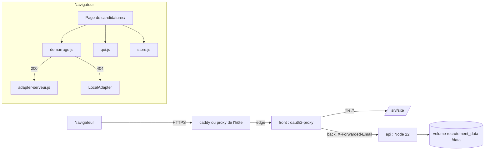

# Spec v1 — Pages de candidatures branchées sur l'API, API dans Docker derrière oauth2-proxy

> Au chargement, chaque page de `candidatures/` demande à l'API qui est connecté : si l'API répond, les dossiers, l'identité, l'équipe et les options de disponibilité passent par elle ; s'il n'y a pas d'API sur le site (404), tout reste dans le navigateur comme aujourd'hui ; sinon la page ne montre rien et explique pourquoi.
> L'API rejoint la pile Docker sur un réseau interne que seul oauth2-proxy partage avec elle.

## Contexte et objectif
La v1.2 a livré l'API de stockage (`api/`) sans la brancher. Les recruteurs travaillent donc chacun dans leur navigateur, sur des données fictives, et passent les dossiers d'un poste à l'autre par des codes ou des exports. Après cette version, sur `recrutement.yeita.fr`, toute l'équipe lit et écrit les mêmes dossiers, chacun sous son compte Google, avec un refus explicite quand deux personnes modifient le même dossier. La logique métier des pages (`store.js`, parcours, fiches) ne change pas : seuls le stockage et l'identité changent. Sur un poste sans API (tests, aperçu statique), rien ne change.

## Utilisateurs et parcours
Recruteurs (rôles `recruteur`, `admin`), lecteurs (`lecture`), et l'exploitant du serveur.

### P1 — Ouvrir une page (mode serveur)
1. La page s'affiche sans données ; le démarrage appelle `/api/moi`.
2. 200 : la page charge l'équipe et les options, puis lit ses dossiers ; en haut, « Connecté·e : Alice » à la place de la liste « Qui es-tu ? ».
3. Chaque action est notée au nom du compte (`historique[].par` = prénom de l'équipe).
Cas limites : session expirée (401) → la page se recharge et oauth2-proxy renvoie vers Google ; compte hors équipe (403) → message d'accès, aucune donnée ; API arrêtée (502) ou réseau coupé → message réseau avec « Recharger », aucune donnée.

### P2 — Deux recruteurs sur le même dossier
1. Alice et Bob ouvrent la même candidature.
2. Bob enregistre ; Alice enregistre ensuite.
3. L'enregistrement d'Alice est refusé ; un bandeau visible dit « La candidature a été modifiée par quelqu'un d'autre. Recharge la page. » avec un bouton « Recharger » ; le dossier de Bob est intact.
Cas limite : Alice quitte l'onglet puis y revient avant d'enregistrer : la page relit le dossier (version de Bob) ; son enregistrement suivant passe.

### P3 — Lecteur
Léa (`lecture`) voit le tableau et les dossiers, « Connecté·e : Léa » ; toute écriture est refusée avec « Lecture seule : tu ne peux pas modifier. ».

### P4 — Poste sans API (tests, aperçu)
`/api/moi` rend 404 : la page fonctionne exactement comme avant (localStorage, liste « Qui es-tu ? »).

### P5 — Exploitant
1. `deploy/deploy.sh` construit les images `front` et `api`, démarre la pile, attend que `api` soit saine, lance `tools/check-site.sh`.
2. Il ajoute le premier admin : `docker compose exec api node api/equipe.js add prenom.nom@yeita.fr Prénom admin`.

## Périmètre
### Inclus
- Démarrage (`assets/demarrage.js`), adaptateur serveur (`assets/adapter-serveur.js`), `QUI` et options de disponibilité en mode serveur, relecture au retour sur l'onglet, attente du démarrage dans les 6 pages.
- `[ajout]` Bandeau d'erreur visible du mode serveur (R11), réduit au message et à un bouton « Recharger » (chef d'équipe, P1) : sans lui, un conflit ou un refus pendant un enregistrement automatique resterait invisible (`YEITA.flash(null, …)` n'écrit que dans la zone `#live`, masquée, V1).
- Service `api` dans Docker, `docker/api.Dockerfile`, réseau `back`, volume, oauth2-proxy, `.dockerignore`, `check-site.sh`, `deploy.sh` (attente de l'api), `deploy/README.md`.
- Notes d'impression de `carte.html` et `decompte.html` (décision de l'utilisateur).
- `[ajout]` `YEITA.SITE` vers `https://recrutement.yeita.fr/` (R36) : la note corrigée garde sinon un lien « Ouvrir sur le site » qui mène à une page 404 (V25).
- `[ajout]` Garde contre une boucle de rechargement sur 401 (R8) : si l'API refuse l'identité alors que la session oauth2-proxy est valide (email absent, H1), le rechargement imposé par le pitch tournerait sans fin.
- Tests : non-régression en mode navigateur, test de bout en bout du mode serveur.
- Fiches 1.2-1, 1.2-2, 1.2-3 (sans l'essai Google ni la migration).

### Exclu
Bandeau « Données fictives » ; relais `yeita-match-resultat` ; règles de `store.js` (seule la source des options ajoutées change) ; temps réel ; sauvegardes (1.2-5) ; évolution de l'API (aucun fichier de `api/src/` modifié) ; migration du localStorage ; autres liens vers GitHub Pages (libellé de l'inventaire de `index.html`, 1.1-1) ; 1.2-6, 1.2-8, 1.2-9, 1.1-5, 1.1-8 ; essai avec un vrai compte Google (manuel).

## Existant réutilisé
| Besoin | Décision | Élément | Référentiel |
|---|---|---|---|
| Branchement du stockage | réutiliser | `DOSSIER.use`, `DOSSIER.adapter()` | [API](../../../technique/api.md) |
| Mise à niveau à la lecture | réutiliser | `DOSSIER.upgrade` | — |
| Adaptateur | créer (aucun adaptateur HTTP dans l'arbre ; forme reprise de `a86b6f4:assets/adapter-supabase.js`, V2) | `assets/adapter-serveur.js` | [Décisions](../../../technique/decisions.md) |
| Choix du mode, bandeau | créer (aucun point de démarrage commun aux pages, V1) | `assets/demarrage.js` | — |
| Identité | étendre | `assets/qui.js` | — |
| Options de disponibilité | étendre (source des ajouts) | `STORE.dispos`, `STORE.addDispo` | — |
| Style du bandeau | réutiliser | `.notice`, `.notice.err` (`candidatures/style.css` l. 111-113) | — |
| Contrat HTTP | réutiliser | `api/README.md` (V4) | [API](../../../technique/api.md#routes) |
| Pile Docker | étendre | `compose.yaml`, `deploy/oauth2-proxy.cfg`, `.dockerignore`, `deploy/deploy.sh`, `tools/check-site.sh` | [Architecture](../../../technique/architecture.md) |
| Image de l'API | créer (V13, V14) | `docker/api.Dockerfile` | — |
| Test de bout en bout | réutiliser l'outillage (Playwright Python) | `tools/e2e-serveur.py` (créer) | [Conventions](../../../technique/conventions.md#tests) |

## Règles et comportements
### Démarrage
| # | Règle | Détail / valeurs |
|---|---|---|
| R1 | Un démarrage commun | `assets/demarrage.js`, chargé par les 6 pages après `dossier.js`, `qui.js`, `store.js`, `adapter-serveur.js`, avant `ui.js`. Il lance aussitôt `GET ../api/moi` et expose `DEMARRAGE.pret` (promesse), `DEMARRAGE.mode()` (`"attente"`, `"serveur"`, `"navigateur"`, `"bloque"`), `DEMARRAGE.auRetour(fn)`, `DEMARRAGE.erreur(message, action)` |
| R2 | Choix du mode sur la réponse de `/api/moi` (décision de l'utilisateur, V9, V10, V22) | **200** avec JSON `{prenom, role}` → serveur. **404** (tout type de contenu) → navigateur. **401** → rechargement (R8). **403** → bloqué, message d'accès (R9). **Autre statut, réponse non JSON, `fetch` rejeté** → bloqué, message réseau |
| R3 | Mode serveur | `DOSSIER.use(AdaptateurServeur())`, puis `GET ../api/equipe` et `GET ../api/options-disponibilite` en parallèle ; l'échec de l'un d'eux suit R2 (401, 403, réseau). `DEMARRAGE.pret` est résolue ensuite seulement |
| R4 | Mode navigateur | rien n'est changé : `LocalAdapter`, `QUI` local, options locales ; `DEMARRAGE.pret` résolue |
| R4b | Mode bloqué | `DEMARRAGE.pret` n'est jamais résolue : la page ne lit ni n'écrit rien ; le bandeau (R11) donne le message et « Recharger » (`location.reload()`) |
| R4c | Chaque page attend | la première lecture du stockage (V1, tableau du cadrage) et tout ce qui lit `QUI` ou les options passent dans `DEMARRAGE.pret.then(...)` ; le reste du script (textes, logo, écouteurs) ne change pas. `decompte.html` sans identifiant ne lit pas le stockage et n'attend pas |
| R4d | Codes de l'ancienne carte | en mode serveur, `carte.html` ne lance pas `migrateCodes()` (les codes restent dans le navigateur, `codesDone` inchangé) : ce serait une migration de données locales vers la base, exclue par l'utilisateur |

### Adaptateur serveur
| # | Règle | Détail / valeurs |
|---|---|---|
| R5 | Forme | `AdaptateurServeur()` rend `{name: "serveur", volatile: false, list, get, put, remove}` (V24) ; requêtes de même origine vers `../api/candidats`, `Accept: application/json`, `cache: "no-store"` |
| R6 | Version gardée par dossier | la version de l'enveloppe est retenue pour **l'objet** dossier rendu (table faible objet → version) et, à défaut, par identifiant (dernière lue). `put(d)` envoie la version de l'objet `d` s'il a été lu ou enregistré par l'adaptateur, sinon celle de l'identifiant, sinon `null`. Raison : une page qui garde un ancien objet (`ec2.html` relit le même dossier dans `renderFrom1`) ne doit pas écraser en silence une version plus récente |
| R6b | `list()` | `GET ../api/candidats` → `data` de chaque enveloppe passé par `DOSSIER.upgrade`, dans l'ordre de l'API (même ordre que `LocalAdapter`, V4) |
| R6c | `get(id)` | identifiant hors format `^cand-[a-z0-9]{1,16}-[a-z0-9]{1,16}$` (motif de l'API) → `null` sans requête ; 200 → `upgrade(data)` ; 404 `introuvable` → `null` ; 400 → `null` ; 404 sans `code` → rejet « Route inconnue. » (1.2-3, point 2) |
| R6d | `put(d)` | `PUT ../api/candidats/<id>` `{version, data: d}` en `application/json` ; 200/201 → nouvelle version retenue pour `d` et pour l'identifiant ; rend `d` (comme `LocalAdapter`) |
| R6e | `remove(id)` | `DELETE` ; 204 ou 404 `introuvable` → résolue, version oubliée |
| R7 | Rejets | toute autre réponse rejette avec `Error(message)` ; `error.code` = `code` de l'API s'il existe (`conflit`, `hors-equipe`, `lecture-seule`), sinon `reseau`. Aucune nouvelle tentative automatique ; après un 409, la version gardée n'est pas changée (les enregistrements suivants sont refusés aussi) |
| R8 | 401 | `location.reload()` et la promesse reste en attente ; **garde** : si un 401 survient moins de 60 s après un rechargement provoqué par un 401 (horodatage en `sessionStorage` `yeita-rechargement-401`), pas de nouveau rechargement : mode bloqué, message de session (R9). Même règle au démarrage. Le corps du 401 n'est pas lu (V29) |
| R8b | JSON | le corps n'est analysé que si `Content-Type` contient `application/json` ; sinon, ou si l'analyse échoue : message réseau (1.2-3, point 1 ; V10) |
| R9 | Messages (décision de l'utilisateur) | voir § Contenu et textes |
| R10 | Requêtes | toujours relatives à la page (`../api/…`), donc de même origine (cookie `SameSite=Lax`, V28) ; aucun en-tête d'identité envoyé par la page ; jamais de contenu de dossier dans l'adresse |

### Bandeau d'erreur
| # | Règle | Détail / valeurs |
|---|---|---|
| R11 | `[ajout]` Erreurs visibles en mode serveur | tout rejet de l'adaptateur (sauf 401 en cours de rechargement) et tout échec de R14 appellent `DEMARRAGE.erreur(message)` en plus de rejeter : bandeau en tête du `<body>`, classes existantes `.notice.err` et `role="alert"`, avec le message et un seul bouton « Recharger » (`location.reload()`) ; un nouveau message remplace le précédent. Les pages qui affichent déjà `x.message` continuent de le faire |

### Identité (`assets/qui.js`)
| # | Règle | Détail / valeurs |
|---|---|---|
| R12 | Mode serveur | le démarrage appelle `QUI.compte({prenom, role}, equipe)` : `QUI.moi()` rend le prénom du compte ; `QUI.equipe()` rend les prénoms de `/api/equipe` (membres actifs, ordre de l'API) ; `QUI.choisir()` ne change rien et rend `moi()` ; `QUI.ajouter(nom)` ajoute le nom à la liste **de l'onglet seulement** (rien dans le localStorage) |
| R13 | `QUI.monter(el)` | n'affiche rien tant que le mode n'est pas connu, puis : en mode navigateur, la liste actuelle (inchangée) ; en mode serveur, `` « Connecté·e : <prénom> », sans liste ni champ ; `focus()` reste appelable (ne fait rien) |
| R13b | Pages | aucun changement d'appel : `QUI.monter` est déjà appelé une fois par page (`index`, `candidat`, `ec1`, `ec2`) ; `S.me()` n'est jamais vide en mode serveur (prénom obligatoire en base) |

### Options de disponibilité (`assets/store.js`)
| # | Règle | Détail / valeurs |
|---|---|---|
| R14 | Source des ajouts | `STORE.dispos()` et `STORE.addDispo()` gardent leurs règles (liste de base `D.DISPOS` + ajouts, sans doublon, synchrones) ; seule la source des ajouts change : en mode serveur, la liste chargée au démarrage (R3) ; `addDispo(label)` l'ajoute aussitôt à cette liste et envoie `POST ../api/options-disponibilite {libelle}` ; la réponse remplace la liste ; un échec affiche le bandeau (l'option reste proposée dans l'onglet) |

### Retour sur l'onglet
| # | Règle | Détail / valeurs |
|---|---|---|
| R15 | Relecture | `DEMARRAGE.auRetour(fn)` : en mode serveur, `fn()` à chaque `visibilitychange` vers `visible` ; en mode navigateur, rien (les écoutes `storage` existantes restent et suffisent) |
| R15b | Pages | `index` (`load()`), `candidat` (même garde que l'écoute actuelle : dossier ouvert et rien en attente d'enregistrement), `ec2` (`renderFrom1()`), `carte` (`refresh(id)`) enregistrent leur fonction d'écoute actuelle par `DEMARRAGE.auRetour`. Les écoutes `storage` ne sont pas retirées. `ec1` (`yeita-match-resultat`) ne change pas |

### Mode navigateur
| # | Règle | Détail / valeurs |
|---|---|---|
| R16 | Inchangé | sur un site sans API, comportement identique à `main` ; les 4 tests de bout en bout existants passent sans modification (V22) |

### Docker
| # | Règle | Détail / valeurs |
|---|---|---|
| R22 | Service `api` | `compose.yaml` : construit depuis `.` avec `docker/api.Dockerfile`, image `recrutement-api`, volume `recrutement_data:/data`, réseau `back` seul, **aucun `ports:`**, aucune variable (`environment` absent), `restart: unless-stopped`, journaux `*journaux`. `front` : réseaux `edge` et `back`. `caddy` : `edge` seul. Réseau `back` : `internal: true` (V11, V18) |
| R23 | oauth2-proxy | `upstreams` + `"http://api:8000/api/"` ; `api_routes = ["^/api/"]` ; `skip_auth_routes` inchangé (aucune route d'API publique) (V5) |
| R24 | Joignabilité | l'API n'est joignable ni depuis l'hôte, ni depuis caddy, ni depuis un conteneur du seul réseau `edge` ; `front` la joint ; un en-tête d'identité forgé n'atteint pas l'API sans session et est écrasé avec une session (V7, V11, V12) |
| R25 | Image | `docker/api.Dockerfile` : `FROM node:22.23.4-slim@sha256:de170b39439eb0e5a3444ad7d60b015614a381e10fecae2e30ec9e735122f38d` (décision de l'utilisateur, exception aux 14 jours, V13) ; `LABEL fr.yeita.projet=recrutement` (nettoyage de `deploy.sh`, V26) ; `WORKDIR /app` ; `npm ci --omit=dev` depuis `api/package.json`, `api/package-lock.json`, `api/.npmrc` ; copie de `api/` ; `USER node` ; `ENV NODE_ENV=production HOST=0.0.0.0 PORT=8000 DB_PATH=/data/recrutement.sqlite` ; `CMD ["node", "api/server.js"]` |
| R26 | Droits | `/data` créé dans l'image, propriétaire `node`, mode 700 (V14 : 755 sinon) ; base en 600 (masque de l'API) |
| R27 | Santé | `HEALTHCHECK` par `node -e "fetch('http://127.0.0.1:8000/api/sante')…"` (V20), intervalle 30 s, délai 5 s, 3 essais, 10 s de démarrage |
| R28 | Jamais de mode local | ni `DEV_EMAIL` ni `DEV_STATIC` dans `compose.yaml` ; l'image fixe `NODE_ENV=production` ; l'API refuse de démarrer sinon (V15) |
| R29 | Échec de démarrage | une base illisible fait sortir l'API en code 1 avec sa cause au journal ; Compose la relance ; après correction, elle repart sans autre action (V16) |
| R30 | Déploiement | `deploy/deploy.sh` attend, après `/ping`, que `api` soit `healthy` (60 s au plus), sinon même sortie en échec que pour `front` (commande de retour) ; puis `check-site.sh` |
| R31 | Équipe en production | `deploy/README.md` : `docker compose exec api node api/equipe.js add|list|disable|role …`, depuis `/opt/recrutement` ; premier admin après le premier `up` ; la base est dans le volume `recrutement_data` (V17) |
| R33 | `check-site.sh` | 6e contrôle : `/api/moi` sans cookie → 401 (V5) |
| R34 | `.dockerignore` | + `api/node_modules`, `api/data`, `*.sqlite`, `*.sqlite-wal`, `*.sqlite-shm` (1.2-2) |

### Textes d'impression
| # | Règle | Détail / valeurs |
|---|---|---|
| R35 | Notes | `carte.html` l. 232 et `decompte.html` l. 171 ne parlent plus du « site GitHub » (§ Contenu et textes) |
| R36 | `[ajout]` Lien | `assets/yeita.js` : `SITE = "https://recrutement.yeita.fr/"`, commentaires « GitHub Pages » mis à jour (V25) |

### Tests et documentation
| # | Règle | Détail / valeurs |
|---|---|---|
| R37 | Non-régression | `node tools/test-store.js`, les 4 `tools/e2e-*.py` en mode navigateur, `cd api && npm test` passent sans modification |
| R38 | Test du mode serveur | `tools/e2e-serveur.py` (Playwright Python) contre l'API lancée avec une base temporaire et `DEV_STATIC` (site construit), sans `DEV_EMAIL` ; chaque navigateur de test porte son identité par `X-Forwarded-Email` (V21) ; équipe de test : Alice et Bob (`recruteur`), Léa (`lecture`) ; commande documentée dans `hlyja/technique/conventions.md` |
| R39 | Banc Docker | les règles R22 à R34 sont vérifiées sur la pile construite, sur les valeurs résolues (`docker compose config`) |
| R40 | `MODELE.md` | les messages de R9 ; le branchement réel (`demarrage.js`, `adapter-serveur.js`) ; le tableau « Ce qui vit encore dans le navigateur » mis à jour pour le mode serveur |

## UX / UI
- **Attente** : pendant le démarrage, la page montre sa structure sans données (mêmes éléments masqués qu'aujourd'hui avant `load()`). Pas d'indicateur de chargement nouveau.
- **En-tête** : « Connecté·e : Alice » à l'emplacement de « Qui es-tu ? » (`#qui`), même taille de texte ; rien en mode navigateur.
- **Bandeau** (R11) : en tête de la page, `.notice.err`, `role="alert"` (lu aussitôt par les lecteurs d'écran), message puis bouton « Recharger » ; le focus n'est pas déplacé (l'utilisateur peut être en train d'écrire).
- **Retour sur l'onglet** : la page se met à jour sans rechargement et sans perdre le défilement ; rien n'est relu si un enregistrement est en attente (`candidat.html`).
- **Mode bloqué** : seul le bandeau est utile ; « Recharger » recharge la page.

## Contenu et textes
Textes exacts (dans `assets/wording.fr.js`, clé `serveur`) :
| Cas | Texte | Source |
|---|---|---|
| Conflit (409) | La candidature a été modifiée par quelqu'un d'autre. Recharge la page. | `MODELE.md` l. 18, `api/README.md` |
| Hors équipe (403 `hors-equipe`, ou 403 sans JSON) | Tu ne fais pas partie de l'équipe. | `api/README.md` |
| Lecture seule (403 `lecture-seule`) | Lecture seule : tu ne peux pas modifier. | `api/README.md` |
| Réseau (5xx, non JSON, `fetch` rejeté) | La base ne répond pas. Vérifie ta connexion, puis réessaie. | `a86b6f4:assets/adapter-supabase.js` |
| Session (garde de R8) | Ta session n'a pas pu être vérifiée. Ferme l'onglet, puis rouvre le site. | nouveau |
| Autre réponse JSON de l'API (400, 413, 415, 503, 404 sans `code`) | le texte `erreur` de l'API | `api/README.md` |
| En-tête | Connecté·e : {prenom} | nouveau |
| Bouton du bandeau | Recharger | nouveau |
| Note `carte.html` | Pour imprimer ou exporter en PDF, ouvre cette page dans un onglet du site du recrutement. | remplace « … depuis le site GitHub du recrutement. » |
| Note `decompte.html` | Pour imprimer, ouvre cette page dans un onglet du site du recrutement, ou utilise le PDF du kit. | idem |

## API et intégrations
| Méthode | Appel | Succès | Autres réponses |
|---|---|---|---|
| démarrage | `GET ../api/moi` | 200 `{email, prenom, role}` | R2 |
| démarrage | `GET ../api/equipe` | 200 `[{prenom, role}]` | R3 |
| démarrage, `STORE.dispos` | `GET ../api/options-disponibilite` | 200 `["…"]` (ajouts) | R3 |
| `STORE.addDispo` | `POST ../api/options-disponibilite` `{libelle}` | 200/201, la liste | R7, R11 |
| `list()` | `GET ../api/candidats` | 200 `[{id, version, data}]` | R7 |
| `get(id)` | `GET ../api/candidats/<id>` | 200 | R6c |
| `put(d)` | `PUT ../api/candidats/<id>` | 200/201 | 409 → conflit ; R7 |
| `remove(id)` | `DELETE ../api/candidats/<id>` | 204 | 404 `introuvable` → résolue ; R7 |
Aucune route ni comportement de l'API ne change. Les réponses d'oauth2-proxy (401 `{}`, 502 HTML, 302 sur une forme non reconnue) sont traitées par R2, R8, R8b.

## Architecture technique

Ordre des scripts dans chaque page : … `dossier.js`, `config.js`, `wording.fr.js`, `qui.js`, `store.js`, `adapter-serveur.js`, `demarrage.js`, `data-parcours.js`, `ui.js`, (`parcours-ui.js`), script de la page. Aucune dépendance ajoutée, côté navigateur ni côté API.
Alternatives écartées : mode navigateur sur tout échec (lettre du pitch, repli silencieux, décision de l'utilisateur) ; version par identifiant seul (écrasement silencieux par un objet ancien, R6) ; options de disponibilité dans l'adaptateur du dossier (contrat à quatre méthodes de `MODELE.md` changé) ; `front` dépendant de la santé d'`api` (le site public tomberait avec l'API).

## Sécurité et conformité
| Sujet | Règle |
|---|---|
| Qui joint l'API | `front` seul (R22, R24) ; aucun port publié ; réseau interne sans sortie |
| Identité | posée par oauth2-proxy depuis la session (V7) ; la page n'envoie aucun en-tête d'identité (R10) ; H1 (Google) vérifié à la main |
| Mode local | impossible dans l'image (R28, V15) |
| Rôles | appliqués par l'API (V8) ; la page n'en déduit aucun droit |
| Requêtes inter-sites | cookie `SameSite=Lax`, corps JSON (prévol CORS) : une page tierce ne peut pas écrire (V28, argument) |
| Données dans le navigateur | en mode serveur, aucun dossier n'est écrit dans le localStorage ; les dossiers locaux existants restent (pas de migration) ; les réponses portent `Cache-Control: no-store` |
| Journaux | API : méthode, adresse (avec l'identifiant du dossier), statut ; jamais le corps (v1.2) ; oauth2-proxy : adresse et compte, comme aujourd'hui pour les pages |

## Déploiement et compatibilité
- **Compatibilité** : mode navigateur intact (R16) ; un dépôt sans API (aperçu, tests) se comporte comme `main`.
- **Mise en service** : `deploy.sh` (R30), puis premier admin (R31), puis contrôle manuel H1 : `/api/moi` dans le navigateur rend son email.
- **Données existantes** : les dossiers du localStorage des postes ne sont pas repris ; ils restent visibles seulement sur un site sans API.
- **Retour arrière** : `deploy/deploy.sh <commit de la 1.2>` ; le volume `recrutement_data` est conservé (Compose ne supprime pas un volume nommé) ; les pages de la 1.2 n'appellent pas l'API.

## Exploitation
- Journaux : `docker compose logs api` (JSON) ; une ligne par contrôle de santé (toutes les 30 s).
- État : `docker compose ps` (colonne santé) ; l'API refuse de démarrer avec sa cause au journal (R29).
- Équipe : R31. Base : volume `recrutement_data` (`docker volume inspect recrutement_data`).
- Contrôle : `tools/check-site.sh` (6 contrôles, R33) ; sur le serveur, `curl -m 3 http://127.0.0.1:8000/api/sante` doit échouer (port non publié, 1.2-1), consigné au README.

## Critères d'acceptation
- [ ] CA1 — Avec l'API (mode serveur), la première lecture de chacune des 6 pages a lieu après la réponse de `/api/moi` ; aucune écriture n'atteint le localStorage `yeita-dossiers` (R1, R3, R4c).
- [ ] CA2 — Démarrage : 404 → mode navigateur ; 200 → serveur ; 401 → un rechargement, puis, si 401 de nouveau sous 60 s, bandeau « session » sans nouveau rechargement ; 403 → bandeau d'accès, aucune lecture ; 502, réseau coupé, 200 non JSON → bandeau réseau, aucune lecture (R2, R4b, R8).
- [ ] CA3 — Création d'une candidature par Alice, rechargement : elle est là, lue depuis l'API (R6b, R6d).
- [ ] CA4 — Conflit : Alice et Bob ouvrent le même dossier, Bob enregistre, puis Alice : refus, bandeau « La candidature a été modifiée… » avec « Recharger » ; la base garde la version de Bob (R6, R7, R11).
- [ ] CA5 — Un objet ancien ne passe pas : sur `ec2.html`, une relecture du dossier (`renderFrom1`) après une modification par Bob, suivie d'un enregistrement de la fiche, est refusée (R6).
- [ ] CA6 — Léa (`lecture`) voit le tableau et « Connecté·e : Léa » ; une écriture est refusée avec « Lecture seule : tu ne peux pas modifier. » (R7, R11, R13).
- [ ] CA7 — Prénom sans liste : en mode serveur, aucun `select#qui-sel` ; « Connecté·e : Alice » ; l'historique d'une action porte « Alice » ; le champ Recruteurs propose les prénoms de `/api/equipe` (R12, R13).
- [ ] CA8 — Options de disponibilité : une option ajoutée par Alice est proposée à Bob après rechargement ; rien dans `yeita-options-disponibilite` (R14).
- [ ] CA9 — Retour sur l'onglet : Bob modifie un dossier ; Alice revient sur l'onglet du tableau : la modification apparaît sans rechargement (R15).
- [ ] CA10 — Adaptateur : `get` d'un identifiant hors format → `null` sans requête ; 404 sans `code` → rejet distinct de `introuvable` ; réponse non JSON → message réseau ; `list`/`get` rendent des dossiers mis à niveau (R6c, R8b ; 1.2-3).
- [ ] CA11 — Non-régression : `test-store.js`, 4 e2e en mode navigateur, `npm test` (52) passent (R16, R37).
- [ ] CA12 — Banc Docker : `docker compose config` : `api` sans `ports`, sans `environment`, réseau `back` seul, `back` interne ; `front` sur `edge` et `back` ; `caddy` sur `edge` seul (R22, R28).
- [ ] CA13 — Banc Docker, essais d'attaque avec témoins : hôte → 8000 refusé ; caddy → api échoue (nom et adresse) ; conteneur sur `back` → 200 ; `X-Forwarded-Email` forgé sans session → 401 sans requête à l'API ; avec session → email de la session (R24).
- [ ] CA14 — Image : base figée par digest, utilisateur `node`, `/data` en 700, `healthy` ; `DEV_EMAIL` ou `DEV_STATIC` passés au conteneur → code 1 ; volume en lecture seule → code 1 puis relance saine (R25 à R29).
- [ ] CA15 — `check-site.sh` sur la pile locale : 6 contrôles OK dont `/api/moi` → 401 (R33).
- [ ] CA16 — `deploy.sh` attend la santé d'`api` et échoue proprement si elle ne vient pas (R30) — essayé dans un banc, `api` rendue malade exprès.
- [ ] CA17 — `docker compose exec api node api/equipe.js add|list` fonctionne et l'API voit le membre à la requête suivante (R31).
- [ ] CA18 — `.dockerignore` : une base factice dans `api/data/` et `api/node_modules` n'entrent pas dans le contexte de construction (R34).
- [ ] CA19 — Notes d'impression : plus aucune occurrence de « GitHub » dans `carte.html` et `decompte.html` ; le lien « Ouvrir sur le site » mène à `https://recrutement.yeita.fr/<page>` (R35, R36).
- [ ] CA20 — `MODELE.md`, `deploy/README.md`, référentiel à jour (R31, R40).

## Hypothèses et questions ouvertes
- H1 : avec Google, oauth2-proxy pose l'email du compte (vérifié avec Dex en OIDC, V7, pas avec Google) — essai manuel au guide de test.
- H2 : les pages ne sont pas ouvertes en `file://` (le démarrage serait bloqué, message réseau) ; les aperçus dans un cadre (artefact) servent `/api/moi` en 404 → mode navigateur. À confirmer à la QA pour l'artefact si possible.
- H3 : les exemples fictifs (« Charger des exemples ») écrivent dans la base en mode serveur, comme toute action ; c'est la logique de `store.js`, hors périmètre ; le bandeau « Données fictives » aussi.
