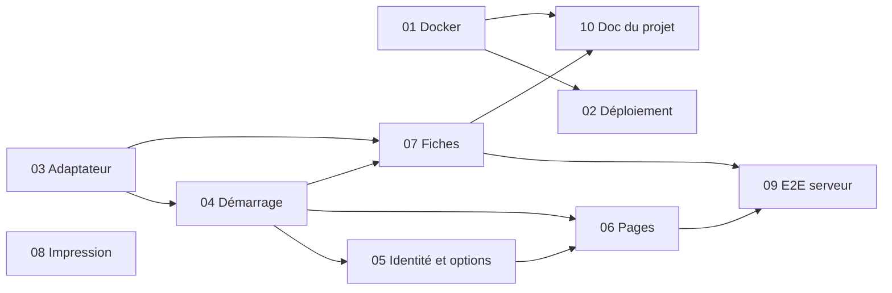

# Découpage — Pages de candidatures branchées sur l'API, API dans Docker derrière oauth2-proxy

> 10 tâches · ordre : le risque d'abord (réseau Docker et adaptateur), puis le démarrage, l'identité, les pages et les fiches, enfin le test de bout en bout et la documentation du projet.

## Tâches
| # | Tâche | Objectif | Dépend de | Spec |
|---|---|---|---|---|
| 01 | [Image et service de l'API dans Docker](01-docker-api.md) | L'API tourne dans la pile Docker, sur un réseau interne sans adresse côté hôte que seul `front` partage avec elle ; oauth2-proxy la sert sous `/api/`. | — | R22, R22b, R23, R24, R25 à R29, R34, R39 ; CA16, CA17, CA18, CA23 |
| 02 | [Déploiement et contrôle du site](02-deploiement.md) | `deploy.sh` attend une API saine quand la version déployée en a une ; `check-site.sh` vérifie que `/api/moi` sans cookie rend 401. | 01 | R30, R33 ; CA19, CA20 |
| 03 | [Adaptateur serveur](03-adaptateur-serveur.md) | `assets/adapter-serveur.js` : list/get/put/remove en `fetch` vers `../api/candidats`, version par objet et par identifiant, file par dossier, classement des réponses, identifiants contrôlés, envoi de départ. | — | R5 à R8, R10, tableau § API et intégrations ; CA6, CA13 |
| 04 | [Démarrage, bandeau et retour sur l'onglet](04-demarrage.md) | `assets/demarrage.js` choisit le mode, pose l'adaptateur d'attente, affiche le bandeau, relaie le retour sur l'onglet ; textes dans `wording.fr.js`. | 03 | R1 à R4e, R8, R11, R11b (bandeau), R15 ; Contenu et textes ; CA2, CA3 |
| 05 | [Identité et options de disponibilité en mode serveur](05-identite-options.md) | `QUI` rend le prénom du compte et la liste de `/api/equipe` ; « Qui es-tu ? » devient « Connecté·e : … » ; les options ajoutées passent par l'API. | 04 | R12 à R14 ; CA10, CA11 |
| 06 | [Pages : attente du démarrage, retour sur l'onglet, import](06-pages.md) | Les 6 pages chargent les deux nouveaux scripts, attendent le démarrage avant leur première lecture, relisent au retour sur l'onglet sans redessin inutile ; l'import ne propose plus « Remplacer tout » en mode serveur. | 04, 05 | R4c, R4d, R15b, R17, R18 ; CA1, CA12, CA14 |
| 07 | [Fiches : écriture de leur partie, départ de la page, Non enregistré](07-fiches.md) | `ec1`, `ec2`, `decompte` relisent le dossier et n'écrivent que leur partie, refusent si la même partie a changé ou si le dossier a disparu, envoient aussitôt en quittant la page ; les indicateurs affichent « Non enregistré ». | 03, 04 | R6g, R6h, R6i, R11b (indicateur) ; CA5, CA7, CA8 |
| 08 | [Notes d'impression et lien du site](08-impression.md) | Les notes de `carte.html` et `decompte.html` ne parlent plus du site GitHub ; « Ouvrir sur le site » mène à `recrutement.yeita.fr`. | — | R35, R36 ; CA24 |
| 09 | [Test de bout en bout du mode serveur](09-e2e-serveur.md) | `tools/e2e-serveur.py` lance l'API sur une base temporaire avec `DEV_STATIC`, sans `DEV_EMAIL`, et joue les parcours du mode serveur avec trois navigateurs identifiés par `X-Forwarded-Email`. | 06, 07 | R38 ; CA1 à CA12, CA14, CA21 (partie navigateur) |
| 10 | [Documentation du projet](10-documentation-projet.md) | `docs/backend/MODELE.md`, `deploy/README.md` et `api/README.md` décrivent le branchement, l'exploitation de l'API et les consignes. | 01 à 07 | R31, R32, R40 ; CA22, CA25 |

## Logique d'ordre
- **01** d'abord : c'est le risque de sécurité (joignabilité de l'API), déjà essayé sur banc ; la pile doit être juste avant que les pages l'appellent.
- **03** ensuite, indépendante : l'adaptateur porte la logique la plus fine (file, versions, classement des réponses), testée en Node sans navigateur.
- **04** et **05** s'appuient sur l'adaptateur ; **06** et **07** branchent les pages une fois le démarrage et `QUI` prêts.
- **08** est indépendante (textes), placée là où elle ne gêne rien.
- **09** vérifie l'ensemble en mode serveur ; **10** décrit ce qui a été livré. Le référentiel `hlyja/` est mis à jour à chaque tâche qui touche un composant, puis à l'étape Documentation.
- **Critère de sortie de chaque tâche** (non-régression, R16, R37, CA15) : `node tools/test-store.js`, `node tools/test-serveur.js`, `cd api && npm test`, les 4 `tools/e2e-*.py` et `tools/e2e-serveur.py` dès qu'une page est touchée.
- L'aide d'écriture de partie des fiches (tâche 07) va dans `assets/dossier.js` (`DOSSIER.ecrirePartie`) : une seule réalisation pour les trois fiches, dans les deux modes.

## Dépendances

