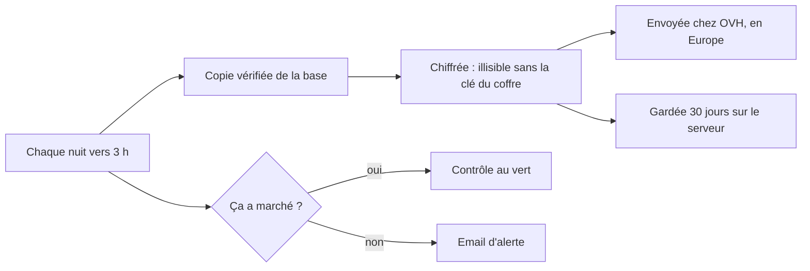

# Sauvegarder la base chaque nuit, hors du serveur, et savoir la restaurer

> Chaque nuit, la base des candidatures est copiée, vérifiée, chiffrée et envoyée chez OVH. Une alerte arrive si ça rate ou si le disque se remplit. Une procédure écrite permet de tout remettre, même si le serveur disparaît.

## Pourquoi
Aujourd'hui, les dossiers candidat n'existent qu'à un seul endroit : le serveur. Une panne, une fausse manœuvre ou un disque plein, et tout est perdu.

## Ce qui change pour l'utilisateur
Rien pour l'équipe de recrutement au quotidien. L'administrateur du serveur reçoit un email si une sauvegarde rate ou si le disque dépasse 80 %. Après une restauration, l'équipe refait dans l'interface les suppressions faites depuis la copie.

## Comment ça marche

## Les règles à retenir
- La clé qui ouvre les copies n'est jamais sur le serveur : elle est au coffre, connue d'au moins deux personnes. Sans elle, les copies sont perdues.
- Le serveur peut déposer des copies chez OVH, mais pas les effacer. OVH les efface seul au bout de 30 jours.
- Une copie n'est jamais déchiffrée sur le serveur, seulement sur un poste, dans un dossier temporaire effacé à la fin.
- Chaque sauvegarde a son propre nom : relancer ne détruit jamais celle de la nuit.
- Un dossier supprimé reste au plus 3 jours dans le serveur, 31 jours dans les copies du serveur et 32 jours chez OVH.

## Restaurer
Avant de remplacer quoi que ce soit, on vérifie la copie (intacte, bonne version, nombre de dossiers) et on sauvegarde l'état actuel, pour pouvoir revenir en arrière. La copie est vérifiée une seconde fois une fois arrivée sur le serveur. Ensuite, l'équipe refait les suppressions faites depuis la date de la copie.

## Ce qu'on ne fait pas
- Sauvegarder les certificats HTTPS (Caddy).
- Un tableau de bord de supervision : seuls les deux contrôles healthchecks.io existent.
- Modifier l'application.

## Comment on saura que c'est réussi
Les deux contrôles healthchecks.io sont au vert, une copie récupérée chez OVH s'ouvre sur un poste, et une restauration complète a été répétée sur un serveur d'essai.

## Points de vigilance
- Les vrais réglages OVH (droits des comptes, durée de 30 jours) ne peuvent être essayés que sur le vrai compte : c'est une étape du guide de test.
- Perdre la clé du coffre rend toutes les copies illisibles.
