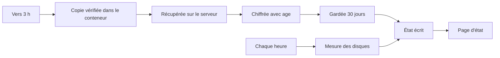

# Sauvegarder la base chaque nuit sur le serveur, et le voir sur une page

> Chaque nuit, la base des candidatures est copiée, vérifiée, chiffrée et gardée 30 jours sur le serveur. Une page réservée aux admins dit en vert que tout va bien, ou en rouge ce qui ne va pas. Une procédure écrite permet de restaurer la base, sans jamais la déchiffrer sur le serveur.

## Pourquoi
La base de l'API est aujourd'hui la seule copie des dossiers candidat. Une fausse manœuvre ou un disque abîmé, et tout est perdu.

Après cette version, une copie vérifiée existe chaque matin, et on sait la remettre en place. Un admin voit d'un coup d'œil si la sauvegarde de la nuit a marché.

> Cette version est une **reprise** (v1.7, 28 octobre 2026). La première spec envoyait les copies chez OVH Object Storage, avec des alertes healthchecks.io. Tu as retiré tout cela : le stockage OVH est payant. Les copies restent donc sur le serveur, et une page d'état remplace les alertes.

## Ce qui change pour l'utilisateur

| Avant | Après |
|---|---|
| Une seule copie de la base, dans Docker | Une copie chiffrée par nuit, gardée 30 jours sur le serveur |
| Aucun moyen de savoir si la base est protégée | Une page d'état, verte ou rouge, pour les admins |
| Pas de procédure de restauration | Une page qui dit quoi faire selon le cas, testée sur un serveur d'essai |
| Pas de clé | Une clé de sauvegarde : la partie publique sur le serveur, la partie secrète dans un fichier gardé par une ou deux personnes |
| Mise à jour du site connue d'une seule personne | Une page « Mettre à jour le site en production », pas à pas |

L'équipe de recrutement ne voit rien changer. Elle n'intervient qu'après une restauration, pour refaire certaines suppressions.

## Comment ça marche

### Chaque nuit, et chaque heure

Un timer systemd lance la sauvegarde entre 3 h et 3 h 15. Si le serveur était éteint, elle part à son redémarrage. La copie en clair n'existe sur le serveur que le temps de la chiffrer.

Chaque passage écrit son résultat dans l'état des sauvegardes : réussite, ou échec avec l'étape qui a raté. Un second timer mesure l'occupation des disques toutes les heures.

### Consulter l'état
Un admin connecté ouvre `https://recrutement.yeita.fr/admin/sauvegardes.html`. Il y voit le verdict, la dernière réussite, la dernière tentative, le nombre de copies et l'occupation des disques. Chaque raison d'un rouge est écrite en clair.

### Restaurer
La copie est récupérée du serveur, déchiffrée et contrôlée sur un Mac. Elle repart par SSH directement dans le volume, et ne remplace la base que si son empreinte et son contrôle sont bons. L'équipe refait ensuite, dans l'interface, les suppressions faites depuis la date de la copie.

## Les règles à retenir

| Règle | En clair | Exemple |
|---|---|---|
| Copie sûre | La copie passe par SQLite lui-même et n'est gardée que si elle est intacte | une copie abîmée n'est jamais gardée |
| Jamais de clair laissé | Même en cas d'échec ou d'arrêt forcé, la copie en clair est supprimée | coupure à 3 h 05 : rien en clair au redémarrage |
| Une clé publique sur le serveur | Le serveur peut chiffrer, pas relire | la clé secrète est un fichier `.txt` hors du serveur |
| 30 jours | Les copies chiffrées de plus de 30 jours partent, seulement après une sauvegarde réussie | sauvegardes en panne : rien n'est effacé |
| En retard | Plus de 26 h sans réussite, ou plus de 2 h sans mesure des disques : la page passe au rouge | serveur arrêté une nuit |
| Disque plein | Au-delà de 80 % sur le disque du système ou celui de Docker : rouge | « Un disque dépasse 80 % » |
| Page réservée | Seul le rôle admin voit l'état ; les autres lisent « Réservé aux admins de l'équipe. » | un recruteur ouvre la page |
| Dossier supprimé | Il reste au plus 3 jours dans la copie de travail et 31 jours dans les copies chiffrées | demande d'effacement d'un candidat |

## À l'écran

| Situation | Ce que montre la page |
|---|---|
| Tout va bien | « Tout va bien : la dernière sauvegarde a réussi et les disques ont de la place. » |
| Un problème | « À vérifier », puis une phrase par raison |
| Compte non admin | « Réservé aux admins de l'équipe. » |
| Session expirée | « Session expirée : recharge la page pour te reconnecter. » |
| Site sans API | « État indisponible ici : ce site n'a pas l'API. » |

La page n'a aucun lien depuis l'espace Candidatures. Elle est protégée par la connexion Google, comme le reste.

## Côté technique
- Une commande de l'API fait la copie ; un script du serveur la récupère, la chiffre et fait le ménage.
- L'état tient en trois petits fichiers dans le volume de l'API, sans aucune donnée de candidat.
- Une nouvelle route de l'API, en lecture seule, rend cet état aux seuls admins.
- Deux timers systemd, installés une fois par l'administrateur ; une unité modifiée n'est jamais écrasée.
- Aucune dépendance ajoutée à l'API ; seul l'outil `age` est installé sur le serveur.

## Ce qu'on ne fait pas
- **Pas de copie hors du serveur** : la perte du serveur emporte aussi les sauvegardes. C'est accepté pour cette version.
- **Pas d'alerte envoyée** : il faut ouvrir la page. Les emails viendront plus tard.
- Pas de tableau de bord d'administration : seule la page des sauvegardes existe sous `/admin/`.
- Pas de coffre de mots de passe pour la clé : un fichier, en attendant.
- Pas d'installation automatique d'outils, ni de changement du script de déploiement.

## Comment on saura que c'est réussi
- Sur un serveur d'essai avec systemd, une sauvegarde complète produit une copie chiffrée, qui se déchiffre et contient un repère connu, absent de tout fichier en clair.
- Chaque panne provoquée (API malade, disque plein, arrêt forcé, clé fausse) laisse un état « échec » avec son étape, aucune copie en clair, et les anciennes copies intactes.
- La page affiche vert, chaque motif de rouge, et les refus (non admin, session expirée, API absente) dans un vrai navigateur.
- La restauration est rejouée telle qu'écrite dans trois cas : base existante, volume intact, volume neuf.
- Les pages de la clé, de la mise à jour et le guide de test se suivent sans réfléchir, et leurs commandes passent sous zsh.

## Points de vigilance
- **Perdre le fichier de la clé** rend toutes les copies illisibles. Il faut le garder à deux endroits sûrs et le vérifier après la première sauvegarde.
- **Personne n'est prévenu** si la sauvegarde s'arrête : quelqu'un doit regarder la page de temps en temps.
- Avant une maintenance de Docker, il faut arrêter les timers : une commande `docker` des sauvegardes le relancerait.

Le détail des règles et des critères est dans la version complète.
