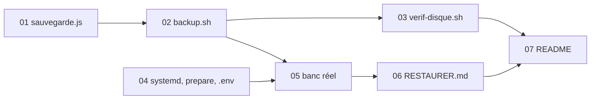

# Découpage — Sauvegarde chiffrée de la base

> 7 tâches. Risque d'abord : la copie (seul code dans `api/`), puis `backup.sh` qui porte presque toutes les règles, puis le reste. Les essais réels sur le banc Ubuntu 26.04 (avec dockerd, et avec systemd) sont faits dans les tâches qui les demandent.

## Tâches
| # | Tâche | Spec | CA | Réutilise |
|---|---|---|---|---|
| 01 | `api/sauvegarde.js` et ses tests | R1-R4 | CA1-CA3 | `cheminBase`, `estOccupee`, `ATTENTE_MS` ; tests dans `api/test/equipe.test.js` |
| 02 | `deploy/backup.sh` et `deploy/healthchecks.sh`, lanceur de tests à faux outils `tools/test-sauvegarde.sh` | R5-R10, R20 | CA4-CA8 | style et lecture de réglages de `deploy.sh`, verrou de déploiement |
| 03 | `deploy/verif-disque.sh` | R6, R10, R11 | CA9 | `healthchecks.sh` (tâche 02), lanceur de la tâche 02 |
| 04 | Unités systemd, `prepare-serveur.sh`, `.env.example` | R13, R14, R19 | CA13-CA15 | boucle d'outils de `prepare-serveur.sh` |
| 05 | Banc réel : bout en bout, échecs provoqués, arrêts forcés | R7, R8, R14 | CA10, CA11 | banc `ubuntu:26.04` (dockerd), variante systemd (V15) |
| 06 | `deploy/RESTAURER.md` et sa répétition sur le banc | R16, R17 | CA12 | V7, V17 |
| 07 | `deploy/README.md`, `api/README.md`, `README.md` (outil de test) | R12, R14-R19 | CA16 | § existants des deux README |
Le guide de test humain sur le serveur (CA19) est écrit à la QA (`qa/guide-test-humain.md`).

## Logique d'ordre
01 avant 02 (la dernière ligne de `sauvegarde.js` est le contrat de `backup.sh`) ; 02 avant 03 (fonctions communes) ; 04 avant 05 (unités essayées sur le banc systemd) ; 05 avant 06 (copies réelles à restaurer) ; 07 en dernier (décrit ce qui existe).

## Dépendances

## Fichiers hors de la liste de la spec (P3)
- `deploy/healthchecks.sh` : fonctions communes à `backup.sh` et `verif-disque.sh` (lecture des réglages, refus, ping) ; évite de dupliquer les gardes de R6 et R10.
- `tools/test-sauvegarde.sh` : lanceur des tests à faux outils (CA4-CA9) ; documenté dans le `README.md` racine (tâche 07).
