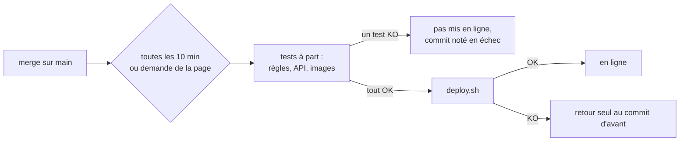

# Le serveur met main en ligne tout seul, après les tests

> Toutes les 10 minutes, le serveur regarde si `main` a avancé ; si oui, il teste le nouveau commit à part, le met en ligne si tout passe et revient seul en arrière si la mise en ligne rate. Un admin suit et pilote tout depuis une page.

## Pourquoi
Aujourd'hui, mettre en ligne demande une connexion SSH et une commande ; rien ne teste le commit avant, et personne ne voit ce qui est en ligne. Après : un merge sur `main` est en ligne en 10 minutes s'il passe les tests, sinon la page dit pourquoi, et un admin redéploie ou revient en arrière sans SSH.

## Ce qui change pour l'utilisateur
| Avant | Après |
|---|---|
| Quelqu'un lance `deploy.sh` en SSH après chaque merge | Le merge part seul, après les tests |
| Un commit cassé peut partir en ligne | Un commit dont un test échoue n'est jamais mis en ligne |
| Mise en ligne ratée : il faut revenir en arrière à la main | Le serveur revient seul au commit d'avant |
| Rien ne dit ce qui est en ligne | `/admin/deploiement.html` : une phrase verte, neutre ou rouge, le commit en ligne, l'historique des 30 derniers passages |
| Revenir en arrière demande SSH | « Déployer ce commit » sur la page (met l'automatisme en pause), puis « Reprendre » |

## Comment ça marche

La page ne lance rien elle-même : elle dépose une demande, et c'est le serveur qui vérifie qu'elle est valable avant d'agir. Une demande arrive en quelques secondes ; pendant un passage, elle est traitée juste après.

## Les règles à retenir
| Règle | En clair | Exemple |
|---|---|---|
| Un commit en échec n'est pas retenté | Tant que `main` n'avance pas, le serveur ne retente pas | On corrige, on merge : le nouveau commit est testé |
| La pause | Déployer un autre commit que le dernier de `main` arrête l'automatisme jusqu'à « Reprendre » | Retour arrière sur un commit d'hier : les merges suivants attendent |
| Seuls les commits « pointe de main » | La page n'accepte que des commits qui ont été en tête de `main` (pas une étape intermédiaire d'une branche) | Un merge de PR : oui ; un commit au milieu de la branche : refusé |
| La main humaine l'emporte | Un déploiement fait en SSH pendant un passage annule ce passage | Retour d'urgence en SSH : il n'est pas défait |
| Le serveur décide seul | L'application ne peut ni lancer de commande ni changer les décisions du serveur | Même une application piratée ne peut déployer qu'un commit testé de `main` |

## À l'écran
- Une phrase en tête : « À jour », « main a avancé : test au prochain passage », « En pause », ou en rouge « Le dernier commit a échoué », « Le serveur ne vérifie plus main », « Retour arrière raté : le site est peut-être hors service » avec la commande à lancer.
- « Demande en attente », « Passage en cours — étape 2/4 », alerte si une demande n'est pas prise en charge en 5 minutes.
- Les passages se déplient sur leurs étapes, chaque étape sur sa sortie ; l'étape en échec est ouverte.
- Chaque bouton demande confirmation avec ce qui va se passer (tests relancés, pause, demande remplacée).

## Côté technique
- `deploy/auto-deploy.sh`, lancé par un timer systemd (10 min) et par une unité qui surveille les demandes.
- Les tests tournent dans une copie à part du dépôt et dans des conteneurs jetables ; les images de production ne sont pas touchées.
- Le serveur garde ses propres fichiers de décision, hors de portée de l'application ; la page n'en lit qu'une copie.
- La pause est le fichier `deploy/PAUSE` ; `deploy.sh` reste le secours sans tests.

## Ce qu'on ne fait pas
- GitHub Actions, préproduction, notifications par email ou message.
- Tableau de bord d'administration, autres changements de l'application.
- Vérifier après chaque déploiement que les unités systemd installées sont à jour.

## Comment on saura que c'est réussi
- Sur un banc Linux avec systemd, un cycle complet passe : merge → en ligne ; test KO → rien ; mise en ligne ratée → retour ; demande depuis la page → pause → reprise.
- Les cas de concurrence (deux passages, SSH pendant les tests, passage tué) finissent dans l'état prévu, sans fichier perdu.
- Les images de production gardent leur identifiant ; aucun reste d'essai.
- La page affiche le bon verdict et les bons textes pour chaque état, sans faux rouge.
- Les suites existantes restent vertes.

## Points de vigilance
- Le serveur doit joindre npm et Docker Hub depuis un conteneur.
- Le volume Docker doit être à son emplacement par défaut ; sinon l'installation s'arrête et dit quoi changer.
- Déployer le dernier de `main` pendant une pause ne la retire pas : la confirmation le dit.
