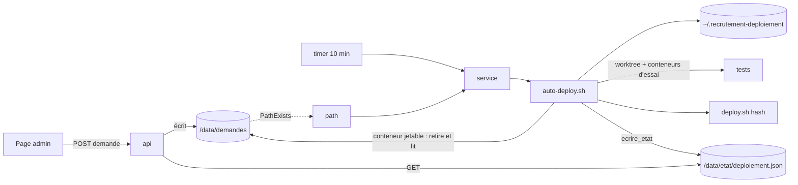

# Spec finale — Déploiement automatique de main après les tests

> Toutes les 10 minutes, ou dès qu'un admin dépose une demande, le serveur teste le commit visé dans un dossier à part, le déploie si les tests passent et revient seul au commit d'avant si le déploiement échoue.
> Validée au tour 2 (86/100). Depuis la v2 : passage en cours gardé par l'hôte, `deploye` écrit par `deploy.sh`, ordre des cas de l'automatisme, retour sous verrou, issues des attentes, alertes sans faux rouge (voir challenges/tour-2.md).

## Changements depuis la version précédente
Depuis la v2 (tour 2) : R1 (X15), R5 (X16), R6 (S9), R10 (D3, X16), R11 (T16, X15, X16), R13 (T15, D11, U2), R20 (T15, U10), verdict et bandeau (U2, U3, U10), Exploitation (X18), CA3, CA8, CA9, CA11, CA19.
Depuis la v1 (tour 1) : R1 (S2, X2, X6, T13) · R3 (S1, décision de l'utilisateur) · R5 (X1, X9) · R6 (S3, X1, X4) · R7 (T6) · R8 (S5, X3, X9, D7) · R9 (X3, T3) · R10 (D3, T1, X8) · R11 (D2, D6) · R12 (U5, U6) · R13 (S2, U2, D10) · R14 (D1, D8) · R15 (D9) · R17 (S6, S7) · nouvelles R19 (T1), R20 (T3) · UX (U1–U8, D6) · Exploitation (X11–X14) · CA réécrits (T2, T4, T8, T9, T14) · exemple de `deploiement.json` (T10).

## Contexte et objectif
Aujourd'hui, mettre en ligne demande une connexion SSH et `deploy/deploy.sh` à la main ; rien ne teste le commit avant, et rien ne dit à l'équipe ce qui est en ligne. Après cette version : un merge sur `main` est en ligne sous 10 minutes si ses tests passent, sinon il n'est pas déployé et la page dit pourquoi ; un admin redéploie, revient en arrière ou reprend l'automatisme depuis `/admin/deploiement.html`, sans SSH. Pas de GitHub Actions : le serveur vérifie lui-même.

## Utilisateurs et parcours
### P1 — Un merge sur main (personne n'agit)
1. Le timer lance un passage ; `origin/main` a un nouveau commit, l'automatisme est actif.
2. Tests dans un worktree temporaire (`test-store`, `npm test`, `docker compose build`) ; tous OK → `deploy.sh <hash>` → « Mis en ligne ».
Cas limites : test KO → commit noté en échec, plus retenté tant que `main` n'avance pas ; `deploy.sh` KO → retour automatique ; en pause → rien ; panne réseau → rien, la page montre que le serveur ne joint plus GitHub.
### P2 — Un admin redéploie ou revient en arrière depuis la page
1. Il ouvre `/admin/deploiement.html` (compte admin) : verdict en une phrase, commit en ligne, automatisme, passages.
2. « Déployer maintenant » ou, sur un passage aux tests OK, « Déployer ce commit » → confirmation → « Demande envoyée » → « Passage en cours (étape k/4) ».
3. Un commit autre que le dernier de main met l'automatisme en pause ; « Reprendre » la retire et le dernier de main est testé puis mis en ligne s'il ne l'est pas.
Cas limites : demande refusée (motif affiché) ; deux demandes rapprochées → la plus récente ; demande non prise en charge après 5 min → alerte.
### P3 — Un administrateur en SSH
`deploy/auto-deploy.sh` : dernier de main tout de suite, avec les tests (même en pause). `deploy/deploy.sh <hash>` : secours sans tests (met en pause si ce n'est pas le dernier de main). `sudo journalctl -u recrutement-deploy` : trace complète.

## Périmètre
### Inclus
`deploy/auto-deploy.sh` ; `deploy/deploy.sh` (pause) ; `deploy/systemd/recrutement-deploy.{service,timer,path}` ; `GET /api/deploiement`, `POST /api/deploiement/demande` ; `admin/deploiement.html` ; `README.md` « Publier », `deploy/README.md`, `deploy/METTRE-A-JOUR.md` ; banc `tools/test-auto-deploy.sh`.
`[ajout]` `tools/check-site.sh` : `/admin/deploiement.html` → 302 (une page qui dépose des demandes servie sans connexion passerait inaperçue).
`[ajout]` Relecture de la page toutes les 10 s tant qu'une demande attend ou qu'un passage est en cours (sinon l'admin ne voit pas le résultat).
`[ajout]` Résultats `annule` (R19) et `interrompu` (R20), en plus des quatre du pitch : sans eux, un retour SSH serait défait en silence (T1) et un passage tué figerait la page (T3).
`[ajout]` Alerte « demande non prise en charge » après 5 min (U3) et « aucune vérification depuis 25 min » (U2) : sans elles, « actif » s'affiche alors que rien ne tourne.
`[ajout]` Fichiers de décision de l'hôte hors du volume (R13) : sans eux, l'application pourrait effacer la marque d'échec d'un commit (S2).
### Exclu
GitHub Actions ; préproduction ; notifications (1.7-6) ; `admin/index.html` (1.7-7) ; 1.8-1 ; contrôle des unités installées après un déploiement (X10, extension) ; tout autre changement de l'application ; nouveau mécanisme CSRF (V10).

## Existant réutilisé
| Besoin | Décision | Élément | Référentiel |
|---|---|---|---|
| Déployer un commit | étendre (pause) | `deploy/deploy.sh` | [Architecture](../../../technique/architecture.md#scripts) |
| Écrire l'état d'une page admin | réutiliser | `deploy/commun.sh` `ecrire_etat`, `maintenant` → `/data/etat/deploiement.json` | idem |
| Lire l'état, réservé aux admins | réutiliser le modèle | `api/src/sauvegardes.js` → `api/src/deploiement.js` | [API](../../../technique/api.md) |
| Identité, rôle, corps JSON | réutiliser | `api/src/app.js` (`onRequest`, 415) | idem |
| Page | réutiliser le modèle | `admin/sauvegardes.html` (verdict vert / rouge / neutre, messages) | [Architecture](../../../technique/architecture.md) |
| Unités et installation | réutiliser le modèle | `deploy/systemd/recrutement-backup.*`, `deploy/README.md` § 14 | [Mise à jour](../../../technique/mise-a-jour-production.md) |
| Banc | réutiliser le modèle | `tools/test-sauvegarde.sh` ; tests de page : `tools/e2e-serveur.py` | [Conventions](../../../technique/conventions.md) |
| Écrire une demande | créer (rien n'écrit aujourd'hui de fichier hors de la base) | `api/src/deploiement.js` | — |

## Règles et comportements
| # | Règle | Détail / valeurs |
|---|---|---|
| R1 | Un passage traite, dans l'ordre : la demande déposée, puis le lancement à la main, puis l'automatisme ; chacun est un passage enregistré s'il fait quelque chose. | Automatisme, dans cet ordre : (1) `deploy/PAUSE` existe → rien ; (2) `origin/main` est le dernier commit en échec → rien, même si le commit en place est incertain (la page reste rouge jusqu'à une action humaine) ; (3) commit en place incertain (`HEAD` ≠ `deploye`, ou marque `incertain`, R13) → tester et déployer `origin/main` ; (4) `origin/main` = `deploye` → rien ; (5) sinon tester et déployer. Demande et lancement à la main : toujours traités, même en pause, déjà en ligne ou en échec. `git fetch` en échec : automatisme sans action ; demande refusée « GitHub injoignable » ; `dernier_controle` noté sans `fetch` réussi. |
| R2 | Lancement à la main (`deploy/auto-deploy.sh` sans option) = demande « dernier de main », déclencheur « ligne de commande ». | Le service lance `auto-deploy.sh --auto`. |
| R3 | Une demande de commit est validée par l'hôte avant tout. | Refus si : hors de `^[0-9a-f]{7,40}$` ; ne se résout pas en un seul commit (V13) ; absent de `git rev-list --first-parent origin/main` (un commit qui a été la pointe de main, décision de l'utilisateur, V16) ; sans `deploy/auto-deploy.sh` (antérieur à la 1.9). On agit ensuite sur le hash complet. `deploy.sh <hash>` en SSH garde sa règle (ancêtre de main). |
| R4 | L'application ne fait que déposer une demande. | `/data/demandes/deploiement.demande`, nom temporaire puis renommage ; lignes `action=`, `commit=`, `par=`, `le=`. Ni commande, ni Docker, ni scripts ; `compose.yaml` inchangé. Le seul effet de l'application sur l'hôte est de déclencher le service (V5). |
| R5 | Planification. | Timer `OnCalendar=*:0/10` (V11), path `PathExists=` seul sur la demande dans le point de montage du volume (V5, V6, vérifié à l'installation) ; service oneshot, `User=deploy`, `Group=deploy`, `UMask=0077`, `WorkingDirectory=/opt/recrutement`, `After=docker.service`, `TimeoutStartSec=4h` (verrou 30 min + 3 étapes × 20 min + verrou de `deploy.sh` 15 min + `deploy.sh` ~30 min + verrou 15 min + retour ~30 min = 3 h, marge 1 h), `TimeoutStopSec=90`. Le script ne coupe jamais `deploy.sh` ni le retour : leurs 30 min sont une estimation ; au-delà, l'arrêt par systemd est traité par R20. On active le timer et le path, pas le service. |
| R6 | La demande est retirée en premier, toujours, et lue strictement. | Première action après le verrou : retrait par renommage dans un conteneur jetable `api`, puis lecture : fichier ordinaire (pas un lien), 1 024 octets au plus, exactement les 4 clés une fois chacune, `action` ∈ {`deployer`, `reprendre`}, `commit` = `main` ou R3, `par` = email (254 caractères au plus), `le` = date ISO ; sinon refusée (motif fixe, jamais le contenu). Docker muet : attendre 60 s puis sortir en échec (V12). Docker répond mais le retrait ou la lecture échoue (dossier rendu illisible par l'application) : « demande illisible » au journal, le passage continue avec l'automatisme, puis attend 60 s avant de sortir (l'unité path relancée au plus une fois par minute ne tombe pas, V12). Pas de reboucle : une demande posée pendant le passage relance le service par l'unité path, juste après (V6). |
| R7 | Un seul passage à la fois. | Verrou `~/.recrutement-auto-deploy.lock` ; pris : attendre 30 min au plus (« un passage est en cours, attente… »), puis sortir en échec (journal, rien d'enregistré). Durées des attentes réglables par variables d'environnement (valeurs par défaut ci-dessus ; les unités ne les fixent pas). |
| R8 | Tests dans un worktree, jamais dans le dépôt de production. | `umask 022` ; worktree détaché du commit visé dans `~/.recrutement-deploiement/essai`. `test-store` et `npm-test` (`npm ci` puis `npm test` dans `api/`, où `.npmrc` s'applique) dans l'image du `FROM` de `docker/api.Dockerfile` du commit, sous l'identité de `deploy`, `--rm`, étiquette `fr.yeita.projet=recrutement-essai`, seul le worktree monté (ni socket Docker, ni volume, ni `.env`, ni `--privileged`, ni réseau hôte) (V1, V2). `build` : `.env.example` du commit, projet `recrutement-essai`, noms d'image `recrutement-essai-*` (V3, V4). 20 min au plus par étape ; arrêt au premier KO. |
| R9 | Rien ne reste d'un passage. | Au début et à la fin, même en échec : conteneurs d'étiquette `recrutement-essai` supprimés, dossier d'essai vidé, `git worktree prune` (V8), images d'essai supprimées **par nom**, jamais par identifiant ni `-f` (V4). Le service le refait en `ExecStopPost` sous `flock -n` du verrou de passage. Cache de construction gardé (surveillé par `verif-disque`). |
| R10 | Tests OK → `deploy.sh <hash complet>`, avec `RECRUTEMENT_PAR_AUTO=1`. | Avant : attendre le verrou de `deploy.sh` (15 min, V15), le libérer, puis R19. Attente expirée : `annule`, motif « verrou de deploy.sh occupé (sauvegarde ou déploiement à la main) », commit non noté en échec. Après un échec, sortie de `deploy.sh` **sans** sa ligne `· Dépôt sur` = arrêt avant changement de commit (vaut aussi quand le commit visé est déjà en place) : « déploiement KO » avec la ligne `ARRÊT`, sans retour ; commit noté en échec sauf si l'arrêt est « déjà en cours ». Ligne présente et commit visé = commit d'avant (redéploiement) : pas de retour vers lui-même, marque `incertain` et alerte (R11). |
| R11 | `deploy.sh` KO après changement de commit → retour automatique (décision de l'utilisateur). | Commit d'avant = `deploye` lu au début du passage. Prendre le verrou de `deploy.sh` (15 min), vérifier que `HEAD` est toujours le commit visé (sinon : pas de retour, `annule`, motif de R19, commit visé noté en échec), `git checkout --detach <commit d'avant>` sous le verrou, le libérer, puis le `deploy.sh` de ce commit, `RECRUTEMENT_PAR_AUTO=1` (étape « retour ») ; refus « déjà en cours » : `annule` (un déploiement à la main a pris la main). Commit visé noté en échec ; pause inchangée. Retour réussi : `deploye` = commit d'avant (écrit par `deploy.sh`, R13). Retour KO ou attente expirée : marque `incertain` et alerte `retour_ko` (commit visé, commit d'avant) gardées jusqu'au prochain déploiement réussi. |
| R12 | Statut d'un passage. | Début, fin, déclencheur, commit (hash court, message, auteur), branche `main`, résultat (`deploye`, `tests-ko`, `deploiement-ko`, `demande-refusee`, `annule`, `interrompu`) et motif ; étapes `test-store`, `npm-test`, `build`, `deploy`, `retour` : `ok` / `ko` / `non-lancee`, durée, 300 dernières lignes (V2, V9). Libellés affichés : tableau UX. |
| R13 | L'hôte décide sur ses propres fichiers ; `deploiement.json` n'est qu'une vue. | `~/.recrutement-deploiement/` (700, `deploy`) : `deploye` (dernier commit déployé avec succès, écrit par le `deploy.sh` de la 1.9 à « Déploiement réussi », quel que soit le lanceur ; initialisé avec `HEAD` par la commande d'installation des unités s'il est absent), `echec`, `incertain`, `retour-ko`, `en-cours` (commit visé, commit d'avant, étape, début : écrit au début de chaque étape, retiré en fin de passage), `passages/` (30 derniers). `auto-deploy.sh` ne lit dans le volume que la demande. `deploiement.json` (exemple ci-dessous) n'en est qu'une copie, réécrite en entier par `ecrire_etat` : à chaque passage, même sans action, et au début de chaque étape (`dernier_controle` mis à jour les deux fois), et s'il est absent. Un `ecrire_etat` en échec n'arrête jamais un passage et n'en change pas les décisions (journal seulement). |
| R14 | Pause. | `deploy/PAUSE` (une ligne : date, par qui, commit). Créée par `auto-deploy.sh` pour une demande d'un hash qui n'est pas l'`origin/main` lu à son `fetch` ; par `deploy.sh <hash>` lancé à la main (sans `RECRUTEMENT_PAR_AUTO`), après validation et changement de commit, même s'il échoue ensuite. Jamais pour l'automatisme, une demande « main », un retour automatique, ni `deploy.sh` sans argument. Retirée seulement par « reprendre ». `/deploy/PAUSE` dans `.git/info/exclude` (V7). |
| R15 | Les scripts se remplacent pendant qu'ils tournent. | Corps entier dans une fonction lue avant d'agir ; tableau ci-dessous. Compatibilité : le service `api`, `/data/etat`, `/data/demandes` et les formats de la demande, de l'état et de `~/.recrutement-deploiement/` restent lisibles par l'`auto-deploy.sh` de la 1.9 (contrainte des versions suivantes, reprise dans `technique/`). |
| R16 | `GET /api/deploiement` (admin). | `{maintenant, etat, demande}` : `etat` = `deploiement.json` (`null` absent, `{illisible: true}`) ; `demande` = demande en attente lue avec les règles de R6 (ou `null`). Non admin : 403 `admin-requis`. |
| R17 | `POST /api/deploiement/demande` (admin). | `{action: "deployer", commit: "<hash>"|"main"}` ou `{action: "reprendre"}` ; autre forme → 400 ; non admin → 403 ; non JSON → 415 (V10) ; 202 `{demande}` ; demande identique à celle en attente : 202 sans réécrire. `par` = `req.membre.email`, jamais l'en-tête brut ni le corps. Écriture impossible : 503. |
| R18 | Aucune donnée de candidat dans l'état ni dans les demandes. | Sorties de tests et de construction seulement. La trace complète est le journal ; l'historique de la page n'est pas un audit. |
| R19 | `[ajout]` Un déploiement fait à la main pendant les tests l'emporte. | Juste avant `deploy.sh`, verrou obtenu : si `HEAD` n'est plus le commit du début du passage, ou (automatisme) si `PAUSE` est apparue → `annule`, motif « déploiement fait à la main pendant le passage », commit non noté en échec. |
| R20 | `[ajout]` Passage interrompu. | Sous le verrou de passage, un `~/.recrutement-deploiement/en-cours` trouvé au début (jamais celui du volume) est enregistré `interrompu` avec son étape, puis retiré ; interrompu pendant `deploy` ou `retour` : marque `incertain` et alerte « mise en ligne interrompue » (commande `deploy/deploy.sh <commit d'avant>`). Un `trap` sur TERM fait de même quand il le peut, et retire `en-cours` : un seul `interrompu` par passage. |

### Script qui se remplace (R15)
| Commande | `auto-deploy.sh` qui tourne | `deploy.sh` qui tourne | Pause |
|---|---|---|---|
| Passage normal | celui du commit en place, lu en entier ; la fin du passage utilise `compose.yaml` et l'image `api` du nouveau commit | celui du commit en place | inchangée |
| Premier passage à la 1.9 (à la main, sans argument) | — | celui de la 1.8 | aucune |
| Retour automatique | celui d'avant, en mémoire | celui du commit d'avant (`checkout` d'abord) | inchangée |
| « Déployer ce commit » (≥ 1.9, pas le dernier de main) | celui en place ; les passages suivants : celui de ce commit | celui en place | créée par `auto-deploy.sh` |
| `deploy.sh <hash>` en SSH vers un commit antérieur à la 1.9 | absent : arrêter timer et path avant (doc) | celui en place | créée |
| Remontée depuis un commit antérieur à la 1.9 (`deploy.sh` sans argument) | — | celui du commit ancien | reste : réactiver les unités puis « Reprendre » (doc) |
| Commande affichée après un échec | — | celui du commit en échec | créée (retour manuel) |

### Exemple de `deploiement.json` (T10)
```json
{"maj":"2026-10-28T13:00:02Z","dernier_controle":{"le":"2026-10-28T13:00:02Z","fetch":"ok"},
 "en_ligne":{"commit":"<40>","court":"a1b2c3d","message":"…","auteur":"…","incertain":false},
 "dernier_main":{"commit":"<40>","court":"a1b2c3d","message":"…","auteur":"…"},
 "pause":null,"echec":{"court":"e4f5a6b"},"retour_ko":null,
 "en_cours":{"depuis":"…","commit":"…","declencheur":{"type":"demande","par":"…"},"etape":"npm-test"},
 "passages":[{"id":"20261028T125001Z","debut":"…","fin":"…","declencheur":{"type":"automatique"},
   "commit":{"commit":"<40>","court":"…","message":"…","auteur":"…"},"branche":"main",
   "resultat":"tests-ko","motif":"","etapes":[{"nom":"test-store","statut":"ok","duree_s":1,"sortie":"…"}]}]}
```

## UX / UI
Même gabarit, mêmes classes et messages d'erreur que `sauvegardes.html` ; tout texte inséré comme texte ; repli `<details>` au clavier ; une colonne sous 560 px.

| Verdict (en-tête, U1, U2, D6) | Couleur |
|---|---|
| « Retour arrière raté : le site est peut-être hors service. En SSH : deploy/deploy.sh <commit d'avant> » (`retour_ko`) ; « Commit en ligne : incertain » | rouge |
| « Mise en ligne interrompue pendant <étape> : le site est peut-être hors service. En SSH : deploy/deploy.sh <commit d'avant> » ; « Commit en ligne : incertain » | rouge |
| « Commit en ligne : incertain (une mise en ligne n'a pas abouti). » (marque `incertain` sans alerte ci-dessus) | rouge |
| « Le serveur ne vérifie plus main (dernière vérification il y a N min) » (> 25 min, et aucun passage en cours dont l'étape a commencé il y a moins de 45 min) | rouge |
| « Le serveur ne joint pas GitHub » (dernier `fetch` en échec) | rouge |
| « Le dernier commit de main a échoué (<résultat>) : il ne sera pas mis en ligne tant que main n'avance pas. » | rouge |
| « En pause : les nouveaux commits de main ne sont pas mis en ligne. » | neutre |
| « main a avancé : test au prochain passage (10 min au plus). » / passage en cours | neutre |
| « À jour : le dernier commit de main est en ligne. » | vert |
Le premier cas vrai, dans cet ordre. Sous le verdict : commit en ligne, dernier de main s'il diffère, automatisme, dernière vérification ; bandeau « Demande en attente : <action> par <qui> à <heure> » (rouge après 5 min **sans passage en cours** : « La demande n'a pas été prise en charge : sudo systemctl status recrutement-deploy.path » ; pendant un passage : « Elle sera traitée à la fin du passage en cours. ») ; « Passage en cours depuis <heure> : <commit> — <étape> (k/4) ». État absent : « Aucun passage enregistré : le déploiement automatique n'est peut-être pas installé (deploy/README.md). »

| Texte | Valeur |
|---|---|
| Résultats | « Mis en ligne » · « Tests en échec : pas mis en ligne » · « Mise en ligne ratée — retour à <c> réussi » / « … retour raté » · « Mise en ligne refusée avant de commencer » (`ARRÊT`) · « Demande refusée : <motif> » · « Annulé : déploiement fait à la main pendant le passage » · « Interrompu pendant <étape> » |
| Étapes | « Tests des règles du parcours » · « Tests de l'API » · « Construction des images » · « Mise en ligne » · « Retour arrière » |
| Motifs de refus | « commit mal formé » · « commit introuvable ou ambigu » · « ce commit n'a jamais été la pointe de main » · « commit antérieur au déploiement automatique : deploy.sh <hash> en SSH » · « demande illisible » · « GitHub injoignable » |
| Confirmation « Déployer maintenant » | « Le dernier commit de main (<c> <message>) sera testé puis mis en ligne. » + selon le cas « Il est déjà en ligne : il sera retesté et redéployé. » / « Il a échoué la dernière fois. » / « L'automatisme reste en pause : utilisez Reprendre pour le relancer. » / « Remplace la demande de <qui>. » |
| Confirmation « Reprendre » | « L'automatisme reprend : le dernier commit de main (<c>) sera testé puis mis en ligne s'il ne l'est pas déjà. » |
| Confirmation « Déployer ce commit » | « Les tests seront relancés. » + « L'automatisme sera mis en pause. » (pas le dernier de main) + « La dernière mise en ligne de ce commit a échoué. » (s'il est en échec) + « Remplace la demande de <qui>. » |
| Réponses | 202 « Demande envoyée : le serveur la prend en charge dans quelques secondes. » · 400 « Demande invalide : rien n'a été envoyé. » · 503 « Le serveur n'a pas pu enregistrer la demande : rien n'a été envoyé. » · 401, 403, réseau : messages de `sauvegardes.html` |

Boutons : « Déployer maintenant » toujours ; « Reprendre » en pause ; « Déployer ce commit » sur un passage dont les trois étapes de test sont OK et dont le commit n'est pas en ligne ; tous désactivés pendant un envoi. Seuls les commits passés par l'automatisme figurent dans la liste (sinon : `deploy.sh <hash>` en SSH). Liste : le plus récent en haut, repliée ; étape KO ouverte par défaut.

## API et intégrations
| Route | Rôle | Réponses |
|---|---|---|
| `GET /api/deploiement` | admin | 200 `{maintenant, etat, demande}` ; 403 `admin-requis` |
| `POST /api/deploiement/demande` | admin | 202 ; 400 ; 403 ; 415 ; 503 |

## Architecture technique

Écartés : point de montage partagé de l'hôte (change `compose.yaml`, mêle les droits de `node` et `deploy`) ; Node sur l'hôte (non installé) ; jq ou python (pas garantis ; V9).

## Sécurité et conformité
Quelqu'un qui contrôle l'application ou un compte admin peut seulement : déployer un commit testé de la ligne principale de main ≥ 1.9, mettre ou retirer la pause, faire tourner le service (au plus une fois par minute s'il rend la demande illisible). Il ne peut ni lancer une commande, ni viser une branche, ni lire un fichier de l'hôte, ni changer une décision de l'hôte (R3, R4, R6, R13). Messages de commit, auteurs, sorties : JSON échappé (V9), affichés comme texte. Intersite : protection existante (V10).

## Déploiement et compatibilité
Mise en service : déployer la 1.9 à la main (`deploy.sh`), puis installer les unités (copie si absente, rien si identique, arrêt si différente ; vérifie le point de montage du volume). Retour vers un commit antérieur à la 1.9 : arrêter timer et path avant ; à la remontée, les réactiver puis « Reprendre ».

## Exploitation
`sudo journalctl -u recrutement-deploy` ; sans sudo, `deploy` lit `~/.recrutement-deploiement/passages/` ou la page. Relancer `deploy/auto-deploy.sh` n'est pas un moyen de diagnostic : il met main en ligne, même en pause. Maintenance de Docker : arrêter timer et path, attendre que `systemctl is-active recrutement-deploy` rende `inactive`, puis arrêter Docker. Unité path en `failed` : `sudo systemctl reset-failed recrutement-deploy.service recrutement-deploy.path && sudo systemctl start recrutement-deploy.path`. `deploy/README.md` porte un tableau « message ou verdict → cause → que faire ». Une panne réseau pendant les tests donne « Tests en échec » : « Déployer maintenant » les relance.

## Critères d'acceptation
Banc `tools/test-auto-deploy.sh` (refus sans `AUTO_DEPLOY_JETABLE=oui`), au niveau des faux outils (A) ou sur le banc systemd réel (B), indiqué pour chaque CA ; détail aux tâches.
- [ ] CA1 — (A, B) Nouveau commit, automatisme actif : testé puis déployé, 4 étapes OK, durée et sortie ; `deploye` mis à jour (R1, R8, R10, R12).
- [ ] CA2 — (A) Étape de test KO (chacune des trois) : suivantes « non lancée », pas de `deploy.sh`, commit en échec ; passage suivant sans nouveau commit : aucun passage enregistré, `dernier_controle` mis à jour (R1, R13).
- [ ] CA3 — (A) `deploy.sh` KO : (a) avant changement de commit → pas de retour ; (b) après → retour par le `deploy.sh` du commit d'avant, y compris quand celui du commit visé est en erreur de syntaxe ; (c) retour KO → `retour_ko`, `incertain` ; (d) redéploiement du commit en place qui échoue à `up` → pas de retour, `incertain` ; (e) retour réussi puis passage sans nouveau commit → aucun `deploy.sh` ; commit en échec avec état incertain → aucun `deploy.sh` (R1, R10, R11).
- [ ] CA4 — (A) Pause : nouveau commit non déployé ; demande traitée ; « reprendre » retire la pause puis déploie le dernier de main ; lancement à la main pendant une demande en attente : la demande puis le dernier de main, deux passages (R1, R14).
- [ ] CA5 — (A) `PAUSE` : créée pour une demande de hash ≠ `origin/main` et par `deploy.sh <hash>` à la main après validation ; pas créée si `main` avance pendant les tests, ni par un retour, ni par `deploy.sh` refusé ou sans argument ; dépôt « propre » pour `deploy.sh` (V7) (R14).
- [ ] CA6 — (A) Refus enregistrés avec leur motif : format, introuvable, commit de branche fusionnée (hors `--first-parent`), antérieur à la 1.9, demande mal formée (clé en double, action inconnue, lien symbolique, 2 Mo) ; préfixe ambigu : vérifié par lecture et par `rev-parse` sur un dépôt fabriqué, ou noté non observable (R3, R6).
- [ ] CA7 — (A) Fenêtre ouverte entre retrait et lecture (enveloppe de `docker`) : une demande posée pendant la fenêtre est traitée au passage suivant, une seule fois ; deux demandes pendant un passage : seule la plus récente (R6).
- [ ] CA8 — (B) Scénarios de concurrence, chacun avec son résultat attendu : SC1 deux passages (service puis main) ; SC2 demande pendant les tests ; SC3 `deploy.sh <ancien>` en SSH pendant les tests → `annule`, l'ancien reste en ligne, `PAUSE` présente ; SC4 `deploy.sh` à la main pendant le `deploy.sh` du passage ; SC5 `systemctl kill` pendant les tests ; SC6 pendant `deploy` → un seul `interrompu`, alerte ; SC7 `deploy.sh <autre>` lancé entre l'échec du passage et son retour → l'autre reste en ligne, aucun checkout du passage ; SC8 sauvegarde qui tient le verrou pendant le retour ; dans chaque cas aucun fichier d'un autre effacé, aucun conteneur d'essai restant (R7, R9, R11, R19, R20).
- [ ] CA9 — (B) Sorties rapides sans retrait (Docker arrêté, `.env` illisible) et dossiers `/data/demandes`, `/data/etat` rendus illisibles : 60 s d'attente, l'unité path reste active ; dans le second cas, un nouveau commit est quand même testé et déployé (R6, R13, V12).
- [ ] CA10 — (B) Images de production : même identifiant et mêmes étiquettes après un essai, y compris du commit en place ; aucune image ni conteneur d'essai restant ; montages des conteneurs de test contrôlés par `docker inspect` ; dépôt de production propre (R8, R9).
- [ ] CA11 — (A) `deploiement.json` : JSON valide avec sorties et messages hostiles (V9), 300 lignes au plus par étape, 30 passages, le plus récent d'abord ; falsifié ou supprimé dans le volume (dont un faux `en_cours` et un faux `retour_ko`) → réécrit au passage suivant, ni `interrompu` ni alerte, décisions inchangées (R12, R13, R20).
- [ ] CA12 — (`npm test`) Routes : non-admin 403, lecture seule 403, non JSON 415, forme ou commit invalide 400, `par` = membre, demande identique non réécrite, écriture par renommage (lecture en boucle pendant 50 `POST`, ou notée non observable), 503 ; `GET` rend état et demande (R16, R17).
- [ ] CA13 — (`tools/e2e-serveur.py`) Un `deploiement.json` d'exemple par cas du verdict, plus absent, illisible, passage en cours depuis 40 min (neutre) et demande de plus de 5 min pendant un passage (neutre) : verdict, bandeaux, boutons, textes exacts, étape KO ouverte, texte hostile affiché comme texte, `POST` ralenti et double clic → une seule demande (UX).
- [ ] CA14 — (B) Unités : `systemd-analyze verify` sans remarque ; timer et path déclenchent le service, y compris après suppression et recréation du volume ; commande d'installation (copiée, identique, différente, point de montage faux) ; attentes réduites par variables : chaque attente expire avec l'issue écrite (R5, R7).
- [ ] CA15 — (B) Cycle complet : merge → déployé ; tests KO ; déploiement KO → retour ; demande par la route → « Déployer ce commit » → pause → « Reprendre » (P1, P2).
- [ ] CA16 — `check-site.sh` : `/admin/deploiement.html` → 302 vers Google (`[ajout]`).
- [ ] CA17 — `shellcheck` sans remarque ; banc lancé sous `env -i` et `umask 022` ; suites existantes vertes, ligne de verdict de chaque suite recopiée (`TOUT OK`, `ℹ fail 0`, `ALL OK`).
- [ ] CA18 — `README.md` « Publier », `deploy/README.md` (installation, tableau de diagnostic, maintenance) et `METTRE-A-JOUR.md` disent ce que le pitch demande ; blocs shell vérifiés (`bash -n`, `zsh -n` pour ceux du Mac).
- [ ] CA19 — (B) Tableau R15 rejoué : 1.8 → 1.9 par `deploy.sh` sans argument (aucune `PAUSE`) ; passage dont le commit visé modifie `auto-deploy.sh` (l'ancien corps finit sans erreur) ; retour automatique depuis un commit dont `deploy.sh` est modifié ; `deploy.sh <hash>` réussi en SSH → la page montre ce commit (pas « incertain »), verdict « En pause » ; premier passage après l'installation → aucun redéploiement ; version du script relevée dans le journal (R13, R15).

## Hypothèses et questions ouvertes
- Le serveur joint le registre npm et Docker Hub depuis un conteneur (comme `deploy.sh --pull`).
- Point de montage du volume : `/var/lib/docker/volumes/recrutement_data/_data` ; sinon l'installation s'arrête et dit quoi changer.
- Déployer le dernier de main ne retire pas la pause (lecture littérale du pitch) ; la confirmation le dit.

## Améliorations possibles
Aucune.
