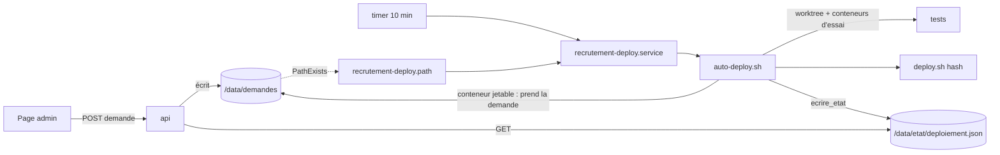

# Spec v1 — Déploiement automatique de main après les tests

> Toutes les 10 minutes, ou dès qu'un admin dépose une demande, le serveur teste le commit visé dans un dossier à part, le déploie si les tests passent et revient seul au commit d'avant si le déploiement échoue.
> L'application ne fait que déposer une demande ; l'hôte la valide. Une page admin montre les 30 derniers passages.

## Contexte et objectif
Aujourd'hui, mettre en ligne demande une connexion SSH et `deploy/deploy.sh` à la main ; rien ne teste le commit avant, et rien ne dit à l'équipe ce qui est en ligne. Après cette version : un merge sur `main` est en ligne sous 10 minutes si ses tests passent, sinon il n'est pas déployé et la page dit pourquoi ; un admin redéploie, revient en arrière ou reprend l'automatisme depuis `/admin/deploiement.html`, sans SSH. Pas de GitHub Actions : le serveur vérifie lui-même.

## Utilisateurs et parcours
### P1 — Un merge sur main (personne n'agit)
1. Le timer lance un passage ; `origin/main` a un nouveau commit, l'automatisme est actif.
2. Tests dans un worktree temporaire : `test-store`, `npm test`, `docker compose build` ; tous OK → `deploy.sh <hash>` → « déployé ».
Cas limites : un test KO → « tests KO », commit noté en échec, plus retenté tant que `main` n'avance pas ; `deploy.sh` KO → retour automatique au commit d'avant, « déploiement KO », commit noté en échec ; en pause → rien.
### P2 — Un admin redéploie ou revient en arrière depuis la page
1. Il ouvre `/admin/deploiement.html` (compte admin) : commit en ligne, automatisme actif ou en pause, passages.
2. « Déployer maintenant » (dernier de main) ou, sur un passage aux tests OK, « Déployer ce commit » → confirmation → demande déposée ; la page affiche « Demande en attente » puis « Passage en cours ».
3. Le passage part dans les secondes qui suivent (unité path) ; un commit autre que le dernier de main met l'automatisme en pause.
4. « Reprendre » retire la pause ; le passage qui suit déploie le dernier de main s'il n'est pas en ligne.
Cas limites : demande refusée (commit inconnu, hors de main, antérieur à la 1.9) → passage « demande refusée » avec le motif ; deux demandes rapprochées → seule la plus récente compte ; demande déposée pendant un passage → traitée juste après.
### P3 — Un administrateur en SSH
- `deploy/auto-deploy.sh` : déploie tout de suite le dernier de main, avec les tests (même en pause).
- `deploy/deploy.sh <hash>` : secours sans tests ; un commit autre que le dernier de main met en pause.
- `sudo journalctl -u recrutement-deploy` : détail.

## Périmètre
### Inclus
`deploy/auto-deploy.sh` ; modification de `deploy/deploy.sh` (pause) ; `deploy/systemd/recrutement-deploy.{service,timer,path}` ; routes `GET /api/deploiement` et `POST /api/deploiement/demande` ; page `admin/deploiement.html` ; `README.md` « Publier », `deploy/README.md` (installation, usage), `deploy/METTRE-A-JOUR.md` ; banc de test du script.
`[ajout]` `tools/check-site.sh` contrôle que `/admin/deploiement.html` exige la connexion (302), comme `sauvegardes.html` depuis la 1.7 : sans cela, une page qui dépose des demandes pourrait être servie sans connexion sans que le contrôle de chaque déploiement le voie.
`[ajout]` La page se relit seule toutes les 10 s tant qu'une demande attend ou qu'un passage est en cours : sans cela, l'admin qui vient de cliquer ne voit pas le résultat sans recharger.
### Exclu
GitHub Actions ; préproduction ; notifications (1.7-6) ; tableau de bord `admin/index.html` (1.7-7) ; 1.8-1 ; tout autre changement de l'application ; nouveau mécanisme CSRF (V10).

## Existant réutilisé
| Besoin | Décision | Élément | Référentiel |
|---|---|---|---|
| Déployer un commit | étendre (pause) | `deploy/deploy.sh` | [Architecture](../../../technique/architecture.md#scripts) |
| Écrire l'état d'une page admin | réutiliser | `deploy/commun.sh` `ecrire_etat`, `maintenant` → `/data/etat/deploiement.json` | idem |
| Lire l'état, réservé aux admins | réutiliser le modèle | `api/src/sauvegardes.js` (`lire`, refus `admin-requis`) → `api/src/deploiement.js` | [API](../../../technique/api.md) |
| Identité, rôle, corps JSON | réutiliser | `api/src/app.js` (`onRequest`, 415) | idem |
| Page | réutiliser le modèle | `admin/sauvegardes.html` | [Architecture](../../../technique/architecture.md) |
| Unités et installation | réutiliser le modèle | `deploy/systemd/recrutement-backup.*`, `deploy/README.md` § 14 | [Mise à jour](../../../technique/mise-a-jour-production.md) |
| Banc | réutiliser le modèle | `tools/test-sauvegarde.sh` (faux outils, `BANC_JETABLE=oui`) | [Conventions](../../../technique/conventions.md) |
| Écrire une demande | créer (rien n'écrit aujourd'hui de fichier hors de la base) | `api/src/deploiement.js` | — |

## Règles et comportements
| # | Règle | Détail / valeurs |
|---|---|---|
| R1 | Un passage évalue, dans l'ordre : la demande déposée (si elle existe), puis le lancement à la main, puis l'automatisme. | Automatisme : rien si `deploy/PAUSE` existe, si `origin/main` est le commit en place (`HEAD` du dépôt de production) ou s'il est le dernier commit en échec. Demande et lancement à la main : toujours traités, même en pause, même si le commit est déjà en place ou en échec. |
| R2 | Lancement à la main (`deploy/auto-deploy.sh` sans option) = demande « dernier de main », déclencheur « ligne de commande ». | Le service lance `auto-deploy.sh --auto` (déclencheur « automatique » ou « demande de <email> »). |
| R3 | Une demande de commit est validée par l'hôte avant tout. | Refus si : ne correspond pas à `^[0-9a-f]{7,40}$` ; ne se résout pas en un seul commit (V13) ; n'est pas un ancêtre de `origin/main` ; ne contient pas `deploy/auto-deploy.sh` (antérieur à la 1.9, décision de l'utilisateur). On agit ensuite sur le hash complet. Refus = passage « demande refusée » avec le motif, aucune étape lancée. |
| R4 | L'application ne fait que déposer une demande. | `POST /api/deploiement/demande` écrit `/data/demandes/deploiement.demande` (volume `recrutement_data`) sous un nom temporaire puis renommé ; contenu : action (`deployer` ou `reprendre`), commit (hash ou `main`), email de l'admin, date. Elle ne lance aucune commande, n'a accès ni à Docker ni aux scripts (inchangé, `compose.yaml` non modifié). Une nouvelle demande remplace celle en attente. |
| R5 | Planification. | `recrutement-deploy.timer` : `OnCalendar=*:0/10` (V11) ; `recrutement-deploy.path` : `PathExists=` sur la demande dans le point de montage du volume (V5, V6), vérifié à l'installation ; les deux lancent `recrutement-deploy.service` (`User=deploy`, oneshot, `TimeoutStartSec=1h`), jamais deux fois en même temps. |
| R6 | Chaque passage retire la demande avant de la traiter, même refusée ; une demande arrivée pendant un passage est traitée par ce même passage juste après. | Retrait par renommage dans un conteneur jetable `api` (V5) puis lecture. Demande illisible ou mal formée = refusée. Docker muet : attendre 60 s puis sortir en échec (évite l'arrêt de l'unité path, V12). Le passage reboucle tant qu'une demande l'attend. |
| R7 | Un seul passage à la fois. | Verrou `flock` propre à `auto-deploy.sh` (hors du dépôt) ; s'il est pris, **attendre** (jusqu'à 1 h, message « un passage est en cours, attente… ») au lieu de sortir (V12, V14). |
| R8 | Tests dans un worktree temporaire, jamais dans le dépôt de production. | Worktree détaché du commit visé dans un dossier fixe hors du dépôt. Étapes dans l'ordre, arrêt au premier KO : `test-store` (`node tools/test-store.js`) et `npm test` (`npm ci` puis `npm test` dans `api/`), dans l'image Node du `FROM` de `docker/api.Dockerfile` du commit, sous l'identité de `deploy` (V1, V2) ; `build` : `docker compose build` avec `.env.example` du commit, un autre nom de projet et des noms d'image d'essai (V3, V4). Images d'essai supprimées après. Chaque étape a une durée maximale (20 min). |
| R9 | Rien ne reste d'un passage interrompu. | Au début de chaque passage : dossier d'essai vidé, `git worktree prune` (V8), images d'essai supprimées ; à la fin, même en échec : idem. |
| R10 | Tests OK → `deploy.sh <hash complet>`. | Avant, attendre le verrou de `deploy.sh` jusqu'à 15 min (sauvegarde en cours, V15). Si `deploy.sh` refuse malgré tout « déjà en cours » : « déploiement KO », motif verrou, ni retour ni commit noté en échec. |
| R11 | `deploy.sh` KO → retour automatique (décision de l'utilisateur). | `deploy.sh <commit en place avant le passage>` lancé aussitôt, sans tests (étape « retour ») ; commit visé noté en échec ; état de pause remis comme avant le passage (le retour ne met pas en pause). Résultat « déploiement KO », avec « retour réussi » ou « retour KO ». |
| R12 | Statut d'un passage qui fait quelque chose. | Début, fin, déclencheur (`automatique`, `demande` + email, `ligne de commande`), commit (hash court, message, auteur), branche (`main`), résultat (`deploye`, `tests-ko`, `deploiement-ko`, `demande-refusee`) et motif ; étapes `test-store`, `npm-test`, `build`, `deploy` (et `retour` si lancé) : statut `ok` / `ko` / `non-lancee`, durée, 300 dernières lignes de sortie (V2, V9). Un passage qui ne fait rien n'est pas enregistré. |
| R13 | État écrit comme celui des sauvegardes. | `ecrire_etat deploiement.json` (`deploy/commun.sh`) dans `/data/etat` : passages (30 derniers, le plus récent en premier), commit en place, dernier de main, pause (depuis, par qui), passage en cours (depuis, commit, déclencheur), dernier commit en échec. Historique gardé aussi hors du dépôt pour reconstruire le fichier. Écrit au début (passage en cours) et à la fin de chaque passage, et quand le commit en place, le dernier de main ou la pause changent. |
| R14 | Pause. | `deploy/PAUSE` (une ligne : date, par qui, commit). Créée par `deploy.sh <hash>` quand le hash n'est pas `origin/main` ; jamais par `deploy.sh` sans argument ; retirée seulement par une demande « reprendre ». `/deploy/PAUSE` est ajouté à `.git/info/exclude` par `deploy.sh` et `auto-deploy.sh` (V7). Déployer le dernier de main en pause ne retire pas la pause. |
| R15 | Les scripts se remplacent pendant qu'ils tournent. | Corps entier dans une fonction lue avant d'agir (comme `deploy.sh`) ; voir le tableau ci-dessous. |
| R16 | `GET /api/deploiement` (admin). | `{maintenant, etat, demande}` : `etat` = contenu de `deploiement.json` (ou `null` absent, `{illisible: true}`) ; `demande` = demande en attente (ou `null`). Rôle autre qu'admin : 403 `admin-requis`. |
| R17 | `POST /api/deploiement/demande` (admin). | Corps JSON `{action: "deployer", commit: "<hash>"|"main"}` ou `{action: "reprendre"}` ; autre forme, commit hors `^[0-9a-f]{7,40}$` → 400 ; non admin → 403 ; corps non JSON → 415 (existant, V10). Réponse 202 avec la demande écrite. L'email est celui de la session (`X-Forwarded-Email`), jamais du corps. |
| R18 | Aucune donnée de candidat dans l'état ni dans les demandes. | Sorties de tests et de construction seulement (données d'exemple des tests). |

### Script qui se remplace (R15)
| Commande | `auto-deploy.sh` qui tourne | `deploy.sh` qui tourne | Pause |
|---|---|---|---|
| Passage normal (version ≥ 1.9 → plus récente) | celui du commit en place, lu en entier | celui du commit en place (il change ensuite de commit) | inchangée |
| Premier passage à la 1.9 (à la main, `deploy.sh` sans argument) | — | celui de la 1.8 | aucune |
| Retour automatique après KO | celui d'avant, en mémoire | celui du commit en échec (le dépôt y est) | remise comme avant |
| « Déployer ce commit » vers un commit ≥ 1.9 | celui en place | celui en place | créée |
| `deploy.sh <hash>` en SSH vers un commit antérieur à la 1.9 | absent ensuite : timer et path à arrêter avant (doc) | celui en place | créée, ignorée par git |
| Commande affichée après un échec (`deploy.sh <précédent>`) | — | celui du commit en échec | créée (retour manuel = pause) |

## UX / UI
Même gabarit, mêmes classes, mêmes messages d'erreur que `sauvegardes.html` (401, `admin-requis`, `hors-equipe`, API absente, réseau) ; tout texte inséré comme texte.

| Zone | Contenu |
|---|---|
| En-tête d'état | commit en ligne (hash court, message, auteur) ; automatisme « actif » ou « en pause depuis <date> (par <qui>) » ; dernier de main s'il diffère du commit en ligne |
| Bandeau | « Demande en attente : <action> par <qui> à <heure> » et/ou « Passage en cours depuis <heure> : <commit> » ; « Dernier commit en échec : <commit> » |
| Boutons globaux | « Déployer maintenant » (dernier de main) ; « Reprendre » seulement en pause |
| Liste | passages, le plus récent en haut, repliés : date, déclencheur, commit, résultat (couleur vert / rouge / neutre) ; dépliés : étapes ; une étape se déplie sur sa sortie ; l'étape KO est ouverte par défaut |
| Par passage | « Déployer ce commit » si ses trois étapes de test sont OK et qu'il n'est pas le commit en ligne ; confirmation « Les tests seront relancés. » + « L'automatisme sera mis en pause. » s'il n'est pas le dernier de main |

| État | Déployer maintenant | Reprendre | Déployer ce commit |
|---|---|---|---|
| Actif, rien en cours | actif | caché | selon R-UX ci-dessus |
| En pause | actif | visible | idem |
| Demande en attente | actif (remplace la demande ; texte de confirmation le dit) | idem | idem (remplace) |
| Passage en cours | actif (traitée juste après) | idem | idem |
| Envoi en cours (requête POST) | désactivés jusqu'à la réponse | idem | idem |
| Refus 401/403/400, réseau | message dans le bandeau, rien n'est déposé | idem | idem |
Repli (`
`) au clavier ; disposition en une colonne sous 560 px comme `sauvegardes.html`. `[ajout]` relecture toutes les 10 s tant qu'une demande attend ou qu'un passage est en cours.

## API et intégrations
| Route | Rôle | Réponses |
|---|---|---|
| `GET /api/deploiement` | admin | 200 `{maintenant, etat, demande}` ; 403 `admin-requis` ; 401/403 existants |
| `POST /api/deploiement/demande` | admin | 202 `{demande}` ; 400 ; 403 `admin-requis` ; 415 ; 503 si la demande ne peut pas être écrite |
Format de la demande sur disque : une ligne `clé=valeur` par champ (`action`, `commit`, `par`, `le`), lu par le script avec des expressions fixes, jamais exécuté ni interprété par le shell.

## Architecture technique

Choix écartés : point de montage partagé de l'hôte (modifierait `compose.yaml` et mêlerait les droits de `node` et de `deploy`) ; Node sur l'hôte (non installé, rien n'est installé par le projet) ; jq ou python pour le JSON (pas garantis ; V9 montre que le shell suffit).

## Sécurité et conformité
- Ce qu'obtient quelqu'un qui contrôle l'application ou un compte admin : déployer un commit de main ≥ 1.9, testé (ou revenir à l'un d'eux), mettre ou retirer la pause. Rien d'autre : pas de commande, pas de branche, pas de fichier de l'hôte (R3, R4, V5).
- Toute valeur d'une demande est revalidée par l'hôte (R3) ; l'email et la date ne servent qu'à l'affichage (échappés, R12 ; expressions fixes sinon « inconnu »).
- Messages de commit, auteurs et sorties sont du texte non fiable : JSON échappé (V9), affichés comme texte.
- Intersite : corps JSON obligatoire et pas de CORS, comme les autres écritures (V10).

## Déploiement et compatibilité
Mise en service : déployer la 1.9 à la main (`deploy.sh`), puis installer les unités (commande du README : copie si absente, rien si identique, arrêt si différente ; vérifie le point de montage du volume). Retour vers un commit antérieur à la 1.9 : arrêter `recrutement-deploy.timer` et `.path` avant (comme les timers des sauvegardes avant la 1.7).

## Exploitation
Journaux : `sudo journalctl -u recrutement-deploy` (sortie complète de chaque passage). `systemctl list-timers 'recrutement-*'`, `systemctl status recrutement-deploy.path`. Maintenance de Docker : arrêter aussi ce timer et ce path. Disque : un worktree et ses `node_modules` le temps d'un passage, images d'essai supprimées.

## Critères d'acceptation
- [ ] CA1 — Nouveau commit sur main, automatisme actif : un passage le teste puis le déploie ; résultat « déployé » avec les 4 étapes OK, durée et sortie (R1, R8, R10, R12).
- [ ] CA2 — Une étape de test KO : étapes suivantes « non lancée », pas de `deploy.sh`, commit noté en échec ; le passage suivant sans nouveau commit ne fait rien et n'enregistre rien (R1, R8).
- [ ] CA3 — `deploy.sh` KO : retour au commit d'avant lancé, étape « retour », commit noté en échec, pause inchangée (R11).
- [ ] CA4 — En pause : un nouveau commit n'est pas déployé ; une demande l'est ; « reprendre » retire la pause et le passage déploie le dernier de main (R1, R14).
- [ ] CA5 — `deploy.sh <hash>` autre que le dernier de main crée `deploy/PAUSE` ; le dépôt reste « propre » pour `deploy.sh` (V7) ; `deploy.sh` sans argument ou sur le dernier de main ne la crée pas (R14).
- [ ] CA6 — Demandes refusées et enregistrées : format, préfixe ambigu, hors de main, antérieur à la 1.9, fichier mal formé (R3, R6).
- [ ] CA7 — Deux demandes pendant un passage : seule la plus récente est traitée, juste après ; aucune demande perdue entre lecture et retrait (R6).
- [ ] CA8 — Scénario combiné sur le banc systemd : un passage du service ralenti, un `auto-deploy.sh` à la main, une demande déposée et un `deploy.sh` à la main pendant ce temps, puis un passage tué (`systemctl kill`) : le second passage attend puis réévalue ; aucun fichier de l'autre n'est effacé ; le `deploy.sh` manuel refusé ou attendu sans état à moitié fait ; le passage suivant nettoie ce qu'a laissé le passage tué ; la demande est traitée une fois (R6, R7, R9, R10).
- [ ] CA9 — Docker muet : le service attend 60 s puis échoue ; l'unité path n'atteint pas sa limite (R6, V12).
- [ ] CA10 — Les images de production gardent leur identifiant après la construction d'essai ; aucune image d'essai ne reste ; le dépôt de production reste propre (R8, R9).
- [ ] CA11 — `deploiement.json` : JSON valide avec sorties hostiles (V9), 300 lignes au plus par étape, 30 passages au plus, le plus récent d'abord (R12, R13).
- [ ] CA12 — Routes : non-admin 403, lecture seule 403, corps non JSON 415, action ou commit invalide 400, email pris de la session ; `POST` écrit la demande par renommage ; `GET` rend état et demande (R16, R17).
- [ ] CA13 — La page affiche chaque état du tableau UX, les dépliages (étape KO ouverte), les boutons selon l'état et la confirmation exacte ; tout texte inséré comme texte (UX/UI).
- [ ] CA14 — Unités : `systemd-analyze verify` sans remarque ; sur le banc systemd, timer et path déclenchent le service ; commande d'installation du README essayée (copiée, identique, différente, point de montage) (R5).
- [ ] CA15 — Cycle complet sur le banc systemd : merge → déployé ; tests KO ; déploiement KO → retour ; demande depuis la route → « Déployer ce commit » → pause → « Reprendre » (P1, P2).
- [ ] CA16 — `check-site.sh` : `/admin/deploiement.html` → 302 vers Google (`[ajout]`).
- [ ] CA17 — `shellcheck` sans remarque ; tests du script lancés depuis un état neutre (`umask 022`, `env -i`) ; suites existantes vertes (non-régression).
- [ ] CA18 — `README.md` « Publier », `deploy/README.md` et `METTRE-A-JOUR.md` disent ce que le pitch demande ; blocs shell vérifiés (`bash -n`, `zsh -n` pour ceux du Mac).

## Hypothèses et questions ouvertes
- Le serveur joint le registre npm et Docker Hub depuis un conteneur (comme pour `deploy.sh --pull`).
- Le point de montage du volume est `/var/lib/docker/volumes/recrutement_data/_data` (dossier Docker par défaut) ; sinon l'installation s'arrête et dit quoi changer.
- Déployer le dernier de main ne retire pas la pause (seul « Reprendre » le fait) : lecture littérale du pitch.

## Améliorations possibles
Aucune.
