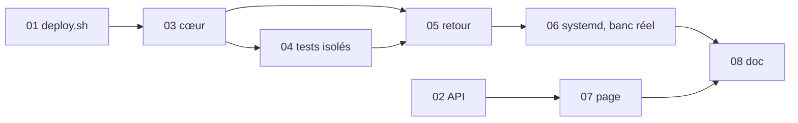

# Découpage — Déploiement automatique de main après les tests

> 8 tâches · ordre : la frontière et les décisions d'abord (`deploy.sh`, API, cœur du script), puis l'isolement des tests et le retour, puis systemd et le banc réel, puis la page et la doc.
> Le banc `tools/test-auto-deploy.sh` naît à la tâche 03 et grandit avec 04 et 05 ; le banc systemd réel (niveau B) est à la tâche 06.

## Tâches
| # | Tâche | Objectif | Dépend de | Spec |
|---|---|---|---|---|
| 01 | [deploy.sh : pause et commit déployé](01-deploy-pause.md) | `PAUSE` créée par un `deploy.sh <hash>` à la main après validation et changement de commit, jamais sous `RECRUTEMENT_PAR_AUTO=1` ; `/deploy/PAUSE` dans `.git/info/exclude` ; `~/.recrutement-deploiement/deploye` écrit à « Déploiement réussi » | — | R13, R14, CA5 |
| 02 | [Routes de l'API](02-api.md) | `api/src/deploiement.js` : `GET /api/deploiement`, `POST /api/deploiement/demande` ; tests dans `api/test/api.test.js` | — | R4, R6 (lecture), R16, R17, CA12 |
| 03 | [Cœur de auto-deploy.sh](03-auto-deploy-coeur.md) | verrou, retrait et lecture stricte de la demande, validation R3, ordre R1, pause R14, fichiers de l'hôte, état et passages (R12, R13), banc niveau A | 01 | R1–R3, R6, R7, R12–R14, R18, CA2, CA4, CA6, CA7, CA11 |
| 04 | [Tests isolés](04-tests-isoles.md) | worktree, conteneurs et construction d'essai, limites, nettoyage, durées | 03 | R8, R9, CA1 (A), CA2, CA10 (A) |
| 05 | [Mise en ligne, retour, annulation, interruption](05-deploy-retour.md) | R10, R11, R19, R20 ; `en-cours`, `incertain`, `retour-ko`, `trap` | 03, 04 | R10, R11, R19, R20, CA3 |
| 06 | [Unités systemd et banc réel](06-systemd-banc-reel.md) | 3 unités, `ExecStopPost`, commande d'installation ; niveau B sur `banc-1.7-systemd` : scénarios SC1–SC8, sorties rapides, images, cycle complet, tableau R15 | 01–05 | R5, R9, CA8, CA9, CA10, CA14, CA15, CA19 |
| 07 | [Page admin](07-page-admin.md) | `admin/deploiement.html` ; vérifications dans `tools/e2e-serveur.py` ; `check-site.sh` | 02 | UX/UI, CA13, CA16 |
| 08 | [Documentation du projet](08-documentation.md) | `README.md` « Publier », `deploy/README.md` (installation, diagnostic, maintenance), `deploy/METTRE-A-JOUR.md`, `api/README.md` (routes) | 01–07 | CA18 |
CA17 (shellcheck, `env -i`, lignes de verdict) s'applique à chaque tâche qui touche un script.

## Logique d'ordre
`deploy.sh` (01) et l'API (02) sont les deux bouts de la frontière : ils se testent seuls. Le cœur du script (03) porte les décisions et le banc ; l'isolement (04) et le retour (05) s'y greffent. Le banc réel (06) ne vaut qu'une fois tout le script écrit. La page (07) ne dépend que de l'API et d'exemples d'état au format de la spec. La doc (08) vient en dernier, quand les messages sont fixés.

## Dépendances

## Banc `tools/test-auto-deploy.sh` (spec, CA ; P2)
- Refus sans `AUTO_DEPLOY_JETABLE=oui` (vérifié avant livraison), refus hors conteneur. Lancé en root dans un conteneur jetable `banc-1.7` (Ubuntu 26.04, utilisateur `deploy`), sous `env -i` et `umask 022`. `OK`/`FAIL` par vérification, `TOUT OK` (0) ou `ÉCHECS : n` (1).
- **Niveau A** : vrais `git`, `flock`, dépôt nu ; faux `docker` (`compose run … api sh -c` joué sur un faux volume, `run` des tests et `compose build` pilotés par un marqueur `.essai/<étape>` du commit testé : code, sortie, durée ; `image rm`, `ps`, `rm` journalisés). Commits d'essai fabriqués dans le dépôt nu : test KO (chaque étape), lenteur, sortie et message hostiles, commit sans `deploy/auto-deploy.sh`, commit de branche fusionnée, `deploy.sh` factice (succès, arrêt avant changement, échec après, erreur de syntaxe). Le vrai `deploy.sh` est essayé à part (tâche 01) avec un faux `docker` et un `check-site.sh` factice.
- **Niveau B** : `banc-1.7-systemd` avec son dockerd, vraie pile (cas B, `DOMAIN=recrutement.localhost`), vraies unités ; durées réduites par variables.
- Chaque scénario a sa propre échéance courte avec un message d'assertion ; une mutation qui bloque est notée « bloque » et corrigée.

## Gardes à mettre à l'épreuve (T7, P2)
| Garde | Mutation | Détectée par |
|---|---|---|
| Verrou de passage | `flock` retiré | SC1 (B), cas A « deux passages » |
| Retrait avant traitement | demande lue sans retrait | CA9 (B), CA7 (A) |
| Lecture stricte | lien suivi ; clé en double acceptée ; taille non limitée | CA6 (A) |
| R3 | chacune des 4 conditions retirée (`--first-parent` remplacé par `--is-ancestor` compris) | CA6 (A) |
| Pause | `PAUSE` ignorée par l'automatisme ; créée sous `RECRUTEMENT_PAR_AUTO=1` | CA4, CA5 (A) |
| `.git/info/exclude` | ligne non ajoutée | CA5 (A) |
| Ordre R1 | « en échec » après « incertain » | CA3 (e) (A) |
| Noms d'image d'essai | surcharge retirée | CA10 (A, B) |
| Nettoyage | fin de passage sans nettoyage ; images supprimées par identifiant | CA10 (A, B) |
| Arrêt avant changement | détection retirée (retour toujours lancé) | CA3 (a), (d) (A) |
| Retour | `deploy.sh` du commit visé au lieu du commit d'avant ; checkout hors verrou | CA3 (b) (A), SC7 (B) |
| R19 | relecture de `HEAD` et `PAUSE` retirée | SC3 (A, B) |
| R20 | `en-cours` lu dans le volume | CA11 (A) |
| Sorties | `tail -n 300` retiré ; 30 passages non limités ; échappement retiré | CA11 (A) |
| API | contrôle admin retiré ; `par` lu dans le corps ; demande identique réécrite | CA12 (`npm test`) |
| Page | texte inséré en HTML ; boutons actifs pendant l'envoi | CA13 (e2e) |
